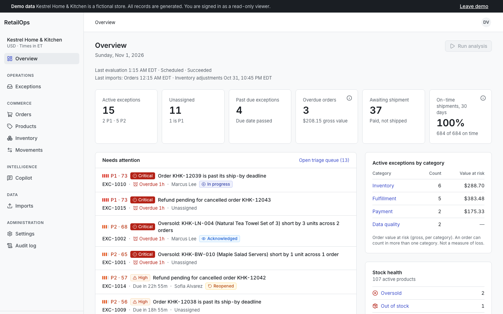
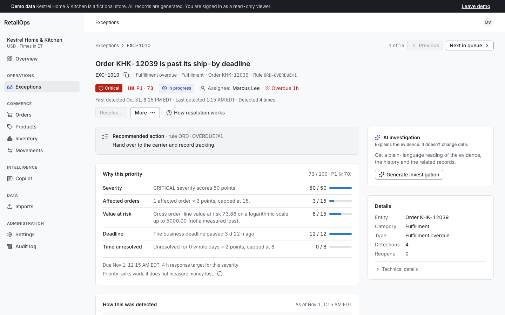
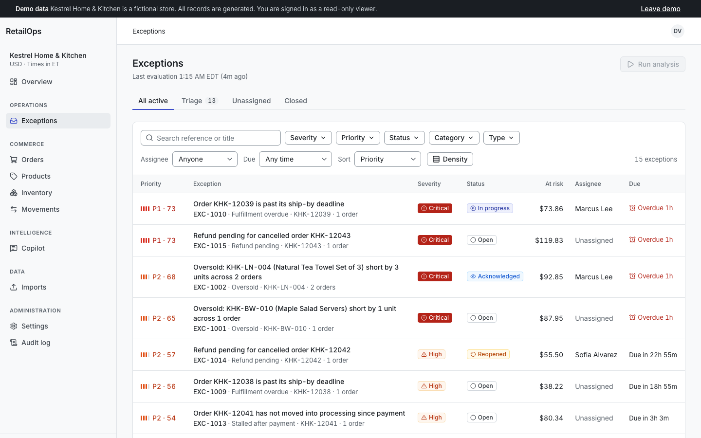
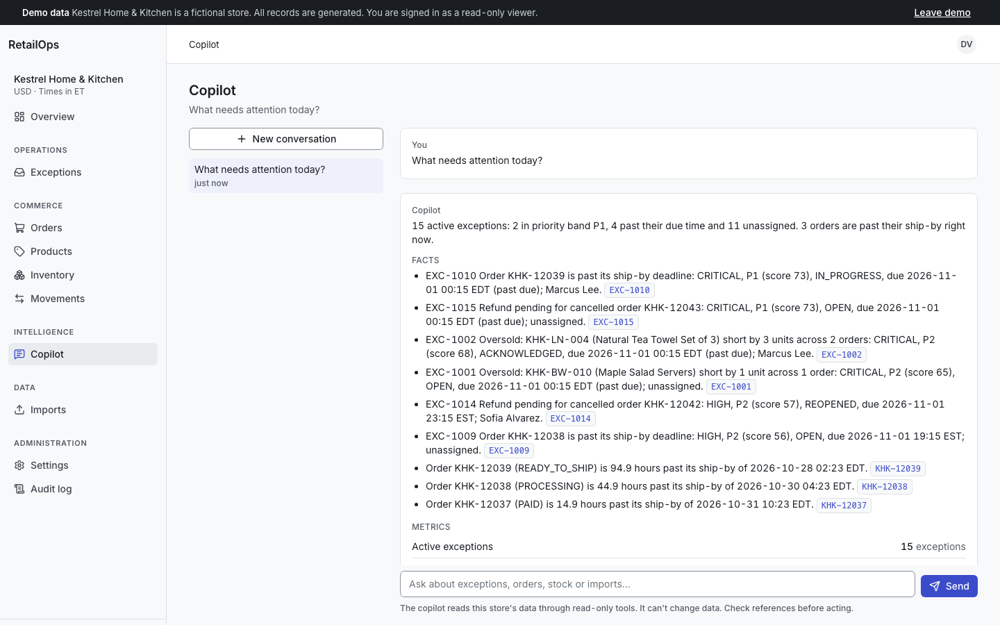
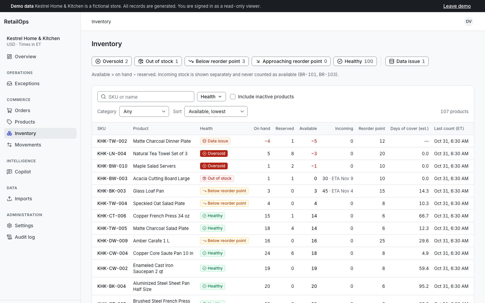
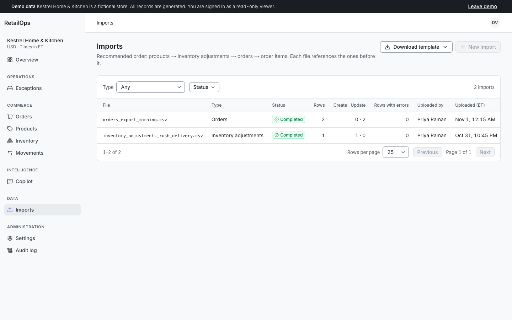
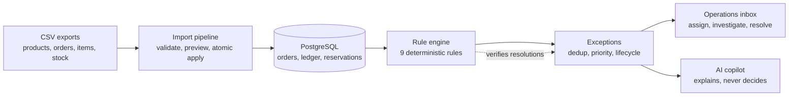
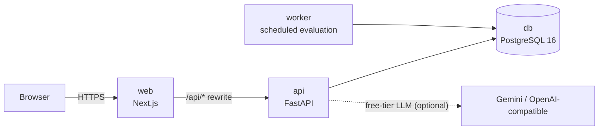

# RetailOps Intelligence

**Turn operational chaos into clear decisions.**

[](https://github.com/tinhne/retailops-intelligence/actions/workflows/ci.yml)


RetailOps Intelligence is an e-commerce operations and decision-intelligence platform for small and
mid-sized online stores. It ingests product, order and inventory data from CSV exports.
Deterministic business rules detect operational exceptions: oversold SKUs, overdue fulfillment,
refunds owed on cancelled orders, and data that does not reconcile. The team prioritises, assigns,
investigates and resolves each exception, the next evaluation verifies the resolution, and an AI
copilot explains the evidence without ever changing data.

> **Status: v1.0, feature-complete.** Every screen, the rule engine, the import pipeline, the
> copilot and the container stack are implemented and tested (see [Testing](#16-testing-and-quality)).
> There is no hosted deployment yet; run it locally in one command ([Quick start](#14-quick-start)).

## Contents

1. [Overview](#retailops-intelligence) · 2. [Screenshots](#2-screenshots) · 3. [The problem](#3-the-problem) ·
4. [Who it is for](#4-who-it-is-for) · 5. [What it does](#5-what-it-does) · 6. [How it works](#6-how-it-works) ·
7. [Exception rules](#7-exception-rules) · 8. [Priority and verification](#8-priority-and-verification) ·
9. [AI copilot](#9-ai-copilot) · 10. [Architecture](#10-architecture) · 11. [Tech stack](#11-tech-stack) ·
12. [Data model](#12-data-model) · 13. [Security](#13-security) · 14. [Quick start](#14-quick-start) ·
15. [Development workflow](#15-development-workflow) · 16. [Testing and quality](#16-testing-and-quality) ·
17. [Demo data and accounts](#17-demo-data-and-accounts) · 18. [Project structure](#18-project-structure) ·
19. [Documentation](#19-documentation) · 20. [Scope, limitations and roadmap](#20-scope-limitations-and-roadmap) ·
21. [Author and license](#21-author-and-license)

## 2. Screenshots

Real screenshots of the running app (the fictional demo store, signed in as the read-only viewer),
captured by `E2E_SCREENSHOTS=1 pnpm --filter @retailops/web e2e`.

| | |
|---|---|
|  |  |
| **Overview**: KPIs, the attention list by priority, value at risk per category | **Exception**: why this priority, the recommended action, evidence and lifecycle |
|  |  |
| **Exceptions inbox**: triage views, filters, search | **Copilot**: labelled facts and metrics, each linked to its record |
|  |  |
| **Inventory**: on hand, reserved, available and stock health | **Imports**: history, status and the analysis each import triggered |

## 3. The problem

Operators often manage orders and stock across disconnected systems and spreadsheet exports.
Problems stay hidden until they cause damage: a SKU is sold more times than it exists, a paid order
sits unprocessed past its handling deadline, or a cancelled order is never refunded. RetailOps
Intelligence gives one place to answer seven questions:

1. What is happening? 2. What is wrong? 3. Why does it matter? 4. What evidence supports it?
5. What should happen next? 6. Who owns it? 7. **Was it actually resolved?**

The last question is the one most tools skip. Here a manual resolution is **verified** by the next
evaluation, and the exception reopens if the condition is still present once fresh data arrives.

## 4. Who it is for

| Persona | Role | Uses it to |
|---|---|---|
| Store owner | Owner | See risk at a glance, manage members and store settings |
| Operations manager | Manager | Triage, assign and resolve exceptions, run imports and analysis |
| Operations staff | Staff | Work the exceptions assigned to them |
| Analyst | Analyst | Read everything, ask the copilot, review the audit log |
| Demo visitor | Viewer | Explore a fictional store read-only, including the copilot |

Roles and permissions are defined in code ([ADR-0007](docs/decisions/ADR-0007-code-defined-role-permission-matrix.md));
the app shows the full matrix under **Users & roles**. Personas: [`docs/product/PERSONAS.md`](docs/product/PERSONAS.md).

## 5. What it does

- **Overview:** KPIs, the attention list by priority, value at risk per category (never totalled),
  stock health, on-time shipments, recent imports and a **Run analysis** button.
- **Exceptions:** an inbox with triage views, filters and search; an investigation page with the
  priority breakdown, the calculation, evidence, affected orders and the full lifecycle:
  acknowledge, assign, start, resolve, dismiss, reopen, due dates and notes.
- **Orders:** three separate status axes (lifecycle, payment, fulfillment), totals checks, linked
  exceptions and the status history with the imports that changed it.
- **Products and inventory:** the catalog, stock positions with health, the append-only movement
  ledger, and per-product stock arithmetic (`available = on_hand − reserved`).
- **CSV imports:** templates, upload with progress, validation with every issue listed, a preview
  of the expected changes, strict or valid-rows-only apply with explicit consent, an issues CSV,
  Validate again for an interrupted apply, and the analysis each import triggered.
- **AI copilot:** questions in plain language, answers in labelled sections (facts, metrics,
  estimates, recommendations, limitations, references) that link to the records they rest on; an
  on-demand investigation of any exception; note drafts a person must review and save.
- **Administration:** members and roles, store settings (SLAs, thresholds, priority weights) and a
  filterable audit log.

## 6. How it works



- **Imports** validate every row, show the expected changes, and apply in one transaction.
- **Evaluations** run after each import, on a schedule (worker) and on demand.
- **Three order status axes.** "Cancelled but still paid" (a refund is owed) stays visible.
- **Append-only inventory ledger.** Reservations follow order status, and stock counts apply *as of*
  the time they were taken, so a late import cannot double-count shipments.

## 7. Exception rules

| Rule | Detects |
|---|---|
| `INV-OVERSOLD` | Committed orders need more units than are on hand |
| `INV-OVERSELL-RISK` | Unpaid orders would oversell the remaining stock |
| `INV-OUT-OF-STOCK` | An active product has nothing available |
| `INV-BELOW-ROP` | Available stock is at or below the reorder point |
| `ORD-OVERDUE` | A committed order is past its ship-by deadline |
| `ORD-STALLED` | A paid order has not moved into processing |
| `PAY-REFUND-PENDING` | A cancelled order is still paid |
| `DQ-ORDER-TOTAL` | An order's lines, discounts, shipping and tax do not add up |
| `DQ-NEGATIVE-ON-HAND` | On-hand stock is negative (a data issue that suspends the stock rules) |

Each rule is a pure, versioned module with its evidence, calculation and recommended action:
[`docs/domain/EXCEPTION_CATALOG.md`](docs/domain/EXCEPTION_CATALOG.md).

## 8. Priority and verification

- **Transparent priority:** a 0–100 score from severity, affected orders, value at risk, deadline
  proximity and age, with weights set per store. Every exception shows its breakdown
  ([`PRIORITY_MODEL.md`](docs/domain/PRIORITY_MODEL.md)).
- **One active exception per condition:** repeated detections refresh it instead of piling up.
- **Verified resolutions:** a manual resolution stays "awaiting verification" until fresh data
  confirms it; if the condition is still present, the exception reopens with the reason
  ([ADR-0008](docs/decisions/ADR-0008-exception-deduplication-verification-reopen.md)).

## 9. AI copilot

- **Read-only tools only:** 11 allowlisted, permission-checked, store-scoped and size-limited tools
  ([`TOOL_CATALOG.md`](docs/ai/TOOL_CATALOG.md)). There is no raw SQL tool and no write tool.
- **Free-tier providers:** Gemini (Google AI Studio free tier) or any OpenAI-compatible free model.
  With no key, or when a quota runs out, a deterministic engine answers from the same tools and the
  answer says so. The product works fully without any key.
- **Grounded answers:** every fact and metric carries references to records; limitations are always
  shown; summaries are cached per evidence version.
- **People act, the AI explains:** note drafts are saved only when a person chooses Save note, and
  are labelled as accepted AI drafts.
- **Evaluated:** `make ai-eval` runs 65 cases (intent, facts, tool choice, attribution, permissions,
  injection, no mutation) with reports in [`apps/api/evals/reports`](apps/api/evals/reports).
  Design and limits: [`docs/ai`](docs/ai).

## 10. Architecture

A modular monolith with explicit module boundaries (identity, catalog, orders, inventory, imports,
exceptions, analytics, audit, AI) behind one FastAPI app, a scheduled worker, PostgreSQL, and a
Next.js web app that proxies `/api/*` to the API on the same origin.



Details: [`ARCHITECTURE_MAP.md`](ARCHITECTURE_MAP.md), [`docs/architecture`](docs/architecture) and
the ADRs in [`docs/decisions`](docs/decisions).

## 11. Tech stack

| Layer | Technology |
|---|---|
| Backend | Python 3.12, FastAPI, Pydantic v2, SQLAlchemy 2, Alembic, uv |
| Database | PostgreSQL 16 |
| Frontend | Next.js 16 (App Router), React 19, TypeScript, Tailwind CSS v4, shadcn/ui (Radix), TanStack Query, React Hook Form + Zod, Recharts |
| Contracts | TypeScript types generated from the OpenAPI schema ([ADR-0013](docs/decisions/ADR-0013-openapi-generated-typescript-contracts.md)) |
| AI | Provider abstraction over plain HTTPS: Gemini, OpenAI-compatible free tiers, deterministic fallback |
| Quality | pytest against real PostgreSQL, mypy `--strict`, ruff, Vitest + Testing Library, Playwright with axe-core |
| Delivery | Multi-stage Docker images (non-root), Docker Compose, GitHub Actions |

## 12. Data model

Stores belong to organizations; every query is store-scoped. Orders keep three status axes and an
event history. Inventory is a balance plus an append-only movement ledger with reservations for
committed orders. Imports keep their file, issues and preview until applied or expired. Exceptions
keep a dedup key, a version for optimistic concurrency, events and notes. Migrations live in
[`apps/api/migrations`](apps/api/migrations); the model is described in
[`docs/domain/DOMAIN_MODEL.md`](docs/domain/DOMAIN_MODEL.md) and
[`ENTITY_RELATIONSHIPS.md`](docs/domain/ENTITY_RELATIONSHIPS.md).

## 13. Security

Server-side sessions (argon2id passwords), session-bound CSRF tokens including a pre-session token
for sign-in, a code-defined permission matrix enforced on every request, cross-tenant requests
answered with 404, rate limits, upload and request-size limits, security headers, an audit log, and
a public demo that cannot change shared data. Threat model, controls and known limitations:
[`SECURITY.md`](SECURITY.md).

## 14. Quick start

Requirements: Docker with Compose v2.

```bash
docker compose up --build   # db, api (migrations on start), worker, web; seeds the demo once
```

Open <http://localhost:3000> and choose **Explore the demo**. The first start seeds the fictional
store, its exception history and two CSV imports; later starts keep your data. To restore the demo
story: `make stack-demo-reset`. Ports, health checks and troubleshooting:
[`docs/operations/RUNBOOK.md`](docs/operations/RUNBOOK.md). A guided tour:
[`docs/operations/DEMO_GUIDE.md`](docs/operations/DEMO_GUIDE.md).

For a customer installation without the demo store, `make stack-up-customer` then
`make stack-provision ARGS="..."` creates the organization, store and owner
([RUNBOOK §2a](docs/operations/RUNBOOK.md#2a-customer-installation-no-demo-organization)). A Vietnamese
walkthrough of every screen, the demo script and the customer setup is in
[`docs/guides/HUONG_DAN_DEMO_VA_TRIEN_KHAI.md`](docs/guides/HUONG_DAN_DEMO_VA_TRIEN_KHAI.md). Ten fictional
Vietnamese shops (VND, one per retail vertical) load with `make load-sample-stores`
([`sample-data/stores-vn`](sample-data/stores-vn/README.md)).

## 15. Development workflow

Requirements: Docker, [uv](https://docs.astral.sh/uv/), Node.js 22+ and pnpm.

```bash
make setup     # install backend dependencies (Python 3.12)
make migrate   # start PostgreSQL in Docker and apply migrations
make seed      # generate (or reset) the demo store "Kestrel Home & Kitchen" (fictional data)
make api-dev   # API on http://localhost:8000, interactive docs at /api/docs
pnpm install && pnpm web:dev   # web on http://localhost:3000 (proxies /api to :8000)
```

Configuration is environment-based: [`.env.example`](.env.example) and
[`ENVIRONMENT_STATUS.md`](ENVIRONMENT_STATUS.md). Never commit a `.env` file. After an API change,
regenerate the TypeScript contracts with `pnpm contracts:generate`.

## 16. Testing and quality

| Suite | What it covers | Command |
|---|---|---|
| Backend: 865 tests | pytest against a real PostgreSQL 16: every business rule (tests cite `BR-xxx` IDs), state machines, the rule engine and its reconciliation, imports, permissions and tenant isolation on every endpoint, the copilot tools and providers | `make check` (with ruff and `mypy --strict`) |
| Web: 265 tests | Vitest + Testing Library: screens and their loading, empty, error and permission states, lifecycle actions, formatting, the API client | `pnpm --filter @retailops/web test` |
| End to end: 18 tests | Playwright against the running stack: the 12-step operations journey (imports → detection → assign → note → resolve → audit → copilot), the read-only public demo, a 375 px pass with no sideways scroll, and axe-core WCAG 2.1 A/AA scans of 11 screens | `pnpm --filter @retailops/web e2e` |
| Copilot evaluation: 65 cases | Intent, facts against the database, tool choice, attribution, permissions, prompt injection, no mutation; reports in [`apps/api/evals/reports`](apps/api/evals/reports) | `make ai-eval` |

GitHub Actions runs all of it on every push: lint, types, unit and integration tests, migrations
checked against the models, production builds, Docker images, a dependency audit, and the
Playwright suite against the Docker Compose stack. Strategy and traceability:
[`docs/operations/TEST_STRATEGY.md`](docs/operations/TEST_STRATEGY.md).

To run the end-to-end suite locally against `make stack-up`, set `DEMO_STAFF_PASSWORD` before the
stack seeds and pass the same value as `E2E_STAFF_PASSWORD`.

## 17. Demo data and accounts

The demo describes a **fictional** store, "Kestrel Home & Kitchen" (114 products, about 1,550
orders over 60 days, 8 suppliers). Every product, order, customer reference and person in it is
invented, and the data is generated relative to the current time so it always looks recent. The seed
also scripts a few hours of team activity: assignments, work in progress, verified resolutions, a
reopened refund, a dismissal and two CSV imports.

- **Explore the demo** signs you in as a read-only viewer.
- For local development, `make seed` with `DEMO_STAFF_PASSWORD` set also enables the staff
  accounts `owner@`, `manager@`, `staff@`, `sofia@` and `analyst@kestrel.example` with that password.

## 18. Project structure

```text
apps/api/            FastAPI app: app/domains/* (one package per module), migrations/, evals/, tests/
apps/web/            Next.js app: app/ (routes), features/* (screens), components/, lib/, tests/e2e/
packages/contracts/  OpenAPI schema and generated TypeScript types
infra/docker/        Dockerfiles
docs/                product, workflows, domain, architecture, decisions, design, ai, operations
```

## 19. Documentation

| Area | Where |
|---|---|
| Product vision, personas, scope | [`docs/product`](docs/product) |
| Business workflows (orders, inventory, imports) | [`docs/workflows`](docs/workflows) |
| Domain rules, state machines, exception catalog, priority model | [`docs/domain`](docs/domain) |
| Architecture, security, API conventions | [`docs/architecture`](docs/architecture), [`SECURITY.md`](SECURITY.md) |
| Architecture decision records | [`docs/decisions`](docs/decisions), [`DECISIONS.md`](DECISIONS.md) |
| Design system, screens, accessibility | [`docs/design`](docs/design) |
| AI architecture, prompts, safety, evaluation | [`docs/ai`](docs/ai) |
| Tests, runbook, demo reset, demo guide | [`docs/operations`](docs/operations) |
| Release notes | [`RELEASE_NOTES.md`](RELEASE_NOTES.md) |

## 20. Scope, limitations and roadmap

v1 deliberately leaves out storefront and checkout, payment processing, carrier integrations,
multi-location inventory, customer personal data, live connectors, autonomous AI actions and
self-service sign-up ([`SCOPE_AND_NON_GOALS.md`](docs/product/SCOPE_AND_NON_GOALS.md)). Known
limitations are listed in [`PROJECT_STATE.md`](PROJECT_STATE.md) and [`SECURITY.md`](SECURITY.md).
Next: a hosted public demo with a scheduled reset, then the P1/P2 items in [`TASKS.md`](TASKS.md).

## 21. Author and license

**Lê Văn Trung Tính**, Software Engineer · AI Product Builder ·
[GitHub @tinhne](https://github.com/tinhne) · [trungtinh.site](https://trungtinh.site)

This is an independent portfolio project. It has no commercial customers or production deployments.
Licensed under [MIT](LICENSE).
