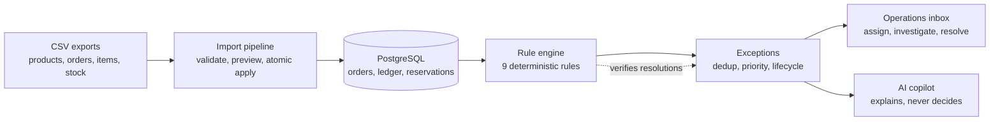

# RetailOps Intelligence

**Turn operational chaos into clear decisions.**

RetailOps Intelligence is an e-commerce operations and decision-intelligence platform for small and
mid-sized online stores. It ingests product, order, and inventory data. Deterministic business rules
detect operational exceptions: oversold SKUs, overdue fulfillment, refunds owed on cancelled orders,
and data that does not reconcile. The team then prioritises, assigns, investigates, and resolves each
exception, and an AI copilot explains the evidence and suggests next steps.

> **Status: in active development.** The backend foundation, the full database schema, the order
> lifecycle, the inventory ledger, and the demo dataset are implemented and tested. The CSV imports,
> the exception engine, the web interface, and the copilot are being built now. There is no hosted demo
> yet. See [`PROJECT_STATE.md`](PROJECT_STATE.md) for verified progress.

## The problem

Operators often manage orders and stock across disconnected systems and spreadsheet exports. Problems
stay hidden until they cause damage: a SKU is sold more times than it exists, a paid order sits
unprocessed past its handling deadline, or a cancelled order is never refunded. RetailOps Intelligence
gives one place to answer seven questions:

1. What is happening?  2. What is wrong?  3. Why does it matter?  4. What evidence supports it?
5. What should happen next?  6. Who owns it?  7. **Was it actually resolved?**

The last question is the one most tools skip. Here, a manual resolution is **verified** by the next
evaluation, and the exception reopens if the condition is still present once fresh data has arrived.

## How it works



- **Three order status axes.** Lifecycle, payment, and fulfillment are tracked separately, so
  "cancelled but still paid" (a refund is owed) is a visible state instead of being lost.
- **Append-only inventory ledger.** `available = on_hand − reserved`. Reservations follow order status,
  and stock counts apply *as of* the time they were taken, so a late import cannot double-count shipments.
- **Transparent priority.** A 0–100 score built from severity, affected orders, value at risk,
  deadline proximity, and age. Every exception shows how its score was calculated.
- **AI with guardrails.** The copilot uses only allowlisted, permission-checked, store-scoped tools. It
  separates facts, estimates, and recommendations, and it never changes data. It runs on free-tier LLM
  APIs, and when no key is configured or the quota runs out, a rule-based assistant answers from the same data.

## Tech stack

| Layer | Technology |
|---|---|
| Backend | Python 3.12, FastAPI, Pydantic v2, SQLAlchemy 2, Alembic |
| Database | PostgreSQL 16 |
| Frontend | Next.js (App Router), TypeScript, Tailwind CSS, TanStack Query |
| AI | Provider abstraction: Gemini (free tier), any OpenAI-compatible free tier, or the deterministic fallback |
| Quality | pytest against real PostgreSQL, mypy `--strict`, ruff, Vitest, Playwright |
| Delivery | Docker multi-stage images, Docker Compose, GitHub Actions |

The backend is a modular monolith (identity, catalog, orders, inventory, imports, exceptions,
analytics, audit, AI) with explicit module boundaries. See [`ARCHITECTURE_MAP.md`](ARCHITECTURE_MAP.md).

## Run it locally

Requirements: Docker, [uv](https://docs.astral.sh/uv/), Node.js 22+, and pnpm.

```bash
make setup     # install backend dependencies (Python 3.12)
make migrate   # start PostgreSQL in Docker and apply migrations
make seed      # generate the demo store "Kestrel Home & Kitchen" (fictional data)
make api-dev   # API on http://localhost:8000. Interactive docs at /api/docs
make check     # lint, strict type check, and the full test suite
```

Configuration is environment-based. See [`.env.example`](.env.example) and
[`ENVIRONMENT_STATUS.md`](ENVIRONMENT_STATUS.md). Never commit a `.env` file.

## Documentation

| Area | Where |
|---|---|
| Product vision, personas, scope | [`docs/product`](docs/product) |
| Business workflows | [`docs/workflows`](docs/workflows) |
| Domain rules, state machines, exception catalog, priority model | [`docs/domain`](docs/domain) |
| Architecture, security, API conventions | [`docs/architecture`](docs/architecture) |
| Architecture decision records | [`DECISIONS.md`](DECISIONS.md) |
| Design system and screens | [`docs/design`](docs/design) |
| AI architecture and safety | [`docs/ai`](docs/ai) |
| Test strategy | [`docs/operations/TEST_STRATEGY.md`](docs/operations/TEST_STRATEGY.md) |

## Demo data

The demo dataset describes a **fictional** store, "Kestrel Home & Kitchen". Every product, order,
customer reference, and person in it is invented. The dataset is generated relative to the current
time, so it always looks recent.

## Author

**Lê Văn Trung Tính**, Software Engineer · AI Product Builder
[GitHub @tinhne](https://github.com/tinhne) · [trungtinh.site](https://trungtinh.site)

This is an independent portfolio project. It has no commercial customers or production deployments.

## License

[MIT](LICENSE)
