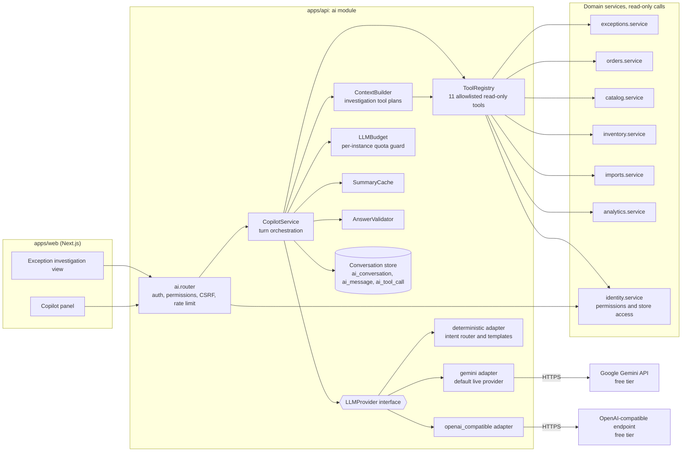
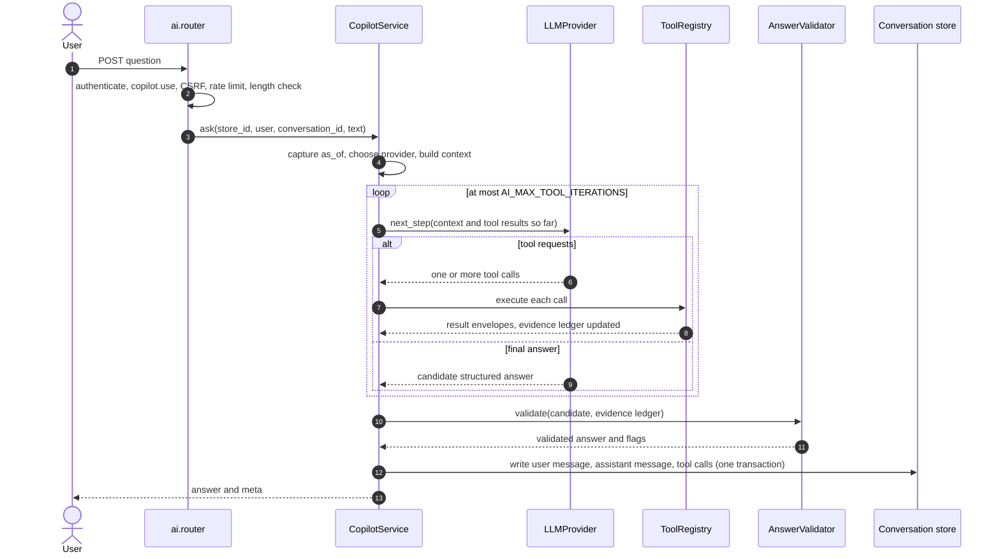

# AI Architecture

> **Status:** Design (v1), task T-070. Nothing in this document is implemented yet. Implementation
> tasks: T-071 (tool registry), T-072 (providers), T-073 (copilot API and UI), T-074 (evaluation).
> Related: [TOOL_CATALOG.md](TOOL_CATALOG.md), [PROMPT_DESIGN.md](PROMPT_DESIGN.md),
> [EVALUATION_STRATEGY.md](EVALUATION_STRATEGY.md), [SAFETY_AND_LIMITATIONS.md](SAFETY_AND_LIMITATIONS.md),
> ADR-0003 (deterministic rule engine separated from the AI layer), ADR-0010 (AI provider
> abstraction, allowlisted tools, deterministic fallback, no raw SQL).

## 1. Role of AI in the product

The product principle from `AGENTS.md` applies without exception: **business-critical facts and
calculations are deterministic and testable. AI explains and recommends. It never invents facts or
bypasses business rules.**

| AI does | AI never does |
|---|---|
| **Explain**: why an exception exists, why it has its severity, how its priority score was built | Decide whether an exception is real, its severity, or its priority (the rule engine and `PRIORITY_MODEL.md` do) |
| **Summarise**: the state of the store, an exception investigation, what changed since yesterday | Compute business numbers of its own. Every number comes from a deterministic tool |
| **Recommend**: an order of work, a next step (starting from the rule-authored `recommended_action`) | Change a status, assign, resolve, dismiss, import, or change settings |
| **Draft**: an exception note that a person edits and accepts | Save anything without a person's explicit action (`ExceptionNote.source = AI_DRAFT_ACCEPTED` only after acceptance) |

Detection is entirely the job of the exception engine (`EXCEPTION_CATALOG.md`). The AI layer reads
its output through the same domain services the UI uses, with the same permissions.

**The product is fully usable without an LLM.** When no LLM API key is configured, or the LLM
provider fails, the `deterministic` provider answers the supported questions from the same tools
with templated, grounded answers.

**Free-tier LLM APIs only (owner decision, 2026-10-31).** The live LLM path uses free-tier API
access so the public demo can serve visitors at no cost. Free tiers have request and token quotas
that will run out at busy times, so the deterministic provider is a first-class path, not an error
state. The design therefore (a) spends as few LLM requests per answer as possible (§4.3), (b) caps
LLM usage per user and per instance (§4.2), (c) caches investigation summaries (§8.3), and
(d) falls back automatically, with a visible notice, whenever the live provider is unavailable
(§8).

## 2. Components

The `ai` module lives in `apps/api/app/domains/ai/` and owns the tables `ai_conversation`,
`ai_message`, and `ai_tool_call` (`DOMAIN_MODEL.md §1`). It writes only those tables.

| Component | Location (planned) | Responsibility |
|---|---|---|
| `ai.router` | `ai/router.py` | HTTP endpoints. Enforces authentication, `copilot.use` (plus feature permissions, §2.1), CSRF on POST, the copilot rate limit (20 requests/min per user), and the 2,000-character question limit |
| `CopilotService` | `ai/service.py` | Orchestrates one turn: loads history, captures `as_of` once, selects the provider, runs the tool-use loop (§4), calls the validator, persists the turn, and handles fallback |
| `LLMProvider` (interface) | `ai/providers/base.py` | Provider-neutral contract: `next_step(request) -> ToolRequests \| FinalAnswer \| ProviderFailure`. Three adapters |
| `gemini` adapter | `ai/providers/gemini.py` | The default live provider. Maps the neutral request to the Google Gemini API with function calling. Free API key from Google AI Studio (`GEMINI_API_KEY`). Server-side only |
| `openai_compatible` adapter | `ai/providers/openai_compatible.py` | Any OpenAI-compatible chat-completions endpoint that offers a free tier (for example Groq, or free models on OpenRouter), configured by `LLM_BASE_URL`, `LLM_API_KEY`, and `LLM_MODEL`. The chosen model must support tool (function) calling. Server-side only |
| `deterministic` adapter | `ai/providers/deterministic/` | Intent router, tool plans, and answer templates (§7). No network calls. Always available. The fallback for every live-provider failure |
| `LLMBudget` | `ai/budget.py` | In-process global budget per API instance: LLM requests per minute and per day, and tokens per day. Checked before every LLM request (§4.2) |
| `SummaryCache` | `ai/cache.py` | Reuses an LLM investigation summary while the exception's evidence and history are unchanged (§8.3) |
| `ToolRegistry` | `ai/tools/registry.py` | The allowlist of 11 read-only tools. For each call: validates arguments (Pydantic), checks permission, injects `store_id` and `as_of`, runs the domain service in a read-only transaction with a timeout, caps the result size, and records the call. Builds the per-turn **evidence ledger** |
| `ContextBuilder` | `ai/context.py` | For exception investigation (summary and note draft): runs a fixed, deterministic tool plan for the exception type and hands the results to the provider as already-executed tool results |
| `AnswerValidator` | `ai/validation.py` | Validates the candidate answer against the schema and the evidence ledger. Drops and flags unverifiable references, unverified metrics, and prohibited claims (§6) |
| Conversation store | `ai/repository.py` | Persists conversations, messages, and tool-call metadata (§9). Store- and user-scoped |
| Prompt registry | `ai/prompts/` | Versioned prompt texts (`PROMPT_DESIGN.md`). The version is stored on each `ai_message` |

### 2.1 Endpoints and permissions (proposed; final paths belong to the API conventions doc, T-022)

| Endpoint | Purpose | Permissions |
|---|---|---|
| `POST /api/v1/stores/{store_id}/copilot/conversations` | Start a conversation (`context_type` `GENERAL` or `EXCEPTION`, optional `context_id`) | `copilot.use` (+ `exceptions.read` for `EXCEPTION`) |
| `GET /api/v1/stores/{store_id}/copilot/conversations` | List the caller's own conversations | `copilot.use` |
| `GET /api/v1/stores/{store_id}/copilot/conversations/{id}` | Read one of the caller's conversations with messages | `copilot.use` |
| `POST /api/v1/stores/{store_id}/copilot/conversations/{id}/messages` | Ask a question (one turn) | `copilot.use` |
| `POST /api/v1/stores/{store_id}/exceptions/{exception_id}/ai/investigation-summary` | Generate an investigation summary | `copilot.use` + `exceptions.read` |
| `POST /api/v1/stores/{store_id}/exceptions/{exception_id}/ai/note-draft` | Draft a note (not saved) | `copilot.use` + `exceptions.work` |
| `POST /api/v1/stores/{store_id}/exceptions/{exception_id}/notes` | Save a note (existing exceptions endpoint). With `source = AI_DRAFT_ACCEPTED` when the body came from a draft | `exceptions.work` |

Note drafting requires `exceptions.work` because a draft that the caller cannot save would be a
fake control (`AGENTS.md §4`). ANALYST and VIEWER can ask questions and read investigation
summaries but do not see the "Draft note" action.

Conversations are private to their author. No role, including OWNER, can read another user's
conversations in v1. Another user's conversation id returns 404.

## 3. Component diagram



Neither adapter executes tools. Both return tool requests to `CopilotService`, which executes them
through the `ToolRegistry`. Permission checks, scoping, size caps, and logging therefore live in
exactly one place, whichever provider is active.

## 4. The tool-use loop



### 4.1 Steps

1. **Admission.** `ai.router` checks the session, `copilot.use`, CSRF, the copilot rate limit, and
   that the question is 1–2,000 characters. The store comes from the path and is checked against
   the caller's membership (BR-002, BR-003). A store the caller cannot access returns 404.
2. **Turn setup.** `CopilotService` captures `as_of = clock.now()` once. Every tool call in the turn
   receives this `as_of`, so all numbers in an answer describe the same instant (BR-504). It loads
   the last `AI_HISTORY_TURNS` turns (user text plus the assistant's `summary` only, never earlier
   tool results) and the store context: name, currency, time zone, time of the
   last completed import, and the last evaluation run.
3. **Provider selection** (§8). The configured live adapter (`gemini` or `openai_compatible`) when
   it has credentials, its circuit is closed, and the instance budget has room. Otherwise
   `deterministic`, with the fallback notice when a live provider was configured.
4. **Prefetch** (§4.3). For investigation summaries the `ContextBuilder` plan runs first. For chat
   questions that the deterministic router places with high confidence, that intent's tool plan
   runs first. Both are executed by the `ToolRegistry` before the first LLM request.
5. **Loop.** The provider returns either tool requests or a final answer. Tool requests are
   executed by the `ToolRegistry`, and their result envelopes are appended as tool results. Several
   calls requested together run one after another in the request thread (sync engine). Their
   results return together.
6. **Limits.** The loop stops at whichever limit is reached first (§4.2). When a limit stops the
   loop before a final answer, the service makes one last provider call with tools disabled and an
   instruction to answer from the data gathered and to state what is missing in `limitations`.
7. **Validation** (§6) and, if needed, one repair round-trip or fallback (§8).
8. **Persistence.** The user message, the assistant message, and all `ai_tool_call` rows are
   written in one transaction at the end of the turn, including on failure paths (the turn is
   recorded with its failure reason). Tool-call records are buffered in memory until then and are
   also emitted to the structured log as each call completes.

Prior turns' tool results are **not** re-sent to the provider, and their references are not valid
in a later turn. A follow-up question that needs a record must fetch it again. This costs some
latency, and it guarantees that every reference in an answer was read in the same turn at the same
`as_of`.

### 4.2 Limits (defaults; configurable, §10)

| Limit | Default | Behavior when reached |
|---|---|---|
| Provider round-trips that request tools (`AI_MAX_TOOL_ITERATIONS`) | 6 | Final call without tools. A `limitations` entry says the answer may be incomplete |
| Tool calls per turn (`AI_MAX_TOOL_CALLS_PER_TURN`) | 12 | Further calls are rejected with status `REJECTED_LIMIT` and are recorded |
| Tool execution time (`AI_TOOL_TIMEOUT_SECONDS`) | 5 s | Postgres `statement_timeout` in the tool's read-only transaction. Status `TIMEOUT` |
| Rows per tool result (`AI_TOOL_MAX_ROWS`) | 50 (lower per-tool defaults in `TOOL_CATALOG.md`) | `truncated: true` and `total_available` in the envelope |
| Serialized tool result size (`AI_TOOL_MAX_RESULT_BYTES`) | 16 KB | Long strings are truncated first, then trailing rows are dropped. `truncated: true` |
| One LLM request (`AI_REQUEST_TIMEOUT_SECONDS`) | 20 s | No automatic retry on 429 or quota errors (a retry would spend more quota and time). At most one retry on a 5xx or connection error, and only if the turn deadline leaves room |
| Whole turn (`AI_TURN_DEADLINE_SECONDS`) | 45 s | The LLM path is abandoned and the turn falls back to `deterministic` (§8) |
| Cumulative input tokens per turn (`AI_MAX_INPUT_TOKENS_PER_TURN`) | 30,000 | No more tool rounds. Final call without tools |
| Output tokens per LLM call (`AI_MAX_OUTPUT_TOKENS`) | 4,096 | An answer cut off by the limit counts as invalid output (§8) |
| Copilot requests per user (`COPILOT_RATE_LIMIT_PER_MINUTE`) | 20 per minute | HTTP 429 with the standard error envelope. Applies to every copilot endpoint, whichever provider answers |
| Live LLM requests per API instance (`LLM_BUDGET_REQUESTS_PER_MINUTE`, `LLM_BUDGET_REQUESTS_PER_DAY`) | 10 per minute, 500 per day | The turn is answered by `deterministic` with the fallback notice (`BUDGET_EXCEEDED`). The day resets at 00:00 UTC |
| Live LLM tokens per API instance (`LLM_BUDGET_TOKENS_PER_DAY`) | 1,000,000 per day | Same |

The global budget is a guard **below** the provider's free-tier quota, so the product degrades to
the deterministic provider on its own terms instead of collecting 429 responses. The defaults
above are this project's own conservative placeholders, not the provider's limits. Before a
deployment they must be set at or below the current free-tier limits published for the chosen
model (**Needs validation**: free-tier quotas change and differ per model). Like the HTTP rate
limiter, the budget is in-process and per instance. Several instances would each spend their own
budget against one shared provider quota, which is why provider 429s are still handled (§8).

**MVP assumption:** these defaults are starting points. They are revisited with real measurements
from the evaluation runner (T-074). No latency or token figures exist yet.

### 4.3 Request economy (free-tier quota)

A turn may make up to `AI_MAX_TOOL_ITERATIONS` + 2 LLM requests in the worst case. The design aims
for one or two in the common case:

| Measure | Effect |
|---|---|
| **Prefetch.** Investigation summaries run the `ContextBuilder` plan before the first request. Chat questions that the deterministic router (§7.1) places with high confidence run that intent's tool plan first. The results are passed in as already-executed tool calls (`origin = ROUTER` or `CONTEXT_BUILDER`) | The model usually answers in its first request instead of spending one request per tool round |
| **No LLM for fixed answers.** `HELP`, write requests, and other `UNSUPPORTED` intents placed with high confidence are answered by the deterministic provider directly | No quota spent on refusals. Also safer |
| **Summary cache** (§8.3) | Repeat views of the same exception cost no request |
| **Compact prompts.** The static system prompt and tool definitions have a character budget enforced by a unit test (`PROMPT_DESIGN.md §8`). Tool descriptions are one sentence. Tool results are compact JSON (no indentation, null fields omitted). Default row limits are 20, not 50. History is `AI_HISTORY_TURNS` = 4 turns, assistant turns as summary text only | Fewer input tokens per request, so token-per-minute quotas last longer |
| **Repair only with headroom.** The single repair round-trip (§6) is attempted only if the budget and the deadline allow it. Otherwise the turn falls back directly | Invalid output does not burn quota twice |

The FastAPI copilot endpoints are synchronous (sync SQLAlchemy engine) and run in the server's
thread pool. A slow LLM call occupies one worker thread for up to the turn deadline. This is
acceptable at MVP traffic and is listed in `SAFETY_AND_LIMITATIONS.md`.

## 5. Structured answer contract

Every assistant message, from either provider, is one JSON document with this shape (the schema
settled in the project brief). It is stored in `ai_message.content` and rendered by the UI as
labelled sections.

```json
{
  "summary": "string",
  "facts": [{ "text": "string", "refs": ["exception:<uuid>"] }],
  "metrics": [{ "label": "string", "value": "string", "unit": "string", "formula": "string|null", "refs": ["product:<uuid>"] }],
  "estimates": [{ "text": "string", "basis": "string" }],
  "recommendations": [{ "text": "string", "rationale": "string" }],
  "limitations": ["string"],
  "references": [{ "type": "exception|order|product|import|evaluation_run|aggregate", "id": "string", "label": "string" }],
  "data_window": { "from": "ISO-8601|null", "to": "ISO-8601" },
  "generated_by": "llm:<model>|deterministic"
}
```

### 5.1 Field semantics

| Field | Meaning | Rules |
|---|---|---|
| `summary` | Two or three plain-text sentences answering the question | ≤ 600 characters. No markdown, links, or HTML. Numbers in it are checked (§6) |
| `facts[]` | Observations taken directly from tool results | `text` ≤ 300 characters. `refs` must contain at least one valid reference key. At most 12 |
| `metrics[]` | Numbers the user may act on | `value` is a string holding the number exactly as the tool returned it (money stays a decimal string, BR-503). `unit` is `USD` (store currency), `orders`, `units`, `hours`, `days`, `points`, or `%`. `formula` names the formula and rule ID when the tool supplied one (for example `available = on_hand − reserved (BR-101)`), otherwise `null`. `refs` must be non-empty. At most 12 |
| `estimates[]` | Values that are estimates by definition | Allowed only when a tool returned a field marked `is_estimate: true` (velocity, days of cover, BR-152). `basis` names the method, for example "28-day moving average of units sold (BR-150)". At most 5 |
| `recommendations[]` | Suggested next steps for a person | Phrased as suggestions. Start from the rule-authored `recommended_action` where one exists. `rationale` cites the facts it depends on. At most 5. Never claims an action was taken |
| `limitations[]` | What the answer cannot tell or may get wrong | Server-appended entries always include data freshness ("Data reflects imports up to …"). Exposure, priority, and estimate caveats are added when those values appear. At most 8 |
| `references[]` | Every record the answer cites | `type` + `id` must exist in the turn's evidence ledger. `label` is replaced by the ledger's label (server-authoritative), so the model cannot mislabel a record |
| `data_window` | The time range of the data used | `to` = the turn's `as_of`. `from` = the earliest lower bound of any time-bounded query in the turn (trend window, `detected_since`, velocity window), or `null` when only current-state snapshots were used. Set by the server, not the model |
| `generated_by` | Provenance | Set by the server: `llm:<configured model id>` (for example `llm:<LLM_MODEL value>` from the `gemini` or `openai_compatible` adapter) or `deterministic`. Never taken from model output |

**Reference keys.** Each entry in `refs` is a string `"{type}:{id}"`. Types:

| Type | Id | Produced by |
|---|---|---|
| `exception` | `operational_exception.id` | `list_exceptions`, `get_exception`, `get_exception_history` |
| `order` | `sales_order.id` | `get_related_orders`, `get_overdue_orders` |
| `product` | `product.id` | `get_product`, `get_inventory_position`, `get_inventory_movements` |
| `import` | `data_import.id` | `get_import_errors` |
| `evaluation_run` | `evaluation_run.id` | `get_dashboard_summary` (last run) |
| `aggregate` | the `ai_tool_call` id of the call that returned it | `get_dashboard_summary`, `get_operational_trends` (aggregates have no single source row; the reference points at the recorded tool call with its arguments) |

### 5.2 Response envelope

The API wraps the answer with metadata that the UI needs and the model never writes:

```json
{
  "conversation_id": "uuid",
  "message_id": "uuid",
  "answer": { "...": "structured answer above" },
  "meta": {
    "provider": "gemini|openai_compatible|deterministic",
    "fallback": { "used": true, "reason": "PROVIDER_RATE_LIMITED", "notice": "Live AI is temporarily unavailable; this answer was generated by the rule-based assistant from the same data." },
    "cache": { "hit": false, "generated_at": null },
    "prompt_version": "copilot.system@1;tools@1",
    "tool_calls": [{ "tool_name": "list_exceptions", "status": "SUCCESS", "row_count": 10, "duration_ms": 41 }],
    "validation": { "dropped_refs": 0, "dropped_items": 0, "flags": [] },
    "as_of": "ISO-8601",
    "latency_ms": 1840
  }
}
```

## 6. Reference and answer validation

The `ToolRegistry` builds an **evidence ledger** for the turn. Every record a tool returns carries a
`ref` object (`type`, `id`, `label`), and every numeric field is indexed with the ref it belongs to.
The ledger lives in memory for the turn only.

`AnswerValidator` applies these checks in order:

| # | Check | On failure | Severity |
|---|---|---|---|
| 1 | The candidate parses against the Pydantic answer schema (types, lengths, list caps) | Repair round-trip, then fallback (§8) | Hard |
| 2 | Each key in `facts[].refs` and `metrics[].refs` exists in the ledger | The ref is **dropped** and flag `UNVERIFIED_REF` recorded | Soft |
| 3 | A fact or metric left with no valid ref | The item is **dropped**, flag `UNSUPPORTED_ITEM`. A limitation is appended: "N statements were removed because their sources could not be verified." | Soft |
| 4 | Each metric `value` equals (after decimal normalisation) a numeric field of one of its referenced records | The metric is dropped, flag `UNVERIFIED_METRIC`. The LLM is not allowed to do arithmetic for metrics | Soft |
| 5 | `estimates` present only if the ledger contains an `is_estimate` field | Estimates dropped, flag `UNSUPPORTED_ESTIMATE` | Soft |
| 6 | `references[]` entries exist in the ledger. Labels are overwritten from the ledger. Every key used in `refs` is added to `references` if missing | Unknown entries dropped, flag `UNVERIFIED_REF` | Soft |
| 7 | Numeric tokens in `summary`, `recommendations`, and `estimates` text appear in the ledger (normalised: thousands separators, currency symbols, rounding to the displayed precision) | Flag `UNGROUNDED_NUMBER`. A limitation is appended: "Some figures in the summary could not be matched to source records." | Soft |
| 8 | No claim of having performed an action (patterns such as "I have resolved", "I assigned", "I updated") | Repair, then fallback | Hard |
| 9 | No prohibited wording: exposure described as "loss" or "lost revenue" (BR-404) | Repair, then fallback | Hard |
| 10 | No URLs, markdown links, images, or HTML in any text field | Stripped, flag `MARKUP_REMOVED` | Soft |
| 11 | When the turn's tools returned data, at least one fact or metric survives | Repair, then fallback | Hard |

`data_window` and `generated_by` are always overwritten by the server. The flags and counts are
stored on the message (§9) and drive the evaluation metrics "evidence attribution rate" and
"unsupported-claim rate" (`EVALUATION_STRATEGY.md`).

Deterministic answers pass the same validator. Their templates build every fact from a tool
record, so their attribution is complete by construction, and the validator acts as a regression
check on the templates.

## 7. Deterministic fallback design

The deterministic provider is a pipeline of pure, unit-testable functions:

```
route(question, context) -> RoutedIntent(intent, entities, params)
plan(RoutedIntent) -> list[ToolCall]            # may be staged: stage 2 uses stage-1 results
render(RoutedIntent, tool results, as_of, store) -> StructuredAnswer
```

It plugs into the same loop as the live adapters: `next_step` returns the plan's tool calls (one
stage per iteration), then the rendered answer. `generated_by = "deterministic"`.

### 7.1 Intent router

1. **Normalise** the text: Unicode NFC, lower case, collapse whitespace, strip punctuation except
   inside identifiers.
2. **Context shortcut.** In a conversation with `context_type = EXCEPTION`, questions that name no
   other entity ("why is this critical?", "what should I do?") bind to that exception.
3. **Entity extraction.** UUIDs are candidate exception, order, or product ids. Identifier-like
   tokens (letters, digits, `-`, `_`, `#`; 3–64 characters) are candidate SKUs or order numbers.
   Candidates are resolved by exact lookup through tools (`get_product`, `get_related_orders`).
   These lookups are recorded tool calls. Only exact matches in the current store count.
4. **Parameters.** Severity words (critical, high, medium, low), exception-type words (oversold,
   oversell, out of stock, reorder, overdue, stalled, refund, mismatch, negative stock), time
   phrases (today, yesterday, since yesterday, this week, last N days, in the store time zone), and
   a requested count ("top 5"; capped at the tool limit).
5. **Scoring.** Each intent has keyword groups and patterns with weights. The highest score above a
   threshold wins. Ties go to the intent listed first in §7.2. Below the threshold the router
   returns `HELP`.

The router has no learned components. Its behavior is defined by a table that is tested
phrase by phrase (`TEST_STRATEGY.md`).

### 7.2 Intent catalogue

Questions 1–7 are the copilot questions the product must answer. 8–9 are the exception
investigation features. 10–14 cover supporting questions and refusals.

| # | Intent | Example phrasings | Tool plan | Answer template |
|---|---|---|---|---|
| 1 | `ATTENTION_TODAY` | "What needs attention today?", "Anything urgent?" | `get_dashboard_summary`; `list_exceptions(status=active, sort=-priority_score, limit=10)`; `get_overdue_orders(limit=5)` | Summary of active counts by band and severity. Facts: the top exceptions (title, band, due). Metrics: P1 count, overdue orders, unassigned active exceptions. Recommendations: P1 and past-due items first |
| 2 | `TOP_PRIORITY_EXCEPTIONS` | "Highest-priority exceptions", "Show the top 5 critical issues" | `list_exceptions(status=active, severity/type filters from params, sort=-priority_score, limit=N≤20)` | One fact per exception with score, band, severity, exposure, due date. Priority caveat in limitations |
| 3 | `OVERDUE_ORDERS` | "Which orders are overdue?", "Late shipments" | `get_overdue_orders(sort=-hours_overdue, limit=20)` | Count, the oldest orders with hours overdue and status, the status-specific next step from `EXCEPTION_CATALOG.md` (ORD-OVERDUE). Notes orders that became overdue after the last evaluation run |
| 4 | `OVERSELL_RISK_SKUS` | "Which SKUs are at risk of overselling?" | Stage 1: `list_exceptions(exception_type=[INVENTORY_OVERSELL_RISK], status=active, sort=-priority_score, limit=20)` and `list_exceptions(exception_type=[INVENTORY_OVERSOLD], status=active, limit=20)`. Stage 2: `get_inventory_position` for the top 5 at-risk products | Per SKU: available, pending demand, potential shortage (BR-403), incoming. Oversold SKUs listed separately as already oversold |
| 5 | `CHANGES_SINCE_YESTERDAY` | "What changed since yesterday?" | `get_operational_trends(window_days=2)`; `list_exceptions(detected_since=start of yesterday, store tz, sort=-priority_score, limit=20)`; `list_exceptions(status=[RESOLVED], resolved_since=start of yesterday, limit=20)`; `get_import_errors(since=start of yesterday)` | New, resolved, and reopened exception counts; notable new exceptions; imports applied and their error counts; order activity yesterday vs today so far |
| 6 | `EXPLAIN_EXCEPTION` | "Why is exception X critical?", "Why is this high priority?" | `get_exception(id)`; `get_exception_history(id, limit=20)`; `get_related_orders(exception_id)` when the exception has affected orders | Severity explanation from the rule's severity criteria evaluated with the evidence values; priority breakdown S/A/E/D/T with the score and band; key evidence; the rule's recommended action |
| 7 | `TEAM_PRIORITIES` | "What should the team prioritise?", "Plan for today" | `list_exceptions(status=active, sort=-priority_score, limit=30)`; `get_dashboard_summary` | Suggested order: (1) P1 and unassigned, (2) past `due_at`, (3) business deadline within 24 h, (4) remaining by score. Facts per item with assignee. Labelled **MVP assumption** heuristic. The AI does not assign |
| 8 | `INVESTIGATION_SUMMARY` | Exception view, "Summarise" action | `ContextBuilder` plan for the exception type (§7.3) | Summary of what, why this severity, and what is blocked; evidence facts; priority metrics; estimates where present; recommended action |
| 9 | `NOTE_DRAFT` | Exception view, "Draft note" action | `get_exception`; `get_exception_history(limit=10)` | Note body: current status and assignee, key evidence with values and times (store time zone), the next step. Optional user hint included as "Reported:" |
| 10 | `PRODUCT_LOOKUP` | "Stock for SKU X?", "Tell me about the 10-inch skillet" | `get_product`; `get_inventory_position`; `get_inventory_movements(limit=10)` | Quantities with formulas, health, estimates, recent movements, active exceptions on the product |
| 11 | `ORDER_LOOKUP` | "Status of order KH-10482" | `get_related_orders(order_numbers=[...])` | Three status axes, timestamps, ship-by and source, lines, linked exceptions |
| 12 | `IMPORT_ISSUES` | "Why did my last import have errors?" | `get_import_errors(limit=25)` | Recent imports with status and counts, top issue codes with explanations from the import contract |
| 13 | `TRENDS` | "How have orders trended this week?" | `get_operational_trends(window_days from params, default 14)` | Daily series summarised as totals and first-vs-last comparisons. No projection |
| 14 | `HELP` / `UNSUPPORTED` | Unrecognised questions; requests to change data; forecasts; other stores; personal data | none | Lists supported questions. For write requests, names the screen and action a person should use. States what the copilot cannot do |

### 7.3 ContextBuilder plans for exception investigation

Every plan starts with `get_exception` and `get_exception_history(limit=20)`.

| Exception type | Additional calls |
|---|---|
| `INVENTORY_OVERSOLD` | `get_inventory_position`, `get_related_orders(exception_id)`, `get_inventory_movements(limit=10)` |
| `INVENTORY_OVERSELL_RISK` | `get_inventory_position`, `get_related_orders(exception_id)` |
| `INVENTORY_OUT_OF_STOCK` | `get_inventory_position`, `get_product`, `get_inventory_movements(limit=10)` |
| `INVENTORY_BELOW_REORDER_POINT` | `get_inventory_position`, `get_product` |
| `ORDER_FULFILLMENT_OVERDUE` | `get_related_orders(exception_id)` |
| `ORDER_STALLED_AFTER_PAYMENT` | `get_related_orders(exception_id)` |
| `ORDER_REFUND_PENDING` | `get_related_orders(exception_id)` |
| `DATA_ORDER_TOTAL_MISMATCH` | `get_related_orders(exception_id)` |
| `DATA_NEGATIVE_ON_HAND` | `get_inventory_position`, `get_inventory_movements(limit=10)` |

With a live provider, these results are passed as already-executed tool results and the model may
make at most two more tool rounds. With the deterministic provider, the type-specific template
renders them directly.

## 8. Provider selection, failure, and fallback

### 8.1 Selection

| `LLM_PROVIDER` | Required settings | Effective provider |
|---|---|---|
| unset | none | `gemini` when `GEMINI_API_KEY` is set, otherwise `deterministic` |
| `deterministic` | none | `deterministic`. No notice: it is the configured mode |
| `gemini` | `GEMINI_API_KEY` (free key from Google AI Studio). `LLM_MODEL` optional | `gemini`. If the key is missing, startup logs an error and answers fall back with reason `PROVIDER_NOT_CONFIGURED` |
| `openai_compatible` | `LLM_BASE_URL`, `LLM_API_KEY`, `LLM_MODEL` | `openai_compatible`. Missing settings are handled as for `gemini` |

The model is configurable through `LLM_MODEL`. For `gemini` the default is a current Gemini
"Flash"-class model, whose exact id is set in `.env.example` and reviewed when the provider retires
models. This document deliberately does not fix a model id. `openai_compatible` has no default
model: the chosen model must support tool (function) calling on the chosen endpoint.

### 8.2 Failure and automatic fallback

Every live-provider failure falls back to the deterministic provider **for that answer**. The next
question tries the live provider again unless the circuit is open or the budget is spent.

| Condition | `fallback.reason` | Circuit effect |
|---|---|---|
| HTTP 429 or quota exhausted (for Gemini, status `RESOURCE_EXHAUSTED`), per-minute or daily | `PROVIDER_RATE_LIMITED` | Opens for the provider's `Retry-After` when given, otherwise 60 s, doubling on consecutive quota errors up to 1 h |
| Request timeout or turn deadline exceeded | `PROVIDER_TIMEOUT` | Counts toward the failure threshold |
| 5xx, connection error, provider outage, or the endpoint rejecting tool definitions | `PROVIDER_ERROR` | Counts toward the failure threshold |
| Instance budget spent (§4.2) | `BUDGET_EXCEEDED` | None. The budget window itself gates requests |
| Circuit open: `AI_CIRCUIT_FAILURE_THRESHOLD` (5) failures within 60 s, then open for `AI_CIRCUIT_OPEN_SECONDS` (60) | `CIRCUIT_OPEN` | The provider is not called |
| Live provider selected but not configured | `PROVIDER_NOT_CONFIGURED` | None |
| Hard validation failure (after the repair round-trip, or without one when there is no headroom), output cut off by the token limit, or a provider-side safety block | `INVALID_OUTPUT` | None |

The notice is shown above the answer and stored with the message:

- For every reason except `INVALID_OUTPUT`: **"Live AI is temporarily unavailable; this answer was
  generated by the rule-based assistant from the same data."**
- For `INVALID_OUTPUT`: "The live AI answer could not be verified against the data, so this answer
  was generated by the rule-based assistant from the same data."

`generated_by` is `deterministic` and `meta.fallback` carries the reason. Tool results already
fetched in the turn are reused by the deterministic plan when it needs an identical call, so the
fallback answer uses the same `as_of` and the same records. If the deterministic router cannot place
the question (`HELP`), the user sees the help answer with the notice. A turn never fails silently
and never shows a partially validated LLM answer.

### 8.3 Investigation summary cache

LLM investigation summaries are the most repeated request (several people open the same P1
exception), so a validated LLM summary is reused while nothing about the exception has changed.

| Aspect | Design |
|---|---|
| Key | `store_id`, `exception_id`, `evidence_hash`, `last_event_id`, `permission_set_hash`, `prompt_version`, provider, model |
| `evidence_hash` | SHA-256 over canonical JSON of the exception's `evidence`, `calculation`, `severity`, `status`, `assignee_id`, `priority_score`, `priority_band`, `due_at`. Any evaluation that changes the evidence snapshot changes the hash. (If the architect adds an `evidence_version` column, it can replace the hash.) |
| `last_event_id` | The latest `exception_event` id, so a new note, assignment, status change, or reopen invalidates the entry |
| `permission_set_hash` | Hash of the caller's permission set. In v1 every copilot role has the same read permissions, so entries are shared across roles, but a future matrix change cannot leak data through the cache |
| TTL | `AI_SUMMARY_CACHE_TTL_HOURS` (12) |
| Storage | The original `ai_message` (`kind = INVESTIGATION_SUMMARY`) with a **proposed** `cache_key` column and an index on `(store_id, cache_key, created_at)`. No separate cache table and no external cache service |
| Hit | Returns the stored answer with `meta.cache = {hit: true, generated_at}`. No LLM request and no tool calls. The UI shows "Generated at <time>" and the original `data_window`. A structured log line records the hit |
| What is cached | Only validated LLM summaries that did not fall back. Deterministic summaries are cheap and always computed fresh. Chat answers and note drafts are never cached, because they depend on free text and on the user |
| Regenerate | A "Regenerate" action bypasses the cache. It counts against the user's rate limit and the instance budget |
| Sharing | A summary request contains no user-written text, and its content is store data that every user with the same permissions can already read. Other users receive the answer content only, never the first requester's conversation |

The summary prompt asks for absolute timestamps rather than relative durations ("ship-by 09:00 EDT
on 28 Oct", not "due in 3 hours"), so a cached summary does not go stale merely because time passed.

### 8.4 Live adapter implementation notes (`gemini`, `openai_compatible`)

- Tool definitions are generated from the `ToolRegistry`'s Pydantic schemas and converted to the
  provider's function-declaration format. Providers accept different subsets of JSON Schema, so the
  adapter strips unsupported keywords. Pydantic still enforces the full schema on every call. Only
  tools the caller has permission for are offered, and the registry still checks permission on
  every call.
- The final answer is delivered through a dedicated output function, `submit_answer`, whose
  parameters are the structured answer. Tool choice stays automatic, because forcing a specific
  function is not supported uniformly across providers and free models. A response that ends with
  plain text instead counts as invalid output (repair if there is headroom, otherwise fallback).
  `submit_answer` is an output channel, not a data tool. It is not in the allowlist and is not
  recorded in `ai_tool_call`.
- Several function calls in one response are executed and answered together, with failures
  returned as error results, not dropped.
- The static system prompt and tool definitions are byte-identical between requests. Per-turn
  values (`as_of`, freshness, the question) go in the user turn. A stable prefix allows
  provider-side caching where a provider offers it, and makes prompt versions meaningful.
- Sampling parameters are not relied on for determinism. LLM variability is measured by repeated
  evaluation runs (`EVALUATION_STRATEGY.md`).
- Token usage from each response's usage metadata is summed into the message. If an endpoint
  reports no usage, tokens are estimated from character counts and the estimate is flagged in
  `validation`.
- Each adapter uses the provider's official Python SDK or plain HTTPS through `httpx` (decided in
  T-072, without adding a framework). Retries and timeouts are owned by the adapter as specified in
  §4.2, not left at library defaults.
- API keys are read from settings on the server only. They are never sent to the browser, written
  to logs, or included in error messages.

## 9. Storage of conversations, messages, and tool calls

Tables are owned by the `ai` module (`DOMAIN_MODEL.md`, "ai" section). Fields marked **proposed**
are needed by this design and are not yet in `DOMAIN_MODEL.md`. They are reported to the architect
for approval and are not added unilaterally.

**`ai_conversation`**: `store_id`, `user_id`, `title` (first question, truncated to 80 characters),
`context_type` (`GENERAL`, `EXCEPTION`), `context_id`. Every query filters by `store_id` **and**
`user_id`.

**`ai_message`**

| Field | Notes |
|---|---|
| `conversation_id`, `role` (`user`, `assistant`) | As in `DOMAIN_MODEL.md` |
| `content` (JSONB) | User: `{"text": "..."}`. Assistant: the validated structured answer, or a note draft (`PROMPT_DESIGN.md §6`) |
| `provider`, `model` | `gemini` or `openai_compatible` + configured model id, or `deterministic` + `null` |
| `latency_ms`, `input_tokens`, `output_tokens` | Tokens are 0 for deterministic answers |
| `prompt_version` (**proposed**) | For example `copilot.system@1;tools@1` or `deterministic.templates@1;tools@1` |
| `kind` (**proposed**) | `CHAT`, `INVESTIGATION_SUMMARY`, `NOTE_DRAFT` |
| `as_of` (**proposed**) | The turn's evaluation instant |
| `fallback_reason` (**proposed**) | Null, or a reason from §8.2 |
| `cache_key` (**proposed**) | Set on cacheable LLM investigation summaries (§8.3) |
| `validation` (**proposed**, JSONB) | `{dropped_refs, dropped_items, flags[]}` |

**`ai_tool_call`**

| Field | Notes |
|---|---|
| `message_id` | The assistant message of the turn |
| `tool_name` | One of the 11 allowlisted names. Unknown names are recorded with status `UNKNOWN_TOOL` |
| `arguments` (JSONB) | Validated arguments as received. Server-injected `store_id`/`as_of` are not stored here (they are on the conversation and message) |
| `status` | `SUCCESS`, `INVALID_ARGUMENTS`, `PERMISSION_DENIED`, `NOT_FOUND`, `TIMEOUT`, `REJECTED_LIMIT`, `UNKNOWN_TOOL`, `ERROR` |
| `result_summary` | Compact JSON text: row count, `truncated`, and the list of returned ref keys (at most 50). Full results are not stored |
| `row_count`, `duration_ms`, `error` | `error` holds an error code and a safe message, never a stack trace or SQL |
| `origin` (**proposed**) | `MODEL`, `ROUTER` (deterministic plan), `CONTEXT_BUILDER` |

**Accepted note drafts.** The note is written by the exceptions module through its own service
(`ExceptionNote.source = AI_DRAFT_ACCEPTED`), which also writes the `NOTE_ADDED` event and the audit
entry. A link from the note to the drafting `ai_message` (**proposed**: `exception_note.ai_message_id`)
would make the provenance queryable.

**Retention.** v1 has no automatic purge, because ADR-0009 allows no background jobs beyond
scheduled evaluation. The demo reset job deletes demo conversations along with the demo dataset.
Users can delete their own conversations (hard delete of the conversation, its messages, and its
tool-call rows). A retention policy for non-demo stores is a documented limitation.

**Audit.** Copilot questions are not business-changing actions and are not written to `audit_log`.
Tool calls denied for permission reasons are written to `audit_log` (`ai.tool_denied`) because they
are security-relevant. Accepting a draft note is audited by the exceptions module.

## 10. Configuration

Names only. Values live in `.env` (never committed). `.env.example` lists the names with safe
placeholders (`AGENTS.md §6`). Non-secret defaults are given where this design sets them.

| Variable | Purpose | Default |
|---|---|---|
| `LLM_PROVIDER` | `deterministic`, `gemini`, or `openai_compatible` (§8.1) | unset: `gemini` if `GEMINI_API_KEY` is set, else `deterministic` |
| `GEMINI_API_KEY` | Free-tier key from Google AI Studio for the `gemini` adapter. Secret, server-side only | none |
| `LLM_MODEL` | Model id for the live adapter. Shown in `generated_by` | `gemini`: a current Gemini "Flash"-class model, set in `.env.example`. `openai_compatible`: required, no default |
| `LLM_BASE_URL` | Base URL of the OpenAI-compatible endpoint (`openai_compatible` only) | none |
| `LLM_API_KEY` | Key for the OpenAI-compatible endpoint (`openai_compatible` only). Secret | none |
| `LLM_BUDGET_REQUESTS_PER_MINUTE` | Live LLM requests per minute per API instance (§4.2) | 10 |
| `LLM_BUDGET_REQUESTS_PER_DAY` | Live LLM requests per UTC day per API instance | 500 |
| `LLM_BUDGET_TOKENS_PER_DAY` | Live LLM tokens (input + output) per UTC day per API instance | 1000000 |
| `COPILOT_RATE_LIMIT_PER_MINUTE` | Copilot requests per user per minute (in-process) | 20 |
| `AI_REQUEST_TIMEOUT_SECONDS` | Timeout of one LLM request | 20 |
| `AI_TURN_DEADLINE_SECONDS` | Deadline for one whole turn | 45 |
| `AI_MAX_TOOL_ITERATIONS` | Tool-requesting provider round-trips per turn | 6 |
| `AI_MAX_TOOL_CALLS_PER_TURN` | Tool calls per turn | 12 |
| `AI_TOOL_TIMEOUT_SECONDS` | Statement timeout of one tool call | 5 |
| `AI_TOOL_MAX_ROWS` | Global row cap per tool result | 50 |
| `AI_TOOL_MAX_RESULT_BYTES` | Serialized size cap per tool result | 16384 |
| `AI_MAX_INPUT_TOKENS_PER_TURN` | Cumulative input-token budget per turn | 30000 |
| `AI_MAX_OUTPUT_TOKENS` | Output-token cap per LLM call | 4096 |
| `AI_HISTORY_TURNS` | Prior turns included as context | 4 |
| `AI_MAX_MESSAGES_PER_CONVERSATION` | Messages before the UI asks for a new conversation | 50 |
| `AI_SUMMARY_CACHE_TTL_HOURS` | Lifetime of a cached investigation summary (§8.3) | 12 |
| `AI_CIRCUIT_FAILURE_THRESHOLD` / `AI_CIRCUIT_OPEN_SECONDS` | Circuit breaker (§8.2) | 5 / 60 |

## 11. Open points for the architect

1. Add the **proposed** fields in §9 to `DOMAIN_MODEL.md` (in particular `ai_message.prompt_version`,
   which the prompt-versioning design depends on).
2. Exceptions have no short human-readable number (for example `EX-1042`). Users asking "why is
   exception X critical?" outside the exception view must use a title, entity, or UUID. A per-store
   sequence number would make this natural.
3. Public demo: if "Explore the demo" signs every visitor into one shared VIEWER user, visitors would
   share conversation history and one copilot rate-limit bucket (20 requests per minute for all
   visitors together). See `SAFETY_AND_LIMITATIONS.md §6`.
4. Providers are limited to free tiers by product decision (ADR-0010): `gemini` (default live
   provider), `openai_compatible`, and `deterministic`, configured with `LLM_PROVIDER`,
   `GEMINI_API_KEY`, `LLM_MODEL`, `LLM_BASE_URL`, `LLM_API_KEY` (see `ENVIRONMENT_STATUS.md`).
