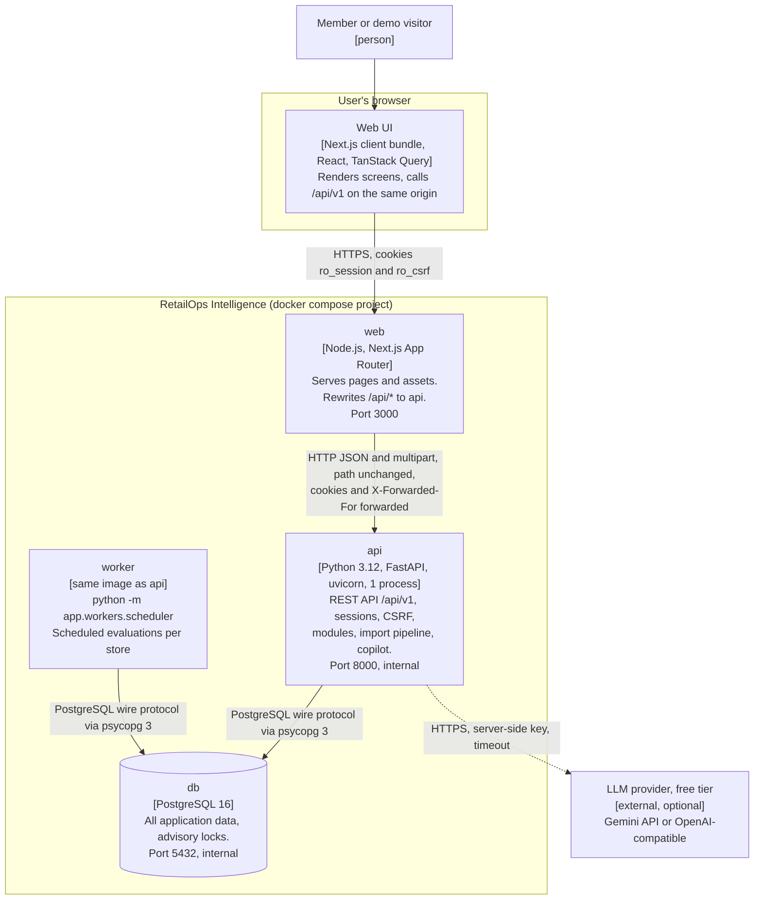

# Containers (C4 level 2)

> **Status:** v1 (T-022), 2026-10-31. Intended runtime topology. `docker-compose.yml` and the
> Dockerfiles are owned by DevOps (T-090); if they differ from this page, the difference is either
> fixed or recorded in an ADR.

Related: [`CONTEXT_DIAGRAM.md`](CONTEXT_DIAGRAM.md) · [`SYSTEM_ARCHITECTURE.md`](SYSTEM_ARCHITECTURE.md) ·
[`SECURITY_ARCHITECTURE.md`](SECURITY_ARCHITECTURE.md) · ADR-0001, ADR-0004, ADR-0009, ADR-0010

## 1. Diagram

## 2. Containers

| Container | Technology | Responsibilities | Talks to | Scaling notes |
|---|---|---|---|---|
| Web UI (browser) | Next.js client bundle, React, Tailwind, shadcn/ui, TanStack Query, React Hook Form + Zod, Recharts | Screens and interaction; sends `X-CSRF-Token` on unsafe methods; never holds the session token (it is `HttpOnly`) | `web` only (same origin) | n/a |
| `web` | Node.js running Next.js (App Router, standalone build) | Server-renders the shell and pages, serves static assets, rewrites `/api/*` to `API_INTERNAL_URL`. Holds no secrets and no business logic | `api` | Stateless; can run several replicas |
| `api` | Python 3.12, FastAPI, Pydantic v2, SQLAlchemy 2 (sync), uvicorn | Every `/api/v1` endpoint: auth, permissions, tenancy, imports (validation and apply), exception lifecycle, manual and import-triggered evaluations, analytics, copilot and its tool loop. Runs migrations on start | `db`, LLM provider | **One process per container in v1**: the in-process rate limiter is only accurate within one process. Sync endpoints run in the threadpool |
| `worker` | Same image as `api`, different command | Every `SCHEDULER_TICK_SECONDS`, runs due evaluations per store under a per-store advisory lock (ADR-0009). No HTTP port | `db` | Several replicas are safe (advisory lock) but unnecessary at target scale |
| `db` | PostgreSQL 16 | System of record for all modules; partial unique indexes; advisory locks; REPEATABLE READ snapshots for evaluations | n/a | Managed PostgreSQL in production |
| LLM provider | External HTTPS API, free tier: Google Gemini API or an OpenAI-compatible endpoint | Generates answers and tool requests from tool results | n/a | Provider quota is shared by all users of a deployment (ADR-0010) |

## 3. Protocols and ports

| From → To | Protocol | Port | Authentication | Notes |
|---|---|---|---|---|
| Browser → `web` | HTTPS (TLS terminated by the host in production; plain HTTP on localhost in development) | 443 public, 3000 in the container | `ro_session` cookie, `ro_csrf` cookie + `X-CSRF-Token` header | The only publicly exposed port |
| `web` → `api` | HTTP/1.1 on the private compose or host network | 8000 | Cookies passed through; the API authenticates every request itself | `web` is not trusted to authenticate users. The Next.js rewrite forwards the browser's `X-Forwarded-For` unchanged, so the API trusts it only with `TRUST_PROXY_HEADERS=true` behind an edge proxy that appends the client address (SECURITY.md §5) |
| `api`, `worker` → `db` | PostgreSQL wire protocol (psycopg 3), TLS required by the managed provider in production | 5432 | Database user and password from `DATABASE_URL` | The application role owns its schema; no superuser at runtime |
| `api` → LLM provider | HTTPS | 443 | `GEMINI_API_KEY` or `LLM_API_KEY`, server-side only | Only when `LLM_PROVIDER` resolves to a live provider; request timeout, automatic fallback to deterministic on 429, timeout or outage |

## 4. docker compose services

| Service | Build / image | Command | Published port | Depends on | Health check | Key environment |
|---|---|---|---|---|---|---|
| `db` | Official `postgres:16` image, named volume for data | default | 5432 in development only | none | `pg_isready` | `POSTGRES_USER`, `POSTGRES_PASSWORD`, `POSTGRES_DB` |
| `api` | `apps/api` multi-stage Dockerfile, non-root user | `alembic upgrade head`, then `uvicorn app.main:app --host 0.0.0.0 --port 8000 --workers 1 --no-proxy-headers` | 8000 in development only (OpenAPI at `/api/docs` is also reachable through `web`) | `db` healthy | `GET /api/v1/health/ready` | `DATABASE_URL`, `SESSION_SECRET`, `APP_ENV`, the LLM provider variables (`.env.example`), `DEMO_MODE_ENABLED`, `TRUST_PROXY_HEADERS` |
| `worker` | Same image as `api` | `python -m app.workers.scheduler` | none | `api` healthy (so migrations have run) | The scheduler touches a heartbeat file every tick (`--heartbeat`); the check fails when it is stale | `DATABASE_URL`, `APP_ENV`, `SCHEDULER_TICK_SECONDS` |
| `web` | `apps/web` multi-stage Dockerfile (Next.js standalone output), non-root user | `node server.js` | 3000 | `api` healthy | `GET /login` returns 200 | `API_INTERNAL_URL=http://api:8000` (a build argument: the rewrite is compiled into the build) |

Notes:

- **Migrations on start** run in the `api` entrypoint. Alembic does not coordinate concurrent
  upgrades, so with more than one `api` replica the migration step must move to a one-off release
  command. v1 runs one `api` replica.
- **The worker has no LLM key** and no reason to have one: it only evaluates rules.
- **Seed data** is loaded by a one-off command (`make seed`, T-056), not on every start, so a
  restart never overwrites data.

## 5. Production topology (intended)

| Concern | Intended setup | Status |
|---|---|---|
| Public entry | Only `web` is reachable from the internet, over HTTPS with HSTS. `api` and `worker` have no public ingress | Hosting choice pending (T-093) |
| Database | Managed PostgreSQL 16 replaces the `db` service; TLS on, automated backups by the provider | Pending (T-093) |
| Secrets | Set in the hosting platform's secret store as environment variables; never in images or the repository | Planned |
| Same origin | `web` and `api` must stay behind one public origin, or session cookies stop being first-party (ADR-0004) | Constraint |
| Egress | `api` needs outbound HTTPS to the chosen LLM provider only when a live provider is configured | Planned |
| Live URL | None exists yet. No URL is published in documentation until a deployment is verified | Fact |
