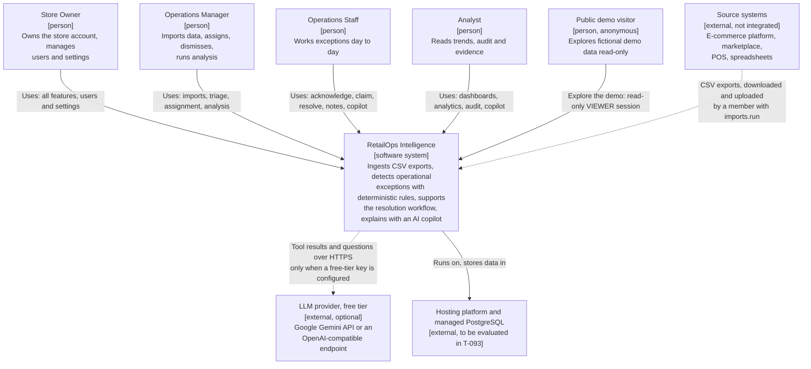

# System Context (C4 level 1)

> **Status:** v1 (T-022), 2026-10-31. Shows who uses RetailOps Intelligence and which external
> systems it depends on. Container-level detail is in [`CONTAINER_DIAGRAM.md`](CONTAINER_DIAGRAM.md).

## 1. Diagram

Solid arrows are runtime interactions. Dotted arrows are optional or indirect: source systems never
connect to the platform, and the LLM provider is used only when a key is configured.

## 2. Elements

| Element | Type | Role in the system | Trust |
|---|---|---|---|
| Store Owner | Person (`OWNER`) | Every permission, including `users.manage` | Authenticated member |
| Operations Manager | Person (`MANAGER`) | Every permission except `users.manage`: imports, assignment, dismiss and reopen, settings, manual analysis | Authenticated member |
| Operations Staff | Person (`STAFF`) | Read access plus `exceptions.work` (acknowledge, claim unassigned, start, resolve own, notes) and the copilot | Authenticated member |
| Analyst | Person (`ANALYST`) | Read-only access plus analytics, audit and the copilot | Authenticated member |
| Public demo visitor | Person (`VIEWER`) | Read-only access to the fictional "Kestrel Home & Kitchen" store plus the copilot. Cannot change shared data (ADR-0011) | Anonymous; treated as untrusted |
| RetailOps Intelligence | Software system | The platform described in [`SYSTEM_ARCHITECTURE.md`](SYSTEM_ARCHITECTURE.md) | |
| Source systems | External systems | Where orders, products and stock counts originate. v1 has **no API integration**: a person exports CSV files and uploads them (BR-601). File content is untrusted | Untrusted content |
| LLM provider (free tier) | External service, optional | Google Gemini API (the default live provider) or any OpenAI-compatible free-tier endpoint. Receives the question, tool definitions and tool results; returns text and tool requests. Never receives credentials, never reaches the database. Without a key, the deterministic provider answers (ADR-0010) | Third party; its output is untrusted |
| Hosting platform and managed PostgreSQL | External platform | A Docker-compatible host plus managed PostgreSQL 16. Choice pending (T-093); nothing paid without the owner's approval | Trusted infrastructure provider |

## 3. Context decisions and their reasons

| Decision | Reason | Label |
|---|---|---|
| CSV upload is the only data entry path in v1 | Every target source can export CSV; connectors per platform are out of scope until the product shape is validated. The import pipeline is built so a connector can later reuse the same validation and apply services | **MVP assumption** |
| No direct integration with payment processors or carriers | Their state reaches the platform through the order export (`payment_status`, `shipped_at`, `tracking_number`). Carrier tracking events are a roadmap rule (`ORDER_DELIVERY_DELAYED`) | **MVP assumption** |
| The LLM is optional and free-tier only | The product must be fully usable without an LLM, and a public demo must not create provider costs (owner decision, ADR-0010) | Settled |
| No email delivery | Not in the stack. Flows that would need email (invitations, password reset) are out of v1 unless the product docs specify otherwise | **MVP assumption**, open question for the PM |
| No customer personal data | Orders carry an opaque `customer_ref` only (BR-505), which also limits what can reach the LLM provider | Settled |
| Which source systems target users actually export from, and in what shape | Not known from real users yet | **Needs validation** |
