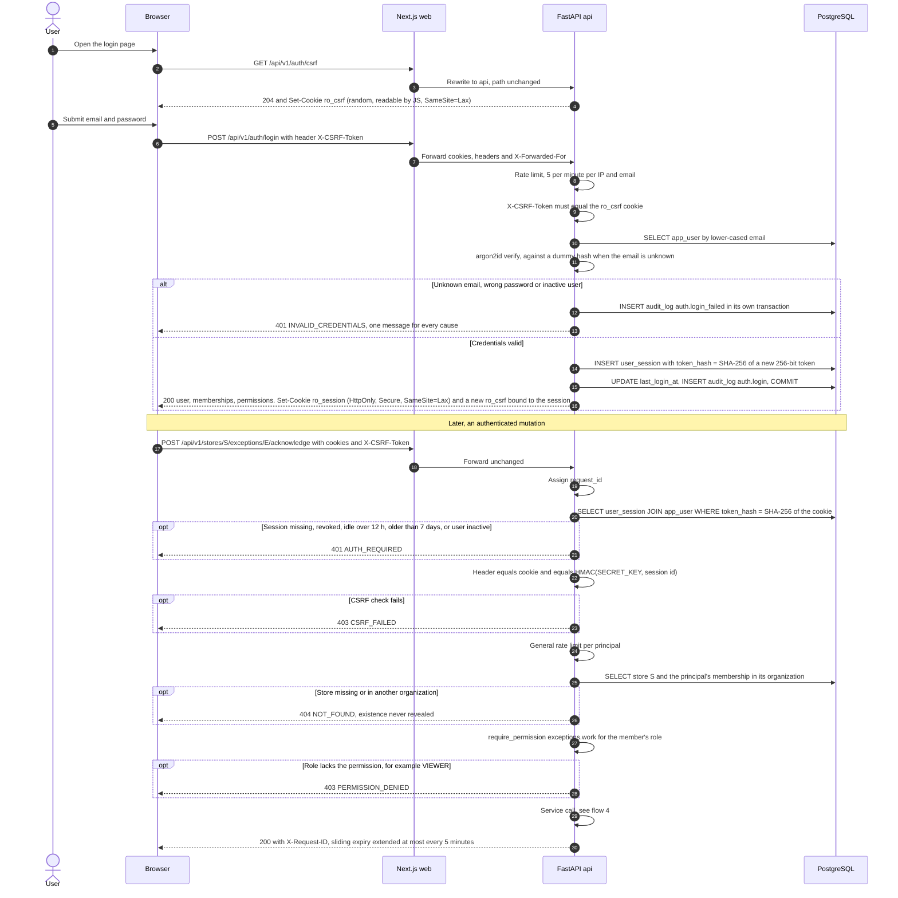
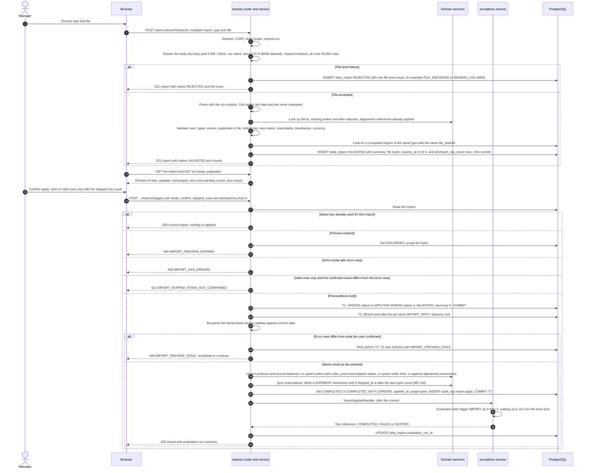
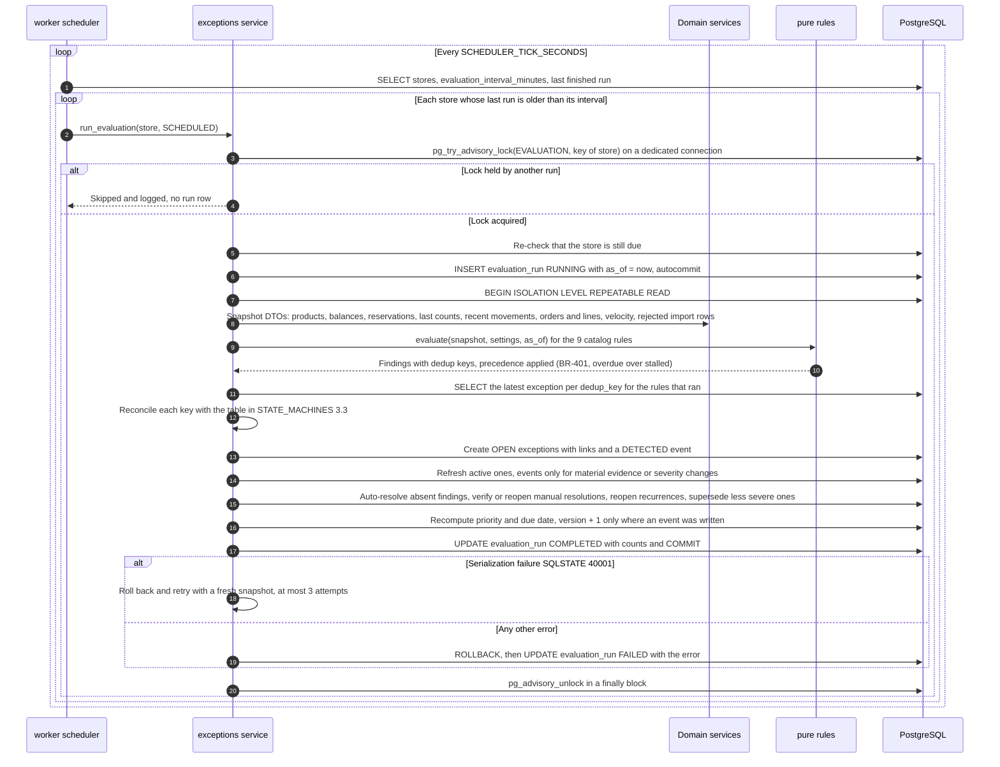
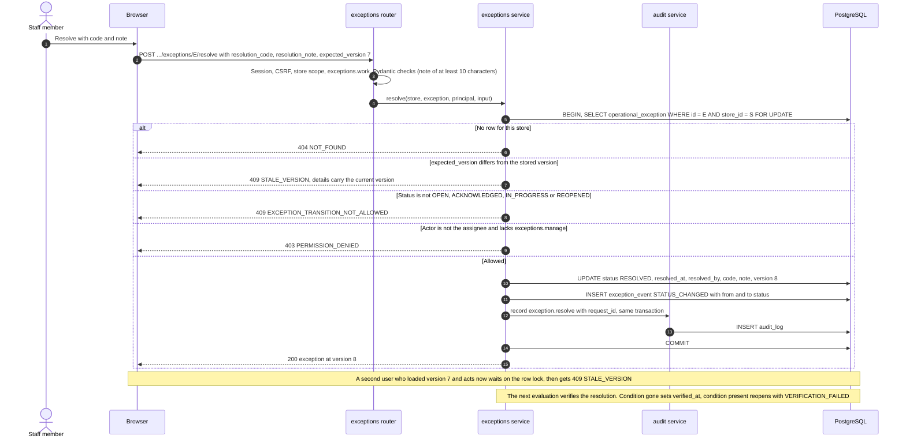
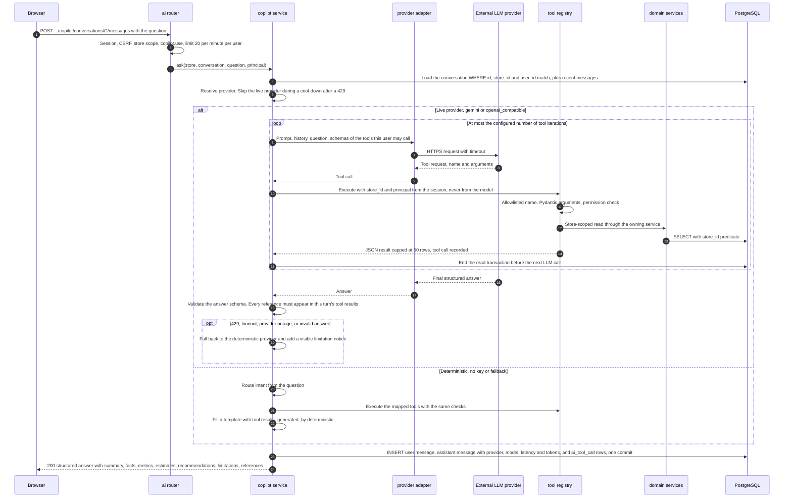

# Data Flows

> **Status:** v1 (T-022), 2026-10-31. Sequence diagrams for the five flows that carry the most risk.
> Browser calls always go through the Next.js rewrite (`/api/*` → `api`); it is drawn in flow 1 and
> omitted afterwards for readability.

Related: [`SYSTEM_ARCHITECTURE.md`](SYSTEM_ARCHITECTURE.md) (§8 transactions, §9 concurrency) ·
[`API_CONVENTIONS.md`](API_CONVENTIONS.md) · [`SECURITY_ARCHITECTURE.md`](SECURITY_ARCHITECTURE.md) ·
[`STATE_MACHINES.md`](../domain/STATE_MACHINES.md) · [`BUSINESS_RULES.md`](../domain/BUSINESS_RULES.md)

| # | Flow | Key guarantees |
|---|---|---|
| 1 | [Login and an authenticated request](#1-login-and-an-authenticated-request) | Hashed opaque session, CSRF double-submit, 404 before 403 |
| 2 | [CSV import: validate, preview, apply, evaluate](#2-csv-import-validate-preview-apply-evaluate) | Nothing skipped silently, apply is one transaction, evaluation follows |
| 3 | [Scheduled evaluation](#3-scheduled-evaluation) | One run per store at a time, consistent snapshot, dedup reconciliation |
| 4 | [Exception transition](#4-exception-transition-with-optimistic-concurrency) | Valid transitions only, stale writes rejected, event and audit in the same commit |
| 5 | [Copilot question](#5-copilot-question) | Allowlisted, store-scoped tools; deterministic fallback; no writes |

## 1. Login and an authenticated request

Notes:

- The session token never leaves the cookie. JavaScript cannot read it, and the database stores
  only its SHA-256 hash, so a database leak does not yield usable sessions.
- Logout sets `revoked_at` and clears both cookies. Password change and member deactivation revoke
  all of the user's sessions.
- `POST /api/v1/auth/demo` follows the same success path with the demo VIEWER identity and no
  password (ADR-0011). It is available only when `DEMO_MODE_ENABLED=true`.

## 2. CSV import: validate, preview, apply, evaluate

Upload and validation are one request; preview reads are separate; apply is a separate request
with explicit consent. "Domain services" are the `catalog`, `orders` and `inventory` services, which
own the tables the import writes.

Failure paths:

- **Any error inside T2** (constraint violation, bug, lost connection) rolls back every business
  change. A separate transaction marks the import `FAILED` with the error, and the response is the
  standard error envelope. "Retry" re-validates (`FAILED → VALIDATING`), using the bytes kept for
  `FAILED` imports.
- **Evaluation failure or lock timeout** never undoes the import. The run is recorded as `FAILED`
  or `SKIPPED`; the UI says the analysis will run at the next scheduled evaluation, and a user with
  `evaluations.run` can start it manually.
- **Valid-rows-only** applies only rows without errors. Skipped rows stay in `import_row_issue` and
  are downloadable as a formula-safe CSV (`GET .../issues/export`). Nothing is skipped silently
  (BR-606).

## 3. Scheduled evaluation

"Domain services" are the `catalog`, `orders`, `inventory` and `imports` services, which return
read-only snapshot DTOs. Manual and import-triggered runs follow the same path from `run_evaluation`
onwards; only the lock behaviour differs (SYSTEM_ARCHITECTURE §9).

Reconciliation outcomes per dedup key (from STATE_MACHINES §3.3):

| Latest exception for the key | Finding present | Finding absent |
|---|---|---|
| none | create `OPEN` | nothing |
| active | refresh evidence, `last_detected_at`, `detection_count`, severity, priority | auto-resolve `CONDITION_CLEARED` |
| `RESOLVED` by a user, first run after the resolution | reopen `VERIFICATION_FAILED` | set `verified_at` |
| `RESOLVED`, re-detected within `reopen_window_hours` | reopen `RECURRED_WITHIN_WINDOW` | nothing |
| `RESOLVED`, re-detected after the window | create new `OPEN` with `previous_occurrence_id` | nothing |
| `DISMISSED`, condition never cleared | update `last_detected_at` only | set `condition_cleared_at` |
| `DISMISSED`, condition had cleared | create new `OPEN` with `previous_occurrence_id` | nothing |

Supersession (BR-401) creates the more severe exception first, then resolves the less severe one with
`SUPERSEDED`, sets `superseded_by_id`, and carries the assignee over (an `ExceptionAssignment` row with
`assigned_by` null). Both keys differ, so the partial unique index is never violated mid-transaction.

## 4. Exception transition with optimistic concurrency

The same pattern applies to every lifecycle command (acknowledge, start, claim, assign, unassign,
set due date, dismiss, reopen). Checks run in this order: tenancy (404), version (409), transition
validity (409), actor rules (403), then the write. `start` without an assignee assigns the actor and
writes both an `ASSIGNED` and a `STATUS_CHANGED` event; both bump `version` once per request.

## 5. Copilot question

Notes:

- **Investigation summaries** (`POST .../copilot/exception-summaries`) first look up a cached
  assistant message by `cache_key` (store, exception id, exception `version`, permission-set hash,
  provider, model, prompt version). A hit returns the stored answer, labelled as cached with its
  generation time, without calling the LLM. A material change to the exception bumps `version`, so a
  stale summary is never served.
- **Note drafts** (`POST .../copilot/note-drafts`) return text only. Saving it is a separate call by
  a person with `exceptions.work` to `POST .../exceptions/E/notes` with `source = AI_DRAFT_ACCEPTED`.
  A VIEWER or ANALYST can draft but cannot save.
- **What leaves the platform.** With a live provider, the question, recent history, tool schemas and
  tool results are sent to the provider over HTTPS. They contain SKUs, product names, order numbers,
  amounts and opaque `customer_ref` values, never customer personal data (BR-505), credentials or
  session data.
