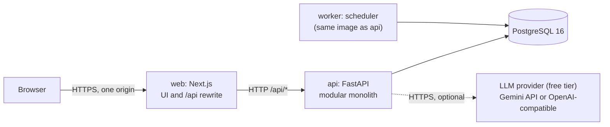
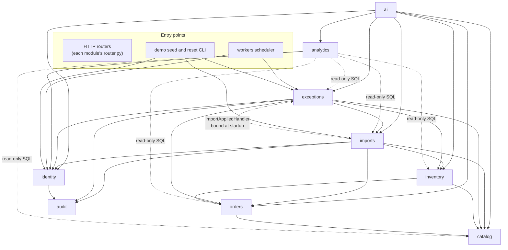

# System Architecture

> **Status:** v1 (T-022), 2026-10-31. Describes the planned system; nothing here claims the code
> already exists. Module boundaries and table ownership follow [`DOMAIN_MODEL.md`](../domain/DOMAIN_MODEL.md).
> A change to a boundary, layer rule, or transaction boundary needs an ADR
> ([`DECISIONS.md`](../../DECISIONS.md)) and an update to [`ARCHITECTURE_MAP.md`](../../ARCHITECTURE_MAP.md).

Related: [Context](CONTEXT_DIAGRAM.md) · [Containers](CONTAINER_DIAGRAM.md) ·
[Data flows](DATA_FLOW.md) · [Security](SECURITY_ARCHITECTURE.md) · [API conventions](API_CONVENTIONS.md) ·
[ER diagram](../domain/ENTITY_RELATIONSHIPS.md) · [Decisions summary](ARCHITECTURE_DECISIONS.md)

## 1. Overview

RetailOps Intelligence ingests product, order and inventory data from CSV exports, keeps a
consistent operational model (orders with three status axes, an append-only stock ledger,
reservations), runs deterministic rules that raise **operational exceptions**, and supports the team
through the exception lifecycle. An AI copilot explains the evidence through allowlisted read-only
tools and works without an LLM key.



Shape of the system:

- **One backend deployable, two processes.** The `api` process serves HTTP; the `worker` process
  runs scheduled evaluations. Both run the same code (ADR-0001, ADR-0009).
- **Nine backend modules** with exclusive table ownership. Cross-module calls go through the other
  module's `service.py`.
- **One database.** Cross-module consistency (an import that touches products, orders, reservations
  and the ledger) is a single PostgreSQL transaction, not a distributed protocol.
- **The browser talks to one origin.** Next.js rewrites `/api/*` to FastAPI, so session cookies are
  first-party and no CORS policy exists (ADR-0004).
- **Facts are computed deterministically; AI only reads.** The rule engine, priority model and
  inventory math are pure functions with an explicit `as_of` (BR-504). The AI layer calls read-only
  tools and never writes business data (ADR-0003, ADR-0010).

## 2. Architectural drivers

| Driver | Source | Architectural consequence |
|---|---|---|
| Business facts must be reproducible and testable | AGENTS.md §1 | Pure rule functions, explicit `as_of`, versioned `rule_id`, evidence and calculation stored with each exception |
| Imports never silently skip rows; apply is atomic | AGENTS.md §5, BR-606 | Apply is one database transaction across catalog, orders and inventory |
| Strict tenant isolation | BR-001..003 | Store-scoped repositories, 404 for other tenants, cross-tenant tests per endpoint |
| Must work without an LLM key | Brief, ADR-0010 | `LLMProvider` with a deterministic adapter; no feature depends on the LLM |
| Built and operated by one person; free to run | Product context | Modular monolith, one database, no broker or cache in v1 |
| Small and mid-sized stores | Product context | Design point: the demo dataset (~120 SKUs, ~1,500 orders over 60 days) and the import limit (20,000 rows per file). Larger volumes are **Needs validation** |

## 3. Quality attributes

| Attribute | Scenario | How it is met | Verified by |
|---|---|---|---|
| **Correctness and determinism** | The same data and `as_of` always produce the same exceptions, severities and priorities | Pure rules `(snapshot, settings, as_of) → findings`; `Decimal` money; UTC `timestamptz`; reconciliation table in STATE_MACHINES §3.3; DB constraints in ENTITY_RELATIONSHIPS §4 | Unit tests per BR id and per catalog rule; reconciliation table fully tested (T-053) |
| **Explainability and auditability** | An operator asks "why is this P1?" or "who resolved this?" | `evidence`, `calculation`, `priority_breakdown` stored on the exception; immutable `exception_event`, `order_event`, `inventory_movement`; `audit_log` with `request_id` | API tests assert events and audit rows for every transition (T-054) |
| **Security and tenant isolation** | A user of store A guesses an id from store B | Store scoping in repositories, 404 on mismatch, `require_permission`, code-defined matrix, CSRF, hashed sessions | Cross-tenant and permission tests for every store-scoped endpoint; route inventory test (§16) |
| **Graceful degradation** | No LLM key, or the free-tier provider returns 429, times out or is down | Deterministic provider; automatic per-request fallback with a visible notice; short cool-down after a 429 so the quota is not hammered; cached investigation summaries (ADR-0010) | Copilot tests run with no key and with a fake provider that returns 429 and timeouts (T-072) |
| **Concurrency safety** | Scheduled run, import-triggered run and a user's resolve happen together | Per-store advisory locks, REPEATABLE READ evaluation with retry, optimistic `version` on exceptions (§9) | Integration tests with concurrent sessions (T-053, T-055) |
| **Maintainability** | A new rule or module is added without touching unrelated code | Module ownership, layering rules, acyclic dependencies, generated TypeScript contracts | Boundary import test (§16), ruff, `mypy --strict`, contract diff check in CI |
| **Operability** | A run failed at 03:00, or a user reports an error | JSON logs with `request_id`; `evaluation_run` rows with status and error; health endpoints | Manual run-book checks; health checks in compose (T-090) |
| **Performance (target scale)** | Inbox, dashboards and evaluation stay responsive for one store | Indexed store-scoped queries, page size ≤ 100, capped AI tool results, full re-evaluation per run sized for small and mid-sized stores | **Needs validation**: no benchmarks exist yet. A benchmark on a 20,000-row import is a planned check (T-052, T-053) |
| **Cost** | The demo runs on a small host with managed PostgreSQL | No broker, cache or vector store; LLM optional | Hosting evaluation (T-093) |

## 4. Modules

Each module lives in `apps/api/app/domains/<module>/`. "Public interface" is the set of functions in
`service.py` other modules may call; the names are planned and indicative. All functions take the
SQLAlchemy `Session` and a `store_id` where data is store-scoped.

| Module | Responsibility | Owned tables | Public service interface (planned) |
|---|---|---|---|
| `identity` | Authentication, sessions, CSRF, tenancy (organizations, stores, memberships), role → permission matrix, store settings | organization, store, store_settings, app_user, membership, user_session | `authenticate`, `create_demo_session`, `resolve_session`, `revoke_session`, `revoke_user_sessions`, `list_accessible_stores`, `get_store`, `get_store_settings`, `update_store_settings`, `list_members`, `add_member`, `change_role`, `deactivate_member`, `has_permission`. FastAPI dependencies in `identity/deps.py`: `current_principal`, `csrf_protect`, `store_scope`, `require_permission` |
| `catalog` | Product master data and suppliers | supplier, product | `upsert_products`, `resolve_skus`, `get_product`, `list_products`, `list_suppliers`, `snapshot_products` |
| `orders` | Order lifecycle, three status axes, reachability, order history | sales_order, order_item, order_event | `upsert_orders`, `upsert_order_items`, `get_order`, `list_orders`, `list_order_events`, `list_overdue_orders`, `committed_lines`, `pending_demand`, `units_sold`, `snapshot_orders` |
| `inventory` | Ledger, balances, reservations, cycle-count cutoff, health, velocity, reconciliation | inventory_balance, inventory_movement, stock_reservation | `ensure_balances`, `apply_adjustments`, `sync_reservations_for_orders` (also writes `SHIPMENT` movements, BR-130), `get_position`, `list_positions`, `list_movements`, `velocity`, `reconcile`, `snapshot_inventory` |
| `imports` | CSV upload, validation, preview, apply, error export, templates | data_import, import_row_issue | `create_import`, `get_import`, `list_imports`, `list_issues`, `export_issues_csv`, `apply_import`, `discard_import`, `revalidate_import`, `get_template`, `rejected_rows_for_orders`. Declares the `ImportAppliedHandler` protocol (§5) |
| `exceptions` | Rule engine, evaluator, precedence, reconciliation (dedup, verify, reopen, supersede), priority, lifecycle transitions, notes, assignment | evaluation_run, operational_exception, exception_entity_link, exception_event, exception_assignment, exception_note | `run_evaluation`, `list_exceptions`, `get_exception`, `get_history`, `acknowledge`, `start`, `resolve`, `dismiss`, `reopen`, `claim`, `assign`, `unassign`, `set_due_date`, `add_note`, `list_notes`, `exceptions_for_entity`, `list_runs`, `get_run` |
| `audit` | Append-only record of security-relevant and business-changing actions | audit_log | `record`, `list_entries` |
| `ai` | Copilot conversations, provider abstraction (gemini, openai_compatible, deterministic), tool registry, cached investigation summaries, note drafts | ai_conversation, ai_message, ai_tool_call | `create_conversation`, `list_conversations`, `get_conversation`, `ask`, `summarize_exception`, `draft_note`, `provider_status` |
| `analytics` | Read-only aggregates for the dashboard and analytics pages | *(none)* | `dashboard_summary`, `trends`, `exception_breakdown`, `fulfillment_performance` |

Rules that follow from the table:

- **A module writes only its own tables** (AGENTS.md §3). The import apply writes products, orders and
  stock rows, but it does so by calling `catalog`, `orders` and `inventory` services inside the
  transaction the `imports` service owns.
- **Services exchange DTOs, not ORM objects.** A service returns Pydantic schemas or frozen
  dataclasses to other modules. Handing out ORM instances would allow hidden writes through
  attribute assignment and lazy loads outside the owning module.
- **Status fields change only through `state.py` transition functions** (orders, inventory
  reservations, exceptions, imports), which validate the move and write the event row
  (STATE_MACHINES, DOMAIN_MODEL §4 invariant 4).

## 5. Module dependencies

Arrows mean "may call the public service interface of". The graph is acyclic.



| Edge | Why it exists |
|---|---|
| `orders → catalog` | Resolve `sku` to `product_id` for order lines |
| `inventory → orders, catalog` | Committed lines for reservations, pending demand and units sold for velocity (BR-150), product status for health |
| `exceptions → inventory, orders, catalog` | Build the evaluation snapshot (read-only DTOs) |
| `exceptions → identity` | `store_settings`; validate that an assignee is an active member with `exceptions.work` |
| `exceptions → imports` | Evidence for `DATA_ORDER_TOTAL_MISMATCH`: rejected import rows for the order (EXCEPTION_CATALOG) |
| `imports → catalog, orders, inventory` | Apply rows through the owning services |
| `imports → identity` | Store currency (BR-004) and time zone (BR-502) for validation |
| `* → audit` | Record business-changing actions in the same transaction |
| `ai → *` | Tools call read methods of the owning services; the AI module never writes outside `ai_*` |

**The one inverted edge.** The import-triggered evaluation would create a cycle
(`imports → exceptions → imports`). `imports` therefore declares a small protocol,
`ImportAppliedHandler.on_import_applied(store_id, import_id) -> EvaluationRunRef | None`, and the
composition root (`app/main.py`, and the CLI entry points) binds it to
`exceptions.service.run_import_triggered_evaluation`. The call is synchronous and explicit at the
binding site; it is not a general event bus.

**Cross-cutting dependency.** Every router uses `identity/deps.py` (`current_principal`,
`csrf_protect`, `store_scope`, `require_permission`). These read only identity's own tables and are
excluded from the acyclicity rule, which applies to `service.py` imports.

## 6. Layering rules

Within a module, calls go one way: **router → service → repository → models**.

| Layer | File | May | Must not |
|---|---|---|---|
| Router | `router.py` | Declare path, method, permission dependency, request and response schemas; call one service entry point | Import SQLAlchemy, query the database, contain business rules, return ORM objects (AGENTS.md §4) |
| Service | `service.py` | Implement use cases; own the transaction for entry points; call `state.py` and pure rule code; call other modules' services; record audit entries; raise typed domain errors | Build HTTP responses; read another module's tables |
| Repository | `repository.py` | Query and persist the module's own models; every store-scoped query carries `store_id` (base class `StoreScopedRepository`) | Commit or roll back; call services; touch another module's models |
| Models | `models.py` | SQLAlchemy 2 mapped classes | Business behaviour beyond simple derived properties |
| Schemas | `schemas.py` | Pydantic v2 models for API input and output and for cross-module DTOs (`extra="forbid"` on inputs) | Import models |
| Pure domain code | `state.py`, `rules/`, `priority.py`, calculators | Pure functions over plain data | Perform I/O, import `app.db`, read the clock (BR-504) |

**Transaction ownership.** Only an *entry-point* service function (one called by a router, the worker
or a CLI) commits. A service function called by another service participates in the caller's
transaction and never commits. Repositories never commit. This rule is what makes "import apply is
one transaction" true even though four modules write during it.

**Errors.** Services raise typed errors (`NotFound`, `PermissionDenied`, `Conflict(code)`,
`ValidationFailed(details)`). One exception handler maps them to the envelope in
[API_CONVENTIONS §6](API_CONVENTIONS.md#6-errors). Unexpected exceptions become `500 INTERNAL_ERROR`
with the `request_id`; the stack trace goes only to the log.

## 7. Request lifecycle

```mermaid
flowchart LR
    a["Browser<br/>/api/v1/..."] --> b["Next.js rewrite"]
    b --> c["Request context<br/>request_id"]
    c --> d["current_principal<br/>401"]
    d --> e["csrf_protect<br/>unsafe methods, 403"]
    e --> f["rate limit<br/>429"]
    f --> g["store_scope<br/>404"]
    g --> h["require_permission<br/>403"]
    h --> i["Pydantic body<br/>422"]
    i --> j["service<br/>409 and domain errors"]
    j --> k["response schema<br/>+ X-Request-ID"]
```



1. The browser calls `/api/v1/...` on the Next.js origin with its cookies. Next.js rewrites the
   request to `API_INTERNAL_URL` with the path unchanged.
2. **Request context middleware** accepts an incoming `X-Request-ID` only if it matches
   `^[A-Za-z0-9-]{8,64}$`, otherwise it generates a UUID. The id is put in a context variable used by
   the logger, returned as `X-Request-ID`, written to `audit_log.request_id`, and included in every
   error envelope.
3. **`current_principal`** hashes the `ro_session` cookie (SHA-256), loads the session and user, and
   rejects revoked, expired (12 h sliding), over-age (7 days absolute) or inactive sessions with 401.
   The sliding expiry is written at most once every 5 minutes per session, so reads do not become
   writes.
4. **`csrf_protect`** runs for POST, PUT, PATCH and DELETE (ADR-0004).
5. **Rate limiting** applies the per-principal general limit; login and copilot have their own
   limits ([API_CONVENTIONS §9](API_CONVENTIONS.md#9-rate-limits)).
6. **`store_scope`** loads the store in the path and checks that the principal has a membership in
   its organization (BR-002). Missing store and other tenant's store both return 404.
7. **`require_permission`** checks the role → permission matrix (ADR-0007) and returns 403.
   Tenancy is checked before permission so that a 403 never confirms another tenant's store exists.
8. The router validates the body (422), calls the service, and returns a response schema.
9. The access log writes one JSON line: `request_id`, method, route template, status,
   `duration_ms`, `user_id`, `store_id`.

## 8. Transaction boundaries

| Flow | Transactions | Isolation | Notes |
|---|---|---|---|
| Ordinary read or mutation | 1 | READ COMMITTED | Committed by the entry-point service before the router returns, so a commit failure surfaces as an error rather than a 200 |
| Exception transition | 1 | READ COMMITTED + `SELECT … FOR UPDATE` on the exception | Status, event, assignment row and audit entry commit together (§9) |
| Failed login | 1 separate | READ COMMITTED | The `auth.login_failed` audit row must persist although the request fails |
| Import upload and validation | 1 | READ COMMITTED | Creates `data_import` and all `import_row_issue` rows; the status ends `VALIDATED` or `REJECTED` |
| **Import apply** | T1 guard, **T2 apply**, T3 on failure | READ COMMITTED + per-store `IMPORT_APPLY` advisory lock in T2 | T1 moves `VALIDATED → APPLYING` with a conditional update. **T2 is the single business transaction**: re-validate, upsert through catalog/orders/inventory, sync reservations and shipments, set `COMPLETED` or `COMPLETED_WITH_ERRORS`, purge file bytes, audit. Any error rolls back T2 entirely and T3 records `FAILED` (STATE_MACHINES §4: "no business data changed") |
| Import-triggered evaluation | Starts after T2 commits | see next row | Runs in the same HTTP request (the only background process is the worker). Its failure never undoes the import |
| **Evaluation run** | Run row insert (autocommit), **one main transaction**, failure update | REPEATABLE READ | The main transaction reads a consistent snapshot, reconciles, writes exceptions and events, and sets the run `COMPLETED`: **one commit per run**. Serialization failures (SQLSTATE 40001) retry the run up to 3 times |
| Copilot question | Short read transactions per tool, 1 write at the end | READ COMMITTED | **No transaction stays open across an LLM call.** The service ends the read transaction after each tool. User message, assistant message and tool-call rows are written together at the end |
| Demo reset | 1 per demo store | READ COMMITTED | Takes both advisory locks for the store first |

**Why the evaluation uses REPEATABLE READ.** The rules compare quantities from several tables
(balances, reservations, order lines). Under READ COMMITTED each statement sees a newer snapshot,
so an import committing mid-run could produce an inconsistent snapshot and a spurious exception that
the next run then auto-resolves, leaving noise in the history. REPEATABLE READ gives every query in
the run the same snapshot. The cost is a possible serialization failure when a user changes an
exception row the run also updates; the run is pure and cheap to repeat, so it is retried.

## 9. Concurrency control

| Concern | Mechanism | Behaviour under contention |
|---|---|---|
| Overlapping evaluations for one store | **Session-level advisory lock** `pg_try_advisory_lock(EVALUATION, key(store_id))`, taken on a dedicated connection **before** the REPEATABLE READ transaction starts, released in `finally` | Scheduled: skip and log. Manual: `409 EVALUATION_IN_PROGRESS`. Import-triggered: poll for up to `EVALUATION_LOCK_WAIT_SECONDS` (default 10), then record the run as `SKIPPED` and tell the user the next scheduled run will cover it |
| Two workers deciding a store is due | Re-check "is due" after acquiring the lock | The second worker sees the fresh run and does nothing |
| Concurrent applies for one store | Transaction-level advisory lock `pg_advisory_xact_lock(IMPORT_APPLY, key(store_id))` in T2, plus the `VALIDATED → APPLYING` conditional update in T1 | Applies serialize. Re-validation inside T2 reads current order statuses, so the reachability check (BR-608) holds for the whole transaction |
| User edits on an exception | `SELECT … FOR UPDATE`, then compare `expected_version` with `version`; increment `version` whenever an `exception_event` is written | Stale client → `409 STALE_VERSION` with the current version in `details`. Without `expected_version` the transition is validated against the locked current state |
| Evaluation vs user edit on the same exception | Row locks plus REPEATABLE READ | If the user commits first, the run gets a serialization failure and retries with a fresh snapshot (and, for a fresh manual resolution, verifies it per STATE_MACHINES §3.3). If the run commits first, the user's `expected_version` is stale only when the run wrote an event (severity change, auto-resolve, reopen, supersede) |
| Balance counters | Atomic `UPDATE … SET on_hand = on_hand + :delta, version = version + 1` inside the apply transaction | No lost updates; drift is detectable by `inventory.reconcile` (BR-104) |
| Duplicate shipment or reservation rows | Unique `(store_id, reference)` and unique `order_item_id` (ENTITY_RELATIONSHIPS §4.1) | A retry cannot double-decrement stock |
| Double-click on apply or "Run analysis" | `Idempotency-Key` plus the state machine guard | Replay returns the original result ([API_CONVENTIONS §8](API_CONVENTIONS.md#8-idempotency)) |
| A process crashes during apply | T2 rolls back; T1 left the import in `APPLYING` | An import in `APPLYING` for longer than 15 minutes is treated as `FAILED` when next read (lazy recovery); a retry re-validates |

**Advisory lock keys.** The two-integer form is used: a namespace constant (`EVALUATION`,
`IMPORT_APPLY`) and a 32-bit integer derived from the store UUID. Two stores can collide on the
derived key; the only effect is that their runs serialize. Correctness never depends on the key
being unique.

**Why a session-level lock for evaluation.** In REPEATABLE READ the snapshot is taken by the first
statement of the transaction. If that statement were a blocking `pg_advisory_xact_lock`, the run
would wait with a snapshot from *before* the previous run committed. Taking the lock first, outside
the transaction, avoids that. Constraint: session-level locks need a real session, so a
transaction-pooling connection proxy (none is used in v1) would require revisiting this design.

**Why `version` moves only with events.** The scheduled run refreshes `last_detected_at`,
`detection_count` and the time component of priority on every active exception every 15 minutes.
If those writes bumped `version`, every open detail page would go stale and every action would fail
with 409. Tying `version` to events means a conflict signals a change the user would care about.

## 10. Exceptions to module ownership

There are exactly two, and they are deliberately narrow.

**10.1 Read-only analytics queries.** `analytics/queries.py` may `SELECT` from other modules'
tables, because building dashboards out of per-row service calls would be slow and would push
aggregation logic into unrelated modules. Constraints:

- `SELECT` only. No `INSERT`, `UPDATE`, `DELETE` or locking clause. The boundary test (§16)
  allows other modules' models to be imported in this one file only.
- Every query has a `store_id` predicate and goes through the same `store_scope` and permission
  dependencies (`dashboard.read` or `analytics.read`).
- Business formulas are not re-implemented: availability, health and priority values are read from
  stored columns or obtained from the owning service. Analytics computes counts, sums, rates and
  time buckets in the store time zone (BR-501).
- Tests reconcile every number with the underlying rows (T-057).

| Query | Tables read |
|---|---|
| Dashboard summary (active exceptions by band and severity, top-priority attention list, overdue order count, exposure at risk, inventory health counts) | operational_exception, sales_order, inventory_balance, product |
| Trends (exceptions opened and resolved per day, orders placed per day) | operational_exception, exception_event, sales_order |
| Exception breakdown (by type, category, severity, status; mean time to resolve) | operational_exception, exception_event |
| Fulfillment performance (on-time shipment rate against `ship_by`, paid-to-shipped hours) | sales_order |
| Import quality (rows applied, error and warning counts per import), if exposed | data_import, import_row_issue |

**10.2 Demo reset.** `python -m app.demo.reset` deletes and regenerates data for organizations with
`is_demo = true`. It is the only code path allowed to delete rows from append-only tables, it refuses
to run against a non-demo organization, and it regenerates data through the same service functions
the import pipeline uses, so seeded data satisfies every invariant (ADR-0011).

## 11. Background processing

There is one background process: the `worker` (`python -m app.workers.scheduler`).

- Every `SCHEDULER_TICK_SECONDS` (default 60) it lists stores and, for each store whose last
  completed run (any trigger) finished more than `evaluation_interval_minutes` ago (default 15),
  calls `exceptions.service.run_evaluation(trigger=SCHEDULED)`.
- The scheduled run is what makes time-based conditions appear without new data: an order becomes
  overdue when the clock passes `ship_by`, not when a row changes.
- Runs for different stores are sequential within one worker. More workers can be added safely
  because of the advisory lock (§9).
- v1 always runs the full rule set. `evaluation_run.rules` records the rule ids and versions that
  ran; the reconciliation algorithm already supports partial runs (STATE_MACHINES §3.3: only rules
  that ran can auto-resolve).

Housekeeping without extra jobs (the brief allows no other background jobs):

| Task | v1 approach |
|---|---|
| Expire previews after 24 h (`VALIDATED → DISCARDED`) and purge file bytes | Lazy: on read or apply of the import, and for the store's expired previews whenever a new import is created |
| Recover imports stuck in `APPLYING` | Lazy, on read (§9) |
| Expired `user_session` rows | Harmless (lookups check expiry); removal is an open question |
| Demo dataset freshness | `python -m app.demo.reset`, run on demand or by the host's scheduler, not by the worker |

## 12. Observability

| Signal | Content | Purpose |
|---|---|---|
| **Structured logs** (JSON on stdout) | `timestamp`, `level`, `logger`, `message`, `request_id`, `user_id`, `store_id`, `route`, `status`, `duration_ms`; worker lines carry `evaluation_run_id` and `store_id` | Debugging and incident analysis; collected by the host |
| **`request_id`** | Generated or accepted at the edge of the API (§7) | Joins a UI error toast, the log lines, the audit row and the error envelope |
| **`evaluation_run`** | Trigger, `as_of`, rule versions, status, timings, counts (created, refreshed, resolved, reopened, superseded), error | Detection telemetry: proves the scheduler is alive and explains why an exception appeared or closed |
| **`ai_message` / `ai_tool_call`** | Provider, model, latency, tokens; per tool: name, validated arguments, status, row count, duration, error | AI telemetry and traceability of every answer to its tool calls; input to the evaluation runner (T-074) |
| **`audit_log`** | Actor, action, target, metadata, IP, `request_id` | Accountability for security-relevant and business-changing actions (not a debugging log) |
| **Health** | `GET /api/v1/health/live` (process up, no I/O); `GET /api/v1/health/ready` (`SELECT 1` with a short timeout, 503 on failure) | Container health checks and load balancer readiness |

Log hygiene (details in [SECURITY_ARCHITECTURE §12](SECURITY_ARCHITECTURE.md#12-logging-hygiene-and-privacy)):
no passwords, session or CSRF tokens, cookie or `Authorization` headers, raw CSV content, or LLM
prompts and completions in logs.

Not in v1: a metrics backend and distributed tracing. Key operational numbers (run durations,
failure counts, copilot latency) can be queried from the tables above. **Industry practice** would
add OpenTelemetry tracing when there is more than one service to trace across.

## 13. Configuration

Configuration follows the twelve-factor approach: everything that differs between environments is
an environment variable, read once at startup into a typed Pydantic settings object
(`app/core/config.py`). The names below are **proposed**; `.env.example` (owned by DevOps) becomes
authoritative once it exists, and `ENVIRONMENT_STATUS.md` lists the names (AGENTS.md §10). Secrets are
marked; they never appear in logs or in client bundles.

| Variable | Used by | Default | Secret | Purpose |
|---|---|---|---|---|
| `APP_ENV` | api, worker | `development` | no | `development`, `test`, `production`; production forces secure cookies |
| `LOG_LEVEL` | api, worker | `INFO` | no | |
| `DATABASE_URL` | api, worker | none | **yes** | `postgresql+psycopg://…` |
| `DB_POOL_SIZE`, `DB_MAX_OVERFLOW` | api, worker | `10`, `10` | no | Keep api + worker connections under the managed database's limit |
| `DB_STATEMENT_TIMEOUT_MS` | api | `15000` | no | Guards against runaway queries in request handlers |
| `SECRET_KEY` | api | none | **yes** | HMAC key for session-bound CSRF tokens (ADR-0004). Session tokens do not depend on it |
| `SESSION_IDLE_TIMEOUT_HOURS`, `SESSION_ABSOLUTE_TIMEOUT_DAYS` | api | `12`, `7` | no | |
| `COOKIE_SECURE` | api | `true` when `APP_ENV=production` | no | |
| `FORWARDED_ALLOW_IPS` | api (uvicorn) | none | no | Peers trusted to set `X-Forwarded-For` (the Next.js container) |
| `RATE_LIMIT_ENABLED` | api | `true` | no | Disabled only in tests that do not test limits |
| `DEMO_MODE_ENABLED` | api | `false` | no | Enables `POST /api/v1/auth/demo` |
| `LLM_PROVIDER` | api | unset | no | `deterministic`, `gemini`, `openai_compatible` (ADR-0010). Unset: `gemini` when `GEMINI_API_KEY` is set, otherwise `deterministic`. A live provider without its key logs a startup warning and runs as `deterministic` |
| `GEMINI_API_KEY` | api | empty | **yes** | Free-tier Google Gemini API key (Google AI Studio). Server-side only |
| `LLM_MODEL` | api | set by the AI engineer (`docs/ai`, T-070) | no | Model name for the selected live provider |
| `LLM_BASE_URL` | api | empty | no | `openai_compatible` only: the provider's OpenAI-compatible base URL (HTTPS) |
| `LLM_API_KEY` | api | empty | **yes** | `openai_compatible` only. Server-side only |
| `API_DOCS_ENABLED` | api | `true` | no | Serves `/api/docs` and `/api/v1/openapi.json` |
| `SCHEDULER_TICK_SECONDS` | worker | `60` | no | |
| `EVALUATION_LOCK_WAIT_SECONDS` | api | `10` | no | Import-triggered run's wait for the store lock |
| `API_INTERNAL_URL` | web (server side) | `http://api:8000` | no | Rewrite target. Never exposed as `NEXT_PUBLIC_*` |

Business configuration (SLA hours, thresholds, priority weights, evaluation interval) is per store
in `store_settings`, not in environment variables (BUSINESS_RULES §7). Import limits (5 MB,
20,000 rows) are business rules (BR-602) and live in code.

## 14. Backend folder layout (planned)

```text
apps/api/
├── app/
│   ├── main.py                    # FastAPI app factory, middleware, routers, composition root
│   ├── core/                      # cross-cutting, no business logic
│   │   ├── config.py              # Pydantic settings (section 13)
│   │   ├── logging.py             # JSON logging, request_id context variable
│   │   ├── errors.py              # domain error types, envelope, exception handlers
│   │   ├── security.py            # argon2id hashing, token generation, CSRF HMAC
│   │   ├── rate_limit.py          # in-process limiter
│   │   └── pagination.py          # page/page_size/sort parsing, list envelope
│   ├── db/
│   │   ├── base.py                # DeclarativeBase, naming convention for constraints
│   │   ├── session.py             # engine, sessionmaker, session dependency
│   │   ├── repository.py          # StoreScopedRepository base
│   │   └── locks.py               # advisory lock helpers (namespaces, key derivation)
│   ├── domains/
│   │   ├── identity/              # models, schemas, repository, service, router, deps.py, permissions.py
│   │   ├── catalog/               # models, schemas, repository, service, router
│   │   ├── orders/                # ... + state.py (transitions, reachability, axis matrix)
│   │   ├── inventory/             # ... + calculations.py (health, velocity, cutoff), state.py
│   │   ├── imports/               # ... + parsing.py, validators/, templates/, state.py
│   │   ├── exceptions/            # ... + rules/, evaluator.py, reconciliation.py, priority.py, state.py
│   │   ├── audit/                 # models, schemas, repository, service, router
│   │   ├── ai/                    # ... + providers/ (gemini, openai_compatible, deterministic),
│   │   │                          #       tools/ (registry), summary cache
│   │   └── analytics/             # schemas, queries.py, service, router (no models)
│   ├── workers/
│   │   └── scheduler.py           # python -m app.workers.scheduler
│   └── demo/
│       ├── generator.py           # dataset relative to now, fixed seed
│       └── reset.py               # python -m app.demo.reset
├── migrations/                    # Alembic env.py and versions/
├── tests/
│   ├── unit/                      # pure functions: rules, transitions, priority, calculations
│   └── integration/               # API tests against real PostgreSQL: permissions, tenancy, flows
├── evals/                         # copilot evaluation dataset and runner (T-074)
└── pyproject.toml
```

Each module directory contains the files it needs from `models.py`, `schemas.py`, `repository.py`,
`service.py`, `router.py` (AGENTS.md §3). `analytics` has no `models.py`; the composition root binds
`ImportAppliedHandler` in `main.py` and in each CLI entry point.

## 15. Frontend architecture and layout (planned)

```text
apps/web/
├── app/                           # Next.js App Router
│   ├── (public)/                  # login, "Explore the demo" landing
│   └── (app)/                     # authenticated shell: overview, exceptions, orders,
│                                  # inventory, imports, copilot, admin
├── components/                    # shared UI (shadcn/ui based), layout, states
│                                  # (loading, empty, error, permission-denied)
├── features/                      # one folder per domain: exceptions, orders, inventory,
│                                  # imports, copilot, admin, overview (hooks, components, forms)
├── hooks/                         # cross-feature hooks (useCurrentUser, usePermission, useStore)
├── lib/
│   ├── api/                       # typed fetch wrapper over packages/contracts, CSRF header,
│   │                              # error envelope parsing, request_id surfacing
│   └── format/                    # money, dates in store time zone, labels
├── styles/                        # tokens.css, Tailwind theme
└── tests/                         # vitest + Testing Library; e2e/ for Playwright
```

- **Data fetching.** TanStack Query hooks per feature call `lib/api`, which uses the generated types
  from `packages/contracts` (ADR-0013) and sends `X-CSRF-Token` on unsafe methods. All calls go to the
  same origin (`/api/v1/...`).
- **Authorization in the UI is presentation only.** `GET /api/v1/auth/me` returns the permission
  set; the UI hides or disables actions with a reason (AGENTS.md §4), and the API enforces it.
- **No business calculations in the browser.** Available stock, health, priority and exposure are
  displayed from API fields, together with the stored `calculation` and `priority_breakdown`.
  The UI never recomputes them.
- **Forms** use React Hook Form with Zod for client-side feedback; the API's 422 details are the
  authority and are mapped back to fields.
- **Demo labelling.** When the organization is a demo organization, the shell shows a persistent
  "Demo data" label (ADR-0011).

## 16. Architecture fitness tests

These tests turn the rules in this document into CI failures. None needs a new dependency.

| Test | Asserts |
|---|---|
| Module boundary test | Parses imports with `ast`: no module imports another module's `models`, `repository` or `router`; only `analytics/queries.py` imports other modules' models; `service.py` imports form an acyclic graph matching §5 |
| Pure code test | `state.py`, `rules/`, `priority.py` and calculators import nothing from `app.db` and never call `datetime.now` / `utcnow` (BR-504) |
| Route inventory test | Every route is either in an explicit public allowlist (health, `auth/csrf`, `auth/login`, `auth/demo`, `meta`) or depends on `require_permission`; every route under `/stores/{store_id}` appears in the cross-tenant test matrix |
| Migration test | `alembic upgrade head` on an empty PostgreSQL 16 database; models and migrations produce no autogenerate diff |
| Contract test | Regenerating `packages/contracts` from the current OpenAPI schema produces no diff (ADR-0013) |

## 17. Known limitations and open questions

| Item | Type | Note |
|---|---|---|
| In-process rate limiting is per process | Limitation | Accurate only with one API process (one uvicorn worker per container). Scaling out needs a shared store such as Redis |
| Import-triggered evaluation runs inside the apply request | Limitation | Adds evaluation time to the apply response. **Needs validation** with a 20,000-row benchmark |
| Full re-evaluation per run | Limitation | O(store size) per run; fine at target scale, incremental evaluation is a later optimisation |
| Single database is a shared failure domain | Limitation | Accepted for v1 (ADR-0001) |
| Housekeeping of expired sessions and old previews | Open question | Lazy handling only; a scheduled housekeeping task would contradict "no other background jobs" |
| Proposed columns (`operational_exception.version`, idempotency keys, `file_content`, run statuses) | Open question | Listed in [ENTITY_RELATIONSHIPS §5](../domain/ENTITY_RELATIONSHIPS.md#5-proposed-additions-pending-approval) |
| Retention of AI conversations, tool calls and audit rows | Open question | Kept indefinitely in v1; needs a decision before real customer data is processed |
| Free-tier LLM quotas are shared by every user of a deployment | Limitation | One key serves all users (including public demo visitors), so the provider's quota, not the per-user limit, is the real ceiling. Excess requests fall back to deterministic answers with a notice (ADR-0010) |
| Free-tier data-use terms | Needs validation | Provider terms for free tiers may allow use of submitted data. No PII is sent (BR-505), but store operational data is; the deployer must check the chosen provider's current terms before connecting real store data |
