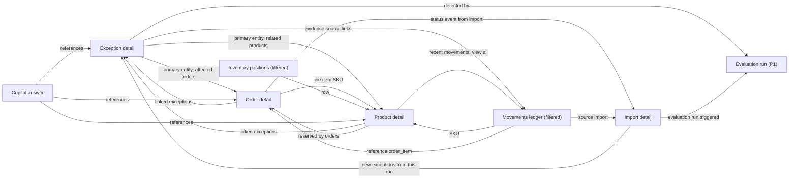

# Information Architecture

> **Status:** v1 design specification (task T-030, milestone M3).
> **Canonical inputs:** `docs/domain/STATE_MACHINES.md`, `BUSINESS_RULES.md`, `EXCEPTION_CATALOG.md`,
> `PRIORITY_MODEL.md`, `DOMAIN_MODEL.md`, and the role/permission matrix (ADR-0007).
> **Companion docs:** `USER_FLOWS.md`, `DESIGN_SYSTEM.md`, `SCREEN_SPECIFICATIONS.md`, `COMPONENT_INVENTORY.md`.

This document defines what lives where in the web app: the navigation tree, the URL scheme,
the permission each route requires, how entities link to each other, the store context, and the
scope of global search. The frontend engineer builds the App Router file tree and `SidebarNav`
directly from §3 and §4.

---

## 1. Principles

| # | Principle | Consequence in the UI |
|---|---|---|
| IA-1 | **The navigation lists places, not records.** | Sidebar items are list pages. Detail pages (exception, order, product, import) are reached through links and highlight their parent item. |
| IA-2 | **Work before reference.** | Overview and Operations sit at the top. Commerce data (orders, products, stock) is reference material for investigating exceptions. |
| IA-3 | **Every route is store-scoped in the URL.** | `/s/{storeId}/…` makes deep links unambiguous, keeps two tabs on two stores independent, and maps 1:1 onto the API path `/api/v1/stores/{store_id}/…`. |
| IA-4 | **Hide places you cannot enter; show actions you cannot take, with a reason.** | Nav items whose route permission is missing are not rendered. Inside a page, mutating actions the user cannot perform render disabled (`aria-disabled`) with a tooltip naming the missing permission (or "The public demo is read-only"). |
| IA-5 | **No fake controls** (AGENTS.md §4). | No page, menu item or button exists for a capability v1 does not have (no data-source connectors, no password reset, no notifications, no bulk actions, no exports beyond the import-issue CSV). |
| IA-6 | **Deterministic facts first, AI second.** | On every investigation surface, the rule-produced evidence and calculation appear before (and visually separate from) AI output. |
| IA-7 | **Seeded data is always labelled.** | Every page in a demo organization (`organization.is_demo = true`) renders the `DemoBanner`. |

---

## 2. Navigation tree (v1)

```text
RetailOps Intelligence
├── Overview                              /s/{storeId}/overview
├── OPERATIONS
│   ├── Exceptions                        /s/{storeId}/exceptions
│   │   └── (Exception detail)            /s/{storeId}/exceptions/{exceptionId}
│   └── Evaluation runs            [P1]   /s/{storeId}/evaluation-runs
├── COMMERCE
│   ├── Orders                            /s/{storeId}/orders
│   │   └── (Order detail)                /s/{storeId}/orders/{orderId}
│   ├── Products                          /s/{storeId}/products
│   │   └── (Product detail)              /s/{storeId}/products/{productId}
│   ├── Inventory                         /s/{storeId}/inventory
│   └── Movements                         /s/{storeId}/inventory/movements
├── INTELLIGENCE
│   ├── Analytics                  [P1]   /s/{storeId}/analytics
│   └── Copilot                           /s/{storeId}/copilot
│       └── (Conversation)                /s/{storeId}/copilot/{conversationId}
├── DATA
│   ├── Imports                           /s/{storeId}/imports
│   │   ├── (New import)                  /s/{storeId}/imports/new
│   │   └── (Import detail / wizard)      /s/{storeId}/imports/{importId}
│   └── Data quality               [P1]   /s/{storeId}/data-quality
└── ADMINISTRATION
    ├── Users & roles                     /s/{storeId}/admin/users
    ├── Settings                          /s/{storeId}/admin/settings
    └── Audit log                         /s/{storeId}/admin/audit-log
```

Items in parentheses are not in the sidebar. `[P1]` marks routes that ship after the P0 set. Their
sidebar entries are not rendered until the page exists (IA-5).

**Persistent chrome (every authenticated page):** `DemoBanner` (demo orgs only) → `TopBar`
(`StoreSwitcher`, global search trigger, `UserMenu`) → `SidebarNav` + content. See
`SCREEN_SPECIFICATIONS.md §0` and `COMPONENT_INVENTORY.md` (AppShell).

**Sidebar badges.** Only one item carries a count: **Exceptions** shows the number of active P1
exceptions (`analytics summary.active_by_band.P1`) when it is greater than zero, as a danger-soft
count badge with the accessible name "12 active P1 exceptions". No other counts: a badge must
mean "act now".

---

## 3. Adjustments to the directive's proposal

The directive proposed: Overview; Operations (Exceptions inbox, Exception detail, Activity);
Commerce (Orders, Order detail, Products, Inventory, Movements); Intelligence (Analytics,
Copilot); Data (Imports, Import detail, Data quality); Administration (Users & roles, Settings,
Audit log).

| # | Change | Justification |
|---|---|---|
| A1 | **Detail pages leave the sidebar** (Exception detail, Order detail, Import detail). | A detail page has no meaning without a record ID, so a sidebar link to it would be a dead control. They are reached from lists, search, and cross-links, and they highlight their parent item (IA-1). |
| A2 | **"Activity" becomes "Evaluation runs" (P1).** | A generic activity feed would duplicate two things that already exist: per-record timelines (exception events, order events) and the Audit log. It also has no backing entity. `EvaluationRun` is a real, observable entity ("makes every detection observable", DOMAIN_MODEL). It answers the questions an operations manager actually asks: *when did the system last check, what did it change, and why did this exception appear?* It also gives the manual "Run analysis" trigger (`evaluations.run`) a natural home. The P0 product exposes the latest run on Overview and the Exceptions inbox header, so nothing is lost before P1. |
| A3 | **Add "Product detail"** (`/products/{productId}`, not in the sidebar). | The required cross-links (order → product → movements → exceptions) need one destination per SKU. Without it, a product would be spread across three list pages with no single place showing master data, stock position, reservations, recent movements and linked exceptions together. It is the hub that makes Products, Inventory and Movements cohere. Specified as P0 in `SCREEN_SPECIFICATIONS.md`. |
| A4 | **Keep Products and Inventory as separate list pages.** | They serve different jobs. *Products* is catalog hygiene (status, price, cost, supplier, reorder settings). *Inventory* is stock risk (on hand, reserved, available, incoming, health, days of cover). Merging them would produce a 15-column table that serves neither job. Both link to the same Product detail. |
| A5 | **Movements nests under Inventory in the URL** (`/inventory/movements`) but keeps its own sidebar item. | The ledger is the source of truth for `on_hand` (BR-110). The URL expresses the relationship, and the sidebar item keeps it one click away during investigations. |
| A6 | **No "Data source configuration" page.** | v1 ingests CSV uploads only (BR-601). A connector settings page would be a fake control (IA-5). The upload flow, column contracts and templates live in Imports. |
| A7 | **Import templates live inside Imports**, not as a separate page. | Templates are only useful at the moment of importing. A "Download template" menu sits on the Imports list and in step 1 of the wizard. |
| A8 | **"New import" and "Import detail" share the record route.** `/imports/new` only selects the type and uploads. The upload creates a `data_import` record, and the app then replaces the URL with `/imports/{importId}`, which renders the wizard while the import is in progress (`UPLOADED`, `VALIDATING`, `VALIDATED`, `APPLYING`) and the detail view once it is terminal. | The preview survives a reload and can be resumed for 24 h (STATE_MACHINES §4). A wizard held only in client state would lose a validated preview on refresh. |
| A9 | **Data quality is P1 and has a defined scope.** | The catalog sends invalid CSV rows to "Import errors / Data quality page" (EXCEPTION_CATALOG, "Explicitly not exceptions"). The page aggregates: active `DATA_QUALITY` exceptions (links into the inbox), and imports with rejected or skipped rows. It adds no new data source. In P0 the same information is reachable through the inbox category filter and the Imports list status filter. |
| A10 | **Analytics is P1.** | P0 analytics needs (KPIs, attention list, fulfillment performance) are on Overview (T-061). The Analytics page adds trend exploration for the Analyst persona and the "Ask the copilot about this chart" entry point. It is specified briefly in `SCREEN_SPECIFICATIONS.md §P1`. |
| A11 | **Users & roles shows the role matrix read-only.** | Roles and permissions are code-defined (ADR-0007). An editable permission grid would be a fake control. Owners can change a member's role. They cannot edit what a role grants. |
| A12 | **Administration pages are organization-wide but stay under the store prefix.** Users & roles and Audit log operate on the organization of the current store, and the page header says so ("Kestrel Commerce · organization-wide"). | Keeps one shell and one URL scheme. Memberships and audit logs belong to the organization (DOMAIN_MODEL), so a store-level copy would be misleading. |
| A13 | **No account/profile page.** The user menu shows name, email, role and organization, plus "Sign out". | v1 has no password change, profile editing or notification settings, so a page would be empty or fake. |

---

## 4. Route map (Next.js App Router)

### 4.1 File tree

```text
apps/web/app/
├── (public)/
│   ├── login/page.tsx                         Login + "Explore the demo"
│   └── demo/page.tsx                          Shareable demo entry (explains, then starts a viewer session)
├── (app)/
│   ├── layout.tsx                             Session guard: GET /api/v1/me, else redirect /login?next=
│   ├── page.tsx                               "/" → redirect to last-used store's overview
│   └── s/[storeId]/
│       ├── layout.tsx                         StoreProvider + AppShell (DemoBanner, TopBar, SidebarNav)
│       ├── page.tsx                           redirect → ./overview
│       ├── overview/page.tsx
│       ├── exceptions/page.tsx
│       ├── exceptions/[exceptionId]/page.tsx
│       ├── evaluation-runs/page.tsx                     [P1]
│       ├── orders/page.tsx
│       ├── orders/[orderId]/page.tsx
│       ├── products/page.tsx
│       ├── products/[productId]/page.tsx
│       ├── inventory/page.tsx
│       ├── inventory/movements/page.tsx
│       ├── analytics/page.tsx                           [P1]
│       ├── copilot/page.tsx
│       ├── copilot/[conversationId]/page.tsx
│       ├── imports/page.tsx
│       ├── imports/new/page.tsx
│       ├── imports/[importId]/page.tsx
│       ├── data-quality/page.tsx                        [P1]
│       └── admin/
│           ├── users/page.tsx
│           ├── settings/page.tsx
│           └── audit-log/page.tsx
├── not-found.tsx                              Global 404
└── error.tsx                                  Global error boundary (ErrorState with request_id)
```

Each `page.tsx` is a thin server component that renders a client feature module from
`apps/web/features/<area>/` (TanStack Query owns data fetching on the client, so every state in
`SCREEN_SPECIFICATIONS.md` is reachable).

### 4.2 Route table

| Route | Screen | Required permission | P | Notes |
|---|---|---|---|---|
| `/login` | Login | none (public) | P0 | Redirects to `/` if a session exists. Reads `?next=` and `?reason=expired`. |
| `/demo` | Demo entry | none (public) | P0 | Shareable link. Explains the demo, then **Start the demo** posts to the demo-session endpoint. A `GET` never creates a session (avoids login CSRF). |
| `/` | Redirect | session | P0 | Last-used store (`localStorage ro.lastStoreId`, validated against `/me`), else the first store of the first membership. |
| `/s/{storeId}` | Redirect | session + store access | P0 | → `/overview`, or to the first route the user may access. |
| `/s/{storeId}/overview` | Overview | `dashboard.read` | P0 | |
| `/s/{storeId}/exceptions` | Exceptions inbox | `exceptions.read` | P0 | Views via `?view=active\|mine\|unassigned\|triage\|closed` |
| `/s/{storeId}/exceptions/{exceptionId}` | Exception detail | `exceptions.read` | P0 | Actions need `exceptions.work` / `.assign` / `.manage`. AI panel needs `copilot.use`. |
| `/s/{storeId}/evaluation-runs` | Evaluation runs | `exceptions.read` | P1 | "Run analysis" needs `evaluations.run`. |
| `/s/{storeId}/orders` | Orders | `orders.read` | P0 | |
| `/s/{storeId}/orders/{orderId}` | Order detail | `orders.read` | P0 | Linked-exceptions section needs `exceptions.read`. |
| `/s/{storeId}/products` | Products | `catalog.read` | P0 | |
| `/s/{storeId}/products/{productId}` | Product detail | `catalog.read` | P0 | Stock sections need `inventory.read`. Exceptions section needs `exceptions.read`. |
| `/s/{storeId}/inventory` | Inventory positions | `inventory.read` | P0 | |
| `/s/{storeId}/inventory/movements` | Movements ledger | `inventory.read` | P0 | |
| `/s/{storeId}/analytics` | Analytics | `analytics.read` | P1 | |
| `/s/{storeId}/copilot` | Copilot | `copilot.use` | P0 | Starts a new conversation. |
| `/s/{storeId}/copilot/{conversationId}` | Copilot conversation | `copilot.use` | P0 | Only the conversation's own user can open it (404 otherwise). |
| `/s/{storeId}/imports` | Imports | `imports.read` | P0 | "New import" needs `imports.run`. |
| `/s/{storeId}/imports/new` | New import (type + upload) | `imports.run` | P0 | Users without it get the permission-denied state, not a redirect. |
| `/s/{storeId}/imports/{importId}` | Import wizard / detail | `imports.read` | P0 | Apply, discard and retry need `imports.run`. |
| `/s/{storeId}/data-quality` | Data quality | `imports.read` **and** `exceptions.read` | P1 | |
| `/s/{storeId}/admin/users` | Users & roles | `users.read` | P0 | Role changes need `users.manage`. |
| `/s/{storeId}/admin/settings` | Settings | `settings.read` | P0 | Saving needs `settings.manage`. |
| `/s/{storeId}/admin/audit-log` | Audit log | `audit.read` | P0 | |

**Route guard behaviour.** (1) No session → `/login?next={path}`. (2) `storeId` not in any
membership → global 404 ("This store doesn't exist or you don't have access"). This mirrors the
API's 404-not-403 tenancy rule. (3) Store accessible but route permission missing → the page
renders the `PermissionDenied` state inside the shell. The nav never links there, but a pasted
URL must still explain itself. The backend enforces the same rules. The frontend guard only
avoids a broken page (AGENTS.md §6).

### 4.3 Sidebar visibility by role

`●` visible · `–` hidden (permission missing). Derived mechanically from the ADR-0007 matrix.

| Sidebar item | Permission | OWNER | MANAGER | STAFF | ANALYST | VIEWER (demo) |
|---|---|---|---|---|---|---|
| Overview | `dashboard.read` | ● | ● | ● | ● | ● |
| Exceptions | `exceptions.read` | ● | ● | ● | ● | ● |
| Evaluation runs [P1] | `exceptions.read` | ● | ● | ● | ● | ● |
| Orders | `orders.read` | ● | ● | ● | ● | ● |
| Products | `catalog.read` | ● | ● | ● | ● | ● |
| Inventory, Movements | `inventory.read` | ● | ● | ● | ● | ● |
| Analytics [P1] | `analytics.read` | ● | ● | ● | ● | ● |
| Copilot | `copilot.use` | ● | ● | ● | ● | ● |
| Imports | `imports.read` | ● | ● | ● | ● | ● |
| Data quality [P1] | `imports.read` + `exceptions.read` | ● | ● | ● | ● | ● |
| Users & roles | `users.read` | ● | ● | – | – | – |
| Settings | `settings.read` | ● | ● | ● | ● | ● |
| Audit log | `audit.read` | ● | ● | – | ● | ● |

If every item of a group is hidden, the group label is hidden too (STAFF sees an Administration
group containing only Settings).

### 4.4 Action permissions (where actions live)

| Action | Permission | Where it appears |
|---|---|---|
| Run analysis | `evaluations.run` | Overview header, Exceptions inbox header, Evaluation runs [P1] |
| Acknowledge, Start work, Add note | `exceptions.work` | Exception detail action bar, timeline composer |
| Claim (assign to me) | `exceptions.work`, exception unassigned | Exception detail action bar |
| Resolve | `exceptions.work` and (actor is the assignee **or** holds `exceptions.manage`) | Exception detail |
| Assign / reassign / unassign, change due date | `exceptions.assign` | Exception detail (assignee field, due field) |
| Dismiss, Reopen | `exceptions.manage` | Exception detail ("More" menu / primary on closed) |
| Generate AI investigation, ask copilot | `copilot.use` | Exception detail AI panel, Copilot |
| Draft note with AI → save | `copilot.use` to draft, `exceptions.work` to save | Exception detail composer |
| New import, apply, discard, retry | `imports.run` | Imports list, Import wizard/detail |
| Download issues CSV, templates | `imports.read` | Import detail, Imports list, wizard step 1 |
| Save settings | `settings.manage` | Settings |
| Change member role | `users.manage` | Users & roles |

---

## 5. What the demo viewer sees

Public visitors choose **Explore the demo** and receive a `VIEWER` session in the demo
organization "Kestrel Commerce", store "Kestrel Home & Kitchen" (USD, America/New_York). VIEWER
has the ANALYST permission set: read everything operational, use the copilot, read the audit log
and settings. It never mutates shared data (ADR-0011).

| Area | Viewer experience |
|---|---|
| Chrome | `DemoBanner` on every page: "Demo data. Kestrel Home & Kitchen is a fictional store. All records are generated and periodically reset. You are signed in as a read-only viewer." It has the actions **Take the tour** and **Leave demo** (sign out). It is not dismissible. It collapses to one line below 640 px. |
| Overview | Full content. **Run analysis** is rendered disabled with the tooltip "The public demo is read-only." |
| Exceptions | Full list and detail, including evidence, calculation, priority breakdown, timeline and notes. Lifecycle buttons are visible but disabled with the read-only reason, so the workflow is legible without being executable. The note composer is replaced by a read-only notice. |
| AI investigation / Copilot | Enabled (`copilot.use`). "Save as note" on an AI draft is disabled (needs `exceptions.work`). Rate limit is 20 questions per minute per user (see open question Q-IA-3 on shared viewer identities). |
| Orders, Products, Inventory, Movements | Full read access. |
| Imports | List and detail (including issue tables and the issues CSV) are readable. **New import** is disabled with the read-only reason. Templates can be downloaded. |
| Settings | Rendered as read-only values (a definition list, not disabled inputs). |
| Audit log | Readable, for seeded actors. See open question Q-IA-2 about IP addresses of real visitors. |
| Users & roles | Hidden (no `users.read`). |

**Disabled-reason copy** (used by `PermissionGate`, exact strings):

| Situation | Tooltip text |
|---|---|
| Demo organization, any mutation | "The public demo is read-only." |
| Missing permission (non-demo) | "You need the {Permission label} permission. Ask an owner or manager." |
| Staff resolving an exception assigned to someone else | "Only the assignee or a manager can resolve this exception." |
| Staff starting work on someone else's exception | "This exception is assigned to {name}. Ask a manager to reassign it." |
| Transition not allowed from current status | "Not available while the exception is {Status label}." |

Permission labels: `exceptions.work` "Work on exceptions", `exceptions.assign` "Assign exceptions",
`exceptions.manage` "Manage exceptions", `evaluations.run` "Run analysis", `imports.run` "Run
imports", `settings.manage` "Manage settings", `users.manage` "Manage users", `copilot.use` "Use
the copilot".

---

## 6. Cross-links between entities

Every entity reference in the UI is a link to its detail page, rendered with the entity's
natural key (order number, SKU, short exception reference), never a raw UUID.



| From | Element | To | Data source |
|---|---|---|---|
| Exception detail | Primary entity chip (header) | Order detail or Product detail | `operational_exception` primary link (`exception_entity_link.role = PRIMARY`) |
| Exception detail | Affected orders table | Order detail | `exception_entity_link` (`role = AFFECTED`, `entity_type = order`), with `affected_order_ids` from the evidence |
| Exception detail | Evidence row "Source" | Order, Product, Movement (ledger filtered by `reference`), Import | Each evidence item's source reference (EXCEPTION_CATALOG "evidence: typed facts, each with the source record") |
| Exception detail | "Detected by evaluation run" | Evaluation run [P1]. In P0 this is plain text: trigger and time | `exception_event.evaluation_run_id` |
| Exception detail | Previous occurrence / Superseded by | Exception detail | `previous_occurrence_id`, `superseded_by_id` |
| Order detail | Line item SKU | Product detail | `order_item.product_id` |
| Order detail | Linked exceptions | Exception detail | `GET exceptions?order_id=` (via `exception_entity_link`) |
| Order detail | Status history event with `source = IMPORT` | Import detail | `order_event.import_id` |
| Product detail | Linked exceptions (active + last 5 closed) | Exception detail | `GET exceptions?product_id=` |
| Product detail | Reservations (ACTIVE) | Order detail | `stock_reservation.order_item_id → order` |
| Product detail | Recent movements → "View all" | `/inventory/movements?product_id=` | `inventory_movement` |
| Movements ledger | SKU / Reference / Import | Product / Order / Import detail | `product_id`, `reference = order_item:{id}`, `import_id` |
| Inventory positions | Row (SKU cell link) | Product detail | `product_id` |
| Import detail | Evaluation run summary | Exceptions inbox filtered `?evaluation_run_id=` | `data_import.evaluation_run_id` |
| Copilot answer | Reference chips | Exception / Order / Product detail | `references[] {type, id, label}` |
| Overview | KPI cards, attention list | Filtered list pages / Exception detail | analytics summary |

**Back navigation.** Detail pages show a breadcrumb (`Exceptions / EXC-9B1C4E2A`). The parent
crumb returns to the list **with the filters the user came from** (the list URL is kept in
`sessionStorage ro.lastListUrl.{area}`), falling back to the unfiltered list.

**Exception reference format.** `operational_exception` has no human-readable number in v1, so
the UI shows `EXC-` plus the first 8 hex characters of the UUID, upper-cased (`EXC-9B1C4E2A`), in
the mono font. See open question Q-IA-1.

---

## 7. Global store context

| Concern | Rule |
|---|---|
| Source of truth | The `storeId` URL segment. `StoreProvider` resolves it against `GET /api/v1/me` (memberships → organization → stores) and exposes `{ id, name, code, currency, timezone, organization: { id, name, slug, isDemo }, role, permissions }`. |
| Data fetching | Every TanStack Query key starts with `['store', storeId, …]`. Switching store never shows another store's cached data. |
| Formatting | `Money`, `DateTime` and `RelativeTime` read currency and time zone from the store context, **never** from the browser locale or zone (BR-004, BR-501). Locale is fixed to `en-US` in v1. |
| Store switcher | Lists every store across the user's memberships, grouped by organization. Choosing a store navigates to the **same section** in the new store, with record IDs stripped (`/s/A/exceptions/123` → `/s/B/exceptions`). With exactly one store (the demo), the switcher renders as a static label, not a dropdown (IA-5). |
| Zone hint | The store switcher's second line reads "USD · Times in ET". Table column headers that hold times carry the generic zone ("Placed (ET)"). Full timestamps carry the specific abbreviation (EDT/EST). See `DESIGN_SYSTEM.md §13`. |
| Last store | Stored in `localStorage ro.lastStoreId` for the `/` redirect only. It is never used for data access. |
| Document title | `{Page} · {Store name} · RetailOps`, for example `EXC-9B1C4E2A · Kestrel Home & Kitchen · RetailOps`. |

---

## 8. Global search

Opened with **Ctrl K / ⌘ K** or the search button in the top bar. It is a command palette (shadcn
`Command` inside a `Dialog`) with result groups. A dedicated search endpoint is not required: the
palette calls each list endpoint with `q` and `page_size=5` in parallel.

| Group | Matches | Endpoint (proposed) | Permission | Result row |
|---|---|---|---|---|
| Exceptions | Title (contains, case-insensitive). Reference: `EXC-xxxxxxxx` or a pasted full UUID | `GET /stores/{id}/exceptions?q=` | `exceptions.read` | Severity badge · title · status · `EXC-…` |
| Orders | Order number (prefix, case-insensitive) | `GET /stores/{id}/orders?q=` | `orders.read` | Order number · status pill · total · placed date |
| Products | SKU (prefix, case-sensitive per BR-506) or name (contains) | `GET /stores/{id}/products?q=` | `catalog.read` | SKU (mono) · name · health badge |
| Go to | Static list of the sidebar pages the user can see | client-side | per route | Page name |

Behaviour: minimum 2 characters, 200 ms debounce, 5 results per group, and a "See all results
in Orders" row that opens the list page with `?q=`. Groups the user cannot read are not queried.
An exact match on a full order number or SKU is ranked first. Customer references (`customer_ref`)
are searchable only from the Orders list filter, not globally (data minimisation, BR-505). Recent
searches are not stored.

---

## 9. URL state conventions

| State | Where it lives | Example |
|---|---|---|
| Filters, sort, page, page size, list view | URL search params (shareable, survives reload) | `/s/…/exceptions?view=active&severity=CRITICAL,HIGH&sort=-priority_score&page=2` |
| Open dialog / sheet | Component state (not in the URL) | Resolve dialog |
| Detail page section | URL hash | `/exceptions/{id}#evidence` |
| Table density | `localStorage ro.density.{table}` | `compact` |
| Sidebar collapsed | `localStorage ro.sidebar.collapsed` | `true` |

Param names mirror the API query params (`status`, `severity`, `priority_band`, `category`,
`exception_type`, `assignee`, `sort`, `page`, `page_size`, `q`), so the list page can forward
them unchanged.

---

## 10. Open questions (for the architect / orchestrator)

| ID | Question | Recommendation |
|---|---|---|
| Q-IA-1 | `operational_exception` has no human-readable reference. Search "by ID" means pasting a UUID or a short prefix. | Add a per-store sequential `number` (display `EXC-1042`). Until then, the UI uses the 8-character UUID prefix and the API must support prefix search on `id`. |
| Q-IA-2 | VIEWER has `audit.read`. If the shared demo org records `auth.login` / demo-session events with real visitors' IPs, public visitors could read each other's IPs. | Omit `ip` from audit responses for VIEWER (or never record IPs for demo-session events). The UI shows the IP column only when the field is present. |
| Q-IA-3 | If every demo visitor shares one VIEWER user, copilot conversations (`ai_conversation.user_id`) are visible to all visitors, and the 20/min copilot limit is shared. | Create one VIEWER user per demo session (expiring with the session), or scope demo conversations to the session. |
| Q-IA-4 | User provisioning: no canonical flow exists for adding members (invitation or initial password). | v1 UI: list members, change role. Adding members is done through a server-side command until a provisioning ADR exists. No "Add member" button ships until the endpoint exists (IA-5). |
| Q-IA-5 | Deactivating access: `membership` has no status, and `app_user.is_active` is global across organizations. | Add `membership.status` (ACTIVE/SUSPENDED) if deactivation is required in v1. Otherwise v1 has role change only. |
