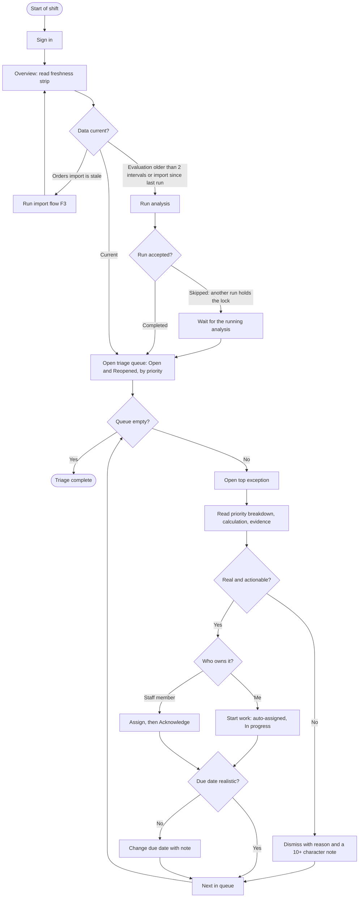
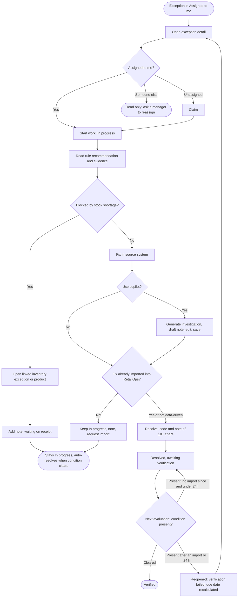
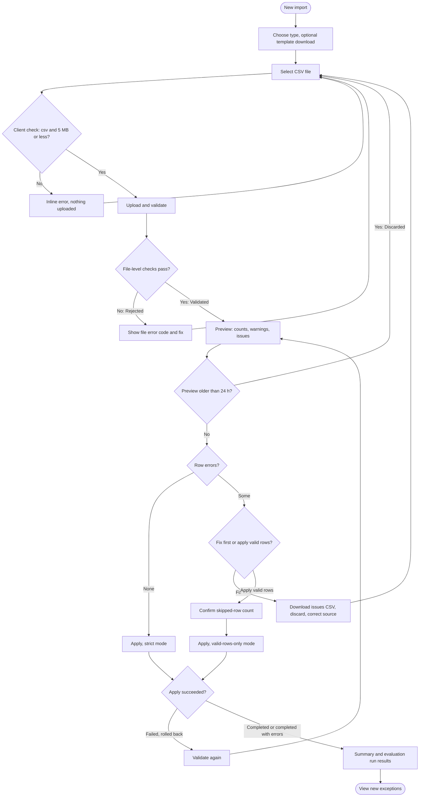
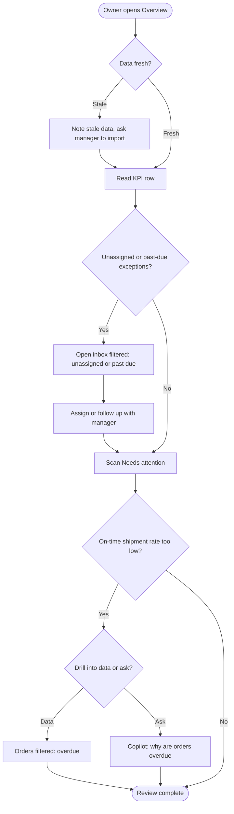
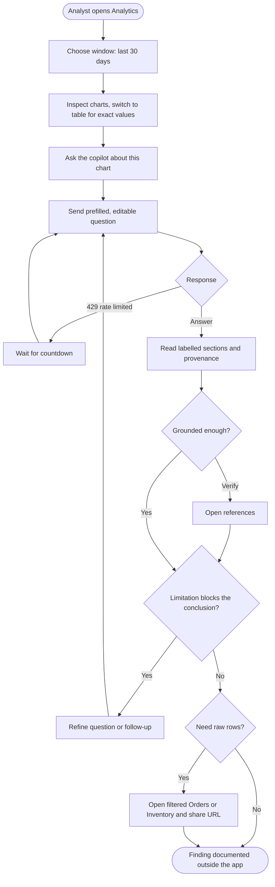
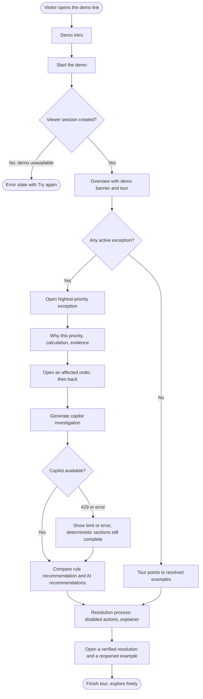

# User Flows

> **Status:** v1 design specification (task T-030, milestone M3).
> Screen IDs (`S-xx`) refer to `SCREEN_SPECIFICATIONS.md`. Routes refer to
> `INFORMATION_ARCHITECTURE.md §4`. State names, exception types, resolution codes and formulas
> are the canonical ones from `docs/domain/*`.

These flows describe the intended journeys through the v1 product. They are design intent, not
observed behaviour. The personas are the four product personas (Store Owner, Operations Manager,
Operations Staff, Analyst) plus the public demo visitor. Durations ("about 15 minutes") are design
targets (**MVP assumption**), not measurements.

Example data uses the fictional demo store **Kestrel Home & Kitchen** (USD, America/New_York).
Example records are illustrative of the seeded dataset's shape. The UI never hard-codes them.

| # | Flow | Persona (role) | Main screens |
|---|---|---|---|
| F1 | Morning triage | Operations Manager (`MANAGER`) | S-02 → S-03 → S-04 |
| F2 | Investigate and resolve an assigned exception | Operations Staff (`STAFF`) | S-03 → S-04 → S-06 / S-08 → S-04 |
| F3 | Import with errors, then correct | Operations Manager (`MANAGER`) | S-11 → S-12 → S-13 → S-03 |
| F4 | Review the overview | Store Owner (`OWNER`) | S-02 → S-03 / S-05 |
| F5 | Explore trends and ask the copilot | Analyst (`ANALYST`) | S-20 (P1) or S-02 → S-14 → S-04 / S-05 |
| F6 | Demo tour | Public visitor (`VIEWER`) | S-01 → S-02 → S-04 → S-06 → S-04 |

Diagram legend: rectangles are user actions or screens, diamonds are decisions, and rounded
nodes are end states.

---

## F1. Morning triage (Operations Manager)

**Goal.** Within about 15 minutes of starting the day, every P1/P2 exception is confirmed as real,
has an owner and a realistic due date, and noise has been dismissed.
**Trigger.** Start of shift. **Preconditions.** `MANAGER` role (`exceptions.work`, `.assign`,
`.manage`, `evaluations.run`). At least one evaluation run exists.

| Step | Screen | User action | System response / what the user sees |
|---|---|---|---|
| 1 | S-01 → S-02 Overview | Signs in | Overview loads with the **freshness strip**: "Last evaluation 7:45 AM EDT · Scheduled · Succeeded" and "Last orders import Oct 31, 6:02 AM EDT". |
| 2 | S-02 | **D1** Is the data current? If the last orders import is older than expected, imports come first (F3). If an import finished after the last evaluation, or the run is older than 2 × `evaluation_interval_minutes`, the manager clicks **Run analysis**. | The button shows "Running analysis…". On completion a toast reads "Analysis complete: 3 new, 6 refreshed, 2 resolved, 0 reopened" with **View new**. If another run holds the store lock, the API returns the run with status `SKIPPED` and the UI says "An analysis is already running. Results will appear when it finishes." |
| 3 | S-02 | Reads the KPI row and clicks **Open triage queue** under "Needs attention". | Navigates to S-03 with `?view=triage` (`OPEN` + `REOPENED`, sorted by priority score, descending). |
| 4 | S-03 Inbox | Opens the top row. | S-04 detail. The breadcrumb remembers the triage filter. |
| 5 | S-04 Detail | Reads the header, **Why this priority**, **How this was detected** and **Evidence**. | All deterministic sections render before the AI panel. |
| 6 | S-04 | **D2** Is the exception real and actionable? | |
| 6a | S-04 | *No* → **Dismiss** (More menu) and choose `FALSE_POSITIVE`, `ACCEPTED_RISK`, `DUPLICATE` or `NOT_ACTIONABLE`, with a required note of at least 10 characters. | Confirm dialog. Status becomes `DISMISSED`. Toast "Exception dismissed" with **Next in queue**. (There is no undo. A manager can reopen it.) |
| 6b | S-04 | *Yes* → **D3** Who owns it? Self: **Start work** (auto-assigns the manager, status `IN_PROGRESS`). Someone else: **Assign** → choose a staff member, then **Acknowledge** (status `ACKNOWLEDGED`). | Assignment and status changes appear in the timeline as `ASSIGNED` and `STATUS_CHANGED` events. |
| 7 | S-04 | **D4** Is the computed due date realistic? (For example, the replenishment ETA is in 3 days.) If not → **Change due date**, with a reason. | `DUE_DATE_CHANGED` event, audited. The manual due date is kept until the exception is reopened, when it is recalculated from the reopen time. |
| 8 | S-04 | If the status was `REOPENED`, reads the reopen reason in the timeline (`VERIFICATION_FAILED` or `RECURRED_WITHIN_WINDOW`) before reassigning. | Timeline shows "Reopened: verification failed. The condition was still present after the data was refreshed." The due date was recalculated from the reopen time, so step 7 applies again. |
| 9 | S-04 | **Next in queue** | Opens the next exception in the remembered list. At the end of the queue: "Triage queue is clear. 0 exceptions open or reopened." |
| 10 | S-03 | Switches to **All active** sorted by **Due** to follow up items whose `due_at` has passed. | Overdue-due rows show "Overdue 2h" in the Due column. |

**Failure and edge paths**

| Situation | Behaviour |
|---|---|
| Another user changed the exception meanwhile (`409 STALE_VERSION`, because the `expected_version` sent no longer matches) | Warning toast "Someone else updated EXC-1042. The latest details are now shown. Review them and try again." The exception refetches. An open dialog stays open with its input, and the next submit sends the new version. |
| The exception auto-resolved while open (a refetch returns `RESOLVED` / `CONDITION_CLEARED`) | An info banner replaces the action bar: "Resolved automatically at 7:52 AM EDT. The condition cleared during the latest evaluation." Lifecycle buttons update to the `RESOLVED` set. |
| A more severe exception superseded this one (`SUPERSEDED`) | Banner: "Superseded by EXC-1038 (Oversold)" with a link. The assignee carried over (BR-401). |
| No staff exist to assign to | The Assign combobox shows "No members can work on exceptions. Owners can change roles in Users & roles." |

---

## F2. Investigate and resolve an assigned exception (Operations Staff)

**Goal.** Understand why an exception assigned to me exists, fix the cause, record what was done,
and see the fix verified.
**Example.** `ORDER_FULFILLMENT_OVERDUE` on order KHK-10482: status `READY_TO_SHIP`, ship-by passed
30 h ago (severity `HIGH`), total $120.00.
**Preconditions.** `STAFF` role (`exceptions.work`, `copilot.use`). The exception is assigned to
me, or it is unassigned and I claim it.

| Step | Screen | User action | System response |
|---|---|---|---|
| 1 | S-03 | Opens Exceptions. The default view for STAFF is **Assigned to me**, sorted by priority. | The list shows my active exceptions. A `REOPENED` row is easy to spot by its status pill. |
| 2 | S-04 | Opens the exception. **D1** Is it assigned to me? If unassigned → **Claim**. If assigned to someone else → read only (the Start and Resolve reasons say who owns it). | Claim writes an `ASSIGNED` event with me as actor and assignee. |
| 3 | S-04 | **Start work** | `IN_PROGRESS`. The primary action becomes **Resolve**. |
| 4 | S-04 | Reads **Recommended action** (rule-authored): "Hand over to the carrier and record tracking." Reads evidence: status, paid at, ship by, hours overdue (30), SLA source (`STORE_SLA`), lines, and any open inventory exception on those lines. | Evidence rows link to sources. |
| 5 | S-04 → S-06 | **D2** Is a line blocked by a stock shortage? (The evidence lists an open `INVENTORY_OVERSOLD` on a line's product.) | |
| 5a | S-06 → S-08 → S-04 | *Yes* → follows the linked inventory exception or product. Adds a note ("Line 2 waiting on Northfield receipt, ETA Nov 4"). **Leaves the exception In progress.** | Ends here for now. The system auto-resolves (`CONDITION_CLEARED`) once a later orders import shows the order shipped. |
| 5b | S-04 | *No* → does the work in the source system (hands the parcel to the carrier). | |
| 6 | S-04 | Optional: **Generate investigation** in the AI panel, then **Draft note** → edits the draft → **Save note**. | The note is saved with `source = AI_DRAFT_ACCEPTED` only after the person saves it. Until then it is a local draft. |
| 7 | S-04 | **D3** Is the fix already in RetailOps data? (Has the updated order been imported?) | The Resolve dialog says: "The next evaluation checks the data in RetailOps. If your change in the source system has not been imported yet, this exception will reopen." |
| 7a | S-04 | *Not yet imported* → keeps it In progress with a note, or asks a manager to run the orders import (F3). | |
| 7b | S-04 | *Imported, or the cause is outside the data (customer contacted)* → **Resolve**: picks a resolution code (`ORDER_FULFILLED`) and writes a note of at least 10 characters. | Status `RESOLVED`, shown as "Resolved — awaiting verification". |
| 8 | S-04 / S-03 | **D4** Each evaluation after the resolution checks the condition. Cleared → `VERIFIED` event and the pill reads "Verified" ("Verified at 8:15 AM EDT"). Still present → it reopens only once the data has been refreshed (an import completed after `resolved_at`) or 24 h have passed (grace rule, STATE_MACHINES §3.3–3.4). Until then it stays "Resolved — awaiting verification". | Reopened → `REOPENED` (`VERIFICATION_FAILED`), the due date is recalculated from the reopen time, and the item is back in **Assigned to me**. |

**Failure and edge paths**

| Situation | Behaviour |
|---|---|
| Resolve note too short | Inline error: "Enter at least 10 characters (currently 6)." The dialog stays open. |
| Staff tries to resolve an exception assigned to someone else | Resolve is `aria-disabled` with "Only the assignee or a manager can resolve this exception." |
| Copilot rate limit (429) | AI panel shows "Copilot limit reached (20 requests per minute). Try again in 34 s." with a countdown. Deterministic sections are unaffected. |
| Network failure while saving a note | The note stays in the composer with an inline error and **Retry**. It is never lost. |

---

## F3. Import products or orders with errors, then correct (Operations Manager)

**Goal.** Load a CSV export without silently losing rows, understand every rejected row, and fix
it.
**Example.** `orders.csv`, 1,240 rows: 14 row errors (5 × `ORDER_INVALID_STATUS_COMBINATION`,
4 × `INVALID_DATETIME`, 3 × `ORDER_TRANSITION_NOT_ALLOWED`, 2 × `CURRENCY_MISMATCH`) and 3 warnings
(`TIMEZONE_ASSUMED`).
**Preconditions.** `imports.run` (OWNER, MANAGER).

| Step | Screen | User action | System response |
|---|---|---|---|
| 1 | S-11 Imports | **New import** | S-12 step 1. |
| 2 | S-12 | Chooses the type: Products, Orders, Order items, or Inventory adjustments. Optionally **Download template**. | Recommended order (IMPORT_PIPELINE §10): products → inventory adjustments → orders → order items. The Order items card says "Order items must reference orders and SKUs that already exist." |
| 3 | S-12 | Drops or browses for the file. | Client pre-checks: the extension is `.csv` and the size is ≤ 5 MB. A failure shows an inline error and nothing is uploaded. |
| 4 | S-12 → S-13 | Clicks **Upload and validate**. | "Uploading and validating…" with upload progress. Validation runs inside the upload request, which returns the import as `VALIDATED` or `REJECTED`. The URL becomes `/imports/{id}`. |
| 5 | S-13 | **D1** File-level result? | `REJECTED` → a danger alert names the code and the fix (for example `MISSING_COLUMNS`: "Missing required columns: placed_at, payment_status", which may add "this looks like a products file"). **Upload a corrected file** returns to step 3 with the type kept. |
| 6 | S-13 | `VALIDATED` → reviews the preview: counts (312 to create, 914 to update, 0 unchanged, 14 rows with errors, 3 rows with warnings), the expected-changes table (row, key, action, changed fields), file metadata, "Preview expires in 23 h 58 m", and the issues table grouped by code. | A `DUPLICATE_FILE` warning, if present, says: "This file matches an import completed on Oct 30. Applying it again is safe (upserts) but may be unnecessary." |
| 7 | S-13 | **D2** Any row errors? | |
| 7a | S-13 | *No* → **Apply import** (strict). Confirm dialog: "Apply 1,240 rows to Kestrel Home & Kitchen?" | `APPLYING` → `COMPLETED`. |
| 7b | S-13 | *Yes* → **D3** Fix first, or apply the valid rows now? | Strict mode: Apply is `aria-disabled` with "Strict mode blocks apply while 14 rows have errors." |
| 7b-i | S-13 | *Fix first* → **Download issues CSV** → corrects the export in the source system → **Discard import** → new upload (step 3). | The issues CSV is formula-injection safe. Discarded imports keep their issue list for reference. |
| 7b-ii | S-13 | *Apply valid rows* → selects **Valid rows only** → ticks "I understand 14 rows will be skipped and kept as import errors." → **Apply 1,226 rows, skip 14**. | `APPLYING` → `COMPLETED_WITH_ERRORS`. |
| 8 | S-13 | **D4** Did apply succeed? | `FAILED` → "No data was changed. The transaction was rolled back." with **Validate again** (`FAILED → VALIDATING` from the stored file, once that endpoint exists; otherwise upload again). `IMPORT_PREVIEW_STALE` (data changed since the preview) → nothing applied, validate or upload again. |
| 9 | S-13 Summary | Reads the summary: rows applied, rows skipped, and the evaluation run triggered by the import ("Evaluation run: 3 new exceptions, 1 resolved"). | **View 3 new exceptions** → S-03 filtered by `evaluation_run_id`. |
| 10 | S-12 | Later: fixes the 14 skipped rows and imports a file containing only those rows. | Upserts by natural key make a partial corrective file safe (BR-608). |

**Failure and edge paths**

| Situation | Behaviour |
|---|---|
| `TOO_MANY_ROWS` (more than 20,000), `FILE_TOO_LARGE`, `FILE_ENCODING`, `FILE_EMPTY`, `FILE_TYPE` | `REJECTED` with a code-specific fix ("Save the file as CSV UTF-8", "Split the file into parts of 20,000 rows or fewer"). |
| Order items before orders | Row errors `UNKNOWN_ORDER` / `UNKNOWN_SKU`. The issue group header suggests "Import the orders/products file first, then re-upload this file." |
| Line change on a shipped order | `ORDER_LINE_LOCKED`: "An already-recorded line of a shipped order can't change." First-time lines on a shipped order are accepted (BR-609). |
| An old cycle count is re-sent | `STALE_CYCLE_COUNT` row error (a count older than the product's latest count, BR-113). The fix text says to drop the row, or record a `CORRECTION` if the old count really was wrong. |
| A product import is applied first, before adjustments | The summary notes that new active products show as Out of stock until inventory adjustments are imported (IMPORT_PIPELINE §10). |
| User leaves during `VALIDATING` / `APPLYING` | The work continues server-side. The Imports list shows the live status. Returning to the record resumes the stepper. |
| User without `imports.run` | **New import** is disabled with a reason. Import records and issue CSVs stay readable. |

---

## F4. Review the overview (Store Owner)

**Goal.** In about 5 minutes: is anything serious happening, is the team on it, and is
fulfilment on track?
**Preconditions.** `OWNER`.

| Step | Screen | User action | System response |
|---|---|---|---|
| 1 | S-02 | Signs in and lands on Overview. | KPI row, Needs attention, Fulfilment, Freshness. |
| 2 | S-02 | **D1** Is the data fresh? Reads the freshness strip. | If the last orders import is older than 24 h, a warning-tone note appears: "Order data was last imported 2 days ago. Figures may be out of date." |
| 3 | S-02 | Reads the KPIs: Active exceptions (P1 and P2 counts), Unassigned, Past due exceptions, Overdue orders (with gross value), Awaiting shipment, On-time shipments (30 d). Reads order value at risk **per category** in the category card. There is no grand total, because one order can appear in several exceptions. | Each KPI links to the filtered list behind it. |
| 4 | S-02 → S-03 | **D2** Any unassigned or past-due exceptions? → clicks the KPI. | S-03 with `view=unassigned` (or past due, sorted by due date). The owner assigns (they hold `exceptions.assign`) or follows up with the manager outside the app. |
| 5 | S-02 | Scans **Needs attention** (top 8 by priority). Opens one if needed. | S-04. Back returns to Overview. |
| 6 | S-02 | **D3** Is the 30-day on-time shipment rate lower than expected, or is the shipments chart showing late days? | "94.1%, 412 of 438 on time" with the definition in a tooltip. Late days show in the stacked chart, with legend and table view, never colour alone. |
| 6a | S-02 → S-05 | *Yes* → **Overdue orders** KPI → Orders filtered `overdue=true`. | |
| 6b | S-02 → S-14 | Or asks the copilot: "Why are more orders overdue this week?" | Grounded answer with references (F5 step 5). |
| 7 | — | Done. | |

---

## F5. Explore trends and ask the copilot (Analyst)

**Goal.** Explain a change in operational performance with evidence, without changing data.
**Preconditions.** `ANALYST` (`analytics.read`, `copilot.use`, read-only). In P0 the trend
entry point is the Overview fulfilment and exception panels. The Analytics page (S-20) is P1.

| Step | Screen | User action | System response |
|---|---|---|---|
| 1 | S-20 (P1) / S-02 | Opens Analytics and picks **Last 30 days**. | Charts: Orders placed per day, On-time shipment rate per week, Exceptions detected per day by category, Active exceptions by severity, Inventory health distribution. All are in store-local days (ET). |
| 2 | S-20 | Notices that fulfilment exceptions rose in the last week. Switches the chart to **Table** for exact values. | The same data as an accessible table. |
| 3 | S-20 → S-14 | **Ask the copilot about this chart** | A new conversation, prefilled: "Why did fulfillment exceptions increase between Oct 24 and Oct 31?" The data window is attached. The question is editable before sending. |
| 4 | S-14 | Sends. | Pending: "Gathering data…", then the tool-call list fills in as it runs (`get_operational_trends`, `list_exceptions`, `get_overdue_orders`). |
| 5 | S-14 | Reads the answer: Summary, Facts (each with references), Metrics (each with its formula), Estimates (each with its basis), Recommendations (each with its rationale), Limitations, References, data window, and "Generated by". | Labelled sections, always in that order. Empty sections are omitted, except Limitations, which always renders. |
| 6 | S-14 | **D1** Is the answer adequately grounded? Opens reference chips to verify. | Each chip opens S-04, S-06 or S-08 in the same tab. Back returns to the conversation. |
| 7 | S-14 | **D2** Does a limitation block the conclusion? (For example "Carrier tracking events are not available in v1.") | The analyst either refines the question or goes to raw lists. |
| 8 | S-14 | Asks a follow-up: "Which SKUs are on those orders?" | Same conversation. Context is kept. |
| 9 | S-05 | **D3** Needs raw rows → Orders filtered (overdue, placed in the window). Shares the URL, which carries the filters. | Conversations are private to their author. Lists are shareable by URL. |

**Failure and edge paths**

| Situation | Behaviour |
|---|---|
| No LLM key configured, or the provider fails | The backend answers with the deterministic engine. The UI shows "Generated by the deterministic engine". The section structure is identical. |
| Question outside the tool allowlist ("Change the price of…", "Run SQL") | The answer states it cannot do that. The copilot is read-only. A Limitations entry explains why. |
| Question about data the analyst lacks permission for | The tool returns a permission refusal, and the answer says which data was unavailable. |

---

## F6. Demo tour (public visitor)

**Goal.** In about 3 minutes, a visitor understands what the product does and sees the
deterministic-first design: dashboard → highest-priority issue → evidence → affected orders →
copilot summary → recommended action → resolution process.
**Preconditions.** None. The visitor receives a `VIEWER` session (read-only, `copilot.use`).
The tour is the optional `DemoTourPanel` (P1). Without it, the same path is followed through
ordinary links. Every target is computed from live data (no hard-coded IDs).

| Step | Screen | Visitor action | What they see |
|---|---|---|---|
| 1 | S-01 `/demo` | Opens the shared demo link and reads the intro (fictional store, about 120 SKUs, about 1,500 orders over 60 days, read-only, data resets periodically). Clicks **Start the demo**. | A viewer session is created and the visitor is redirected to `/s/{storeId}/overview?tour=1`. |
| 2 | S-02 | Tour step 1, **Dashboard**: KPIs and Needs attention. | `DemoBanner` is fixed at the top: "Demo data. Kestrel Home & Kitchen is a fictional store…". |
| 3 | S-02 → S-04 | Tour step 2, **Highest-priority issue**: opens the first Needs-attention row (for example "Oversold: Enamel Dutch Oven 5.5 qt, Sage", P1 · 81). | Header with severity Critical, P1 · 81, status, assignee, due. |
| 4 | S-04 | Tour step 3, **Evidence**: **Why this priority** (Severity 50 + Affected orders 12 + Exposure 11 + Deadline 8 + Time unresolved 0 = 81). **How this was detected**: `available = on_hand − reserved = 18 − 22 = −4`. **Evidence** rows, with sources. | All deterministic, each with its formula. |
| 5 | S-04 → S-06 | Tour step 4, **Affected orders**: opens one affected order. | Three status axes (Paid / Paid / Unfulfilled), the line with its active reservation, and the linked exception. Back returns to S-04. |
| 6 | S-04 | Tour step 5, **Copilot summary**: **Generate investigation** in the AI panel. | Facts, Metrics, Estimates, Recommendations, Limitations, References, and "Generated by". |
| 7 | S-04 | Tour step 6, **Recommended action**: compares the rule recommendation ("Confirm physical stock with a cycle count…", deterministic, rule `INV-OVERSOLD@1`) with the AI recommendations (labelled, with rationale). | The two are visually distinct. The tour copy explains that the rule decides and the AI explains. |
| 8 | S-04 | Tour step 7, **Resolution process**: hovers or focuses the disabled lifecycle buttons ("The public demo is read-only."), opens **How resolution works**, then **See a verified resolution**. | Lifecycle explainer (Open → Acknowledged → In progress → Resolved — awaiting verification → Verified, or Reopened when the condition is still there after fresh data or 24 h). The demo seed includes a resolved-and-verified exception (timeline `RESOLVED` then `VERIFIED`, pill "Verified") and a reopened one (`VERIFICATION_FAILED`). The tour links to both. |
| 9 | any | **Finish tour**. | The panel closes. The banner stays. The visitor explores freely or chooses **Leave demo**. |

**Failure and edge paths**

| Situation | Behaviour |
|---|---|
| No P1 exists after a reset | Step 2 targets the highest-priority active exception of any band. With no active exceptions at all: "No active exceptions right now. The demo dataset is regenerated periodically." The tour then continues with the seeded verified and reopened examples. |
| Demo organization missing (seed not run) | The `/demo` start button fails with "The demo is temporarily unavailable. Try again in a few minutes." No fallback data is invented. |
| Visitor tries a mutation via a pasted API call | The backend refuses it with 403. The UI never offers it. |
| Small screen (360 px) | The tour panel is a bottom sheet with one step visible. Each step has **Go there** and **Next** buttons. |
