# Entity Relationships

> **Status:** v1, derived from [`DOMAIN_MODEL.md`](DOMAIN_MODEL.md) (canonical). If this diagram and
> `DOMAIN_MODEL.md` disagree, `DOMAIN_MODEL.md` wins and this file is corrected. Columns marked
> *proposed* are not yet in `DOMAIN_MODEL.md`; they are needed by settled architecture decisions and
> are pending the orchestrator's approval (see [§5](#5-proposed-additions-pending-approval)).
> Verification (T-021): compare against `apps/api/app/domains/*/models.py` once the models exist.

Related: [`DOMAIN_MODEL.md`](DOMAIN_MODEL.md) · [`STATE_MACHINES.md`](STATE_MACHINES.md) ·
[`BUSINESS_RULES.md`](BUSINESS_RULES.md) · [`EXCEPTION_CATALOG.md`](EXCEPTION_CATALOG.md) ·
[`SYSTEM_ARCHITECTURE.md`](../architecture/SYSTEM_ARCHITECTURE.md)

## 1. Reading guide

- One diagram covers all 26 v1 tables. Entity names are the physical table names in upper case
  (`SALES_ORDER` is the table `sales_order`).
- Attribute types are logical: `uuid`, `string` (varchar/text), `int`, `bigint`, `numeric`
  (`NUMERIC(12,2)` for money, BR-503), `boolean`, `timestamptz` (UTC, BR-501), `jsonb`, `bytea`.
- Markers: `PK` primary key, `FK` foreign key, `UK` unique. Composite or partial uniqueness is
  written in the attribute comment and listed in full in [§4](#4-indexes-and-constraints).
- `created_at` and `updated_at` exist on every table (DOMAIN_MODEL §2 conventions) and are omitted
  from the diagram unless they carry business meaning.
- Solid lines are real foreign keys. Dotted lines are **polymorphic references** (`entity_type` +
  `entity_id`, `context_type` + `context_id`) that the database does not enforce; the owning service
  validates them.
- Enumerations are stored as `varchar` with a `CHECK` constraint (SQLAlchemy `Enum(native_enum=False)`)
  so adding a value is a constraint change in an ordinary migration.

## 2. Diagram

```mermaid
erDiagram
    %% ---------- identity ----------
    ORGANIZATION ||--o{ STORE : "owns"
    ORGANIZATION ||--o{ MEMBERSHIP : "grants access via"
    APP_USER ||--o{ MEMBERSHIP : "holds"
    APP_USER ||--o{ USER_SESSION : "signs in with"
    STORE ||--|| STORE_SETTINGS : "configured by"

    %% ---------- catalog ----------
    STORE ||--o{ SUPPLIER : "buys from"
    STORE ||--o{ PRODUCT : "sells"
    SUPPLIER |o--o{ PRODUCT : "supplies"

    %% ---------- orders ----------
    STORE ||--o{ SALES_ORDER : "receives"
    SALES_ORDER ||--o{ ORDER_ITEM : "contains"
    PRODUCT ||--o{ ORDER_ITEM : "ordered as"
    SALES_ORDER ||--|{ ORDER_EVENT : "status history"
    DATA_IMPORT |o--o{ ORDER_EVENT : "caused"

    %% ---------- inventory ----------
    STORE ||--o{ INVENTORY_BALANCE : "tracks"
    PRODUCT ||--|| INVENTORY_BALANCE : "stock position"
    STORE ||--o{ INVENTORY_MOVEMENT : "keeps ledger"
    PRODUCT ||--o{ INVENTORY_MOVEMENT : "moved by"
    DATA_IMPORT |o--o{ INVENTORY_MOVEMENT : "caused"
    APP_USER |o--o{ INVENTORY_MOVEMENT : "created by"
    STORE ||--o{ STOCK_RESERVATION : "holds"
    PRODUCT ||--o{ STOCK_RESERVATION : "reserved stock of"
    ORDER_ITEM ||--o| STOCK_RESERVATION : "reserved by"

    %% ---------- imports ----------
    STORE ||--o{ DATA_IMPORT : "ingests"
    APP_USER ||--o{ DATA_IMPORT : "uploaded"
    DATA_IMPORT ||--o{ IMPORT_ROW_ISSUE : "reports"
    EVALUATION_RUN |o--o| DATA_IMPORT : "triggered by apply of"

    %% ---------- exceptions ----------
    STORE ||--o{ EVALUATION_RUN : "evaluated by"
    APP_USER |o--o{ EVALUATION_RUN : "triggered"
    STORE ||--o{ OPERATIONAL_EXCEPTION : "raises"
    APP_USER |o--o{ OPERATIONAL_EXCEPTION : "is assignee of"
    APP_USER |o--o{ OPERATIONAL_EXCEPTION : "resolved"
    OPERATIONAL_EXCEPTION |o--o{ OPERATIONAL_EXCEPTION : "superseded by"
    OPERATIONAL_EXCEPTION |o--o| OPERATIONAL_EXCEPTION : "previous occurrence of"
    OPERATIONAL_EXCEPTION ||--|{ EXCEPTION_ENTITY_LINK : "touches"
    PRODUCT |o..o{ EXCEPTION_ENTITY_LINK : "polymorphic entity_id"
    SALES_ORDER |o..o{ EXCEPTION_ENTITY_LINK : "polymorphic entity_id"
    OPERATIONAL_EXCEPTION ||--|{ EXCEPTION_EVENT : "history"
    EVALUATION_RUN |o--o{ EXCEPTION_EVENT : "emitted"
    APP_USER |o--o{ EXCEPTION_EVENT : "acted in"
    OPERATIONAL_EXCEPTION ||--o{ EXCEPTION_ASSIGNMENT : "assignment history"
    APP_USER ||--o{ EXCEPTION_ASSIGNMENT : "assigned to"
    APP_USER |o--o{ EXCEPTION_ASSIGNMENT : "assigned by"
    OPERATIONAL_EXCEPTION ||--o{ EXCEPTION_NOTE : "annotated by"
    APP_USER ||--o{ EXCEPTION_NOTE : "wrote"

    %% ---------- audit ----------
    ORGANIZATION ||--o{ AUDIT_LOG : "audited in"
    STORE |o--o{ AUDIT_LOG : "audited in"
    APP_USER |o--o{ AUDIT_LOG : "acted in"

    %% ---------- ai ----------
    STORE ||--o{ AI_CONVERSATION : "scopes"
    APP_USER ||--o{ AI_CONVERSATION : "owns"
    OPERATIONAL_EXCEPTION |o..o{ AI_CONVERSATION : "polymorphic context_id"
    AI_CONVERSATION ||--o{ AI_MESSAGE : "contains"
    AI_MESSAGE ||--o{ AI_TOOL_CALL : "executed"

    ORGANIZATION {
        uuid id PK
        string name
        string slug UK
        boolean is_demo
    }
    STORE {
        uuid id PK
        uuid organization_id FK
        string name
        string code "unique per organization (proposed)"
        string currency "ISO-4217"
        string timezone "IANA"
    }
    STORE_SETTINGS {
        uuid store_id PK, FK
        int fulfillment_sla_hours "default 48"
        int stall_threshold_hours "default 12"
        int refund_overdue_hours "default 24"
        numeric approaching_reorder_factor "default 1.25"
        int velocity_window_days "default 28"
        int reopen_window_hours "default 72"
        numeric exposure_cap "default 5000"
        jsonb priority_weights
        int evaluation_interval_minutes "default 15"
    }
    APP_USER {
        uuid id PK
        string email UK "lower-cased"
        string full_name
        string password_hash "argon2id"
        boolean is_active
        timestamptz last_login_at
    }
    MEMBERSHIP {
        uuid id PK
        uuid user_id FK "unique with organization_id"
        uuid organization_id FK
        string role "OWNER MANAGER STAFF ANALYST VIEWER"
    }
    USER_SESSION {
        uuid id PK
        uuid user_id FK
        string token_hash UK "SHA-256 of opaque token"
        timestamptz created_at "absolute limit is created_at plus 7d"
        timestamptz expires_at "sliding 12h"
        timestamptz revoked_at
        string ip
        string user_agent
    }
    SUPPLIER {
        uuid id PK
        uuid store_id FK
        string name "unique per store"
        int lead_time_days
        string contact_ref
    }
    PRODUCT {
        uuid id PK
        uuid store_id FK
        string sku "unique per store, BR-506"
        string name
        string category
        string status "ACTIVE DRAFT ARCHIVED"
        numeric unit_price
        numeric unit_cost
        int reorder_point
        int reorder_quantity
        uuid supplier_id FK "nullable"
    }
    SALES_ORDER {
        uuid id PK
        uuid store_id FK
        string order_number "unique per store"
        string channel "WEB MARKETPLACE POS OTHER"
        string customer_ref "opaque, BR-505"
        string status
        string payment_status
        string fulfillment_status
        timestamptz placed_at
        timestamptz paid_at
        timestamptz ship_by
        string ship_by_source "IMPORTED STORE_SLA"
        timestamptz shipped_at
        timestamptz delivered_at
        timestamptz cancelled_at
        string currency
        numeric subtotal
        numeric discount_total
        numeric shipping_total
        numeric tax_total
        numeric total
        string carrier
        string tracking_number
    }
    ORDER_ITEM {
        uuid id PK
        uuid order_id FK "unique with line_number"
        uuid product_id FK
        string sku "as imported"
        int line_number
        int quantity "greater than 0"
        numeric unit_price
        numeric line_discount
    }
    ORDER_EVENT {
        uuid id PK
        uuid order_id FK
        string from_status "null for creation"
        string to_status
        jsonb skipped_statuses
        string source "IMPORT USER SYSTEM"
        uuid import_id FK "nullable"
        timestamptz occurred_at
    }
    INVENTORY_BALANCE {
        uuid store_id PK, FK
        uuid product_id PK, FK
        int on_hand "may be negative"
        int reserved
        int incoming
        timestamptz incoming_eta
        timestamptz last_cycle_count_at
        int version
    }
    INVENTORY_MOVEMENT {
        uuid id PK
        uuid store_id FK
        uuid product_id FK
        string movement_type
        int on_hand_delta
        int incoming_delta
        timestamptz occurred_at
        string source "IMPORT ORDER SYSTEM"
        string reference "unique per store when not null"
        uuid import_id FK "nullable"
        string note
        uuid created_by FK "nullable for system"
    }
    STOCK_RESERVATION {
        uuid id PK
        uuid store_id FK
        uuid product_id FK
        uuid order_item_id FK, UK
        int quantity
        string status "ACTIVE CONSUMED RELEASED"
        timestamptz activated_at
        timestamptz closed_at
    }
    DATA_IMPORT {
        uuid id PK
        uuid store_id FK
        string import_type
        string status
        string mode "STRICT VALID_ROWS_ONLY"
        string original_filename
        string file_sha256
        bigint size_bytes
        int row_count
        jsonb summary
        bytea file_content "proposed, purged after apply or expiry"
        string apply_idempotency_key "proposed"
        timestamptz validated_at
        timestamptz applied_at
        timestamptz expires_at
        uuid created_by FK
        uuid evaluation_run_id FK "unique when not null"
    }
    IMPORT_ROW_ISSUE {
        uuid id PK
        uuid import_id FK
        int row_number
        string column "see note in section 6"
        string code
        string severity "ERROR WARNING"
        string message
        string raw_value
    }
    EVALUATION_RUN {
        uuid id PK
        uuid store_id FK
        string trigger "MANUAL IMPORT SCHEDULED"
        timestamptz as_of
        jsonb rules "rule ids with versions"
        string status "values proposed in section 5"
        timestamptz started_at
        timestamptz finished_at
        jsonb counts
        uuid triggered_by FK "nullable"
        string error
        string idempotency_key "proposed"
    }
    OPERATIONAL_EXCEPTION {
        uuid id PK
        uuid store_id FK
        string exception_type
        string category
        string rule_id "e.g. INV-OVERSOLD@1"
        string dedup_key "partial unique while active"
        string status
        string severity
        int priority_score "0 to 100"
        string priority_band "P1 to P4"
        jsonb priority_breakdown
        string title
        jsonb evidence
        jsonb calculation
        string recommended_action
        numeric exposure_amount
        int affected_order_count
        timestamptz deadline_at
        timestamptz due_at
        uuid assignee_id FK "nullable"
        timestamptz first_detected_at
        timestamptz last_detected_at
        int detection_count
        timestamptz resolved_at
        uuid resolved_by FK "nullable"
        string resolution_code
        string resolution_note
        timestamptz verified_at
        string dismissed_reason
        timestamptz condition_cleared_at
        uuid superseded_by_id FK "self, nullable"
        uuid previous_occurrence_id FK "self, nullable"
        int reopen_count
        int version "proposed, optimistic concurrency"
    }
    EXCEPTION_ENTITY_LINK {
        uuid id PK
        uuid exception_id FK
        string entity_type "product or order"
        uuid entity_id "polymorphic, no FK"
        string role "PRIMARY AFFECTED"
    }
    EXCEPTION_EVENT {
        uuid id PK
        uuid exception_id FK
        string event_type
        string actor_type "USER SYSTEM"
        uuid actor_id FK "nullable"
        uuid evaluation_run_id FK "nullable"
        string from_status
        string to_status
        jsonb payload
        timestamptz occurred_at
    }
    EXCEPTION_ASSIGNMENT {
        uuid id PK
        uuid exception_id FK
        uuid assignee_id FK
        uuid assigned_by FK "nullable for system carry-over"
        timestamptz assigned_at
        timestamptz unassigned_at
    }
    EXCEPTION_NOTE {
        uuid id PK
        uuid exception_id FK
        uuid author_id FK
        string body "max 4000 chars"
        string source "USER AI_DRAFT_ACCEPTED"
    }
    AUDIT_LOG {
        uuid id PK
        uuid organization_id FK
        uuid store_id FK "nullable"
        uuid actor_user_id FK "nullable for system"
        string action "e.g. exception.resolve"
        string target_type
        uuid target_id "polymorphic, no FK"
        jsonb metadata "never secrets"
        string ip
        string request_id
        timestamptz occurred_at
    }
    AI_CONVERSATION {
        uuid id PK
        uuid store_id FK
        uuid user_id FK
        string title
        string context_type "GENERAL EXCEPTION"
        uuid context_id "polymorphic, no FK"
    }
    AI_MESSAGE {
        uuid id PK
        uuid conversation_id FK
        string role "user assistant"
        jsonb content "structured answer"
        string provider
        string model
        int latency_ms
        int input_tokens
        int output_tokens
        string cache_key "proposed, investigation summary cache"
    }
    AI_TOOL_CALL {
        uuid id PK
        uuid message_id FK
        string tool_name
        jsonb arguments
        string status
        string result_summary
        int row_count
        int duration_ms
        string error
    }
```

## 3. Relationships

Cardinality is read left to right: "one organization owns zero or more stores".

| # | Parent | Child | Cardinality | FK column (on child) | Nullable | Notes |
|---|---|---|---|---|---|---|
| R1 | organization | store | 1 : 0..n | `store.organization_id` | no | Tenant boundary (BR-001) |
| R2 | organization | membership | 1 : 0..n | `membership.organization_id` | no | Role is per organization (BR-002) |
| R3 | app_user | membership | 1 : 0..n | `membership.user_id` | no | Unique (user_id, organization_id) |
| R4 | app_user | user_session | 1 : 0..n | `user_session.user_id` | no | Revocable server-side sessions (ADR-0004) |
| R5 | store | store_settings | 1 : 1 | `store_settings.store_id` (also PK) | no | Created in the same transaction as the store |
| R6 | store | supplier | 1 : 0..n | `supplier.store_id` | no | |
| R7 | store | product | 1 : 0..n | `product.store_id` | no | |
| R8 | supplier | product | 0..1 : 0..n | `product.supplier_id` | yes | Created on import when `supplier_name` is new |
| R9 | store | sales_order | 1 : 0..n | `sales_order.store_id` | no | |
| R10 | sales_order | order_item | 1 : 0..n | `order_item.order_id` | no | 0 lines is legal: `orders.csv` can be applied before `order_items.csv` |
| R11 | product | order_item | 1 : 0..n | `order_item.product_id` | no | Import rejects unknown SKUs (`UNKNOWN_SKU`), so the FK is never null |
| R12 | sales_order | order_event | 1 : 1..n | `order_event.order_id` | no | Creation is recorded as the first event (`from_status` null) |
| R13 | data_import | order_event | 0..1 : 0..n | `order_event.import_id` | yes | Set when `source = IMPORT` |
| R14 | store | inventory_balance | 1 : 0..n | `inventory_balance.store_id` | no | Part of the composite PK |
| R15 | product | inventory_balance | 1 : 1 | `inventory_balance.product_id` | no | Created in the transaction that creates the product (import orchestration calls `inventory.ensure_balances`) |
| R16 | store | inventory_movement | 1 : 0..n | `inventory_movement.store_id` | no | Append-only ledger (BR-110) |
| R17 | product | inventory_movement | 1 : 0..n | `inventory_movement.product_id` | no | |
| R18 | data_import | inventory_movement | 0..1 : 0..n | `inventory_movement.import_id` | yes | Adjustment imports and import-driven shipments |
| R19 | app_user | inventory_movement | 0..1 : 0..n | `inventory_movement.created_by` | yes | Null for system-generated `SHIPMENT` movements |
| R20 | store | stock_reservation | 1 : 0..n | `stock_reservation.store_id` | no | |
| R21 | product | stock_reservation | 1 : 0..n | `stock_reservation.product_id` | no | |
| R22 | order_item | stock_reservation | 1 : 0..1 | `stock_reservation.order_item_id` | no | Unique: one reservation per order line (BR-120..123) |
| R23 | store | data_import | 1 : 0..n | `data_import.store_id` | no | |
| R24 | app_user | data_import | 1 : 0..n | `data_import.created_by` | no | |
| R25 | data_import | import_row_issue | 1 : 0..n | `import_row_issue.import_id` | no | Errors and warnings |
| R26 | evaluation_run | data_import | 0..1 : 0..1 | `data_import.evaluation_run_id` | yes | The `trigger = IMPORT` run that followed the apply |
| R27 | store | evaluation_run | 1 : 0..n | `evaluation_run.store_id` | no | |
| R28 | app_user | evaluation_run | 0..1 : 0..n | `evaluation_run.triggered_by` | yes | Null for `SCHEDULED` runs |
| R29 | store | operational_exception | 1 : 0..n | `operational_exception.store_id` | no | |
| R30 | app_user | operational_exception | 0..1 : 0..n | `operational_exception.assignee_id` | yes | Current assignee (history in R37) |
| R31 | app_user | operational_exception | 0..1 : 0..n | `operational_exception.resolved_by` | yes | Null for system resolutions |
| R32 | operational_exception | operational_exception | 0..1 : 0..n | `superseded_by_id` | yes | BR-401 and overdue-supersedes-stalled |
| R33 | operational_exception | operational_exception | 0..1 : 0..1 | `previous_occurrence_id` | yes | Recurrence after the reopen window, or after a dismissed condition cleared (STATE_MACHINES §3.3) |
| R34 | operational_exception | exception_entity_link | 1 : 1..n | `exception_entity_link.exception_id` | no | Exactly one `PRIMARY` link plus `AFFECTED` links |
| R35 | product / sales_order | exception_entity_link | 0..1 : 0..n | `entity_type` + `entity_id` | n/a | Polymorphic, validated by the exceptions service |
| R36 | operational_exception | exception_event | 1 : 1..n | `exception_event.exception_id` | no | First event is `DETECTED` |
| R37 | operational_exception | exception_assignment | 1 : 0..n | `exception_assignment.exception_id` | no | |
| R38 | app_user | exception_assignment | 1 : 0..n | `assignee_id` | no | |
| R39 | app_user | exception_assignment | 0..1 : 0..n | `assigned_by` | yes | Null when the system carries the assignee over on supersession |
| R40 | evaluation_run | exception_event | 0..1 : 0..n | `exception_event.evaluation_run_id` | yes | Set for `SYSTEM` events |
| R41 | app_user | exception_event | 0..1 : 0..n | `exception_event.actor_id` | yes | Set for `USER` events |
| R42 | operational_exception | exception_note | 1 : 0..n | `exception_note.exception_id` | no | Append-only |
| R43 | app_user | exception_note | 1 : 0..n | `exception_note.author_id` | no | For `AI_DRAFT_ACCEPTED`, the person who accepted the draft |
| R44 | organization | audit_log | 1 : 0..n | `audit_log.organization_id` | see §6 | |
| R45 | store | audit_log | 0..1 : 0..n | `audit_log.store_id` | yes | Null for organization-level actions |
| R46 | app_user | audit_log | 0..1 : 0..n | `audit_log.actor_user_id` | yes | Null for system actions |
| R47 | store | ai_conversation | 1 : 0..n | `ai_conversation.store_id` | no | |
| R48 | app_user | ai_conversation | 1 : 0..n | `ai_conversation.user_id` | no | Conversations are private to their owner |
| R49 | operational_exception | ai_conversation | 0..1 : 0..n | `context_type` + `context_id` | n/a | Polymorphic; only `EXCEPTION` today |
| R50 | ai_conversation | ai_message | 1 : 0..n | `ai_message.conversation_id` | no | |
| R51 | ai_message | ai_tool_call | 1 : 0..n | `ai_tool_call.message_id` | no | Tool calls belong to the assistant message they produced |

**Tenancy through parents.** Child tables without their own `store_id` (`order_item`, `order_event`,
`import_row_issue`, `exception_entity_link`, `exception_event`, `exception_assignment`,
`exception_note`, `ai_message`, `ai_tool_call`) are scoped through their parent. Repositories never
load a child by its own id alone: they join or filter on the parent's `store_id`, and every API
path names the parent (`/stores/{store_id}/exceptions/{exception_id}/notes`). See
[`SECURITY_ARCHITECTURE.md` §7](../architecture/SECURITY_ARCHITECTURE.md#7-tenancy-isolation).

**Delete behaviour.** Foreign keys use `ON DELETE RESTRICT`. Business rows are never hard-deleted
in normal operation: products are archived (`status = ARCHIVED`), users are deactivated
(`is_active = false`), and ledgers and histories are append-only. The only delete path is the demo
reset command, which deletes data for organizations with `is_demo = true` in dependency order
(ADR-0011).

## 4. Indexes and constraints

Names follow `uq_<table>_<cols>`, `ix_<table>_<cols>`, `ck_<table>_<rule>`.

### 4.1 Uniqueness (business invariants)

| Table | Constraint | Definition | Why |
|---|---|---|---|
| operational_exception | `uq_operational_exception_active_dedup` | `UNIQUE (store_id, dedup_key) WHERE status IN ('OPEN','ACKNOWLEDGED','IN_PROGRESS','REOPENED')` (partial) | At most one active exception per condition (DOMAIN_MODEL §4 invariant 5, ADR-0008). Resolved and dismissed rows keep the key, so history is preserved |
| product | `uq_product_store_sku` | `UNIQUE (store_id, sku)` | BR-506, upsert key for `products.csv` |
| sales_order | `uq_sales_order_store_order_number` | `UNIQUE (store_id, order_number)` | Upsert key for `orders.csv` (BR-608) |
| order_item | `uq_order_item_order_line` | `UNIQUE (order_id, line_number)` | Upsert key for `order_items.csv` |
| stock_reservation | `uq_stock_reservation_order_item` | `UNIQUE (order_item_id)` | One reservation per order line; makes `reservations.sync_for_orders` idempotent (BR-123) |
| inventory_movement | `uq_inventory_movement_store_reference` | `UNIQUE (store_id, reference) WHERE reference IS NOT NULL` (partial) | Idempotent adjustment imports (BR-112) and at most one `SHIPMENT` per order line (BR-131, `reference = order_item:{id}`) |
| supplier | `uq_supplier_store_name` | `UNIQUE (store_id, name)` | Supplier lookup by `supplier_name` during product import |
| membership | `uq_membership_user_org` | `UNIQUE (user_id, organization_id)` | One role per user per organization |
| app_user | `uq_app_user_email` + `ck_app_user_email_lower` | `UNIQUE (email)`, `CHECK (email = lower(email))` | Case-insensitive login without a functional index |
| user_session | `uq_user_session_token_hash` | `UNIQUE (token_hash)` | Indexed session lookup on every request |
| organization | `uq_organization_slug` | `UNIQUE (slug)` | |
| store | `uq_store_org_code` *(proposed)* | `UNIQUE (organization_id, code)` | Stable human-readable store code |
| data_import | `uq_data_import_evaluation_run` | `UNIQUE (evaluation_run_id) WHERE evaluation_run_id IS NOT NULL` | One import-triggered run per import |
| data_import | `uq_data_import_apply_idem` *(proposed)* | `UNIQUE (store_id, apply_idempotency_key) WHERE apply_idempotency_key IS NOT NULL` | `Idempotency-Key` on apply ([API_CONVENTIONS §8](../architecture/API_CONVENTIONS.md#8-idempotency)) |
| evaluation_run | `uq_evaluation_run_idem` *(proposed)* | `UNIQUE (store_id, idempotency_key) WHERE idempotency_key IS NOT NULL` | `Idempotency-Key` on manual trigger |
| exception_entity_link | `uq_exception_entity_link` | `UNIQUE (exception_id, entity_type, entity_id)` | |
| exception_entity_link | `uq_exception_entity_link_primary` | `UNIQUE (exception_id) WHERE role = 'PRIMARY'` | Exactly one primary entity (the "at least one" half is enforced by the service) |
| exception_assignment | `uq_exception_assignment_current` | `UNIQUE (exception_id) WHERE unassigned_at IS NULL` | At most one open assignment row per exception |

### 4.2 Check constraints

| Table | Check | Source |
|---|---|---|
| order_item | `quantity > 0`, `unit_price >= 0`, `line_discount >= 0 AND line_discount <= quantity * unit_price` | `order_items.csv` contract |
| sales_order | `subtotal, discount_total, shipping_total, tax_total, total >= 0` | `orders.csv` contract |
| stock_reservation | `quantity > 0` | BR-120 |
| inventory_balance | `reserved >= 0`, `incoming >= 0`. **No** check on `on_hand`: a negative value is a detectable data-quality condition (`DATA_NEGATIVE_ON_HAND`), so the database must be able to store it | BR-102, EXCEPTION_CATALOG |
| inventory_movement | `on_hand_delta <> 0 OR incoming_delta <> 0 OR movement_type = 'CYCLE_COUNT'` (a count that matches the book quantity is still recorded) | BR-110, BR-111 |
| product | `unit_price >= 0`, `unit_cost >= 0`, `reorder_point >= 0`, `reorder_quantity >= 0` | `products.csv` contract |
| supplier | `lead_time_days BETWEEN 0 AND 365` | `products.csv` contract |
| operational_exception | `priority_score BETWEEN 0 AND 100`; `superseded_by_id <> id`; `status <> 'RESOLVED' OR (resolved_at IS NOT NULL AND resolution_code IS NOT NULL)`; `status <> 'DISMISSED' OR dismissed_reason IS NOT NULL` | PRIORITY_MODEL, STATE_MACHINES §3.2 |
| exception_note | `char_length(body) BETWEEN 1 AND 4000` | DOMAIN_MODEL |
| store_settings | positive integers for hour/day/minute settings; `approaching_reorder_factor >= 1` | BUSINESS_RULES §7 |

Cross-table rules (axis compatibility matrix, currency equals store currency, reachability,
timestamp ordering) cannot be expressed as `CHECK` constraints. They are enforced by the domain
transition functions and covered by tests (DOMAIN_MODEL §4 invariants 3 and 4).

### 4.3 Query indexes

| Table | Index | Serves |
|---|---|---|
| operational_exception | `(store_id, status, priority_score DESC)` | Inbox default sort (active, highest priority first) |
| operational_exception | `(store_id, dedup_key, first_detected_at DESC)` | Reconciliation: "latest exception for this key" regardless of status |
| operational_exception | `(store_id, assignee_id) WHERE status IN (active)` | "My exceptions" |
| operational_exception | `(store_id, exception_type, status)` | Filters and analytics breakdowns |
| exception_entity_link | `(entity_type, entity_id)` | "Which exceptions touch this order or product?" (joined to the parent for `store_id`) |
| exception_event | `(exception_id, occurred_at)` | Timeline |
| sales_order | `(store_id, status, ship_by)` | Overdue and stalled rules (BR-202, BR-203) |
| sales_order | `(store_id, placed_at)` | Lists, velocity window (BR-150), trends |
| order_item | `(product_id)` | Committed and pending demand per product |
| order_event | `(order_id, occurred_at)` | Order timeline |
| inventory_movement | `(store_id, product_id, occurred_at)` | Ledger view, last 10 movements (evidence), reconciliation |
| stock_reservation | `(store_id, product_id) WHERE status = 'ACTIVE'` | `reserved` recomputation (BR-104) |
| data_import | `(store_id, created_at DESC)` | Import history |
| data_import | `(store_id, import_type, file_sha256)` | Duplicate-file warning (BR-607) |
| import_row_issue | `(import_id, severity, row_number)` | Preview table and error CSV export |
| evaluation_run | `(store_id, started_at DESC)` | Run history, scheduler due check |
| audit_log | `(organization_id, occurred_at DESC)`, `(store_id, occurred_at DESC)`, `(target_type, target_id)` | Audit viewer filters |
| user_session | `(user_id)` | Revoke all sessions of a user |
| ai_conversation | `(store_id, user_id, updated_at DESC)` | Conversation list |
| ai_message | `(conversation_id, created_at)` | Conversation transcript |
| ai_tool_call | `(message_id)` | Tool trace per answer |

Every store-scoped index starts with `store_id`, matching the repository rule that every query
carries a `store_id` predicate (BR-003). Indexes beyond this list are added only with a query plan
that justifies them.

## 5. Proposed additions (pending approval)

These columns are required by settled decisions in the architecture brief but are not yet in
`DOMAIN_MODEL.md`. They are drawn in the diagram and marked *proposed*. The orchestrator decides
whether to add them to the canonical model.

| Column | Needed by | Proposal |
|---|---|---|
| `operational_exception.version int not null default 1` | Optimistic concurrency on exception mutations (`expected_version` → 409) | Incremented by the exceptions service **exactly when an `exception_event` row is written**. Refresh-only updates (`last_detected_at`, `detection_count`, time-driven priority drift) do not bump it, so an open detail page does not go stale every 15 minutes. See [SYSTEM_ARCHITECTURE §9](../architecture/SYSTEM_ARCHITECTURE.md#9-concurrency-control) |
| `data_import.content bytea null` (implemented) | "File bytes are stored for the validation-to-apply window, then purged" (DOMAIN_MODEL) | Stored in PostgreSQL (≤ 5 MB, BR-602) so no file storage service is needed. Set to null on `COMPLETED`, `COMPLETED_WITH_ERRORS`, `DISCARDED` and `REJECTED`; kept while `FAILED` so a retry can re-validate |
| `data_import.apply_idempotency_key string null` | `Idempotency-Key` on import apply | Unique per store when not null |
| `evaluation_run.idempotency_key string null` | `Idempotency-Key` on the manual evaluation trigger | Unique per store when not null |
| `evaluation_run.status` values | Now canonical (STATE_MACHINES §3.3) | `RUNNING`, `SUCCEEDED`, `FAILED`, `SKIPPED` (`SKIPPED` when the run could not obtain the store's advisory lock; see ADR-0009) |
| `store.code` uniqueness | DOMAIN_MODEL lists `code` without a uniqueness rule | Unique per organization |
| `ai_message.cache_key string null` + index `(cache_key, created_at DESC)` | Caching of investigation summaries under free-tier LLM quotas (owner decision, ADR-0010) | Key = hash of (store_id, exception_id, exception `version`, permission-set hash, provider, model, prompt version). A summary request first looks for an assistant message with the same key and returns it, labelled as cached with its generation time. Because `version` changes with every exception event, a cached summary is never served for evidence that has materially changed |

## 6. Implementation notes

- **`import_row_issue.column`.** The canonical name is `column`, which is a reserved word in
  PostgreSQL and must be quoted in raw SQL. SQLAlchemy quotes it automatically. Recommendation for the
  orchestrator: rename it to `column_name` in `DOMAIN_MODEL.md` before the first migration.
- **`audit_log.metadata`.** `metadata` is reserved on SQLAlchemy declarative classes. Map it as
  `metadata_: Mapped[dict] = mapped_column("metadata", JSONB)`; the column name stays `metadata`.
- **`audit_log.organization_id` nullability.** A failed login for an unknown email has no
  organization. Either the column is nullable for pre-authentication `auth.*` events, or such
  attempts are recorded only in structured logs. Open question for the orchestrator; until decided,
  unknown-email failures go to logs only.
- **Append-only tables** (`inventory_movement`, `order_event`, `exception_event`, `exception_note`,
  `exception_assignment` apart from `unassigned_at`, `audit_log`, `ai_tool_call`) have no update or
  delete path in code. An `updated_at` column on them is never written after insert; dropping it
  for those tables is a recommended simplification.
- **Primary keys.** UUIDv4 generated by the application (`uuid.uuid4()`), so ids are known before
  flush and can be used in `dedup_key` and `reference = order_item:{id}` within one transaction.
- **Money** is `NUMERIC(12,2)` mapped to `Decimal` (BR-503). `approaching_reorder_factor` is
  `NUMERIC(4,2)`.
