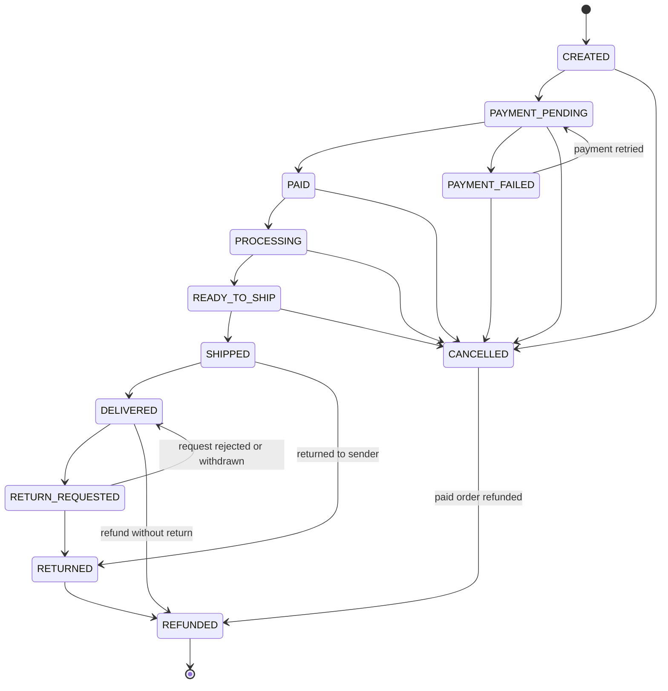
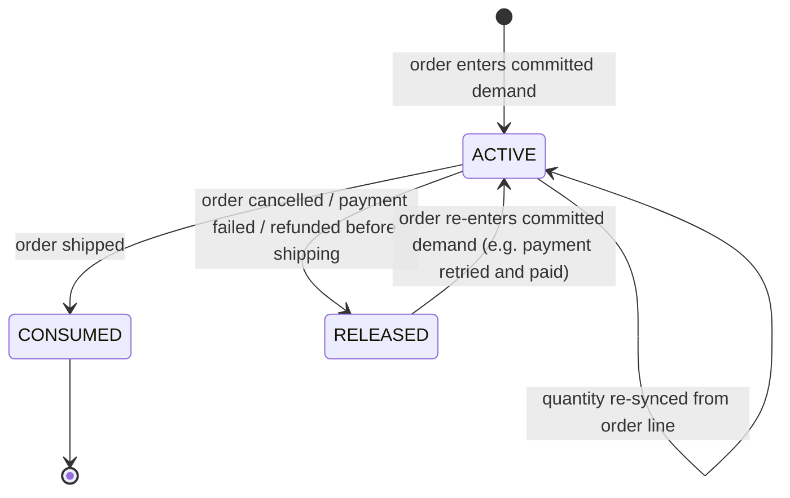
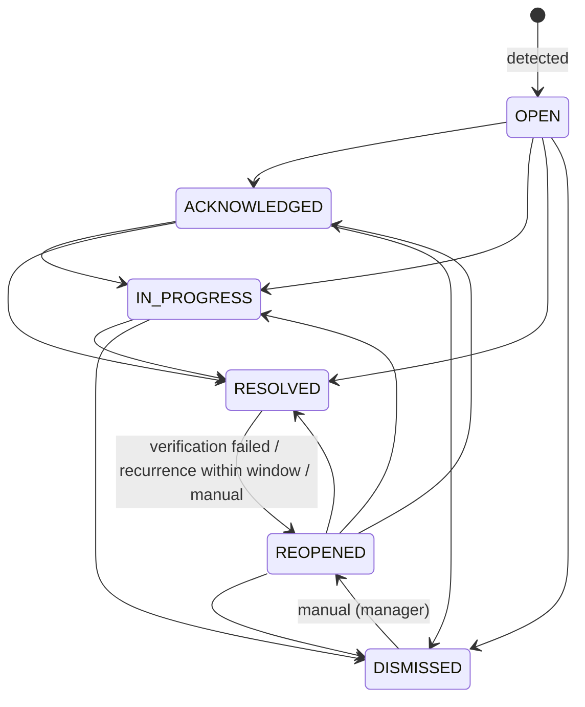
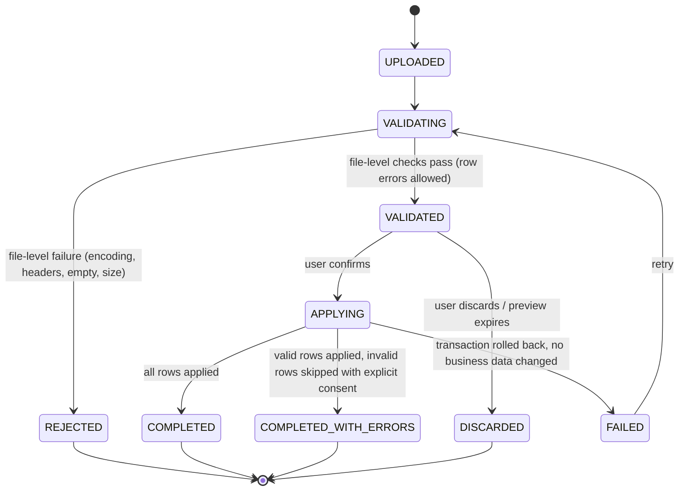

# State Machines

> **Status:** Canonical (v1). Code in `apps/api/app/domains/*/state.py` must implement exactly these
> transitions. Any change requires an ADR in `docs/decisions/` and an update to this file.

RetailOps Intelligence tracks four lifecycles. Each lifecycle is a finite state machine with an
explicit transition table. No service, import, or API endpoint may set a status field directly;
every change goes through the domain transition function, which validates the move and writes an
event/audit record.

1. [Order lifecycle](#1-order-lifecycle) (with independent payment and fulfillment axes)
2. [Stock reservation lifecycle](#2-stock-reservation-lifecycle)
3. [Operational exception lifecycle](#3-operational-exception-lifecycle)
4. [Data import lifecycle](#4-data-import-lifecycle)

---

## 1. Order lifecycle

### 1.1 Three separate axes

An order carries three status fields because they describe different business facts:

| Field | Question it answers | Values |
|---|---|---|
| `status` | Where is the order in its overall lifecycle? | `CREATED`, `PAYMENT_PENDING`, `PAYMENT_FAILED`, `PAID`, `PROCESSING`, `READY_TO_SHIP`, `SHIPPED`, `DELIVERED`, `RETURN_REQUESTED`, `RETURNED`, `CANCELLED`, `REFUNDED` |
| `payment_status` | Where is the customer's money? | `PENDING`, `PAID`, `FAILED`, `REFUNDED` |
| `fulfillment_status` | Where are the goods? | `UNFULFILLED`, `IN_PROGRESS`, `SHIPPED`, `DELIVERED`, `RETURNED` |

Keeping the axes separate matters most in the terminal states. A `CANCELLED` order with
`payment_status = PAID` means the store still owes the customer a refund. A `REFUNDED` order with
`fulfillment_status = DELIVERED` means the customer kept the goods and got their money back. If
everything were collapsed into one field, both facts would be lost.

### 1.2 Lifecycle transitions

| From | Allowed targets |
|---|---|
| `CREATED` | `PAYMENT_PENDING`, `CANCELLED` |
| `PAYMENT_PENDING` | `PAID`, `PAYMENT_FAILED`, `CANCELLED` |
| `PAYMENT_FAILED` | `PAYMENT_PENDING`, `CANCELLED` |
| `PAID` | `PROCESSING`, `CANCELLED` |
| `PROCESSING` | `READY_TO_SHIP`, `CANCELLED` |
| `READY_TO_SHIP` | `SHIPPED`, `CANCELLED` |
| `SHIPPED` | `DELIVERED`, `RETURNED` |
| `DELIVERED` | `RETURN_REQUESTED`, `REFUNDED` |
| `RETURN_REQUESTED` | `RETURNED`, `DELIVERED` |
| `RETURNED` | `REFUNDED` |
| `CANCELLED` | `REFUNDED` (only when `payment_status` was `PAID`) |
| `REFUNDED` | none (terminal) |

`DELIVERED` and `RETURNED` are not terminal: they can still move to a refund or return state.
`CANCELLED` is terminal for unpaid orders.

**Import synchronisation.** The product ingests order snapshots exported from source systems,
and those exports often skip intermediate states (an order exported as `PAID` yesterday can show
up as `SHIPPED` today). An import may move an existing order to any state that is **reachable**
from its current state through the graph above, such as `PAID → SHIPPED` through
`PROCESSING → READY_TO_SHIP`. A move to an unreachable state is rejected as a row-level error,
for example `DELIVERED → PAID` or `CANCELLED → SHIPPED`. The order event history records the
transition with `source = IMPORT` and lists the states that were skipped.

### 1.3 Axis compatibility matrix

Every persisted order must satisfy this matrix. Imports reject rows that violate it (error code
`ORDER_INVALID_STATUS_COMBINATION`).

| `status` | allowed `payment_status` | allowed `fulfillment_status` |
|---|---|---|
| `CREATED` | `PENDING` | `UNFULFILLED` |
| `PAYMENT_PENDING` | `PENDING` | `UNFULFILLED` |
| `PAYMENT_FAILED` | `FAILED` | `UNFULFILLED` |
| `PAID` | `PAID` | `UNFULFILLED` |
| `PROCESSING` | `PAID` | `IN_PROGRESS` |
| `READY_TO_SHIP` | `PAID` | `IN_PROGRESS` |
| `SHIPPED` | `PAID` | `SHIPPED` |
| `DELIVERED` | `PAID` | `DELIVERED` |
| `RETURN_REQUESTED` | `PAID` | `DELIVERED` |
| `RETURNED` | `PAID` | `RETURNED` |
| `CANCELLED` | `PENDING`, `FAILED`, `PAID` | `UNFULFILLED` |
| `REFUNDED` | `REFUNDED` | `UNFULFILLED`, `DELIVERED`, `RETURNED` |

The import format may leave `fulfillment_status` out. In that case it is derived from `status`
using the first allowed value, except for `REFUNDED`, which then requires the column.

### 1.4 Required timestamps and temporal rules

| Condition | Required field |
|---|---|
| always | `placed_at` |
| `payment_status ∈ {PAID, REFUNDED}` | `paid_at` |
| `fulfillment_status ∈ {SHIPPED, DELIVERED, RETURNED}` | `shipped_at` |
| `fulfillment_status ∈ {DELIVERED}` or `status ∈ {RETURN_REQUESTED}` | `delivered_at` |
| `status = CANCELLED` | `cancelled_at` |

Ordering: `placed_at ≤ paid_at ≤ shipped_at ≤ delivered_at` whenever the later field is present.
All timestamps are stored as UTC (`timestamptz`). See `BUSINESS_RULES.md §5` for time-zone handling.

### 1.5 Effect on stock reservations

| `status` | Demand classification | Reservation effect |
|---|---|---|
| `CREATED`, `PAYMENT_PENDING` | **Pending demand** (not reserved) | none |
| `PAYMENT_FAILED` | no demand | none / release if previously active |
| `PAID`, `PROCESSING`, `READY_TO_SHIP` | **Committed demand** | ensure an `ACTIVE` reservation per order line |
| `SHIPPED`, `DELIVERED`, `RETURN_REQUESTED`, `RETURNED` | fulfilled | reservation `CONSUMED`; shipment movement written (see `BUSINESS_RULES.md §2.4`) |
| `CANCELLED` | no demand | reservation `RELEASED` |
| `REFUNDED` | no demand | `RELEASED` if never shipped, otherwise stays `CONSUMED` |

---

## 2. Stock reservation lifecycle

A reservation holds stock for one order line. There is one reservation per `order_item`.

Invariant (checked by the reconciliation job and by tests):
`inventory_balance.reserved = Σ quantity of ACTIVE reservations for that product`.

---

## 3. Operational exception lifecycle

### 3.1 States

| State | Meaning | Active? |
|---|---|---|
| `OPEN` | Detected and not yet looked at by a person | yes |
| `ACKNOWLEDGED` | Someone has seen it and accepted it is real; work not started | yes |
| `IN_PROGRESS` | An owner is actively working on it | yes |
| `REOPENED` | Was resolved, but the condition was still present or came back | yes |
| `RESOLVED` | Addressed. Either the condition cleared (system) or a person resolved it | no |
| `DISMISSED` | A manager decided no action is needed (false positive, accepted risk, duplicate) | no |

### 3.2 Transitions

| Transition | Actor | Permission | Preconditions / required input |
|---|---|---|---|
| `OPEN → ACKNOWLEDGED` | user | `exceptions.work` | none |
| `* → IN_PROGRESS` | user | `exceptions.work` | must have an assignee; if none, the actor is assigned automatically. Staff may only start work on exceptions that are unassigned or assigned to them |
| `* → RESOLVED` (manual) | user | `exceptions.work` | actor is the assignee **or** holds `exceptions.manage`; `resolution_code` and `resolution_note` (≥ 10 chars) are required |
| `* → RESOLVED` (automatic) | system | n/a | condition no longer detected; `resolution_code = CONDITION_CLEARED` |
| `* → RESOLVED` (superseded) | system | n/a | a more severe exception for the same entity was raised; `resolution_code = SUPERSEDED`, `superseded_by_id` set |
| `* → DISMISSED` | user | `exceptions.manage` | `dismissal_reason ∈ {FALSE_POSITIVE, ACCEPTED_RISK, DUPLICATE, NOT_ACTIONABLE}` and a note are required |
| `RESOLVED → REOPENED` | system | n/a | see §3.4 |
| `RESOLVED/DISMISSED → REOPENED` | user | `exceptions.manage` | `reason` note required |

Assignment is a separate attribute, not a state. Assigning or reassigning needs
`exceptions.assign`. One exception: staff with `exceptions.work` can claim an unassigned
exception for themselves. Every assignment change is recorded as an `ExceptionAssignment` row and
an `ASSIGNED` event.

Manual resolution codes: `STOCK_REPLENISHED`, `ORDER_FULFILLED`, `REFUND_ISSUED`,
`DATA_CORRECTED`, `CUSTOMER_CONTACTED`, `FIXED_IN_SOURCE_SYSTEM`, `OTHER`.

### 3.3 Detection and deduplication

Each detection rule emits findings with a deterministic **dedup key**
(`{exception_type}:{entity_type}:{entity_id}`; see `EXCEPTION_CATALOG.md`). One evaluation run,
for each rule it executed, reconciles findings against the latest stored exception for each key:

| Latest exception for key | Finding present in this run | Finding absent in this run |
|---|---|---|
| none | **create** `OPEN` exception | nothing |
| active (`OPEN`/`ACKNOWLEDGED`/`IN_PROGRESS`/`REOPENED`) | **refresh**: update evidence snapshot, `last_detected_at`, `detection_count`, severity, priority. Write an `EVIDENCE_UPDATED` event only if the evidence changed materially, and a `SEVERITY_CHANGED` event if severity changed | **auto-resolve** with `CONDITION_CLEARED` |
| `RESOLVED` by a user, condition still present at the first evaluation after resolution | **reopen** (`REOPENED`, reason `VERIFICATION_FAILED`) | nothing (resolution verified; `verified_at` set) |
| `RESOLVED`, condition cleared and then re-detected within `reopen_window_hours` (default 72) of `resolved_at` | **reopen** (reason `RECURRED_WITHIN_WINDOW`) | nothing |
| `RESOLVED`, re-detected after the window | **create** a new `OPEN` exception with `previous_occurrence_id` linking the old one | nothing |
| `DISMISSED`, condition never cleared since dismissal | update `last_detected_at` only; no event, stays dismissed | set `condition_cleared_at` |
| `DISMISSED`, condition had cleared (`condition_cleared_at` set) and is detected again | **create** a new `OPEN` exception linked via `previous_occurrence_id` | nothing |

Only the rules that actually ran in an evaluation can auto-resolve exceptions. A run limited to
inventory rules never resolves order exceptions.

### 3.4 Why a manual resolution can be reopened

Value proposition #7 ("Was the issue actually resolved?") is enforced here. When a person marks an
exception resolved, the next evaluation checks the underlying condition. If the condition is still
there, the exception returns to `REOPENED` with the reason `VERIFICATION_FAILED`. For long-running
work, such as waiting on a supplier delivery, the owner keeps the exception `IN_PROGRESS` with a
note. When the stock arrives, the system resolves it automatically (`CONDITION_CLEARED`).

---

## 4. Data import lifecycle

- A `VALIDATED` import with row errors can be applied in only two ways. In **strict** mode it is
  blocked until the file is corrected and re-uploaded. In **valid-rows-only** mode the user must
  explicitly confirm the skipped-row count. Skipped rows are persisted as `ImportError` records and
  can be downloaded as a CSV. Nothing is skipped silently.
- `APPLYING` runs in one database transaction. A failure rolls back every business-data change.
- A preview expires after 24 hours (`DISCARDED`), because data may have changed since validation.
- After `COMPLETED` / `COMPLETED_WITH_ERRORS`, an exception evaluation run with
  `trigger = IMPORT` starts automatically.
