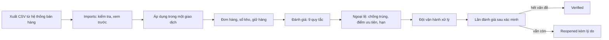
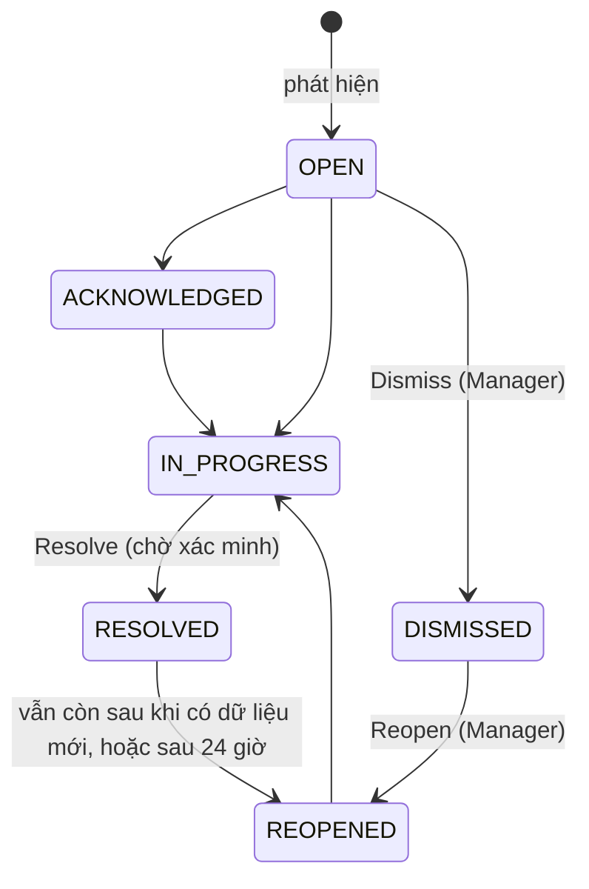

# Hướng dẫn demo và triển khai RetailOps Intelligence

Tài liệu này dành cho người trình bày và người triển khai sản phẩm. Nó gồm: cách chạy, kịch bản
demo, giải thích từng màn hình (vì sao có, dùng để làm gì, chức năng gì, luồng thao tác ra sao), các
luồng nghiệp vụ chính và cách thiết lập cho một khách hàng thật.

Giao diện sản phẩm dùng tiếng Anh, nên tên nút và tên màn hình được giữ nguyên như trên màn hình
(ví dụ **Run analysis**), kèm giải thích tiếng Việt.

> **Tình trạng (01/11/2026):** bản v1.0 đã hoàn thiện về tính năng và được kiểm thử tự động toàn bộ
> (backend 876 test, web 268 test, 18 test end-to-end chạy trên cả máy local và GitHub Actions, quét
> trợ năng WCAG 2.1 AA sạch trên 12 màn hình). **Chưa triển khai lên Internet**: cần chọn nhà cung cấp
> hosting. Xem mục [10](#10-giới-hạn-hiện-tại).

## Mục lục

1. [Sản phẩm giải quyết vấn đề gì](#1-sản-phẩm-giải-quyết-vấn-đề-gì)
2. [Chạy sản phẩm](#2-chạy-sản-phẩm)
3. [Kịch bản demo 15 phút](#3-kịch-bản-demo-15-phút)
4. [Giải thích từng màn hình](#4-giải-thích-từng-màn-hình)
5. [Luồng nghiệp vụ chính](#5-luồng-nghiệp-vụ-chính)
6. [Vai trò và quyền](#6-vai-trò-và-quyền)
7. [Thiết lập cho khách hàng thật](#7-thiết-lập-cho-khách-hàng-thật)
8. [Chuẩn bị dữ liệu CSV](#8-chuẩn-bị-dữ-liệu-csv)
9. [Vận hành hằng ngày](#9-vận-hành-hằng-ngày)
10. [Giới hạn hiện tại](#10-giới-hạn-hiện-tại)
11. [Xử lý sự cố thường gặp](#11-xử-lý-sự-cố-thường-gặp)

---

## 1. Sản phẩm giải quyết vấn đề gì

**Bối cảnh.** Các shop online vừa và nhỏ quản lý đơn hàng, tồn kho và hoàn tiền trên nhiều hệ thống
và file Excel rời rạc. Sự cố chỉ lộ ra khi đã gây thiệt hại:

- bán vượt số hàng thật có trong kho (oversold);
- đơn đã thanh toán nhưng quá hạn giao cho đơn vị vận chuyển;
- đơn đã huỷ nhưng tiền vẫn chưa hoàn cho khách;
- dữ liệu không khớp (tổng tiền đơn sai, tồn kho âm).

**Sản phẩm làm gì.** RetailOps Intelligence nhập dữ liệu từ file CSV, dùng **9 quy tắc nghiệp vụ cố
định** (không dùng AI để phát hiện) để tìm "ngoại lệ vận hành" (exception), xếp ưu tiên, cho đội vận hành
giao việc, điều tra, xử lý và **xác minh** rằng vấn đề đã thật sự hết. AI copilot chỉ giải thích bằng
chứng và gợi ý bước tiếp theo, **không bao giờ tự sửa dữ liệu**.

**Bảy câu hỏi mà mỗi ngoại lệ trả lời được:**

| Câu hỏi | Trả lời ở đâu |
|---|---|
| 1. Chuyện gì đang xảy ra? | Overview, Exceptions inbox |
| 2. Cái gì sai? | Tiêu đề và loại của ngoại lệ |
| 3. Vì sao quan trọng? | Mục *Why this priority* (điểm ưu tiên và cách tính) |
| 4. Bằng chứng là gì? | *How this was detected* và *Evidence*, mỗi dòng có liên kết tới bản ghi gốc |
| 5. Nên làm gì tiếp? | *Recommended action* (do quy tắc sinh ra) và AI investigation |
| 6. Ai phụ trách? | Assignee, hạn xử lý (due) |
| 7. Đã thật sự giải quyết chưa? | Trạng thái "Resolved — awaiting verification" rồi "Verified" hoặc tự mở lại |

Câu 7 là điểm khác biệt: khi người dùng bấm "đã xử lý", hệ thống **chưa tin ngay**. Lần đánh giá sau
khi có dữ liệu mới sẽ kiểm tra lại; nếu điều kiện vẫn còn, ngoại lệ tự mở lại kèm lý do.

---

## 2. Chạy sản phẩm

### 2.1 Cách nhanh nhất: Docker (dùng cho demo)

Yêu cầu: Docker Desktop (có Compose v2).

```bash
cd retailops-intelligence
docker compose up --build
```

Mở <http://localhost:3000> và bấm **Explore the demo**. Lần đầu khởi động, hệ thống tự tạo cửa hàng
giả lập "Kestrel Home & Kitchen" (114 sản phẩm, khoảng 1.550 đơn trong 60 ngày, 8 nhà cung cấp, đủ 9
loại ngoại lệ và lịch sử làm việc của một đội vận hành). Mọi dữ liệu đều là hư cấu.

### 2.2 Muốn demo các thao tác thay đổi dữ liệu (đăng nhập bằng tài khoản nhân viên)

Chế độ **Explore the demo** chỉ cho xem. Để demo thao tác (giao việc, ghi chú, xử lý, nhập CSV),
đặt mật khẩu cho các tài khoản nhân viên giả lập **trước khi** tạo dữ liệu:

```bash
DEMO_STAFF_PASSWORD='mat-khau-do-ban-chon' docker compose up --build
# nếu stack đã chạy trước đó (dữ liệu đã tạo với mật khẩu ngẫu nhiên), tạo lại dữ liệu demo:
DEMO_STAFF_PASSWORD='mat-khau-do-ban-chon' make stack-demo-reset
```

| Email | Vai trò | Dùng để demo |
|---|---|---|
| `owner@kestrel.example` (Jordan Ellis) | Owner | Quản lý thành viên, cài đặt |
| `manager@kestrel.example` (Priya Raman) | Manager | Phân loại, giao việc, xử lý, nhập dữ liệu, chạy phân tích |
| `staff@kestrel.example` (Marcus Lee) | Staff | Làm các ngoại lệ được giao |
| `sofia@kestrel.example` (Sofia Alvarez) | Staff | Như trên |
| `analyst@kestrel.example` (Daniel Kim) | Analyst | Xem mọi thứ, hỏi copilot, xem audit log |

Mật khẩu này chỉ dùng cho máy local. Khi `APP_ENV=production`, hệ thống từ chối nó.

### 2.3 Khôi phục dữ liệu demo về trạng thái ban đầu

```bash
make stack-demo-reset        # khi chạy bằng Docker
make seed                    # khi chạy bằng môi trường phát triển (mục 2.4)
```

Dữ liệu được sinh **tương đối theo thời điểm hiện tại**, nên lúc nào cũng trông "mới".

### 2.4 Mười cửa hàng mẫu tiếng Việt (demo theo ngành)

Ngoài Kestrel (tiếng Anh, USD) còn có 10 shop hư cấu bằng tiếng Việt, mỗi ngành một shop, tiền VND,
giờ Việt Nam. Mỗi shop có sẵn 10 sự cố để demo:

```bash
SAMPLE_OWNER_PASSWORD='mat-khau-tuy-chon' make stack-load-sample-stores   # trong Docker
```

Đăng nhập bằng `owner@<tên-shop>.example`, ví dụ `owner@pet-vui.example`. Danh sách shop:
[`sample-data/stores-vn`](../../sample-data/stores-vn/README.md). Quy trình chào bán và onboarding một
shop thật: [`QUY_TRINH_BAN_VA_ONBOARDING.md`](QUY_TRINH_BAN_VA_ONBOARDING.md).

### 2.5 Môi trường phát triển (cho lập trình viên)

```bash
make setup                    # cài thư viện backend (Python 3.12 qua uv)
make migrate                  # chạy PostgreSQL bằng Docker và áp dụng migration
make seed                     # tạo dữ liệu demo
make api-dev                  # API: http://localhost:8000 (tài liệu API: /api/docs)
pnpm install && pnpm web:dev  # web: http://localhost:3000
```

---

## 3. Kịch bản demo 15 phút

Dành cho nhà tuyển dụng, khách hàng hoặc buổi phỏng vấn kỹ thuật. Mỗi bước có **câu nói gợi ý**.

### Phần 1: xem với vai trò khách (8 phút, nút Explore the demo)

1. **Màn hình đăng nhập → Explore the demo.**
   *"Không cần đăng ký. Đây là cửa hàng hư cấu, chế độ chỉ đọc, nên ai cũng xem được mà không làm hỏng dữ liệu."*
2. **Overview.** Chỉ vào thanh "Demo data" ở trên cùng, các ô KPI, danh sách *Needs attention*.
   *"Mỗi buổi sáng quản lý mở màn hình này: 15 ngoại lệ đang mở, 2 cái mức P1. Danh sách xếp theo
   điểm ưu tiên, không theo thời gian. Giá trị rủi ro tính riêng từng nhóm và không cộng dồn, vì
   một đơn có thể nằm trong nhiều nhóm."*
3. **Mở ngoại lệ đầu tiên** (thường là đơn quá hạn giao, hoặc đơn huỷ chưa hoàn tiền).
   - *Why this priority*: *"Điểm 73/100 đến từ 5 thành phần: mức nghiêm trọng, số đơn bị ảnh
     hưởng, giá trị rủi ro theo thang log, hạn chót, và thời gian chưa xử lý. Không phải hộp đen."*
   - *How this was detected* và *Evidence*: *"Mỗi con số đều có liên kết tới bản ghi gốc."*
4. **Bấm Generate investigation** ở khung AI investigation bên phải.
   *"AI chỉ đọc qua 11 công cụ chỉ-đọc đã được cấp phép. Mỗi dữ kiện có tham chiếu; phần dưới ghi rõ
   câu trả lời do engine nào tạo. Không có API key thì engine quy tắc vẫn trả lời từ cùng dữ liệu."*
5. **Copilot.** Bấm câu hỏi gợi ý *"Which orders are overdue, and why?"*.
   Chỉ vào các mục **Facts / Metrics / Estimates / Recommendations / Limitations** và các chip tham chiếu.
6. **Exceptions inbox.** Đổi giữa các chế độ xem *Triage*, *All active*, *Closed*; lọc theo nhóm;
   mở *How resolution works*.
7. **Orders.** Tìm `KHK-12030`: đơn đã huỷ nhưng vẫn đã thanh toán.
   *"Đơn có 3 trục trạng thái riêng: vòng đời, thanh toán, giao hàng. Gộp chung thì sẽ mất thông
   tin là còn nợ khách tiền hoàn."*
8. **Inventory.** Bật lọc *Oversold* và *Data issue*. Mở sản phẩm `KHK-BW-003` (tồn kho âm).
   *"Tồn âm là dữ liệu sai chứ không phải bán vượt, nên hệ thống tách riêng thành vấn đề dữ liệu."*

### Phần 2: thao tác với vai trò Manager (7 phút, cần mục 2.2)

1. **Đăng xuất (menu tài khoản góc phải) → đăng nhập `manager@kestrel.example`.**
2. Mở một ngoại lệ đang **Open**: **Acknowledge**, rồi **Start work** (tự giao cho mình).
3. **Draft with copilot**: AI viết nháp ghi chú vào ô soạn thảo **nhưng chưa lưu**. Sửa lại rồi
   bấm **Save note**. Ghi chú hiện nhãn "AI draft, accepted by Priya Raman".
   *"Con người quyết định, AI chỉ đề xuất. Không có gì được lưu nếu người dùng chưa bấm."*
4. **Resolve…**: chọn cách đã xử lý, ghi chú ít nhất 10 ký tự. Trạng thái thành
   *"Resolved — awaiting verification"*.
   *"Lần nhập dữ liệu tiếp theo sẽ xác minh. Nếu vẫn thiếu hàng, ngoại lệ tự mở lại kèm lý do."*
5. **Imports → New import**: chọn *1. Products*, tải template, sửa vài dòng (cố tình để một dòng
   sai), tải lên. Xem phần preview, danh sách lỗi, chọn *Valid rows only*, xác nhận số dòng bị bỏ
   qua rồi apply. Bấm **View new exceptions** để xem lần phân tích sau khi nhập đã tìm thấy gì.
6. **Overview → Run analysis** để chạy đánh giá ngay lập tức.
7. (Tuỳ chọn, đăng nhập Owner) **Users & roles**, **Settings**, **Audit log**: mọi thay đổi đều
   có người thực hiện và thời gian.

### Câu hỏi hay gặp khi demo

| Câu hỏi | Trả lời ngắn |
|---|---|
| AI có tự sửa dữ liệu không? | Không. Copilot chỉ có công cụ chỉ-đọc; không có công cụ ghi và không có SQL tuỳ ý. |
| Không có API key AI thì sao? | Engine quy tắc (deterministic) trả lời từ cùng công cụ, câu trả lời ghi rõ nguồn. |
| Dùng model nào? | Gemini gói miễn phí hoặc model miễn phí tương thích OpenAI; hết quota thì tự chuyển sang engine quy tắc. |
| Phát hiện bằng AI à? | Không. Chín quy tắc cố định, có test cho từng điều kiện biên. |
| Dữ liệu khách hàng thật? | Sản phẩm không lưu tên, địa chỉ, email khách mua hàng; chỉ có mã khách hàng. |
| Nhiều cửa hàng / nhiều công ty? | Có cách ly theo tổ chức và cửa hàng; truy cập chéo trả về 404. |

---

## 4. Giải thích từng màn hình

Mọi màn hình trong cửa hàng có đường dẫn dạng `/s/{storeId}/...`. Thanh bên trái nhóm các màn hình
theo công việc:

| Nhóm | Màn hình |
|---|---|
| (đầu) | Overview |
| OPERATIONS | Exceptions |
| COMMERCE | Orders, Products, Inventory, Movements |
| INTELLIGENCE | Copilot |
| DATA | Imports |
| ADMINISTRATION | Users & roles, Settings, Audit log |

Thanh bên chỉ hiện những màn hình mà vai trò của người dùng được mở. Mọi màn hình danh sách đều có
trạng thái đang tải, trống, lỗi (kèm nút thử lại và mã yêu cầu) và "không có quyền". Nút nào bị khoá
đều giải thích lý do khi rê chuột hoặc focus bằng bàn phím.

### 4.1 Sign in (`/login`) và Demo (`/demo`)

- **Vì sao có:** bảo mật; v1 không có tự đăng ký, tài khoản do Owner tạo.
- **Mục đích:** đăng nhập bằng email và mật khẩu, hoặc vào demo chỉ-đọc không cần đăng ký.
- **Chức năng:**
  - ô Email, Password (nút hiện/ẩn mật khẩu), nút **Sign in**;
  - thẻ **Explore the demo**, chỉ hiện khi bản cài đặt có demo. Bản cài cho khách hàng không có
    demo nên thẻ này ẩn đi;
  - thông báo khi phiên hết hạn hoặc vừa đăng xuất; đếm ngược khi bị giới hạn số lần thử;
  - `/demo` là trang giới thiệu có thể chia sẻ, với nút **Start the demo**.
- **Luồng:** mở trang → hệ thống lấy token CSRF → gửi đăng nhập → vào Overview của cửa hàng đầu tiên.
  Đăng nhập sai nhiều lần thì bị chặn tạm thời: 5 lần mỗi phút cho mỗi IP và email. Riêng nút demo
  giới hạn 5 lần mỗi phút cho mỗi IP.

### 4.2 Khung ứng dụng (dùng chung mọi màn hình)

- **Thanh "Demo data"** (chỉ trong demo): nhắc rằng dữ liệu là giả lập; nút **Leave demo**.
- **Thanh bên:** tên cửa hàng, tiền tệ, múi giờ; các nhóm điều hướng; nút **Collapse** để thu gọn.
  Trên điện thoại, thanh bên thành menu trượt.
- **Thanh trên:** tên mục hiện tại; **menu tài khoản** (chữ cái đầu của tên) để đăng xuất.
- **Trợ năng:** liên kết "Skip to content" khi nhấn Tab lần đầu; dùng được hoàn toàn bằng bàn phím.
- **Mất mạng:** hiện thông báo offline.

### 4.3 Overview (`/overview`)

- **Vì sao có:** chủ shop và quản lý cần biết trong 30 giây "hôm nay cần lo gì".
- **Mục đích:** bức tranh vận hành tức thời và danh sách ưu tiên.
- **Chức năng:**
  - **Độ tươi dữ liệu:** lần đánh giá gần nhất, lần nhập dữ liệu gần nhất theo từng loại;
  - **Run analysis**: chạy đánh giá ngay (Owner, Manager);
  - **Ô KPI:** Active exceptions (số P1, P2), Unassigned, Past due exceptions, Overdue orders (kèm
    giá trị gộp), Awaiting shipment (đã trả tiền, chưa gửi), On-time shipments 30 ngày (dạng "684 of 684");
  - **Needs attention:** các ngoại lệ ưu tiên cao nhất (băng P1–P4 · điểm, mức nghiêm trọng, tiêu
    đề, mã EXC-…, hạn, người phụ trách, trạng thái) và liên kết **Open triage queue**;
  - **Active exceptions by category:** số lượng và giá trị rủi ro theo nhóm Inventory, Fulfillment,
    Payment, Data quality, không cộng tổng (một đơn có thể thuộc nhiều nhóm);
  - **Stock health:** số sản phẩm Oversold, Out of stock, Below reorder point, Approaching, Healthy,
    Data issue, mỗi dòng mở ra danh sách tồn kho đã lọc;
  - cửa hàng mới chưa có dữ liệu thì hiện "No data yet", hướng dẫn thứ tự nhập và liên kết tải 4 template CSV.
- **Luồng:** mở Overview → bấm một dòng trong *Needs attention* → vào trang chi tiết ngoại lệ.

### 4.4 Exceptions inbox (`/exceptions`)

- **Vì sao có:** nơi làm việc chính của đội vận hành; thay cho việc dò thủ công nhiều bảng Excel.
- **Mục đích:** phân loại, lọc và chọn việc cần làm.
- **Chức năng:**
  - **Chế độ xem:** *Triage* (cần phân loại), *All active*, *Assigned to me*, *Unassigned*, *Closed*;
  - **Bộ lọc:** trạng thái, mức nghiêm trọng, nhóm, loại quy tắc, băng ưu tiên, người phụ trách,
    hạn (*Overdue*, *Due within 24 h*);
  - tìm theo mã EXC-… hoặc tiêu đề; sắp xếp (mặc định theo ưu tiên); đổi mật độ dòng;
  - **How resolution works:** giải thích vòng đời và cơ chế xác minh;
  - trạng thái bộ lọc nằm trên URL nên có thể chia sẻ đường dẫn.
- **Luồng:** chọn chế độ xem → lọc → mở ngoại lệ. Trên trang chi tiết có nút chuyển sang ngoại lệ
  trước hoặc sau trong cùng hàng đợi.

### 4.5 Exception detail (`/exceptions/{id}`): màn hình quan trọng nhất

- **Vì sao có:** để một người có thể hiểu và xử lý vấn đề mà không phải tự tra cứu ở nơi khác.
- **Mục đích:** điều tra, giao việc, xử lý và theo dõi một ngoại lệ.
- **Chức năng, từ trên xuống:**
  1. **Đầu trang:** breadcrumb, vị trí trong hàng đợi ("1 of 15", **Previous**, **Next in queue**),
     tiêu đề, mã EXC-… (có nút sao chép), loại, nhóm, đối tượng (đơn hoặc sản phẩm), mã quy tắc.
  2. **Nhãn:** mức nghiêm trọng (Critical/High/Medium/Low), băng · điểm (ví dụ P1 · 73), trạng thái,
     **Assignee** (bấm để giao), hạn xử lý; lần phát hiện đầu/cuối, số lần phát hiện.
  3. **Thanh hành động** (thay đổi theo trạng thái và quyền):

     | Trạng thái | Nút chính | Nút phụ | Menu More |
     |---|---|---|---|
     | Open | Acknowledge | Start work, Claim | Resolve…, Dismiss… |
     | Acknowledged | Start work | Claim, Resolve… | Dismiss… |
     | In progress | Resolve… | | Dismiss… |
     | Reopened | Start work | Acknowledge, Claim | Resolve…, Dismiss… |
     | Resolved / Dismissed | Reopen… | | |

  4. **Recommended action:** bước tiếp theo do quy tắc sinh ra (không phải AI).
  5. **Why this priority:** 5 thành phần điểm, mỗi thành phần có giải thích, cộng thành điểm /100.
  6. **How this was detected:** công thức và số liệu đầu vào tại thời điểm đánh giá.
  7. **Evidence:** bảng bằng chứng, mỗi dòng ghi nguồn và liên kết tới bản ghi.
  8. **Affected orders:** các đơn bị ảnh hưởng (với hàng bán vượt: số lượng được đáp ứng hay không).
  9. **Activity:** ô ghi chú, **Draft with copilot** (AI viết nháp), **Add note** hoặc **Save note**,
     lọc *All*/*Notes*, dòng thời gian gồm phát hiện, giao việc, đổi trạng thái, xác minh, mở lại.
  10. **AI investigation** (cột phải): **Generate investigation**, hỏi tiếp câu hỏi.
  11. **Details:** đối tượng, nhóm, loại, số lần phát hiện, số lần mở lại, ngoại lệ bị thay thế;
      *Technical details* cho người kỹ thuật.
- **Luồng điển hình:** Acknowledge → (giao việc hoặc Start work) → điều tra, ghi chú → **Resolve…**
  (chọn cách xử lý và ghi chú ≥ 10 ký tự) → *awaiting verification* → hệ thống xác minh.
  **Dismiss…** (bỏ qua có lý do: báo động sai, chấp nhận rủi ro…) chỉ dành cho Owner/Manager.
- **Khi hai người sửa cùng lúc:** người sau nhận thông báo "đã có người cập nhật", trang tải lại dữ liệu mới.

### 4.6 Orders (`/orders`) và Order detail (`/orders/{id}`)

- **Vì sao có:** nhân viên cần xem nhanh một đơn khi điều tra ngoại lệ hoặc khi khách hỏi.
- **Danh sách:** tìm theo mã đơn hoặc mã khách; lọc **Status**, **Payment**, **Fulfillment**,
  **Channel**, ngày đặt; sắp xếp; nút **Import orders**.
- **Chi tiết:**
  - **Status:** 3 trục riêng (vòng đời / thanh toán / giao hàng); cảnh báo khi đơn huỷ mà chưa hoàn tiền;
  - **Key dates:** đặt, thanh toán, hạn giao (kèm nguồn: từ file hoặc theo SLA), gửi, nhận, huỷ;
  - **Totals:** tạm tính, giảm giá, phí ship, thuế, tổng, đối chiếu với tổng các dòng hàng;
  - dòng hàng kèm trạng thái giữ hàng (reservation);
  - **Status history:** lịch sử trạng thái, ghi lại cả các bước bị bỏ qua và lần import đã thay đổi đơn;
  - **Exceptions:** ngoại lệ liên quan tới đơn;
  - **Ask the copilot:** hỏi AI về đơn này.

### 4.7 Products (`/products`) và Product detail

- **Vì sao có:** danh mục hàng hoá là gốc của mọi phép tính tồn kho và ngoại lệ hàng hoá.
- **Danh sách:** tìm theo SKU hoặc tên, lọc theo trạng thái, nhóm, nhà cung cấp, tình trạng tồn.
- **Chi tiết:** phép tính tồn kho minh bạch (**on hand − reserved = available**), hàng sắp về, tình
  trạng tồn, tốc độ bán và số ngày đủ hàng (ghi rõ là *ước tính*), nhà cung cấp và thời gian giao,
  ngoại lệ đang mở, liên kết tới sổ biến động kho. Sản phẩm tồn âm có giải thích "Data issue".

### 4.8 Inventory (`/inventory`)

- **Vì sao có:** để thấy ngay mặt hàng nào sắp hết, đã hết hoặc bị bán vượt.
- **Chức năng:** thanh **Health** bật/tắt từng tình trạng (Oversold, Out of stock, Below reorder
  point, Approaching, Healthy, Data issue); tìm kiếm, lọc nhóm, sắp xếp; cột on hand, reserved,
  available, incoming, ngưỡng đặt hàng lại; nút **Import inventory adjustments**.
- **Luồng:** bật *Below reorder point* → mở sản phẩm → xem số ngày còn đủ hàng → đặt hàng ở hệ thống
  của mình → nhập phiếu nhập kho bằng CSV → ngoại lệ tự đóng khi tồn đã đủ.

### 4.9 Movements (`/inventory/movements`)

- **Vì sao có:** tồn kho phải truy vết được; sổ chỉ ghi thêm, không bao giờ sửa hay xoá.
- **Chức năng:** lọc theo **Product**, **Type** (kiểm kê, nhập, hàng hỏng, hao hụt, trả hàng nhập
  lại, điều chỉnh, xuất giao), **Source**, thời gian; mỗi dòng có tồn sau biến động và liên kết tới
  đơn hoặc lần import đã tạo ra nó.

### 4.10 Imports (`/imports`, `/imports/new`, `/imports/{id}`)

- **Vì sao có:** v1 lấy dữ liệu từ file CSV xuất ra từ hệ thống bán hàng; nhập sai thì mọi thứ phía
  sau đều sai, nên bước nhập phải kiểm tra kỹ và an toàn.
- **Danh sách:** lịch sử nhập (loại, trạng thái, người nhập, thời gian), lọc theo trạng thái; nút **New import**.
- **New import:** chọn loại (*1. Products*, *2. Inventory adjustments*, *3. Orders*, *4. Order items*);
  mỗi loại có **Template**; kéo thả hoặc chọn file (.csv, UTF-8, tối đa 5 MB và 20.000 dòng);
  **Upload and validate** kèm thanh tiến độ.
- **Trang import, 4 bước:** **Upload → Preview → Apply → Summary**:
  - **Preview:** số dòng tạo mới / cập nhật / không đổi / lỗi / cảnh báo; bảng *Expected changes*;
    bảng *Issues* (mã lỗi, dòng, cột, cách sửa) và **Download issues CSV**; hạn xem trước 24 giờ;
  - **Apply:** *Strict* (có lỗi là không cho áp dụng) hoặc *Valid rows only* (phải tích xác nhận
    "I understand that N rows will be skipped"); mọi thay đổi nằm trong một giao dịch duy nhất, lỗi
    giữa chừng thì không có gì bị đổi;
  - **Summary:** kết quả, **Analysis after import** (số ngoại lệ mới / làm mới / đã giải quyết / mở
    lại) và **View new exceptions**;
  - **Discard import** để huỷ bản xem trước; **Validate again** khi một lần áp dụng bị gián đoạn;
    cảnh báo khi tải lại đúng một file đã nhập (so sánh SHA-256).

### 4.11 Copilot (`/copilot`)

- **Vì sao có:** để hỏi dữ liệu bằng ngôn ngữ thường mà không phải biết lọc ở đâu.
- **Chức năng:**
  - danh sách hội thoại, **New conversation**, câu hỏi gợi ý (ví dụ *What should I work on first
    today?*, *Which orders are overdue, and why?*, *Which products could run out before their
    restock arrives?*, *What went wrong in the last import?*);
  - câu trả lời chia mục **Facts, Metrics, Estimates, Recommendations, Limitations**; mỗi dữ kiện có
    chip tham chiếu mở tới bản ghi;
  - nguồn tạo ghi rõ ("Generated by the deterministic engine" hoặc "Generated by LLM provider · …");
    mục *Data used* liệt kê các công cụ chỉ-đọc đã dùng;
  - giới hạn 20 câu hỏi/phút/người. Trong demo, mỗi phiên khách có lịch sử và hạn mức riêng.
- **Luồng:** hỏi → hệ thống chọn công cụ chỉ-đọc → lấy dữ liệu đúng cửa hàng và đúng quyền → kiểm tra
  mọi tham chiếu có thật → trả lời. Nếu nhà cung cấp AI lỗi, hết quota hoặc quá chậm, câu trả lời
  chuyển sang engine quy tắc và có thông báo.

### 4.12 Users & roles (`/admin/users`)

- **Vì sao có:** v1 không có tự đăng ký và không gửi email; Owner quản lý đội của mình.
- **Chức năng:**
  - danh sách thành viên (tên, email, vai trò, trạng thái);
  - **Add member**: tạo tài khoản với **mật khẩu tạm hiển thị đúng một lần** để chuyển cho người dùng;
  - **Change role…**, **Deactivate…** / **Reactivate…**; khoá tài khoản sẽ thu hồi mọi phiên đăng nhập;
  - chặn tự đổi vai trò của chính mình và chặn hạ quyền Owner cuối cùng;
  - tab **Roles and permissions**: ma trận quyền (chỉ xem; quyền được định nghĩa trong mã nguồn).
- **Quyền:** Owner quản lý; Manager chỉ xem.

### 4.13 Settings (`/admin/settings`)

- **Vì sao có:** mỗi shop có cam kết giao hàng và mức chịu rủi ro khác nhau.
- **Các ngưỡng:**

  | Cài đặt | Ý nghĩa | Mặc định |
  |---|---|---|
  | Fulfillment SLA | Số giờ từ lúc thanh toán tới hạn giao (khi file không có `ship_by`) | 48 giờ |
  | Stalled after | Đơn đã trả tiền mà chưa vào xử lý quá số giờ này thì báo | 12 giờ |
  | Refund overdue after | Đơn huỷ chưa hoàn tiền quá số giờ này thì báo | 24 giờ |
  | Approaching reorder factor | "Sắp tới ngưỡng" khi tồn ≤ ngưỡng × hệ số | 1,25 |
  | Sales velocity window | Số ngày dùng để tính tốc độ bán | 28 ngày |
  | Reopen window | Vấn đề tái diễn trong khoảng này thì mở lại ngoại lệ cũ | 72 giờ |
  | Analysis interval | Chu kỳ đánh giá tự động | 15 phút |
  | Exposure cap | Giá trị rủi ro (theo tiền tệ cửa hàng) đạt điểm tối đa trong thành phần "giá trị" | 5000 |

  Ngoài ra có trọng số điểm ưu tiên. Mỗi thay đổi phải xác nhận và được ghi vào audit log.
- **Quyền:** Owner, Manager sửa; vai trò khác chỉ xem.

### 4.14 Audit log (`/admin/audit-log`)

- **Vì sao có:** trả lời "ai đã làm gì, lúc nào" cho mọi thao tác thay đổi dữ liệu và bảo mật.
- **Chức năng:** lọc **Action**, **Actor**, **Period**; mở chi tiết từng sự kiện; liên kết tới đối
  tượng (ngoại lệ, lần import, cài đặt); sao chép request ID để đối chiếu log. Không bao giờ hiển thị
  địa chỉ IP hay trình duyệt.

---

## 5. Luồng nghiệp vụ chính

### 5.1 Từ dữ liệu tới ngoại lệ



Đánh giá chạy ở 3 thời điểm: ngay sau mỗi lần nhập, khi bấm **Run analysis**, và tự động theo chu kỳ
(mặc định 15 phút). Mỗi cửa hàng chỉ chạy một lượt tại một thời điểm.

### 5.2 Chín quy tắc phát hiện

| Quy tắc | Phát hiện khi | Mức độ |
|---|---|---|
| Oversold | Đơn đã thanh toán cần nhiều hàng hơn số đang có trong kho | Critical |
| Oversell risk | Đơn chưa thanh toán sẽ làm bán vượt nếu được thanh toán | High |
| Out of stock | Sản phẩm đang bán mà không còn hàng khả dụng | High/Medium |
| Below reorder point | Hàng khả dụng ≤ ngưỡng đặt lại (High nếu dự kiến hết trước khi hàng về) | High/Medium |
| Fulfillment overdue | Đơn đã thanh toán quá hạn giao | Medium → Critical theo số giờ trễ |
| Stalled after payment | Đơn đã thanh toán mà chưa vào xử lý quá ngưỡng | High/Medium |
| Refund pending | Đơn đã huỷ nhưng tiền vẫn ở trạng thái đã thanh toán | High → Critical |
| Order total mismatch | Tổng đơn không khớp với dòng hàng, giảm giá, phí ship, thuế | Medium/Low |
| Negative on hand | Tồn kho vật lý âm (dữ liệu sai; tạm dừng các quy tắc kho của sản phẩm đó) | High |

Mỗi điều kiện chỉ có **một** ngoại lệ đang mở tại một thời điểm. Phát hiện lại thì cập nhật ngoại lệ
cũ thay vì tạo thêm. Khi một tình trạng nặng hơn xuất hiện (ví dụ từ "dưới ngưỡng" sang "hết hàng"),
ngoại lệ cũ được đóng với lý do *superseded* và người phụ trách được chuyển sang ngoại lệ mới.

### 5.3 Vòng đời của một ngoại lệ



Khi điều kiện tự biến mất (ví dụ hàng đã về), hệ thống tự đóng ngoại lệ với lý do *condition cleared*.

### 5.4 Điểm ưu tiên (0–100)

`điểm = mức nghiêm trọng + số đơn bị ảnh hưởng + giá trị rủi ro + hạn chót + thời gian chưa xử lý`

| Thành phần | Cách tính | Tối đa |
|---|---|---|
| Mức nghiêm trọng | Critical 50, High 35, Medium 20, Low 8 | 50 |
| Số đơn bị ảnh hưởng | 3 điểm mỗi đơn | 15 |
| Giá trị rủi ro | Theo thang log tới *Exposure cap* | 15 |
| Hạn chót | Đã quá 12, trong 24 giờ 8, trong 72 giờ 4 | 12 |
| Thời gian chưa xử lý | 2 điểm mỗi ngày | 8 |

Băng ưu tiên: **P1 ≥ 70**, **P2 50–69**, **P3 30–49**, **P4 < 30**. Điểm dùng để xếp thứ tự công
việc, **không** phải số tiền bị mất.

### 5.5 Tồn kho

- `available = on_hand − reserved`. Hàng chỉ bị giữ khi đơn đã thanh toán và chưa gửi.
- Mọi thay đổi tồn kho là một dòng mới trong sổ kho, không bao giờ sửa dòng cũ.
- Phiếu kiểm kê (CYCLE_COUNT) áp dụng **tại thời điểm kiểm kê**, nên một file nhập muộn không làm trừ
  trùng các đơn đã gửi trước đó.

---

## 6. Vai trò và quyền

| Vai trò | Dành cho | Được làm |
|---|---|---|
| **Owner** | Chủ shop | Mọi thứ, kể cả quản lý thành viên |
| **Manager** | Quản lý vận hành | Mọi thứ trừ quản lý thành viên: giao việc, bỏ qua, mở lại, nhập dữ liệu, chạy phân tích, sửa cài đặt |
| **Staff** | Nhân viên vận hành | Xem dữ liệu; nhận, bắt đầu, xử lý ngoại lệ của mình; ghi chú; dùng copilot |
| **Analyst** | Phân tích | Xem mọi thứ, xem audit log, dùng copilot; không thay đổi gì |
| **Viewer** | Khách xem demo | Như Analyst; không bao giờ có quyền thay đổi |

Quyền được kiểm tra ở backend cho mọi yêu cầu, không chỉ ẩn nút trên giao diện. Truy cập dữ liệu của
tổ chức khác luôn trả về 404.

---

## 7. Thiết lập cho khách hàng thật

> Mục này dùng cho một bản cài đặt **không có cửa hàng demo**, dành riêng cho một khách hàng. Các
> lệnh đều đã được chạy thử.

### 7.1 Chuẩn bị máy chủ

- Một máy chủ Linux có Docker và Docker Compose v2 (2 CPU và 2–4 GB RAM là đủ cho một cửa hàng nhỏ).
- Một tên miền và HTTPS. Cổng web và API chỉ mở trên `127.0.0.1`, nên cần một reverse proxy cùng máy
  (Caddy hoặc Nginx) chuyển `https://ten-mien` tới `127.0.0.1:3000`.
- Mã nguồn: `git clone https://github.com/tinhne/retailops-intelligence.git`.

### 7.2 Cấu hình (`.env` ở thư mục gốc)

```bash
APP_ENV=production
SESSION_SECRET=<chạy: openssl rand -hex 32>
COOKIE_SECURE=true                 # bắt buộc khi chạy production (HTTPS)
DEMO_MODE_ENABLED=false            # không có demo cho khách hàng
POSTGRES_PASSWORD=<mật khẩu mạnh>
# Không đặt DEMO_STAFF_PASSWORD.
# Tuỳ chọn, AI miễn phí:
# LLM_PROVIDER=gemini
# GEMINI_API_KEY=<key miễn phí từ Google AI Studio>
```

Hệ thống **từ chối khởi động** nếu `APP_ENV=production` mà `SESSION_SECRET` vẫn là giá trị mặc định
(hoặc ngắn hơn 32 ký tự) hoặc `COOKIE_SECURE` khác `true`.

### 7.3 Khởi động (không tạo cửa hàng demo)

```bash
make stack-up-customer
```

Lệnh này chạy database, API (tự áp dụng migration), worker đánh giá định kỳ và web, **bỏ qua** bước
tạo dữ liệu demo. Trang đăng nhập sẽ không có thẻ "Explore the demo".

### 7.4 Tạo tổ chức, cửa hàng và tài khoản Owner

```bash
make stack-provision ARGS="--org-name 'Lotus Home' \
  --store-name 'Lotus Home Online' \
  --currency VND --timezone Asia/Ho_Chi_Minh \
  --owner-email chu.shop@lotushome.vn --owner-name 'Nguyễn Văn An' \
  --exposure-cap 100000000"
```

| Tham số | Bắt buộc | Ghi chú |
|---|---|---|
| `--org-name` | có | Tên công ty |
| `--store-name` | có | Tên cửa hàng hiển thị trong ứng dụng |
| `--currency` | có | Mã tiền tệ ISO 4217 (VND, USD…). Mọi file CSV phải dùng đúng mã này |
| `--timezone` | có | Múi giờ IANA, ví dụ `Asia/Ho_Chi_Minh` |
| `--owner-email`, `--owner-name` | có | Tài khoản Owner đầu tiên |
| `--exposure-cap` | không | Với VND nên đặt khoảng 100.000.000 (mặc định 5000 phù hợp USD) |
| `--slug`, `--store-code` | không | Tự sinh từ tên nếu bỏ trống |

Lệnh in ra mã tổ chức, mã cửa hàng và **mật khẩu tạm (chỉ hiển thị một lần)**. Chuyển mật khẩu này
cho chủ shop qua kênh an toàn. Thao tác được ghi vào audit log (`organization.provision`).

### 7.5 Owner hoàn tất thiết lập trong ứng dụng

1. Đăng nhập bằng email và mật khẩu tạm. Màn hình Overview hiện "No data yet".
2. **Users & roles → Add member** cho từng người (Manager, Staff, Analyst). Mỗi người nhận một mật
   khẩu tạm hiển thị một lần.
3. **Settings:** chỉnh SLA giao hàng, các ngưỡng và *Exposure cap* theo cách vận hành của shop.
4. Nhập dữ liệu ban đầu theo mục 8, theo đúng thứ tự.
5. Mở **Overview** và **Exceptions** để xem kết quả của lần đánh giá đầu tiên.

---

## 8. Chuẩn bị dữ liệu CSV

### 8.1 Thứ tự nhập (bắt buộc)

```text
1. products.csv → 2. inventory_adjustments.csv → 3. orders.csv → 4. order_items.csv
```

Dòng hàng (`order_items`) chỉ được nhận khi đơn và SKU đã tồn tại, nên phải nhập đơn trước. Template
tải được ngay trong màn hình **New import** (hoặc ở thư mục `sample-data/templates`). Bộ ví dụ hợp lệ
và các file lỗi mẫu nằm trong `sample-data/examples`.

### 8.2 Các cột

| File | Cột bắt buộc | Cột tuỳ chọn | Khoá |
|---|---|---|---|
| `products.csv` | `sku, name, status, unit_price, reorder_point` | `category, unit_cost, reorder_quantity, supplier_name, supplier_lead_time_days` | `sku` (cập nhật nếu đã có) |
| `inventory_adjustments.csv` | `reference, sku, adjustment_type, quantity, occurred_at` | `expected_at, note` | `reference` (nhập lại cùng mã thì bỏ qua, không trừ hai lần) |
| `orders.csv` | `order_number, placed_at, status, payment_status, currency, subtotal, total` | `channel, customer_ref, fulfillment_status, paid_at, ship_by, shipped_at, delivered_at, cancelled_at, discount_total, shipping_total, tax_total, carrier, tracking_number` | `order_number` |
| `order_items.csv` | `order_number, line_number, sku, quantity, unit_price` | `line_discount` | `order_number + line_number` |

### 8.3 Quy tắc quan trọng

- **Lần đầu:** nhập một phiếu `CYCLE_COUNT` (số kiểm kê thực tế) cho **mọi** sản phẩm đang bán. Nếu
  không, sản phẩm mới sẽ hiện "Out of stock" vì chưa có tồn.
- **adjustment_type:** `CYCLE_COUNT` (số kiểm kê tuyệt đối), `RECEIPT` (nhập hàng), `INCOMING_EXPECTED`
  (hàng đang về, kèm `expected_at`), `INCOMING_CANCELLED`, `DAMAGE`, `SHRINKAGE`, `RETURN_RESTOCK`,
  `CORRECTION` (số có dấu).
- **Thời gian:** định dạng ISO-8601, nên ghi rõ múi giờ, ví dụ `2026-11-01T09:30:00+07:00`. Nếu thiếu
  múi giờ, hệ thống hiểu theo múi giờ cửa hàng và hiện cảnh báo.
- **Tiền:** dùng dấu chấm thập phân, không dùng dấu phân cách hàng nghìn (`125000.00`); `currency`
  phải trùng tiền tệ cửa hàng.
- **Trạng thái đơn** phải hợp lệ theo 3 trục. Ví dụ `SHIPPED` thì `payment_status=PAID` và phải có
  `shipped_at`. Đơn đã nhập chỉ được chuyển sang trạng thái kế tiếp hợp lệ, ví dụ không quay
  `DELIVERED` về `PAID`.
- **Mã khách** (`customer_ref`) chỉ là mã tham chiếu; không đưa tên, địa chỉ, email hay số điện
  thoại khách vào file.
- Mỗi lỗi có mã và cách sửa trong bảng *Issues*. Tải **issues CSV**, sửa file gốc, rồi nhập lại.

### 8.4 Nhập định kỳ

Mỗi ngày (hoặc vài lần mỗi ngày) xuất lại đơn hàng và biến động kho từ hệ thống bán hàng rồi nhập
vào. Hệ thống **cập nhật theo khoá** nên nhập lại cả file không tạo trùng. Mỗi lần nhập đều kích hoạt
một lần đánh giá và xác minh các ngoại lệ đã được xử lý.

---

## 9. Vận hành hằng ngày

| Ai | Khi nào | Làm gì |
|---|---|---|
| Manager | Đầu ngày | Overview → *Open triage queue* → Acknowledge, giao việc, đặt hạn |
| Staff | Trong ngày | *Assigned to me* → Start work → ghi chú → Resolve… |
| Manager hoặc người phụ trách dữ liệu | Định kỳ | Nhập CSV mới; xem *Analysis after import* |
| Owner | Hằng tuần | Overview (tỉ lệ giao đúng hạn), Audit log, điều chỉnh Settings |

**Bảo trì máy chủ:**

```bash
# Sao lưu cơ sở dữ liệu (nên chạy hằng ngày, lưu bản sao ở nơi khác)
docker compose exec -T db pg_dump -U retailops retailops > backup-$(date +%F).sql
# Cập nhật phiên bản mới (migration tự chạy khi API khởi động)
git pull && make stack-up-customer
# Xem log
docker compose logs --tail 200 api worker
```

Chi tiết vận hành: [`docs/operations/RUNBOOK.md`](../operations/RUNBOOK.md) (tiếng Anh).

---

## 10. Giới hạn hiện tại

| Hạng mục | Tình trạng |
|---|---|
| Triển khai lên Internet và demo công khai | **Chưa làm.** Cần chọn hosting; mọi thứ khác đã sẵn sàng |
| AI với key thật (Gemini) | Đã cấu hình key gói miễn phí ở máy local; kết quả đánh giá thật ghi trong `apps/api/evals/reports` |
| Quên mật khẩu, buộc đổi mật khẩu tạm | **Chưa có.** Owner có thể khoá tài khoản cũ và tạo lại |
| Kết nối trực tiếp Shopee, Lazada, Haravan… | **Chưa có.** v1 chỉ nhận CSV |
| Nhiều kho, giao tách đơn, thanh toán nhiều lần | Ngoài phạm vi v1 |
| Màn hình Analytics riêng | Chưa có (số liệu tổng hợp nằm ở Overview và Copilot) |
| Sửa cài đặt cùng lúc | Người lưu sau sẽ ghi đè |
| Gia cố bảo mật còn mở | Xem `SECURITY.md` §6 (CSP nonce, giới hạn thời gian truy vấn…) |

---

## 11. Xử lý sự cố thường gặp

| Hiện tượng | Nguyên nhân và cách xử lý |
|---|---|
| Trang không mở được ở `localhost:3000` | Có thể cổng đang bị ứng dụng khác dùng. Đặt `WEB_HOST_PORT=3010` rồi chạy lại, hoặc mở `http://127.0.0.1:3000` |
| "Explore the demo" báo thử lại sau | Giới hạn 5 lần mỗi phút cho mỗi IP; chờ hết đếm ngược |
| Không đăng nhập được `manager@kestrel.example` | Dữ liệu demo được tạo khi chưa có `DEMO_STAFF_PASSWORD`; chạy lại `make stack-demo-reset` với biến này (mục 2.2) |
| Nút bị mờ, rê chuột thấy lý do | Vai trò hiện tại không có quyền đó, hoặc đang ở chế độ demo chỉ-đọc |
| "Your session has expired" | Phiên hết hạn sau 12 giờ không hoạt động; đăng nhập lại |
| Import bị *Rejected* | Lỗi cấp file (sai mã hoá, thiếu cột, file rỗng, quá lớn); xem mục *Issues* |
| Import báo `UNKNOWN_SKU` hoặc `UNKNOWN_ORDER` | Nhập sai thứ tự; nhập products và orders trước order_items |
| Mới tạo sản phẩm đã báo "Out of stock" | Chưa nhập phiếu kiểm kê `CYCLE_COUNT` đầu tiên |
| Copilot ghi "Generated by the deterministic engine" | Chưa cấu hình key AI, hoặc nhà cung cấp hết quota hay lỗi; vẫn trả lời đúng từ dữ liệu |
| Ngoại lệ đã Resolve lại tự mở | Dữ liệu mới vẫn cho thấy vấn đề còn tồn tại; xem lý do trong *Activity* |

---

*RetailOps Intelligence: dự án portfolio độc lập của Lê Văn Trung Tính. Mọi dữ liệu demo đều hư cấu.*
