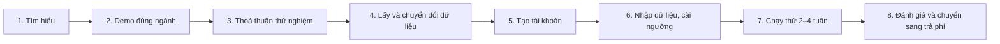

# Quy trình đóng gói, chào bán và onboarding một cửa hàng

Tài liệu này nói về **cách đưa sản phẩm tới khách hàng**. Cách dùng từng màn hình nằm ở
[`HUONG_DAN_DEMO_VA_TRIEN_KHAI.md`](HUONG_DAN_DEMO_VA_TRIEN_KHAI.md).

> **Thẳng thắn về hiện trạng:** RetailOps Intelligence là một dự án portfolio đã hoàn thiện tính năng
> v1 và được kiểm thử đầy đủ. Nó **chưa** được vận hành với khách hàng trả phí nào. Mục 6 liệt kê các
> việc cần làm trước khi thu tiền.

## 1. Bán ứng dụng hay bán SaaS?

Kiến trúc hiện tại hỗ trợ cả hai: nhiều tổ chức trên một máy chủ, dữ liệu cách ly theo tổ chức và cửa
hàng; cài riêng bằng Docker Compose cũng được.

| Mô hình | Cách làm | Hợp với | Ưu điểm | Nhược điểm |
|---|---|---|---|---|
| **SaaS** (khuyến nghị) | Bạn vận hành một máy chủ; mỗi shop là một tổ chức (`make stack-provision`); thu phí theo tháng | Shop nhỏ và vừa, không có đội IT | Một lần cập nhật cho tất cả; onboarding vài phút; doanh thu định kỳ | Bạn chịu trách nhiệm hạ tầng, sao lưu, bảo mật, hỗ trợ |
| **Cài riêng** (self-hosted) | Bàn giao bản cài trên máy chủ của khách (`make stack-up-customer`); phí cài đặt cộng phí bảo trì | Doanh nghiệp lớn hơn, yêu cầu dữ liệu nằm trên hạ tầng của họ | Khách kiểm soát dữ liệu | Mỗi khách một bản để cập nhật; khó hỗ trợ |
| **Dịch vụ triển khai** | Phí thiết lập (chuyển đổi dữ liệu, cấu hình ngưỡng, đào tạo) đi kèm SaaS | Shop có dữ liệu lộn xộn | Thu được tiền ngay từ khâu khó nhất | Tốn công từng khách |

Cách thực tế: **SaaS cộng một khoản phí thiết lập ban đầu**. Mức giá cần khảo sát với khách thật.
Tài liệu này không đưa con số, vì chưa có dữ liệu thị trường được kiểm chứng.

## 2. Có phải chỉ có một demo không?

Không còn chỉ một nữa:

- **Kestrel Home & Kitchen** (tiếng Anh, USD): demo công khai mặc định, chỉ đọc, có lịch sử làm việc
  của đội vận hành. Phù hợp với nhà tuyển dụng hoặc khách nước ngoài.
- **Mười cửa hàng mẫu tiếng Việt** (VND, giờ Việt Nam), mỗi ngành hàng một shop:
  [`sample-data/stores-vn`](../../sample-data/stores-vn/README.md). Gồm thời trang, mỹ phẩm, phụ kiện
  điện thoại, gốm sứ, mẹ và bé, đặc sản, sách, thể thao, thú cưng, handmade. Mỗi shop có đúng 10 tình
  huống sự cố để demo. Tạo cả 10 bằng `make load-sample-stores` (hoặc `make stack-load-sample-stores`
  trong Docker).

Đây đều là **dữ liệu hư cấu**. Không có và không nên dùng dữ liệu thật của cửa hàng khác để làm mẫu,
vì đó là dữ liệu kinh doanh và dữ liệu cá nhân của người khác.

## 3. Quy trình với một cửa hàng thật

| Bước | Làm gì | Công cụ trong sản phẩm |
|---|---|---|
| 1. Tìm hiểu (30 phút) | Hỏi: bán trên nền tảng nào, bao nhiêu đơn mỗi ngày, có bán vượt hay giao trễ không, phát hiện bằng cách nào, ai xử lý, hoàn tiền theo dõi ở đâu | Mục 1 của hướng dẫn demo (bảy câu hỏi) |
| 2. Demo | Mở shop mẫu **cùng ngành** (ví dụ khách bán mỹ phẩm thì mở `hat-ngoc-cosmetics`): Overview, một ngoại lệ bán vượt, copilot | `make load-sample-stores`, đăng nhập `owner@hat-ngoc-cosmetics.example` |
| 3. Thoả thuận | Chạy thử 2–4 tuần; thoả thuận bảo mật; thống nhất dữ liệu nào được gửi (không cần tên, địa chỉ, số điện thoại khách mua) | — |
| 4. Dữ liệu | Shop xuất file từ hệ thống đang dùng; bạn chuyển sang 4 template CSV (hiện làm bằng Excel hoặc script; xem mục 6) | Template trong **Imports → New import**; ví dụ trong `sample-data/stores-vn` |
| 5. Tài khoản | Tạo tổ chức, cửa hàng (VND, `Asia/Ho_Chi_Minh`), tài khoản Owner; gửi mật khẩu tạm qua kênh an toàn | `make stack-provision ARGS="..."` |
| 6. Thiết lập | Owner thêm nhân viên; chỉnh SLA giao hàng, ngưỡng, *Exposure cap*; nhập 4 file theo thứ tự; lần đầu nhập kiểm kê `CYCLE_COUNT` cho mọi sản phẩm | Users & roles, Settings, Imports |
| 7. Chạy thử | Shop nhập dữ liệu mới hằng ngày; quản lý phân loại ngoại lệ mỗi sáng; họp 15 phút mỗi tuần | Overview, Exceptions, Audit log |
| 8. Đánh giá | Dùng số liệu **trong sản phẩm**: số ngoại lệ phát hiện, thời gian tới khi được nhận việc và xử lý, số lần phải mở lại, tỉ lệ giao đúng hạn | Overview, Exceptions (Closed), Audit log |

**Có tạo cửa hàng trong hệ thống không?** Có. Mỗi khách hàng là một **tổ chức**, mỗi tổ chức có một
**cửa hàng** với tiền tệ và múi giờ riêng, tạo bằng `make stack-provision`. Hiện chưa có lệnh hay màn
hình để thêm cửa hàng thứ hai vào một tổ chức đã có (mục 6).

## 4. Gói bàn giao cho một khách hàng

| Thành phần | Có sẵn |
|---|---|
| Bản cài (Docker Compose: database, API, worker, web) | ✅ `docker-compose.yml`, `make stack-up-customer` |
| Tạo tài khoản khách hàng | ✅ `make stack-provision` |
| Template CSV và hướng dẫn chuẩn bị dữ liệu | ✅ Màn hình Imports, `sample-data/`, hướng dẫn mục 8 |
| Hướng dẫn sử dụng tiếng Việt | ✅ `docs/guides/HUONG_DAN_DEMO_VA_TRIEN_KHAI.md` |
| Sổ tay vận hành (khởi động, log, sự cố) | ✅ `docs/operations/RUNBOOK.md` (tiếng Anh) |
| AI copilot miễn phí | ✅ Gemini gói miễn phí hoặc engine quy tắc khi không có key |
| Sao lưu tự động, giám sát, cảnh báo | ❌ Cần làm (mục 6) |

## 5. Bảo mật và dữ liệu khi làm với shop thật

- Sản phẩm **không lưu** tên, địa chỉ, email hay số điện thoại khách mua hàng, chỉ lưu mã khách. Hãy
  dặn shop xoá các cột đó trước khi gửi file.
- Mỗi shop là một tổ chức tách biệt; truy cập chéo bị chặn ở backend (trả về 404).
- Mọi thao tác thay đổi dữ liệu đều có trong Audit log.
- Gói miễn phí của nhà cung cấp AI có thể dùng nội dung gửi lên để cải thiện dịch vụ của họ. Với khách
  thật, cân nhắc gói trả phí hoặc tắt AI (engine quy tắc vẫn chạy), và kiểm tra điều khoản hiện hành.
- Trước khi ký hợp đồng, nên hỏi tư vấn pháp lý về quy định bảo vệ dữ liệu cá nhân hiện hành
  (Nghị định 13/2023/NĐ-CP) và điều khoản dịch vụ.

## 6. Việc cần làm trước khi thu tiền

| Ưu tiên | Việc | Vì sao |
|---|---|---|
| Cao | Triển khai lên máy chủ có tên miền, HTTPS, sao lưu tự động, giám sát | Chưa có bản chạy công khai |
| Cao | Quên mật khẩu và bắt buộc đổi mật khẩu tạm | Hiện chỉ có mật khẩu tạm do Owner cấp |
| Cao | Hỗ trợ **COD** (giao rồi mới thu tiền) | Rất phổ biến ở Việt Nam; mô hình v1 chỉ hỗ trợ thanh toán trước |
| Cao | Bộ chuyển đổi file xuất từ các nền tảng bán hàng phổ biến sang 4 template | Hiện phải chuyển thủ công |
| Trung bình | Thêm cửa hàng thứ hai cho một tổ chức | Shop bán nhiều kênh hoặc nhiều thương hiệu |
| Trung bình | Thu phí, gói dịch vụ, điều khoản sử dụng, chính sách bảo mật | Bán SaaS |
| Thấp | Kết nối API trực tiếp với nền tảng bán hàng | Thay cho nhập CSV |
