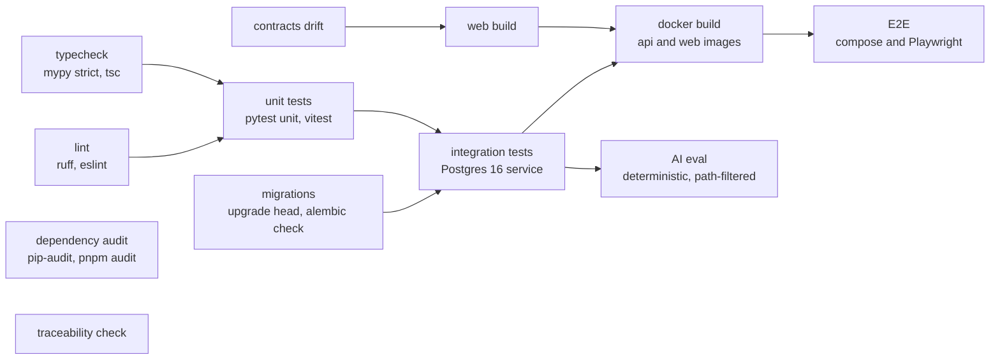

# Test Strategy

> **Status:** Strategy (v1), task T-080. No tests exist yet: the codebase has not been scaffolded.
> Every test named here is **planned**. Nothing in this document reports a result.
> Canonical sources: `AGENTS.md §7`, `docs/domain/*` (BR-xxx, exception rule ids, state machines,
> priority model), `docs/ai/EVALUATION_STRATEGY.md` for the copilot evaluation.

## 1. Principles

1. **Business rules are proven by tests that name them.** Every BR-xxx rule, exception rule id, and
   state-machine transition has at least one test that cites it (§6). A change to a rule changes or
   adds such a test (`AGENTS.md §7`).
2. **Real PostgreSQL for anything that touches the database.** Partial unique indexes, `timestamptz`,
   `NUMERIC(12,2)`, advisory locks, and `READ ONLY` transactions behave differently or do not exist
   in substitutes. No SQLite, no mocked sessions in integration tests.
3. **Time is an input.** Rules receive `as_of` (BR-504). Code that needs "now" gets it from an
   injected clock. Tests never patch the system clock.
4. **Authorization and tenancy are tested at the HTTP boundary** for every route, from a
   route table, so a new endpoint cannot ship without coverage (`AGENTS.md §6`).
5. **No network calls to LLM providers in tests or CI E2E.** The copilot is tested with the
   deterministic provider and a scripted fake provider. Live-provider quality is measured separately
   by `make ai-eval` (`docs/ai/EVALUATION_STRATEGY.md`).
6. **Never weaken, skip, or delete a test to make CI pass.** Known failures are recorded (§13).

## 2. Test pyramid and scope per layer

| Layer | Tooling | Scope | Runs | Speed target (MVP assumption) |
|---|---|---|---|---|
| **Backend unit** | pytest | Pure functions: the 9 exception rules, priority and due date, state-transition tables and reachability, axis matrix, inventory formulas and health, velocity, ship-by and overdue predicates, total reconciliation, CSV column validators, formula-injection escaping, the permission matrix constant, AI intent router, templates, answer validator, tool argument schemas, prompt sanitiser and lock | Every push, locally on save | Whole suite < 30 s |
| **Backend integration** | pytest + PostgreSQL 16 + FastAPI test client | Repositories with store scoping; services (evaluation reconciliation, reservations sync, shipment cutoff, import validate and apply, exception lifecycle); every HTTP route (auth, CSRF, permissions, tenancy, envelopes, pagination); Alembic migrations; AI tools and copilot loop with deterministic and fake providers; worker advisory locks | Every push in CI | < 5 min |
| **Frontend component** | vitest + Testing Library (jsdom) | Components and hooks: the four data states of every data view, permission-dependent actions, forms and Zod schemas, formatting (money, store time zone), copilot answer rendering and provenance labels | Every push | < 60 s |
| **End-to-end** | Playwright against the docker compose stack | The 12-step critical journey (§10), the public-demo read-only check, import failure paths, mobile smoke at 375 px | CI on pull requests to `main` | < 15 min |
| **AI evaluation** | `make ai-eval` (T-074) | Copilot answer quality, attribution, permissions, injection, fallback (`docs/ai/EVALUATION_STRATEGY.md`) | Deterministic in CI on AI-related changes; live providers locally by the owner | n/a |

The bulk of the assertions sit in backend unit tests, because the business logic is designed as
pure functions (`EXCEPTION_CATALOG.md`: rules are `(snapshot, settings, as_of) → findings` with no
I/O). Integration tests prove wiring, SQL, transactions, and HTTP behavior. E2E tests prove that a
person can complete the critical workflows. They do not re-test rule arithmetic.

## 3. Tooling and environment

### 3.1 Backend

| Concern | Choice |
|---|---|
| Runner | `pytest`. Test files under `apps/api/tests/unit/<module>/` and `apps/api/tests/integration/<module>/` |
| HTTP | FastAPI `TestClient` (httpx) against the real app with dependency overrides for the DB session and the clock |
| Database | PostgreSQL 16. Locally: the docker compose `db` service, with a separate database per test session (`retailops_test`), created by a session fixture. In CI: a GitHub Actions `postgres:16` service container. URL from `TEST_DATABASE_URL` |
| Schema | The session fixture runs `alembic upgrade head` on the empty database, so every integration run also tests the migrations |
| Isolation | Each test runs inside an outer transaction with SQLAlchemy 2 `join_transaction_mode="create_savepoint"`, rolled back at teardown. Tests that need real commits or several connections (advisory locks, concurrent apply, partial-unique-index races, idempotency replays) use the `committing_db` fixture, which truncates all tables afterwards |
| Missing database | Integration tests **fail** with a clear message when `TEST_DATABASE_URL` is unreachable. They are never skipped silently. `make api-test-unit` exists for runs without a database |
| Time | `app/core/clock.py` defines a `Clock` protocol (`now() -> aware UTC datetime`), `SystemClock`, and `FixedClock`. The FastAPI dependency `get_clock` is overridden in tests. Rules take `as_of` explicitly. No freezegun or monkeypatching of `datetime` |
| Factories | Plain typed builder functions in `apps/api/tests/factories/` (`make_store`, `make_product`, `make_order(..., status=PAID, paid_at=as_of - timedelta(hours=30))`, `make_movement`, `make_exception`, `make_user(role=STAFF)`). They write through repositories, so invariants hold. No factory library is added unless the builders become hard to maintain |
| Static checks used as tests | AST scan: no `datetime.now(`, `datetime.utcnow(`, `date.today(`, or `time.time(` under `app/domains/` (BR-504). Schema introspection: every `DateTime` column is timezone-aware, every money column is `NUMERIC(12,2)` (BR-503), every store-scoped table has a non-null indexed `store_id` (BR-001, BR-003) |
| Network | A conftest fixture blocks outbound sockets except to the test database. A test that tries to reach an LLM provider fails |
| Coverage | `pytest-cov` report as a CI artifact. No global percentage gate in v1. The traceability check (§6) is the gate for business rules |

### 3.2 Frontend

| Concern | Choice |
|---|---|
| Runner | vitest with jsdom, `@testing-library/react`, `@testing-library/user-event` |
| API | Components receive data through TanStack Query hooks that call the generated client from `packages/contracts`. Tests replace the client module with a typed fake (`vi.mock`) and wrap components in a test `QueryClientProvider` with retries off. Response shapes come from the generated types, so a contract change breaks the fake at compile time |
| Time and money | Formatting helpers take the store time zone and an explicit `now`. Money arrives as decimal strings and is formatted without converting to a JavaScript number |
| Location | Co-located `*.test.tsx` next to components under `apps/web` |

### 3.3 End-to-end

| Concern | Choice |
|---|---|
| Runner | `@playwright/test`. Specs in `apps/web/tests/e2e/` |
| Stack | `docker compose up --build` with `db`, `api`, `web`, and `LLM_PROVIDER=deterministic`. The `worker` service is **not** started for the journey suite, so scheduled evaluations cannot change state mid-test. Evaluations in E2E are import-triggered or manual. The worker has its own integration tests (§7.4) |
| Data | `make seed` with a fixed seed before the suite. CSV fixtures for uploads are generated at test time by a helper that writes timestamps relative to now and references seeded SKUs and order numbers (stable for a fixed seed) |
| Auth | A global setup signs in once per role through the login page with the seeded demo credentials and saves `storageState` files. The public-demo spec uses "Explore the demo" |
| Selectors | Accessible roles and names first (`getByRole`), `data-testid` only for complex widgets |
| Waiting | Playwright auto-waiting and `expect(...).toPass()` polling. `waitForTimeout` is not allowed |
| Artifacts | Trace on first retry, screenshot and video on failure, HTML report uploaded by CI |
| Projects | Desktop Chromium for all specs. A 375 px mobile project for a smoke subset (overview, inbox, exception detail) |
| Accessibility | `@axe-core/playwright` scans of key pages, added with T-083 |

## 4. Test data strategy

| Source | Used by | Rules |
|---|---|---|
| **Factories** | Unit and integration tests | Each test builds the minimum data it asserts on, with explicit values next to the assertion. No shared mutable fixtures across tests. Unique SKUs and order numbers per test (factory sequence) |
| **Rule snapshots** | Rule unit tests | Rules are pure, so tests construct the `snapshot` objects directly (no database) at an explicit `as_of` |
| **Deterministic demo seed** (T-056) | E2E, AI evaluation, seed tests, manual QA | Generated relative to an anchor time with a fixed random seed. Rerunning with the same seed and anchor is byte-for-byte identical. Contains every exception type. Fictional data only (Kestrel Home & Kitchen, example.com addresses) |
| **CSV fixtures** | Import tests | `apps/api/tests/fixtures/imports/<type>/<case>.csv`, one minimal file per failure case (§9). Encoding and size fixtures are generated in the test (latin-1, UTF-16, 5 MB + 1 byte, 20,001 rows) instead of being committed |
| **Second tenant** | Tenancy tests, AI evaluation | Org B with its own store whose SKUs and order numbers deliberately collide with org A's |
| **Hostile-text overlay** | AI injection tests and evaluation | A separate store in org A with product names, notes, and import values that contain instructions and canary tokens. Never part of the public demo seed |

Seed tests (T-056): with a fixed seed and anchor, a snapshot of counts per exception type and
severity; every exception type present at least once; two runs identical; and the `DOMAIN_MODEL.md
§4` invariants hold after seeding (`assert_invariants(store)`, below).

`assert_invariants(store)` is a test helper that checks all six invariants of `DOMAIN_MODEL.md §4`
(on-hand equals ledger sum, reserved equals active reservations, axis matrix holds, every status
change has an event, at most one active exception per dedup key, no unscoped queries are possible).
Integration tests of orders, inventory, imports, and exceptions call it at the end.

## 5. Naming conventions

- Backend: `test_<rule-or-feature>_<behavior>`, for example
  `test_br202_order_exactly_at_ship_by_is_not_overdue`.
- Exception rules: one file per rule, named after the rule id, for example
  `tests/unit/exceptions/rules/test_inv_oversold.py`.
- Frontend: `describe("<Component>")` with `it("<behavior>")`.
- E2E: `jNN-<step>.spec.ts` for journey steps (§10), other specs by feature.

## 6. Traceability

Every test that verifies a canonical rule carries a marker with the rule id(s), and its docstring
states the rule in one line:

```python
@pytest.mark.rule("BR-202")
def test_br202_order_exactly_at_ship_by_is_not_overdue(as_of: datetime) -> None:
    """BR-202: overdue requires as_of > ship_by (strict)."""
```

Accepted ids: `BR-xxx` from `BUSINESS_RULES.md`, rule ids from `EXCEPTION_CATALOG.md`
(`INV-OVERSOLD@1`), `SM-ORDER`, `SM-RESERVATION`, `SM-EXCEPTION`, `SM-IMPORT` with a section
suffix for `STATE_MACHINES.md` (for example `SM-EXCEPTION-3.3`), `PRIORITY` for
`PRIORITY_MODEL.md`, `INV-1`..`INV-6` for the `DOMAIN_MODEL.md §4` invariants, and `ADR-00NN`.
Frontend and E2E tests put the id in the test title (`"BR-404: exposure is labelled value at risk"`).

`make traceability` (proposed target) collects the markers and titles and writes a matrix
(`rule id → tests`) to `reports/traceability.md`. In CI:

- **From the start:** fail when a marker cites an id that does not exist in the canonical docs.
- **From the completion of T-054** (exception lifecycle API, the last task that implements catalogued
  rules): also fail when a catalogued id has no test.

## 7. Coverage map

"U" = backend unit, "I" = backend integration, "C" = frontend component, "E" = E2E. All planned.

### 7.1 Business rules

| Rule | Planned tests |
|---|---|
| BR-001 | I: schema test, every store-scoped table has non-null `store_id`; store belongs to exactly one organization (FK not null) |
| BR-002 | I: a membership in org A grants access to every store of org A and none of org B |
| BR-003 | I: route-table tenancy matrix (§8); U: repository base refuses a query without `store_id` |
| BR-004 | U: `CURRENCY_MISMATCH` row error; I: store requires currency and IANA time zone |
| BR-005 | I: `inventory_balance` key is `(store_id, product_id)`, no location column (schema test) |
| BR-101 | U: `available = on_hand − reserved` table cases; pending demand never subtracted; committed demand not subtracted twice |
| BR-102 | U: negative available reported, not clamped; I: API returns the negative value |
| BR-103 | U: incoming excluded from available; evidence includes incoming and ETA |
| BR-104 | I: `inventory.reconcile` reports injected drift and leaves the balance unchanged |
| BR-110 | I: repository exposes no update or delete for movements; a correction is a new `CORRECTION` row |
| BR-111 | U: delta per movement type (9 types), `CYCLE_COUNT` delta = counted − current, `RECEIPT` reduces incoming but not below 0 |
| BR-112 | I: re-importing an applied adjustment reference gives `ALREADY_APPLIED` and no movement |
| BR-120 | I: reservations created when an order enters PAID, PROCESSING, READY_TO_SHIP (including import jumps) |
| BR-121 | I: released on cancel, payment failure, refund before shipping |
| BR-122 | I: consumed on ship |
| BR-123 | I: `reservations.sync_for_orders` twice gives identical state |
| BR-130 | U+I: shipment after the last cycle count writes a `SHIPMENT` movement; shipment before it writes none and consumes the reservation |
| BR-131 | I: re-importing a shipped order writes no second movement (unique reference) |
| BR-132 | I: `RETURNED` does not restock; `RETURN_RESTOCK` adjustment does |
| §2.5 health | U: each class at its boundaries: available −1, 0, 1, = reorder point, = ceil(rop × 1.25), +1; inactive products not classified |
| BR-140 | U: reorder point 0 never yields BELOW or APPROACHING |
| BR-141 | I: no stored health column (schema test); health computed on read matches the classification |
| BR-150 | U: velocity window, status exclusions (CANCELLED, PAYMENT_FAILED, CREATED, PAYMENT_PENDING), division by window days |
| BR-151 | U: days of cover with velocity 0 returns "not enough sales history" |
| BR-152 | C: velocity and days of cover carry the "Estimate" badge; U: AI validator keeps estimates out of facts and metrics |
| BR-201 | U: ship-by from import when present (`ship_by_source = IMPORTED`), else `paid_at + fulfillment_sla_hours` (`STORE_SLA`) |
| BR-202 | U: exactly at ship-by not overdue, one microsecond after is; only PAID, PROCESSING, READY_TO_SHIP |
| BR-203 | U: stalled threshold boundaries; overdue supersedes stalled |
| BR-204 | U: SLA arithmetic across the DST change of 2026-11-01 in America/New_York is 48 real hours |
| BR-205 | U: mismatch only when the difference exceeds 0.01; orders without lines never mismatch; formula includes order discount, shipping, tax |
| BR-206 | U: refund pending only after `refund_overdue_hours` from `cancelled_at`; not when payment status is REFUNDED |
| BR-401 | U: precedence OVERSOLD > OVERSELL_RISK > OUT_OF_STOCK > BELOW_ROP; I: superseded exception resolved as SUPERSEDED with assignee carried over |
| BR-402 | U: FIFO allocation by `paid_at`, ties by `order_number`; partially covered lines are affected |
| BR-403 | U: oversell risk requires available ≥ 0 and pending demand > available; shortage value |
| BR-404 | U: AI validator rejects "loss" wording; C: UI labels exposure "value at risk"; E: no "loss" text on exception detail |
| BR-501 | I: timestamps stored as `timestamptz` UTC; C: display in store time zone with abbreviation (EDT and EST both covered) |
| BR-502 | U: timestamp without offset interpreted in store time zone with `TIMEZONE_ASSUMED` warning (ambiguous and nonexistent local times: see §14) |
| BR-503 | I: schema test for `NUMERIC(12,2)`; U: money parsing uses `Decimal`, float input rejected |
| BR-504 | U: AST scan for wall-clock calls; every rule takes `as_of` |
| BR-505 | I: schema test, no customer name, email, address, or phone columns; U: a `customer_email` column in a CSV is ignored with `UNKNOWN_COLUMN`; U: AI tools never return `customer_ref` |
| BR-506 | U: SKU trimmed and compared case-sensitively; `abc` and `ABC` are distinct |
| BR-601..608 | Import tests, §9 |
| §7 configuration | I: settings update requires `settings.manage`, validates ranges and priority weights (non-negative integers, maximum ≤ 100), writes an audit entry; priorities recalculated at the next evaluation |

### 7.2 Exception types

Every rule gets a unit test file covering: condition true and false at the boundaries, every severity
branch, exposure, deadline, required evidence fields, the recommended action text, and the
auto-resolve condition. Integration tests cover detection through an evaluation run.

| Exception type | Rule id | Key unit cases |
|---|---|---|
| `INVENTORY_OVERSOLD` | `INV-OVERSOLD@1` | available −1 vs 0; CRITICAL; FIFO affected orders and uncovered quantity; exposure = Σ uncovered × unit price; deadline = earliest ship-by of affected orders; auto-resolve at available ≥ 0 |
| `INVENTORY_OVERSELL_RISK` | `INV-OVERSELL-RISK@1` | pending demand = available (no) vs available + 1 (yes); HIGH; exposure = shortage × current price; pending orders oldest first |
| `INVENTORY_OUT_OF_STOCK` | `INV-OUT-OF-STOCK@1` | available exactly 0; HIGH when velocity > 0, MEDIUM otherwise; exposure 0; inactive product excluded |
| `INVENTORY_BELOW_REORDER_POINT` | `INV-BELOW-ROP@1` | 0 < available ≤ rop; rop 0 excluded; HIGH when days of cover < lead time, else MEDIUM; replenishment quantity in the action text |
| `ORDER_FULFILLMENT_OVERDUE` | `ORD-OVERDUE@1` | severity at 24 h and 72 h boundaries; exposure = order total; status-specific action text; oversold-line action text |
| `ORDER_STALLED_AFTER_PAYMENT` | `ORD-STALLED@1` | threshold boundary; HIGH when ship-by within 12 h; not raised when overdue; superseded by overdue |
| `ORDER_REFUND_PENDING` | `PAY-REFUND-PENDING@1` | 24 h boundary; HIGH, CRITICAL after 3 × threshold; auto-resolve on REFUNDED |
| `DATA_ORDER_TOTAL_MISMATCH` | `DQ-ORDER-TOTAL@1` | difference 0.01 (no) vs 0.02 (yes); LOW below 1.00, MEDIUM otherwise; exposure 0; rejected-rows evidence flag |
| `DATA_NEGATIVE_ON_HAND` | `DQ-NEGATIVE-ON-HAND@1` | on_hand −1 any product status; HIGH; last 10 movements in evidence |

### 7.3 State machines and priority

| Area | Planned tests |
|---|---|
| Order lifecycle (`SM-ORDER-1.2`) | U: full 12 × 12 transition matrix, allowed and rejected; reachability for import (`PAID → SHIPPED` allowed with skipped states recorded; `DELIVERED → PAID`, `CANCELLED → SHIPPED` rejected); `CANCELLED → REFUNDED` only when payment was PAID |
| Axis matrix (`SM-ORDER-1.3`) | U: every status × payment × fulfillment combination; derivation when `fulfillment_status` is omitted; REFUNDED requires the column |
| Timestamps (`SM-ORDER-1.4`) | U: required fields per condition; ordering `placed_at ≤ paid_at ≤ shipped_at ≤ delivered_at` |
| Reservation effects (`SM-ORDER-1.5`, `SM-RESERVATION`) | I: effect per status, `RELEASED → ACTIVE` on re-entry |
| Exception transitions (`SM-EXCEPTION-3.2`) | U: allowed and rejected transitions; I: permission and precondition per transition (assignee rule, resolution code and ≥ 10-character note, dismissal reason) |
| Reconciliation (`SM-EXCEPTION-3.3`) | I: each of the 7 rows of the table, including verification (`verified_at`), reopen `VERIFICATION_FAILED`, reopen `RECURRED_WITHIN_WINDOW` at the 72 h boundary, new occurrence after the window with `previous_occurrence_id`, dismissed behavior; only rules that ran can auto-resolve |
| Import lifecycle (`SM-IMPORT`) | I: every transition, 24 h preview expiry to DISCARDED, FAILED rollback leaves business data unchanged, retry from FAILED |
| Priority (`PRIORITY`) | U: the four worked examples as golden tests; each component's caps and boundaries; total capped at 100; band boundaries 30, 50, 70; due date per severity and the earlier business deadline; manual due-date override audited (I) |
| Evaluation runs (ADR-0009) | I: advisory lock prevents overlapping runs per store (two connections); each trigger recorded as `evaluation_run` |
| Optimistic concurrency | I: stale `expected_version` returns 409 |

### 7.4 Platform

| Area | Planned tests |
|---|---|
| Health | I: `/api/v1/health/live` 200; `/api/v1/health/ready` 200 with the database, 503 without |
| Errors | I: error envelope on 400, 401, 403, 404, 409, 422, 429; `request_id` matches the response header; no stack trace or SQL in any body |
| Pagination and sorting | I: `page_size` > 100 → 422; `sort` accepts only allowlisted fields (SQL injection attempts → 422) |
| Auth and sessions | I: argon2id hash stored; cookie flags (`HttpOnly`, `SameSite=Lax`, `Secure` with production settings); 12 h sliding and 7 d absolute expiry with `FixedClock`; revoked session → 401; login rate limit 5 per minute |
| CSRF | I: every POST, PUT, PATCH, DELETE route without a matching `X-CSRF-Token` → 403 (route-table driven) |
| Rate limits | I: general 300 per minute per user; copilot 20 per minute per user |
| Contracts | CI: regenerating `packages/contracts` from the OpenAPI schema produces no diff |
| Migrations | CI: `alembic upgrade head` on an empty database; `alembic check` reports no model drift |
| Worker | I: scheduled run per store respects `evaluation_interval_minutes` and the advisory lock |

### 7.5 AI module

| Area | Planned tests |
|---|---|
| Tool registry | U: registered set equals the 11 catalogued tools; I: **per tool** a permission test (principal without the tool's permission → `PERMISSION_DENIED`, audit row), a scope test (another store's id → `NOT_FOUND`, identical message), a size-cap test (rows and bytes), a read-only test (a write inside the tool's transaction fails), and an `ai_tool_call` row for every outcome |
| Validator | U: each of the 11 checks in `AI_ARCHITECTURE.md §6`, with dropped refs and items flagged |
| Router and templates | U: phrasing table per intent (including the seven copilot questions); snapshot tests of rendered answers; every template fact carries a ref |
| Loop | I with a scripted `FakeLLMProvider`: iteration cap, tool-call cap, turn deadline, input-token cap, repair round-trip only with headroom, finalize call |
| Fallback | I: each `fallback.reason` (429 or quota, timeout, 5xx, budget, circuit open, not configured, invalid output) produces a deterministic answer, the exact notice text, and the stored reason; tool results reused |
| Budget and circuit | U: per-minute and per-day request windows, token window, circuit opening and `Retry-After` handling |
| Summary cache | I: hit on unchanged exception; miss after evidence change, a new event, TTL expiry, a different permission set, a prompt version change; deterministic summaries never cached |
| Note drafts | I: drafting writes no `exception_note`; requires `exceptions.work`; accepting through the notes endpoint stores `source = AI_DRAFT_ACCEPTED` with a `NOTE_ADDED` event and audit entry |
| Prompts | U: `prompts.lock.json` hashes match; static prefix within its character budget; sanitiser removes control, zero-width, and bidi characters and neutralises delimiters |
| Copilot UI | C: labelled sections, reference links built from type and id, provenance and fallback labels, estimate badge, plain-text rendering (no HTML or links from answer text) |

## 8. Permission and tenancy test design

### 8.1 Route table

A meta-test enumerates every FastAPI route and requires that it either declares a permission
dependency or appears in an explicit public allowlist (health endpoints, login, CSRF bootstrap,
"Explore the demo", OpenAPI and docs). The permission and tenancy suites are parametrised from the
same route table, with a small per-route fixture that builds a valid request (path ids, body). A new
route without such a fixture fails the suite, which forces coverage for every new endpoint.

### 8.2 Role matrix

Expected outcomes are written out by hand in the test module, **not** derived from the
`ROLE_PERMISSIONS` constant, so the test is not a tautology. A separate test asserts that the
constant equals the documented matrix (ADR-0007).

| Action | Permission | OWNER | MANAGER | STAFF | ANALYST | VIEWER | Anonymous |
|---|---|---|---|---|---|---|---|
| Read dashboard, catalog, orders, inventory, exceptions, imports, analytics | `*.read` | 200 | 200 | 200 | 200 | 200 | 401 |
| Acknowledge, claim unassigned, start, resolve own, add note | `exceptions.work` | 200 | 200 | 200 | 403 | 403 | 401 |
| Start or resolve an exception assigned to someone else | `exceptions.manage` (resolve any); start rule in `STATE_MACHINES.md §3.2` | 200 | 200 | 403 | 403 | 403 | 401 |
| Assign, reassign, change due date | `exceptions.assign` | 200 | 200 | 403 | 403 | 403 | 401 |
| Dismiss, reopen manually | `exceptions.manage` | 200 | 200 | 403 | 403 | 403 | 401 |
| Run analysis | `evaluations.run` | 200 | 200 | 403 | 403 | 403 | 401 |
| Upload, validate, apply an import | `imports.run` | 200 | 200 | 403 | 403 | 403 | 401 |
| Read audit log | `audit.read` | 200 | 200 | 403 | 200 | 200 | 401 |
| Read settings / change settings | `settings.read` / `settings.manage` | 200 / 200 | 200 / 200 | 200 / 403 | 200 / 403 | 200 / 403 | 401 |
| List users / manage users | `users.read` / `users.manage` | 200 / 200 | 200 / 403 | 403 / 403 | 403 / 403 | 403 / 403 | 401 |
| Ask the copilot, investigation summary | `copilot.use` (+ `exceptions.read`) | 200 | 200 | 200 | 200 | 200 | 401 |
| Draft a note with AI | `copilot.use` + `exceptions.work` | 200 | 200 | 200 | 403 | 403 | 401 |

("200" stands for the success status of the endpoint, which may be 201 or 204.)

Additional matrix tests:

- **VIEWER never mutates shared data:** every mutating route except the caller's own session and
  copilot endpoints returns 403 for VIEWER (route-table driven).
- **CSRF** is checked before permission on mutating routes, so the matrix runs with a valid token
  and a separate test covers its absence.
- **AI tools:** a test-only principal without each read permission proves every tool's own check,
  because all real roles with `copilot.use` hold all tool permissions in v1.

### 8.3 Tenancy

Fixture: org A (stores A1, A2) and org B (store B1), with colliding SKUs and order numbers, and one
user per role in org A.

| Case | Expected |
|---|---|
| Any store-scoped route with `store_id = B1` | 404, standard envelope, for every method (never 403, never revealing existence) |
| Route under A1 with an entity id that belongs to B1 | 404 |
| List routes under A1 | No B1 row ever appears, even with colliding SKUs and order numbers |
| Org A user on A2 (same organization) | Allowed (BR-002) |
| AI tools with B1 ids, SKUs, or order numbers | `NOT_FOUND` or empty results, never B1 data |
| Another user's copilot conversation in the same store | 404 |
| Accepting an AI draft for an exception in B1 | 404 |

## 9. Import failure-case tests

Each case has a minimal CSV fixture and asserts the code, severity, row number, and column, and that
nothing was written when the file is rejected. Rule ids: BR-601..608, `SM-IMPORT`.

| Group | Cases | Expected |
|---|---|---|
| File level | empty file; header only; 5 MB + 1 byte; 20,001 data rows; `.xlsx` and `.txt` uploads; a CSV renamed with a wrong MIME type; latin-1 bytes; UTF-16; UTF-8 with BOM | `FILE_EMPTY` (both empty cases); `FILE_TOO_LARGE`; `TOO_MANY_ROWS`; `FILE_TYPE`; `FILE_ENCODING`; BOM accepted. Status `REJECTED`, no row issues written |
| Headers | a required column missing; an unknown extra column; duplicated header names; header whitespace and case variants | `MISSING_COLUMNS` rejects the file; `UNKNOWN_COLUMN` warning and the column ignored; duplicated and case variants per the import contract (§14) |
| Field validation (each type) | blank required value; value over max length; bad enum; `12,50` and `abc` for decimals; `1.5` for integers; negative where ≥ 0; non-ISO datetime; datetime without offset | `REQUIRED`, `VALUE_TOO_LONG`, `INVALID_ENUM`, `INVALID_NUMBER`, `INVALID_INTEGER`, `NEGATIVE_VALUE`, `INVALID_DATETIME`, `TIMEZONE_ASSUMED` (warning) |
| Keys and references | same SKU twice; same `(order_number, line_number)` twice; item for an unknown order; item for an order created earlier in the same import; unknown SKU | `DUPLICATE_KEY_IN_FILE` on every occurrence after the first (BR-604); `UNKNOWN_ORDER`; accepted; `UNKNOWN_SKU` (BR-605) |
| Orders | currency ≠ store currency; SHIPPED with payment PENDING; PAID without `paid_at`; `shipped_at` before `paid_at`; existing DELIVERED order imported as PAID; existing PAID imported as SHIPPED; REFUNDED without `fulfillment_status` | `CURRENCY_MISMATCH`; `ORDER_INVALID_STATUS_COMBINATION`; `ORDER_MISSING_TIMESTAMP`; `ORDER_TIMESTAMP_SEQUENCE`; `ORDER_TRANSITION_NOT_ALLOWED`; accepted with skipped states in the order event; error per §1.3 |
| Order items | change a line of a SHIPPED order; line discount above quantity × price | `ORDER_LINE_LOCKED`; `LINE_DISCOUNT_EXCEEDS_LINE` |
| Products | ACTIVE with price 0; cost above price; new supplier name; lead time 366 | `PRICE_ZERO` and `NEGATIVE_MARGIN` warnings, rows applied; supplier created; out-of-range error |
| Adjustments | reference already applied; `CYCLE_COUNT` negative; `CORRECTION` zero; `DAMAGE` with a negative quantity | `ALREADY_APPLIED` warning with no effect (BR-112); errors for the others |
| Apply semantics | strict mode with any row error; valid-rows-only without confirming the skipped count; with a wrong count; with the right count; a failure injected mid-apply | blocked; 422; 409; `COMPLETED_WITH_ERRORS` with skipped rows persisted as issues; `FAILED` with no business data changed (BR-606) |
| Duplicates and idempotency | same file (same SHA-256) uploaded again; `Idempotency-Key` replay of apply; two concurrent applies | `DUPLICATE_FILE` warning, still applicable (BR-607); same response, applied once; one succeeds, the other gets 409 |
| Lifecycle | apply after 24 h | preview `DISCARDED`, apply refused |
| After apply | completed import | an `evaluation_run` with `trigger = IMPORT` exists and is linked to the import |
| Error CSV export | issue values starting with `=`, `+`, `-`, `@`; values with quotes, commas, and newlines | prefixed with an apostrophe; valid CSV quoting |
| Parsing safety | cells containing formulas, very long lines, embedded NUL bytes | parsed as text with the csv module, never evaluated; NUL rejected as an encoding error |

## 10. E2E critical journey (Playwright)

> The project directive's §12 (referenced by T-081) is not in the repository. The 12 steps below are
> reconstructed from the product scope in `AGENTS.md`, `TASKS.md`, and the domain docs. They must be
> reconciled with the directive before T-081 starts.

The journey runs as one serial suite (`test.describe.serial`) on a freshly seeded stack, because
later steps depend on earlier ones. CSV fixtures are generated at run time (§3.3).

| # | Spec | Role | Steps | Assertions |
|---|---|---|---|---|
| 1 | `j01-sign-in-overview.spec.ts` | Manager | Sign in with the seeded demo manager account; open Overview | "Demo data" label visible; KPI tiles show numbers; attention list non-empty and sorted by priority |
| 2 | `j02-import-preview.spec.ts` | Manager | Upload an `orders.csv` containing one new PAID order whose ship-by is 30 h in the past, plus rows with errors and an unknown column | Preview shows counts, row errors with codes (for example `ORDER_INVALID_STATUS_COMBINATION`, `INVALID_DATETIME`), the `UNKNOWN_COLUMN` warning; strict apply disabled with an explanation |
| 3 | `j03-import-apply.spec.ts` | Manager | Download the error CSV; choose valid-rows-only; confirm the skipped-row count; apply | Error CSV contains the codes and an apostrophe-prefixed formula cell; status `COMPLETED_WITH_ERRORS`; history entry |
| 4 | `j04-inbox.spec.ts` | Manager | Open the exception inbox; filter by type `ORDER_FULFILLMENT_OVERDUE`; sort by priority | The new exception for the imported order is listed with HIGH severity, created by an import-triggered evaluation |
| 5 | `j05-exception-detail.spec.ts` | Manager | Open the exception | Evidence (ship-by, hours overdue, SLA source `IMPORTED`), calculation, priority breakdown whose components sum to the score, history with `DETECTED`, linked order |
| 6 | `j06-copilot-explain.spec.ts` | Manager | Ask the copilot in the exception context "Why is this exception high severity?" | Labelled sections; references link to the exception and the order; "Rule-based assistant" label (deterministic in CI) |
| 7 | `j07-copilot-attention.spec.ts` | Manager | Ask "What needs attention today?" in the general panel; click a reference | Answer lists top exceptions; the reference opens that exception |
| 8 | `j08-ai-note-draft.spec.ts` | Manager | Click "Draft note"; check history; edit the draft; accept | No note before accepting; after accepting, the note shows "AI draft accepted" and a `NOTE_ADDED` event |
| 9 | `j09-assign.spec.ts` | Manager | Assign the exception to the demo staff user | `ASSIGNED` event; assignee shown |
| 10 | `j10-staff-resolve.spec.ts` | Staff | Filter "Assigned to me"; acknowledge; start; try to resolve with a 5-character note; resolve with code `ORDER_FULFILLED` and a valid note | Validation message for the short note; status RESOLVED; dismiss and assign actions not offered to Staff |
| 11 | `j11-verify-reopen-autoresolve.spec.ts` | Manager | Run analysis; then import an `orders.csv` that moves the order to SHIPPED | After the run: REOPENED with reason `VERIFICATION_FAILED` (the order is still PAID). After the import: RESOLVED with `CONDITION_CLEARED`; the order timeline shows the skipped states |
| 12 | `j12-audit-and-public-demo.spec.ts` | Owner, then public visitor | Owner opens the audit log and filters by action; a new browser context uses "Explore the demo" | Audit shows `import.apply`, the assignment, and the resolution with actors. The visitor sees data and can ask the copilot; mutation controls are absent or disabled with a reason; a direct mutating API request returns 403 |

Other E2E specs: import file-level rejections (`FILE_ENCODING`, `MISSING_COLUMNS`), permission
views per role (actions hidden or disabled with a reason), each data view's empty and error states
where they can be produced, and the 375 px smoke project.

## 11. CI quality gates



| Gate | Command (planned) | Blocks merge to `main` |
|---|---|---|
| Lint and format | `ruff check`, `ruff format --check`, `pnpm -r lint` | yes |
| Types | `mypy --strict app/`, `pnpm -r typecheck` (`tsc --noEmit`, strict) | yes |
| Unit tests | `pytest tests/unit`, `pnpm -r test` (vitest) | yes |
| Integration tests | `pytest tests/integration` against the Postgres 16 service container | yes |
| Migrations | `alembic upgrade head` on an empty database, `alembic check` | yes |
| Contracts | regenerate `packages/contracts`, `git diff --exit-code` | yes |
| Build | `pnpm -C apps/web build` | yes |
| Docker build | multi-stage build of the api and web images; image runs as non-root | yes |
| Dependency audit | `pip-audit` on the locked requirements, `pnpm audit --prod --audit-level=high` | yes, for high and critical findings. An accepted exception is listed in a committed allowlist with the advisory id, reason, and an expiry date |
| E2E | `docker compose up --build -d`, `make seed`, readiness wait on `/api/v1/health/ready`, `pnpm -C apps/web exec playwright test` | yes |
| Traceability | `make traceability` | yes (scope per §6) |
| AI evaluation (deterministic) | `make ai-eval` on changes to `apps/api/app/domains/ai/`, `apps/api/evals/`, exceptions or analytics services, or the demo seed | yes, for the gates in `EVALUATION_STRATEGY.md §6` |

Secret scanning is not yet specified. GitHub's built-in secret scanning can be enabled on the
repository once it exists (T-092). A separate scanner would be a new dependency and needs a decision.

## 12. Flaky-test policy

A test is **flaky** when it both passes and fails on the same commit with no code change.

**Prevention rules** (enforced in review):
no `sleep` or `waitForTimeout`; no wall-clock reads in tests or rules (use `as_of` and
`FixedClock`); no dependence on test order or on data created by another test (except the serial
E2E journey); unique identifiers per test; no real network calls; the worker container off during
the journey; time-relative CSV fixtures generated at run time instead of committed dates.

**Detection:** Playwright retries up to 2 times in CI only, and its report marks tests that passed
on retry as flaky. pytest and vitest have no automatic retries.

**Response:**

1. A flaky test is recorded in `PROJECT_STATE.md` under Known failures with status `FLAKY` (§13) and
   gets a `TASKS.md` entry, the same day.
2. The root cause is fixed in the test or in the code. A flaky test is never skipped, deleted, or
   loosened, its retries are never raised above 2, and sleeps are never added to hide it.
3. If the same test flakes on `main` twice, fixing it becomes the highest-priority READY task.
4. When the fix lands, the entry is removed from Known failures and the fix is noted in
   `PROGRESS.md`.

## 13. Recording known failures

Known failures live in `PROJECT_STATE.md` under a "Known failures" heading (the orchestrator owns
the file; agents report entries to it). One row per failing or flaky test:

| Field | Content |
|---|---|
| Test id | Full node id or spec title |
| Status | `FAILING`, `FLAKY`, or `ENVIRONMENT` (fails only in one environment) |
| Since | Date and commit of the first observed failure |
| Evidence | CI run link or the exact command and its output excerpt |
| Symptom | What fails and the assertion message |
| Suspected cause | Hypothesis, or "unknown" |
| Linked task | `TASKS.md` id of the fix |

A task whose scope includes a known failure cannot be marked DONE (`AGENTS.md §11`). The README and
release notes report test status only from a CI run on the released commit.

## 14. Open questions found while planning

| # | Question | Where | Effect on tests |
|---|---|---|---|
| 1 | BR-502: how are offset-less timestamps handled when the local time is ambiguous (repeated hour on 2026-11-01) or nonexistent (skipped hour on 2026-03-08) in America/New_York? | `BUSINESS_RULES.md §5` | Tests for those inputs need a defined outcome (for example an `INVALID_DATETIME` error for nonexistent times and the earlier offset for ambiguous ones) |
| 2 | Header matching: are CSV headers trimmed and case-insensitive? What happens with duplicated headers? | Import contract (`docs/workflows/IMPORT_PIPELINE.md`, not yet written) | §9 header cases |
| 3 | Priority D component boundaries: is a deadline exactly 24 h or 72 h away "within"? Is a deadline equal to `as_of` "passed"? | `PRIORITY_MODEL.md` | Boundary tests need the inequality |
| 4 | `ORDER_REFUND_PENDING` CRITICAL after "3 × `refund_overdue_hours`": measured from `cancelled_at` or from the refund deadline? | `EXCEPTION_CATALOG.md` | Severity boundary test |
| 5 | `INVENTORY_BELOW_REORDER_POINT` severity when velocity is 0 (days of cover undefined) or no supplier lead time exists | `EXCEPTION_CATALOG.md` | Severity branch tests |
| 6 | Where are file-level rejection codes and the `DUPLICATE_FILE` warning stored, given `ImportRowIssue` is row-based? | `DOMAIN_MODEL.md` | Assertions on rejected imports |
| 7 | The 12-step journey of directive §12 | not in the repository | §10 must be reconciled |
