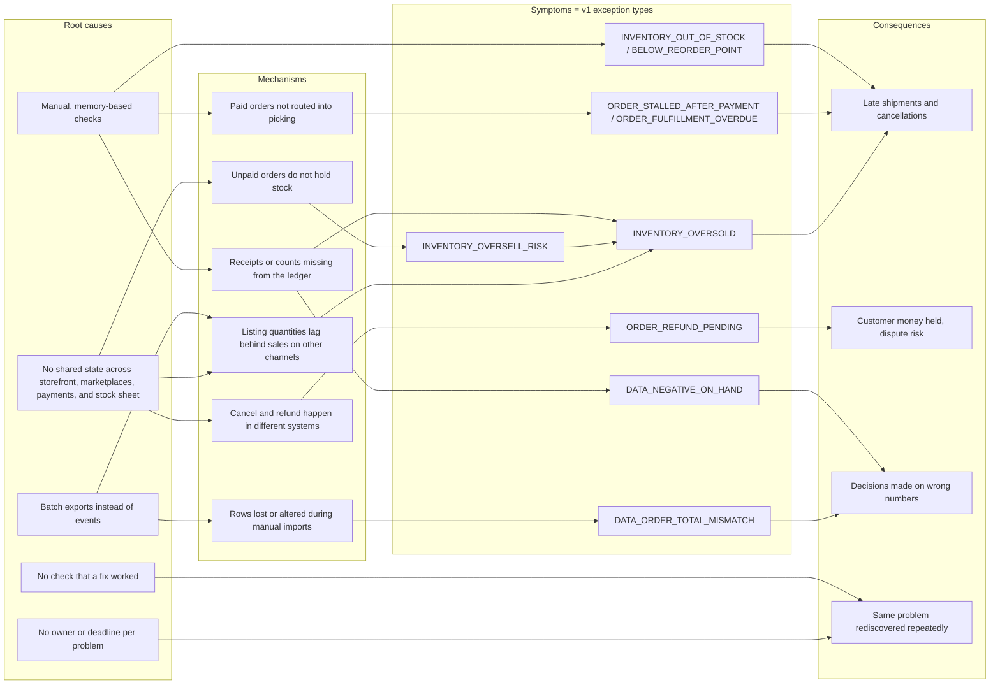
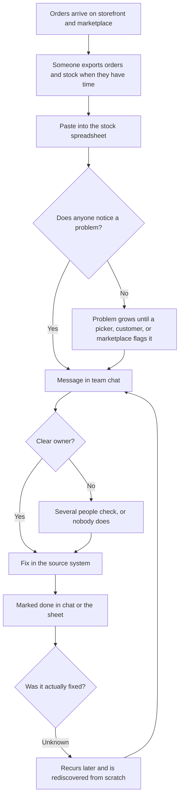
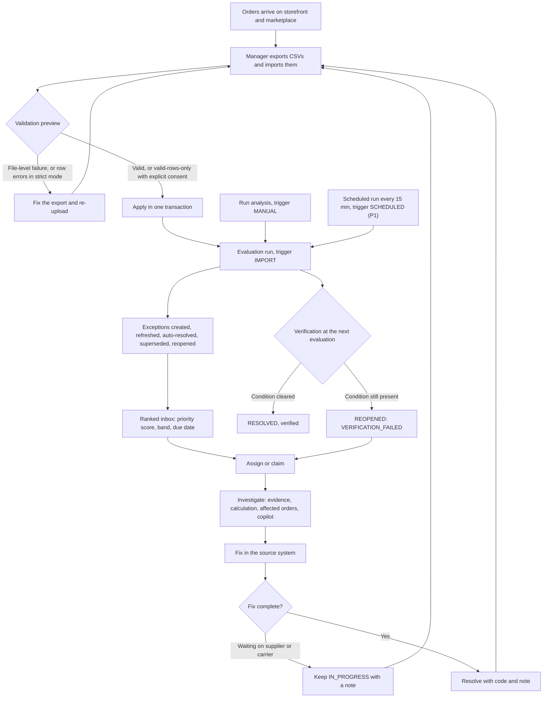

# Problem Analysis

> **Status:** Draft v1 (M0, T-001) · **Owner:** Product/BA · **Last updated:** 2026-10-31
> Related: [PRODUCT_VISION](PRODUCT_VISION.md) · [JOBS_TO_BE_DONE](JOBS_TO_BE_DONE.md) ·
> `docs/domain/EXCEPTION_CATALOG.md` · `docs/domain/BUSINESS_RULES.md`

## 1. Method and labels

This analysis combines desk research with reasoning from the canonical domain model. No field
research has been carried out, and no operator data has been collected. Every claim is labelled:

| Label | Meaning |
|---|---|
| **[Industry practice]** | Established e-commerce practice, or a documented platform or regulatory fact. Where a public source was checked, it is cited as [R1]–[R4] (§11) |
| **[MVP assumption]** | A simplification this product makes in v1 |
| **[Needs validation]** | Plausible, but frequency, severity, or applicability must be confirmed with real operators |

Illustrative scenarios use the fictional demo store "Kestrel Home & Kitchen" (USD,
America/New_York). Their numbers are invented to show the mechanism. They are not observations.

---

## 2. The operating environment

| System | What it holds | How data usually leaves it | Label |
|---|---|---|---|
| Storefront platform | Web orders, payment state per order, listing quantities | Admin screens, CSV exports, APIs | [Industry practice] |
| Marketplace seller account(s) | Marketplace orders, the marketplace's own listing quantity, handling-time settings, seller performance metrics | Seller portal, reports, APIs | [Industry practice] |
| Payment processor | Captures, refunds, disputes | Dashboard, reports | [Industry practice] |
| Shipping tool, 3PL, or warehouse | Labels, tracking numbers, pick lists | Exports, emails | [Industry practice] |
| Stock spreadsheet | Counts, reorder points, incoming deliveries, supplier lead times | Edited by hand | [Needs validation] (common in small stores, but some use an IMS) |
| Team chat and email | Who is doing what | Not structured | [Needs validation] |

Storefront platforms model stock in several states. One platform's documentation separates
*on hand*, *committed* (units in orders placed but not yet fulfilled), *available*, *unavailable*,
and *incoming* (not sellable until received) [R1]. **[Industry practice]** RetailOps Intelligence uses
the same idea: `available = on_hand − reserved` (BR-101), and incoming never counts as available
(BR-103). One difference is deliberate. That platform commits stock when an order is placed, while
RetailOps Intelligence reserves stock when the order is **paid** (BR-120) and treats unpaid orders as
*pending demand* that is compared against `available` in a separate oversell-risk rule (BR-403).
**[MVP assumption]** Platforms differ in when they commit stock, which is one reason the product
keeps pending and committed demand apart. **[Needs validation]**

---

## 3. How operational problems arise

### P-01 Disconnected systems with no shared state

- **Mechanism.** Each system is the source of truth for one slice of a business fact. Whether an
  order is "done" depends on the storefront (status), the payment processor (money), and the
  warehouse (goods). No single system holds all three. **[Industry practice]**
- **Why it matters.** The most expensive problems sit **between** systems: an order cancelled in
  the storefront with its payment still captured, or stock committed on one channel and still listed
  on another. Neither system alone shows the problem. **[Needs validation: frequency]**
- **Product response.** Orders carry three separate status axes (`status`, `payment_status`,
  `fulfillment_status`) so that cross-system facts survive the import (`STATE_MACHINES.md §1.1`).
  **[MVP assumption]**

### P-02 Spreadsheet exports as the integration layer

- **Mechanism.** Small teams move data with CSV exports, copy-paste, and manual imports. **[Needs
  validation: share of stores without an automated sync]**
- **Typical failure modes.**
  - The snapshot is stale as soon as it is exported. **[Industry practice]**
  - Exports skip intermediate states. An order exported as `PAID` yesterday can appear as `SHIPPED`
    today. The product accepts moves to *reachable* states and records the skipped ones
    (`STATE_MACHINES.md §1.2`). **[MVP assumption]**
  - Timestamps without a UTC offset are ambiguous. The product reads them in the store time zone and
    flags `TIMEZONE_ASSUMED` (BR-502). **[MVP assumption]**
  - Rows are lost or altered without trace. A wrong SKU or a non-numeric price makes a row fail, and
    many tools skip it without saying so. The product never skips silently: strict mode is the
    default, and valid-rows-only mode needs explicit consent with the skipped-row count (BR-606).
    **[Needs validation: how often tools drop rows silently]**
  - The same file is imported twice. The product flags `DUPLICATE_FILE` and relies on idempotent
    upserts and adjustment references (BR-607, BR-112). **[MVP assumption]**
  - Exported cells that start with `=`, `+`, `-`, or `@` can execute as formulas when the file is
    opened in a spreadsheet application. Error-CSV exports prefix such cells with an apostrophe.
    **[Industry practice]**
- **How discovered today.** When a number looks wrong in a report, or when an order or SKU is
  missing. **[Needs validation]**

### P-03 Oversell from stock sync lag

- **Mechanism.** The same SKU is listed on several channels. Each channel decrements its own
  listing quantity, and the quantities are reconciled periodically. Between syncs, both channels
  can sell the last units. **[Industry practice]** A second path: unpaid orders do not hold stock,
  so when several pending orders are paid in quick succession, committed demand can exceed physical
  stock. **[Industry practice]**
- **Illustrative scenario (fictional).** SKU `KHK-DO-55` (enamel Dutch oven, 89.00) has 6 units on
  hand. Four paid orders hold 10 units in total: K-1001 (2), K-1002 (3), K-1003 (2), K-1004 (3),
  in that `paid_at` order. `available = 6 − 10 = −4`, so the SKU is oversold (BR-102). FIFO
  allocation by `paid_at` (BR-402) covers K-1001 and K-1002 fully, covers 1 of 2 units on K-1003,
  and none of K-1004. The two affected orders have 4 uncovered units. Exposure is
  `4 × 89.00 = 356.00`, gross order-line value at risk (BR-404). With the nearest affected ship-by
  20 hours away, the priority is `50 + 6 + 10 + 8 + 0 = 74` (band P1, `PRIORITY_MODEL.md`).
- **How discovered today.** At picking, when the shelf is empty, or when a customer asks where the
  order is. **[Needs validation]**
- **Detected in v1 by.** `INVENTORY_OVERSOLD` (`available < 0`) and, earlier,
  `INVENTORY_OVERSELL_RISK` (`available ≥ 0` and `pending_demand > available`).

### P-04 Unprocessed paid orders

- **Mechanism.** An order is paid but never enters the picking flow. Typical reasons: it arrived
  through a channel the team checks less often, it needs a manual step (an address check, a custom
  item), or it fell between shifts. **[Needs validation: reasons and frequency]** Handling-time
  promises are standard. For example, one marketplace's seller standards hold sellers responsible for
  shipping within their stated handling time and count late shipments in seller metrics [R4].
  **[Industry practice]**
- **Illustrative scenario (fictional).** Order K-1187 is paid at 2026-10-12 08:00 EDT. With no
  imported ship-by date, `ship_by = paid_at + 48 h` = 2026-10-14 08:00 EDT (BR-201). If it is still
  `PAID` after 20:00 on 2026-10-12, it is stalled (BR-203, 12 h threshold). From 20:00 on
  2026-10-13 the stalled exception is `HIGH` (12 h or less to ship-by). After 08:00 on 2026-10-14 it
  is overdue (strictly after the deadline, BR-202): `MEDIUM` for the first 24 hours, `HIGH` up to
  72 hours, and `CRITICAL` after 2026-10-17 08:00.
- **How discovered today.** A customer asks, or a marketplace late-shipment warning arrives.
  **[Needs validation]**
- **Detected in v1 by.** `ORDER_STALLED_AFTER_PAYMENT`, then `ORDER_FULFILLMENT_OVERDUE`, which
  supersedes it.

### P-05 Cancelled but not refunded

- **Mechanism.** The cancellation happens in one place (storefront admin, marketplace, customer
  service tool) and the refund in another (payment processor). If the second step is forgotten, the
  order shows `CANCELLED` while the payment stays captured. **[Industry practice]** Card networks have
  dedicated dispute reasons for a cancelled purchase that was never refunded, which one payment
  processor's documentation groups as "credit not processed" [R3]. **[Industry practice]** In the United States, the FTC's
  business guide to the Mail, Internet, or Telephone Order Merchandise Rule sets prompt refund
  deadlines when an order is cancelled under the Rule [R2]. **[Industry practice]** The product's
  default `refund_overdue_hours = 24` is an internal operations target. It is not a legal threshold.
  **[MVP assumption]**
- **Illustrative scenario (fictional).** Order K-1240 (total 64.50) is cancelled at 2026-10-12
  10:00 EDT with `payment_status = PAID`. A refund is pending from that moment (BR-206). After
  24 hours, at the next evaluation, `ORDER_REFUND_PENDING` is raised as `HIGH`. After 72 hours
  (3 × 24 h), it becomes `CRITICAL`.
- **How discovered today.** The customer chases the refund, or a dispute notification arrives.
  **[Needs validation]**
- **Detected in v1 by.** `ORDER_REFUND_PENDING`, auto-resolved when an import shows
  `payment_status = REFUNDED`.

### P-06 Data inconsistencies

- **Mechanism.** Records disagree with each other or with physical reality:
  - **Order totals that do not reconcile** with their lines (BR-205). The most common cause in this
    product's setting is a line that was rejected or missing during import. **[Needs validation]**
  - **Negative physical stock.** A receipt or count was never recorded, so shipments drive
    `on_hand` below zero. Physical stock cannot be negative, so the ledger is incomplete.
    **[Industry practice]**
  - **Stock double-decremented** when a count already reflects shipped orders and a shipment
    movement is also written. The product prevents this with the cycle-count cutoff (BR-130,
    ADR-0012). **[MVP assumption]**
- **Illustrative scenario (fictional).** Order K-1302 has three lines in the storefront. In the
  `order_items.csv` import, one line fails with `UNKNOWN_SKU` because the product had not been
  imported yet. The two imported lines sum to less than the order total, so
  `DATA_ORDER_TOTAL_MISMATCH` is raised. Its evidence notes the rejected import row.
- **How discovered today.** During month-end reconciliation, or never. **[Needs validation]**
- **Detected in v1 by.** `DATA_ORDER_TOTAL_MISMATCH`, `DATA_NEGATIVE_ON_HAND`. Invalid CSV rows are
  reported as import issues, not exceptions, because they were never persisted
  (`EXCEPTION_CATALOG.md`).

### P-07 Replenishment triggered too late

- **Mechanism.** A reorder point is crossed, but nobody compares the remaining days of cover with
  the supplier's lead time. **[Industry practice]** (reorder points and lead times are standard
  inventory concepts).
- **Illustrative scenario (fictional).** A SKU has 8 available, a reorder point of 10, sells about
  1.5 units a day (an estimate, BR-150), and its supplier needs 14 days. Days of cover is about 5.3,
  which is less than the lead time, so `INVENTORY_BELOW_REORDER_POINT` is `HIGH`. The recommended
  quantity is `reorder_point × 2 − available − incoming = 20 − 8 − 0 = 12` units when no
  `reorder_quantity` is set.
- **How discovered today.** When the SKU sells out. **[Needs validation]**
- **Detected in v1 by.** `INVENTORY_BELOW_REORDER_POINT`, `INVENTORY_OUT_OF_STOCK`.

### P-08 No ownership and no verification (the meta-problem)

- **Mechanism.** Even when a problem is spotted, it is raised in a chat thread. Nobody is clearly
  responsible, there is no deadline, and "done" is never checked against data. Problems recur and are
  rediscovered from scratch. **[Needs validation: this is the product's central premise]**
- **Product response.** One active exception per condition (dedup key), an assignee and `due_at`,
  an immutable event history, and verification at the next evaluation (`STATE_MACHINES.md §3.3`).
  **[MVP assumption]**

---

## 4. How each problem is discovered today

| Problem | Typical discovery signal | Who notices | Discovery timing | Label |
|---|---|---|---|---|
| P-03 Oversell | Empty shelf at picking; customer asks | Picker, customer service | After payment, often near the ship-by deadline | [Needs validation] |
| P-04 Unprocessed paid order | Customer asks; marketplace late-shipment metric | Customer service, owner | After the deadline | [Needs validation] |
| P-05 Refund not issued | Customer chases; dispute notification | Customer service, owner | Days after cancellation | [Needs validation] |
| P-06 Total mismatch | Month-end reconciliation | Analyst, bookkeeper | Weeks later, or never | [Needs validation] |
| P-06 Negative on hand | Stock figure looks impossible | Whoever reads the sheet | Unpredictable | [Needs validation] |
| P-07 Late replenishment | SKU sells out | Manager | After the stockout | [Needs validation] |
| P-02 Lost import rows | A record is missing in a later report | Analyst | Unpredictable | [Needs validation] |

The common pattern: the problem is discovered by its **consequence**, not by its **condition**.
**[Needs validation]**

## 5. Cost of late discovery

The product does **not** estimate the money lost to late discovery. It reports gross order-line value
at risk (BR-404) and makes deadlines explicit. What can be stated is how cost grows with time: each
problem has a business deadline, and options narrow once it passes.

| Problem | Deadline that matters | Before the deadline | After the deadline | Label |
|---|---|---|---|---|
| Oversell risk (P-03) | Pending orders being paid | Pause or limit the listing; confirm incoming stock | Becomes an oversold SKU with committed customers | [Industry practice] |
| Oversold (P-03) | Earliest `ship_by` of affected orders | Expedite stock; contact customers; offer alternatives | Late shipment or cancellation; on at least one marketplace, late shipments count in seller metrics [R4] | [Industry practice] |
| Stalled order (P-04) | `ship_by` | Move into processing | Overdue; in the US, the FTC guide expects sellers who cannot ship on time to seek the customer's consent to the delay [R2] | [Industry practice] |
| Refund pending (P-05) | `cancelled_at + refund_overdue_hours` | Issue the refund | Customer money held longer; risk of a "credit not processed" dispute [R3] | [Industry practice] |
| Total mismatch (P-06) | Next financial reconciliation | Re-import the missing line | Reports and decisions use wrong totals | [Needs validation] |
| Negative on hand (P-06) | Next oversell or reorder decision | Cycle count | Wrong available-stock figures feed every inventory rule | [MVP assumption] |
| Below reorder point (P-07) | `days_of_cover` vs supplier lead time | Reorder | Stockout; lost sales are not estimated by the product (`EXCEPTION_CATALOG.md`) | [Industry practice] |

Indirect costs: staff time spent rediscovering the same problem, duplicated effort when two people
work one issue, and management time reconstructing what happened. **[Needs validation: magnitude]**

---

## 6. Root-cause chain

**Five whys for the oversold scenario (illustrative, fictional):**

1. *Why* could K-1003 and K-1004 not be picked? The SKU had 6 units on hand and 10 committed.
2. *Why* were 10 units committed? Marketplace orders were paid while the marketplace listing still
   showed stock.
3. *Why* did the listing still show stock? Its quantity was updated once a night from the stock
   spreadsheet.
4. *Why* once a night? The sync is a manual export and import, done when someone has time.
5. *Why* did nobody see it before picking? Nothing compared committed demand with on-hand stock
   between syncs, and no one was responsible for doing so.

Root causes 4 and 5 are what RetailOps Intelligence addresses directly: a rule compares the quantities
at every evaluation, and the result gets an owner. Root causes 1–3 remain in the source systems.
**[MVP assumption]**

---

## 7. Current-state workflow

**Weak points (all [Needs validation]):** detection depends on someone looking (D), ownership is
implicit (G), and completion is never verified (K).

## 8. Future-state workflow (v1)

| Step | Current state | Future state (v1) | Label |
|---|---|---|---|
| Data arrival | Ad-hoc exports pasted into a sheet | Validated imports with a row-level issue report; nothing skipped silently | [MVP assumption] |
| Detection | Someone notices a consequence | Nine rules at every evaluation (import, manual, scheduled) | [MVP assumption] |
| Prioritisation | Whoever shouts loudest | Transparent score: severity, affected orders, exposure, deadline, age | [MVP assumption]; weights [Needs validation] |
| Ownership | Implicit | Assignee, claim, `due_at`, assignment history | [MVP assumption] |
| Investigation | Three systems open side by side | One view: evidence, calculation, affected orders, related exceptions, history, copilot | [MVP assumption] |
| Fix | In the source system | Still in the source system (unchanged) | [MVP assumption] |
| Closure | "Done" in chat | Resolution code and note; verified by the next evaluation; reopened if the condition persists | [MVP assumption] |

## 9. What the product does not solve

- **Sync lag itself.** The product detects the consequences of lag. It does not sync listing
  quantities across channels. **[MVP assumption]**
- **Data freshness.** Detection can only be as current as the latest import. Time-based rules
  (stalled, overdue, refund pending) advance with the clock between imports, but inventory and
  data-quality rules only change when new data arrives. **[MVP assumption]**
- **Acting in source systems.** Shipping, refunding, and listing changes stay manual and outside
  the product. **[MVP assumption]**

## 10. Questions to validate

| # | Question | Why it matters |
|---|---|---|
| V-1 | Which of P-03 to P-07 happen most often in small stores, and which cost the most? | Rule priorities and default severities |
| V-2 | How long after the condition starts is each problem discovered today? | Baseline for time-to-detect (M-01) |
| V-3 | How often are exports imported? | Data freshness bounds every inventory and data-quality detection |
| V-4 | Do platforms in the target segment commit stock at order placement or at payment? | Whether reserve-on-payment (BR-120) matches what operators see in their admin |
| V-5 | What handling time and refund turnaround do stores promise publicly? | Defaults for `fulfillment_sla_hours` and `refund_overdue_hours` |

## 11. References (verified 2026-10-31)

| ID | Source | Used for |
|---|---|---|
| [R1] | Shopify Help Center, "Inventory states": <https://help.shopify.com/en/manual/products/inventory/managing-inventory-quantities/inventory-states> | Platform inventory states (on hand, committed, available, unavailable, incoming); committed covers units in placed, unfulfilled orders; incoming is not sellable until received |
| [R2] | U.S. Federal Trade Commission, "Business Guide to the FTC's Mail, Internet, or Telephone Order Merchandise Rule": <https://www.ftc.gov/business-guidance/resources/business-guide-ftcs-mail-internet-or-telephone-order-merchandise-rule> | US sellers need a reasonable basis for stated shipping times (30 days when none is stated), must seek consent to delays, and must refund promptly when an order is cancelled under the Rule. US-specific. This product does not model legal compliance |
| [R3] | Stripe Docs, "Dispute reason code categories": <https://docs.stripe.com/disputes/categories> | "Credit not processed" dispute category: the cardholder says a cancelled or returned purchase was not refunded |
| [R4] | eBay Help, "Seller performance standards": <https://www.ebay.com/help/selling/selling-seller-performance/seller-performance-standards?id=4347> | Sellers are responsible for shipping within their stated handling time; late shipments are tracked as a seller metric |

These sources support the general mechanisms above. None of them provides data about how often the
problems occur in small stores, which remains **[Needs validation]**.
