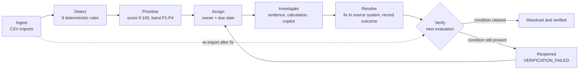

# Product Vision

> **Status:** Draft v1 (M0, T-001) · **Owner:** Product/BA · **Last updated:** 2026-10-31
> Related: [PERSONAS](PERSONAS.md) · [JOBS_TO_BE_DONE](JOBS_TO_BE_DONE.md) ·
> [PROBLEM_ANALYSIS](PROBLEM_ANALYSIS.md) · [SUCCESS_METRICS](SUCCESS_METRICS.md) ·
> [SCOPE_AND_NON_GOALS](SCOPE_AND_NON_GOALS.md) · [FEATURE_CATALOG](FEATURE_CATALOG.md)

RetailOps Intelligence is an independent portfolio project. It has no production users, no customers,
and no usage data. Every claim in the product documents carries one of three labels:

| Label | Meaning |
|---|---|
| **Industry practice** | An established practice in e-commerce operations, or a documented platform/regulatory fact (cited where a source was verified) |
| **MVP assumption** | A simplification made for v1 so the product can be built and tested. Documented so it can be revisited |
| **Needs validation** | A belief that must be checked with real operators before anyone relies on it |

---

## 1. Tagline

**Turn operational chaos into clear decisions.**

## 2. Vision statement

For small and mid-sized e-commerce operations teams who run their business across a storefront, one
or more marketplaces, a payment processor, and a set of spreadsheets, **RetailOps Intelligence is the
exception layer that sits on top of those systems.** It ingests product, order, and inventory data,
detects operational problems with deterministic rules, ranks them by what to work on first, gives
each one an owner and a due date, and then checks the data again to confirm the problem is really
gone.

Unlike a dashboard, it does not stop at showing numbers. Unlike a task tracker, nobody has to notice
the problem and file it by hand. Unlike a general AI chat over data, every fact it shows is computed by
a tested rule and carries a reference to the record it came from.

## 3. Problem statement

In a small online store, the information needed to spot an operational problem usually exists, but
it is spread across systems that do not share state: the storefront admin, the marketplace seller
account, the payment processor, the stock spreadsheet. *(Industry practice)* Problems are found when
someone happens to look, often after a customer has already noticed. *(Needs validation)* When
somebody does fix a problem, nothing confirms the fix worked. *(MVP assumption, the premise this
product tests)*

Four failure patterns recur. The full analysis is in [PROBLEM_ANALYSIS](PROBLEM_ANALYSIS.md).

1. **Stock promised twice.** A SKU sells on two channels faster than stock counts sync, so paid
   orders exceed physical stock (`INVENTORY_OVERSOLD`), or pending orders are about to
   (`INVENTORY_OVERSELL_RISK`).
2. **Paid orders that stop moving.** An order is paid but never enters picking, and the ship-by
   deadline passes (`ORDER_STALLED_AFTER_PAYMENT` → `ORDER_FULFILLMENT_OVERDUE`).
3. **Money held after cancellation.** An order is cancelled but the customer's payment is still
   captured (`ORDER_REFUND_PENDING`).
4. **Data that does not add up.** Order totals that do not match their lines
   (`DATA_ORDER_TOTAL_MISMATCH`), physical stock below zero (`DATA_NEGATIVE_ON_HAND`), and CSV rows
   that silently disappear during a manual import.

## 4. Value proposition: the seven questions

The product is built to answer seven questions for every operational problem. Each answer comes from
a deterministic mechanism defined in the canonical domain documents. The AI copilot explains these
answers. It does not produce them.

| # | Question | What the product provides | Mechanism (canonical source) | Features |
|---|---|---|---|---|
| 1 | **What is happening?** | An overview of the order pipeline by status, inventory health counts, active exceptions by priority band, the last evaluation run, and how fresh each data type is | Analytics module over orders, inventory, exceptions, imports (`DOMAIN_MODEL.md §1`) | F-010 |
| 2 | **What is wrong?** | A deduplicated list of operational exceptions produced by nine versioned rules (inventory, fulfillment, payment, data quality) | `EXCEPTION_CATALOG.md`, dedup and reconciliation in `STATE_MACHINES.md §3.3` | F-006, F-007 |
| 3 | **Why does it matter?** | Severity, gross order-line value at risk ("exposure", never "loss"), business deadline, affected-order count, and a 0–100 priority score with its full breakdown | `PRIORITY_MODEL.md`, BR-404 | F-007, F-009 |
| 4 | **What is the evidence?** | Typed evidence facts linked to source records, the formula inputs and outputs, the affected orders (for an oversold SKU: FIFO allocation by `paid_at`), and the event history | Finding structure in `EXCEPTION_CATALOG.md`, BR-402 | F-009 |
| 5 | **What should we do next?** | A rule-authored recommended action for every exception type, plus copilot explanations that label facts, estimates, and recommendations separately | `recommended_action` per rule, structured answer schema (F-011) | F-009, F-011 |
| 6 | **Who owns it?** | An assignee, a due date (`due_at`) derived from severity and business deadline, a priority band with an expected response time, and a full assignment history | `STATE_MACHINES.md §3.2`, `PRIORITY_MODEL.md` (due date) | F-008 |
| 7 | **Was it resolved?** | A manual resolution is verified by the next evaluation. If the condition is still present, the exception returns as `REOPENED` (`VERIFICATION_FAILED`). If it comes back within 72 hours, it reopens as `RECURRED_WITHIN_WINDOW` | `STATE_MACHINES.md §3.3–3.4` | F-006, F-008 |

Question 7 is the main difference from a task tracker. In RetailOps Intelligence, "resolved" is a claim
the system checks against the data, not a checkbox.

## 5. The operating loop

The product never changes the source systems. The fix (shipping the order, issuing the refund,
correcting stock) happens in the storefront, payment processor, or warehouse. RetailOps Intelligence
detects the problem, organises the work, and confirms the outcome from the next data import.
*(MVP assumption: CSV import is the only ingestion path in v1)*

## 6. Product principles

These principles decide trade-offs. When two of them conflict, the earlier one wins.

1. **Deterministic facts, explanatory AI.** Every business-critical number (available stock,
   overdue hours, exposure, priority) comes from a pure, tested rule function that receives an
   explicit `as_of` (BR-504). The AI explains and recommends. It never invents a fact, never writes
   business data, and never changes a status without a person's action.
2. **Show the working.** Every exception shows its evidence, the calculation that produced it, and
   its priority breakdown (S + A + E + D + T). A number that cannot be traced to records does not
   appear in the product.
3. **Exposure is not loss.** Monetary figures are gross order-line value at risk (BR-404). The
   product never labels them as loss, revenue impact, or savings.
4. **Nothing happens silently.** Imports never skip rows without explicit consent (BR-606). Ledger
   drift is reported, never silently fixed (BR-104). Skipped order states are recorded in the order
   event history (`STATE_MACHINES.md §1.2`). Negative available stock is shown, never clamped
   (BR-102).
5. **Resolution is verified, not declared.** A person's "resolved" is checked by the next evaluation
   (`STATE_MACHINES.md §3.4`).
6. **One condition, one record.** A deterministic dedup key gives at most one active exception per
   condition, so the queue does not fill with repeats. The detection count shows how long a
   condition has persisted.
7. **Least privilege, enforced on the server.** Permissions come from a code-defined role matrix
   (ADR-0007) and are checked in the backend. Hiding a button is never the control.
8. **Usable without an LLM.** With no LLM provider key configured, the copilot answers through
   deterministic intent routing, allowlisted tools, and templates. Every core workflow works without AI.
9. **Collect only what the job needs.** Customers are opaque references (BR-505). The product stores
   no names, addresses, emails, or phone numbers.
10. **Label estimates as estimates.** Sales velocity and days of cover ignore seasonality and
    promotions, and the UI and AI say so (BR-152). The priority score is a heuristic with default
    weights that have not been validated with operators (`PRIORITY_MODEL.md`, Limitations).

## 7. Positioning

RetailOps Intelligence complements the systems a store already uses. It is not a system of record for
orders or stock. The table compares product categories, not named products. Statements about what a
category typically does are generalisations. Individual products vary.

| Category | What it does well | Gap for exception operations | How RetailOps Intelligence differs |
|---|---|---|---|
| **Spreadsheets and exported reports** | Flexible, familiar, free, and easy to share. Good for ad-hoc analysis *(Industry practice)* | A spreadsheet holds a snapshot that is stale as soon as it is exported. Formulas are not versioned or tested. There is no owner, deadline, or history per problem, and rows can be lost in copy-paste without trace *(Needs validation: frequency and impact)* | Validated imports with a row-level issue report, rules versioned as code (`INV-OVERSOLD@1`), and one tracked record per condition with owner, due date, and history |
| **Storefront and marketplace admin panels** | Authoritative per-channel view of orders, payments, and listings, where the actual fix is made *(Industry practice)* | Each panel shows its own channel. Problems that span systems, such as stock committed on two channels or a cancellation in one system and a captured payment in another, need a person to compare them *(Needs validation)* | Combines exports from several sources into one store-level view, detects conditions that span channels, and ranks them in one queue |
| **Inventory and order management systems (IMS/OMS)** | Sync stock across channels, route orders, and run fulfillment workflows *(Industry practice)* | Their job is to execute operations. Tracking accountability for exceptions (who owns a problem, whether the fix held) is usually not their focus *(Needs validation)* | Watches the data those systems export and tracks the follow-up. It works alongside an IMS/OMS and never replaces it |
| **BI and dashboard tools** | Aggregate trends and flexible charting *(Industry practice)* | A chart shows that overdue orders went up. It does not give each overdue order an owner, a deadline, and a verification step | Each condition is a tracked record. Trends are a by-product of the exception lifecycle, not the main surface |
| **Helpdesk and task trackers** | Assignment, due dates, collaboration *(Industry practice)* | Someone has to notice the problem and create the ticket. Closing the ticket says nothing about whether the data changed | Tickets are created, refreshed, and auto-resolved by rules, and manual resolutions are verified against the data |
| **General-purpose AI chat over data** | Natural-language questions without writing queries | Answers may mix computed facts with plausible guesses, and the provenance of each number is often unclear | The copilot can only call allowlisted, permission-checked tools. Its answers separate facts (with record references), metrics (with formulas), estimates, and recommendations |

**Positioning statement.** For an operations team that already has a storefront and possibly an
IMS, RetailOps Intelligence is the layer that turns their exports into an accountable exception
queue: detected by rules, ranked by a transparent score, owned by a person, and verified by data.
*(Needs validation: whether teams see this as a separate product or expect it inside their IMS)*

## 8. Who it is for

| Persona | Primary need | Role in the product |
|---|---|---|
| Store Owner | Know which problems put customers and money at risk without reading every report | `OWNER` |
| Operations Manager | One ranked queue across inventory, fulfillment, payment, and data quality, with assignment and verification | `MANAGER` |
| Operations Staff | A personal work queue where each item carries its evidence and a concrete next step | `STAFF` |
| Analyst | Reproducible numbers, trends, and an audit trail for root-cause work | `ANALYST` |
| Demo visitor (access mode, not a persona) | Explore a realistic store without registering and without changing shared data | `VIEWER` |

Details are in [PERSONAS](PERSONAS.md). All personas are proto-personas built from assumptions.

**Target segment (MVP assumption).** Single-brand online stores selling physical goods through their
own storefront and one or more marketplaces, from one stock location (BR-005, ADR-0005), in one
currency and time zone per store (BR-004). A demo store, "Kestrel Home & Kitchen" (fictional,
USD, America/New_York), shows this segment.

## 9. Strategic bets to validate

| Bet | Label | Why it matters | How it would be validated |
|---|---|---|---|
| A single ranked queue across categories is more useful than separate per-domain views | Needs validation | It is the core UX premise | Observe whether managers work the queue top-down or filter by category first |
| CSV import is an acceptable integration path for v1 | Needs validation | It decides whether the product can be adopted without connectors | Time how long it takes to map a real platform export to the four CSV contracts |
| Verification-based reopening builds trust rather than frustration | Needs validation | Reopens based on stale data could feel like noise (see [SCOPE_AND_NON_GOALS](SCOPE_AND_NON_GOALS.md), risks) | Track reopen reasons and dismissals per rule (M-13, M-16 in [SUCCESS_METRICS](SUCCESS_METRICS.md)) |
| Default thresholds (48 h SLA, 12 h stall, 24 h refund, 72 h reopen window) fit small stores | Needs validation | Wrong defaults produce either noise or silence | Compare with each store's published handling times and refund policy |
| A deterministic copilot is useful without an LLM | MVP assumption | The product must work fully without a key | Run the evaluation dataset (T-074) against both providers |

## 10. What this product is not

It is not a storefront, a payment processor, a shipping tool, an IMS/OMS, an accounting system, or a
forecasting engine. It does not write back to source systems in v1. See
[SCOPE_AND_NON_GOALS](SCOPE_AND_NON_GOALS.md) for the full list and the reasons.
