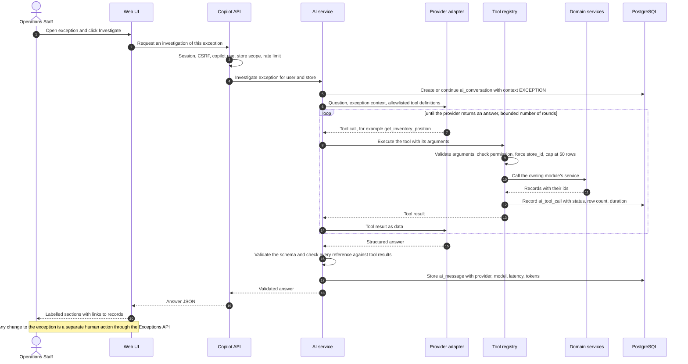

# AI-Assisted Investigation Workflow

> **Status:** v1 business workflow (milestone M1, task T-010). **Owner:** Product / BA.
> **Canonical sources:** AGENTS.md §1 and §5 (product principle, allowlisted tools),
> [`EXCEPTION_CATALOG.md`](../domain/EXCEPTION_CATALOG.md) (evidence, calculation, rule-authored
> recommended action), [`STATE_MACHINES.md §3`](../domain/STATE_MACHINES.md) (who may change an
> exception), [`DOMAIN_MODEL.md`](../domain/DOMAIN_MODEL.md) (AIConversation, AIMessage, AIToolCall,
> ExceptionNote). The AI architecture, tool catalogue, prompts, and evaluation are specified by the AI
> engineer in `docs/ai/`; this document describes the user-facing workflow and must stay consistent
> with it.

Labels for anything the canonical docs do not settle: **Industry practice**, **MVP assumption**,
**Needs validation**. The example uses the fictional demo store *Kestrel Home & Kitchen* (USD,
`America/New_York`) and the oversold skillet from [INVENTORY_LIFECYCLE.md §4.1](./INVENTORY_LIFECYCLE.md).

---

## 1. Principle

> Business-critical facts and calculations are deterministic and testable. AI explains and recommends.
> It never invents facts or bypasses business rules. (AGENTS.md §1)

In this workflow that means:

- Everything that **decides** something is deterministic: detection, evidence, calculation, severity,
  priority, due date, the rule's recommended action, and verification.
- The AI **reads** through allowlisted tools and **writes text**: a summary, labelled facts and metrics
  with references, estimates with their basis, and suggestions with their rationale.
- Only a **person** changes an exception or saves a note.

## 2. Actors and systems

| Actor / system | Role |
|---|---|
| Operations Staff (typical user) | Investigates exceptions assigned to them, acts, writes notes |
| Operations Manager | Investigates during triage, decides on dismissal or reassignment |
| Analyst, demo Viewer | Can read exceptions and use the copilot, but cannot change exceptions or save notes |
| Web UI | Exception detail page with the investigation panel |
| Copilot API and AI service (`ai` module) | Authorises the request, runs the provider, validates the answer, stores conversation and tool-call records |
| Tool registry | The only door from the AI to data: 11 allowlisted, read-only tools |
| Domain services | `exceptions`, `orders`, `inventory`, `catalog`, `imports`, `analytics`: the tools call them, never the database directly |
| LLM provider adapter | An LLM provider adapter when an API key is configured on the server (the key never reaches the browser); the `deterministic` adapter otherwise. The product is fully usable with the deterministic adapter |

## 3. The investigation journey

| # | User step | What the user sees | Source |
|---|---|---|---|
| 1 | Opens an exception from the inbox, overview, or an order or product page | Header: title, type, severity, priority score and band, status, assignee, `due_at`, first and last detection, detection count | Exception record (deterministic) |
| 2 | Reads the details | **Evidence**: typed facts, each with its value and source record (on hand, reserved, incoming and ETA, affected orders with uncovered quantities) | `evidence` (deterministic) |
| 3 | Reads why it was raised | **Detection explanation**: the rule id and the calculation, written out. Example: "`INV-OVERSOLD@1`: available = on hand − reserved = 19 − 21 = −2, which is below 0." Plus the **priority breakdown**: "S 50 + A 3 + E 8 + D 4 + T 0 = 65 (P2)" | `calculation`, `priority_breakdown` (deterministic, never AI) |
| 4 | Looks at related records | Linked product, affected orders, recent movements, open exceptions on the same entities, rejected import rows for these entities | Entity links and module services (deterministic) |
| 5 | Checks history | Timeline of events (detected, evidence updated, severity changed, assigned, status changes, superseded) and notes | `exception_event`, `exception_note` |
| 6 | Reads the rule's next step | **Recommended action** from the catalog, for example "Confirm physical stock with a cycle count. Then expedite incoming stock or contact the affected customers about a delay, starting with the most recent orders." | Rule-authored text (deterministic) |
| 7 | Clicks **Investigate** (or asks a question in the panel) | **AI investigation summary** with labelled sections: summary, facts, metrics, estimates, suggestions, limitations, references, data window, and a badge "Deterministic summary" or "LLM-assisted" | AI service (§5) |
| 8 | Follows references | Each fact or metric links to the record it came from | References |
| 9 | Decides and acts | Uses the normal controls: acknowledge, claim, start, resolve, dismiss, assign, add note. Optionally asks the AI to **draft a note**, edits it, and accepts or discards it | Exceptions API with normal permissions and audit |

**MVP assumption:** the AI summary is generated on demand, not when the page opens. That keeps the
deterministic page fast and respects the copilot rate limit (20 requests per minute per user; per
session for the shared demo viewer). A validated LLM summary is reused while the exception's evidence
and history are unchanged, and is shown with its generation time and a **Regenerate** action;
deterministic summaries are always computed fresh (`docs/ai/AI_ARCHITECTURE.md §8.3`).

## 4. Sequence



With the deterministic adapter, the provider steps are replaced by intent routing and a fixed tool plan
(§6), but the registry, validation, and records are the same.

## 5. What the answer contains, and how its parts differ

The answer follows the structured schema `{summary, facts, metrics, estimates, recommendations,
limitations, references, data_window, generated_by}`. The UI renders each part under its own label.

| Part | Definition | Must carry | Never |
|---|---|---|---|
| **Fact** | A value read from a record and stated as it is | `refs` to the records it came from | Interpreted, rounded into a different meaning, or unreferenced |
| **Metric** | A number computed by a documented formula from facts | `value`, `unit`, `formula` (with the BR id where one exists), `refs` | Computed with a formula that differs from the business rules |
| **Estimate** | A forward-looking or statistical value: velocity, days of cover, "would arrive after the deadline" | `basis`: data and method; labelled "estimate" (BR-152) | Presented as a fact |
| **Recommendation** (shown as "Suggestion") | An action the person might take | `rationale` tied to facts or metrics | Executed by the AI, or confused with the rule's recommended action |
| **Limitation** | What the answer cannot know or did not check | plain text | Omitted when data was capped, missing, or estimated |

The rule's **recommended action** (step 6) and the AI's **suggestions** are shown in separate, labelled
places: the first is a deterministic, tested rule output; the second is advice.

### 5.1 Worked example (deterministic adapter)

`INVENTORY_OVERSOLD` for `KHK-SKL-28`, investigated on Fri Nov 6 2026 at 11:30 EST. Reference keys
such as `order:KHK-100505` are illustrative; the exact reference format is defined in `docs/ai/`.

```json
{
  "summary": "KHK-SKL-28 is oversold by 2 units. Order KHK-100505 cannot be fully shipped from current stock, and the 40 units on order are due after its ship-by deadline.",
  "facts": [
    {"text": "On hand is 19 units. The last cycle count, on Mon Nov 2 08:00 EST, was 24.", "refs": ["inventory_position:KHK-SKL-28", "movement:CC-1102-A"]},
    {"text": "Since that count, 3 units shipped (KHK-100501) and 2 were written off as damaged (DMG-118).", "refs": ["movement:SHIPMENT:KHK-100501", "movement:DMG-118"]},
    {"text": "21 units are reserved for two paid orders: KHK-100503 (12 units) and KHK-100505 (9 units).", "refs": ["order:KHK-100503", "order:KHK-100505"]},
    {"text": "KHK-100505 was paid on Fri Nov 6 11:20 EST and must ship by Sun Nov 8 11:20 EST.", "refs": ["order:KHK-100505"]},
    {"text": "40 units from Ironleaf Cookware are expected on Mon Nov 9 12:00 EST (PO-7781-EXP).", "refs": ["movement:PO-7781-EXP", "product:KHK-SKL-28"]}
  ],
  "metrics": [
    {"label": "Available", "value": -2, "unit": "units", "formula": "on_hand - reserved = 19 - 21 (BR-101)", "refs": ["inventory_position:KHK-SKL-28"]},
    {"label": "Uncovered on KHK-100505", "value": 2, "unit": "units", "formula": "FIFO by paid_at: 19 - 12 for KHK-100503 leaves 7 for 9 ordered (BR-402)", "refs": ["order:KHK-100503", "order:KHK-100505"]},
    {"label": "Gross order-line value at risk", "value": "108.00", "unit": "USD", "formula": "2 x 54.00 (BR-404)", "refs": ["order:KHK-100505"]},
    {"label": "Priority", "value": 65, "unit": "score", "formula": "S 50 + A 3 + E 8 + D 4 + T 0 (PRIORITY_MODEL)", "refs": ["exception:INVENTORY_OVERSOLD:KHK-SKL-28"]}
  ],
  "estimates": [
    {"text": "If PO 7781 arrives on its ETA, KHK-100505 would ship about one day after its deadline.", "basis": "ETA Mon Nov 9 12:00 EST from the INCOMING_EXPECTED adjustment versus ship_by Sun Nov 8 11:20 EST. The ETA is not confirmed by the supplier."},
    {"text": "At about 1.5 units per day, new paid orders before the ETA would deepen the shortage by roughly 4 to 5 units.", "basis": "Sales velocity of 42 units in the last 28 days (BR-150) over about 3 days to the ETA. Ignores seasonality and promotions (BR-152)."}
  ],
  "recommendations": [
    {"text": "Count the KHK-SKL-28 bin before acting.", "rationale": "The shortage is only 2 units and the last count is 4 days old, with a damage write-off since."},
    {"text": "Ask Ironleaf Cookware whether PO 7781 can arrive before Sun Nov 8 11:20 EST.", "rationale": "Arrival before the deadline removes the late shipment entirely."},
    {"text": "If it cannot, contact the customer on KHK-100505 through the sales channel about a short delay.", "rationale": "It is the only affected order under FIFO allocation."}
  ],
  "limitations": [
    "The incoming ETA comes from an imported adjustment and is not confirmed by the supplier.",
    "RetailOps stores no customer contact details (BR-505); contact happens in the sales channel.",
    "Exposure is gross order-line value at risk, not a measured loss."
  ],
  "references": [
    {"type": "product", "id": "<uuid>", "label": "KHK-SKL-28 Cast-iron skillet 28 cm"},
    {"type": "order", "id": "<uuid>", "label": "KHK-100505"},
    {"type": "order", "id": "<uuid>", "label": "KHK-100503"}
  ],
  "data_window": {"from": "2026-10-09T16:30:00Z", "to": "2026-11-06T16:30:00Z"},
  "generated_by": "deterministic"
}
```

The answer recommends no partial shipment, because v1 assumes one shipment per order (DOMAIN_MODEL §3).
What happened next, in the data: the stock was counted, PO 7781 arrived early on Sat Nov 7, and the
exception auto-resolved ([INVENTORY_LIFECYCLE.md §4.1](./INVENTORY_LIFECYCLE.md), steps 11–12).

## 6. Behaviour with no LLM key: the deterministic adapter

When no API key is configured, every copilot request is answered by the deterministic adapter: intent
routing → allowlisted tools → templated, grounded answer, with `generated_by = "deterministic"`. The
product is fully usable this way, and the public demo can run without any key.

Tool plans for an exception investigation (**MVP assumption**; the canonical plans are owned by
`docs/ai/`):

| Exception type | Tools called | Template emphasis |
|---|---|---|
| `INVENTORY_OVERSOLD` | `get_exception`, `get_exception_history`, `get_inventory_position`, `get_inventory_movements`, `get_related_orders`, `get_product` | Shortage, FIFO-affected orders, incoming versus earliest deadline |
| `INVENTORY_OVERSELL_RISK` | `get_exception`, `get_inventory_position`, `get_related_orders`, `get_product` | Pending orders oldest first, potential shortage, incoming |
| `INVENTORY_OUT_OF_STOCK`, `INVENTORY_BELOW_REORDER_POINT` | `get_exception`, `get_inventory_position`, `get_product`, `get_inventory_movements` | Velocity and days of cover (estimates), supplier lead time, incoming |
| `ORDER_FULFILLMENT_OVERDUE`, `ORDER_STALLED_AFTER_PAYMENT` | `get_exception`, `get_related_orders`, `get_exception_history`, `list_exceptions` (open inventory exceptions on the order's products) | Hours overdue, status-specific blocker, linked stock shortage |
| `ORDER_REFUND_PENDING` | `get_exception`, `get_related_orders`, `get_exception_history` | Hours since cancellation, escalation point, amount held |
| `DATA_ORDER_TOTAL_MISMATCH` | `get_exception`, `get_related_orders`, `get_import_errors` | Expected versus recorded total, rejected rows for the order |
| `DATA_NEGATIVE_ON_HAND` | `get_exception`, `get_inventory_movements`, `get_inventory_position` | Last movements and last count, suggestion to count |

General copilot questions are routed by intent, for example "What should I work on first?" →
`get_dashboard_summary`, `list_exceptions`; "Which orders are late?" → `get_overdue_orders`; "Why was
part of this morning's import skipped?" → `get_import_errors`; "How did fulfillment trend this month?"
→ `get_operational_trends`. A question that matches no intent gets an answer listing what the copilot can
answer, never a guess.

What the user gives up without a key: free-form phrasing and synthesis across unusual questions. What
stays the same: the facts, metrics, references, guardrails, and records.

## 7. When data is insufficient

| Situation | Behaviour |
|---|---|
| Product has no sales in the velocity window | Velocity is "not enough sales history" (BR-151). No days-of-cover estimate; a limitation says so |
| Supplier or lead time unknown | No lead-time comparison; a limitation says so |
| A tool result hits the 50-row cap (for example 137 affected orders) | The answer says "showing 50 of 137". Totals come from the exception's own calculation, which covers the full set, never from the capped list |
| The exception changed since it was opened (refreshed, superseded, auto-resolved) | The answer states the current status and links the superseding exception |
| The question needs data RetailOps does not hold: customer contact details, carrier tracking events, margins per order, supplier confirmations | The answer says the data is not available in RetailOps and where it usually lives. It never fills the gap with plausible values |
| A tool is denied for this user | The section is omitted and a limitation names the missing access. (In v1 every role with `copilot.use` also holds the read permissions the tools need; the check is defence in depth) |
| The latest relevant import is old | The answer states the time of the latest import of that type when a tool returns it, so the user can judge freshness |
| An LLM answer fails validation (schema error, a reference not returned by any tool, a metric that differs from the tool value) | A fact or metric without a valid reference is dropped, and a limitation says how many were removed. A hard failure (schema error, a claimed action, "loss" wording, nothing left) gets one repair attempt, then the deterministic answer is used with a fallback notice (`docs/ai/AI_ARCHITECTURE.md §6`, §8.2) |
| The LLM provider times out, rate-limits, or errors, or the instance budget is used up | Automatic fallback to the deterministic adapter for that request, with a notice that the rule-based assistant answered from the same data (`docs/ai/AI_ARCHITECTURE.md §8.2`) |
| Rate limit reached (20 per minute per user, or per session for the shared demo viewer) | 429 with the standard error envelope; the panel shows when to retry |

## 8. Human-in-the-loop guardrails

1. **The AI never changes an exception.** No tool can change status, assignee, due date, severity, or
   notes, and none writes business data. There is no raw SQL tool.
2. **Every action is a human click** on the normal controls, which call the Exceptions API with the same
   permission checks (`exceptions.work`, `exceptions.assign`, `exceptions.manage`), transition rules,
   events, and audit as any other action. A suggestion such as "resolve with `STOCK_REPLENISHED`" is text
   only.
3. **A drafted note requires acceptance.** "Draft a note" returns text shown in an editable box marked
   *AI draft, not saved*. Only **Accept** by a user with `exceptions.work` saves it as an `ExceptionNote`
   with `source = AI_DRAFT_ACCEPTED`, authored by the accepting user, with a `NOTE_ADDED` event.
   **Discard** saves nothing on the exception. A draft the person edited before accepting is still saved
   with `source = AI_DRAFT_ACCEPTED`, because its body came from a draft (`docs/ai/AI_ARCHITECTURE.md`).
4. **Scope and size.** Tools validate arguments, check the user's permission, force the user's store,
   return at most 50 rows, and record an `ai_tool_call`. Another store's data is unreachable.
5. **Tool results are data, not instructions.** Product names, notes, or import values that contain
   instruction-like text are passed as data. Because no tool can write, the worst case is a misleading
   sentence, which reference validation and the deterministic sections next to it make visible.
6. **Language rules.** Exposure is "value at risk", never "loss" (BR-404). Velocity and days of cover are
   always "estimates" (BR-152). Priority is a ranking aid, not business impact (PRIORITY_MODEL).
7. **Traceability.** Every answer is stored with provider, model, latency, token counts, and its tool calls,
   so a reviewer can see what the AI saw.

Role effects: Staff, Managers, and Owners can investigate and accept drafts. Analysts and demo Viewers
can investigate, but the draft-note action is hidden or disabled with the reason "Requires
exceptions.work" (they lack it). For the shared demo viewer, copilot conversations and the copilot rate
limit are keyed by **session**, so one visitor never sees another visitor's questions or uses up their
quota (an AI-phase requirement). Live LLM cost on the public demo is bounded by using free-tier-only
providers and per-instance budget caps; with no key, the deterministic adapter answers.

## 9. Failure paths

| # | Failure | User sees | System records |
|---|---|---|---|
| A1 | No `copilot.use` | Investigate button hidden; the API returns 403 | Nothing in `ai_*` |
| A2 | Exception in another store or tenant | 404 (existence never revealed) | – |
| A3 | Rate limit | "Too many requests, try again in N seconds" (429) | – |
| A4 | Provider error, timeout, or budget exhausted | Deterministic summary with a fallback notice | `ai_message` with the provider actually used and the fallback reason |
| A5 | Tool error (for example a database timeout) | The answer omits that section and says so | `ai_tool_call` with status error |
| A6 | Answer fails validation | Unsupported items removed with a limitation, or, for a hard failure, the deterministic answer with a fallback notice | Validation outcome on the message |
| A7 | User accepts a draft but lost `exceptions.work` meanwhile | 403; the draft stays in the conversation | – |
| A8 | Draft accepted on an exception that changed meanwhile | Saved as a note (notes are append-only and do not conflict with status changes) | `NOTE_ADDED` |

## 10. Verification

| What is verified | How | Where |
|---|---|---|
| Each tool's permission and store scope | One permission test and one cross-tenant test per tool | T-071 |
| Row cap and logging | A tool over 50 rows returns 50 and records `ai_tool_call` | T-071 |
| Works without a key | All exception types investigated with the deterministic adapter; answers validate against the schema | T-072 |
| Grounding | Every fact and metric reference resolves to a record returned by a tool in the same message | T-072, T-074 |
| No writes | No tool or adapter path can change an exception or business table; draft notes save only through the notes endpoint with `exceptions.work` | T-073 |
| Labelled sections in the UI | Facts, metrics, estimates, suggestions, and the rule's action render separately | T-073 (Playwright) |
| Quality over time | Evaluation set for tool selection, factual correctness, attribution, unsupported-answer rate, permission enforcement, latency. Results stored with date and provider and never fabricated | T-074 |

## 11. Open questions raised by this workflow

IDs match the M1 report.

- **O-29** **Resolved** (orchestrator decision, applied in §7 and §8): for the shared demo viewer,
  copilot conversations and rate limits are keyed by session (an AI-phase requirement), and live LLM cost
  is bounded by free-tier-only providers (ADR-0010) plus instance budget caps
  (`docs/ai/SAFETY_AND_LIMITATIONS.md`). The audit-log part is covered in
  [ROLE_AND_PERMISSION_WORKFLOW.md §10](./ROLE_AND_PERMISSION_WORKFLOW.md).
- **O-34** **Resolved** by the AI architecture (`docs/ai/AI_ARCHITECTURE.md §6` and §8.2): automatic
  per-request fallback to the deterministic adapter with a notice on provider errors, rate limits, budget
  exhaustion, or hard validation failures; unsupported items are dropped with a limitation; an edited
  draft keeps `source = AI_DRAFT_ACCEPTED` (§7, §8, §9).
