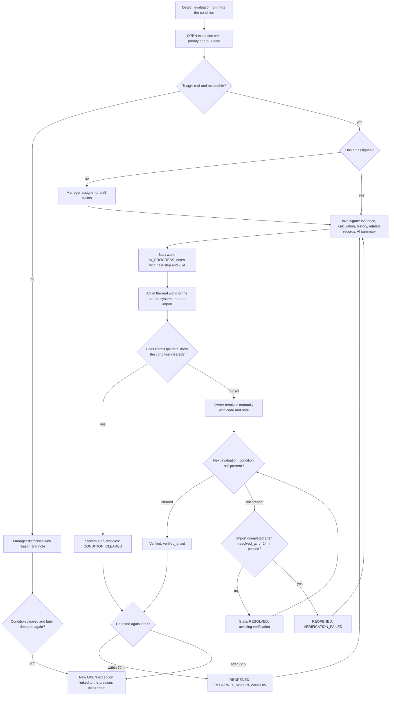
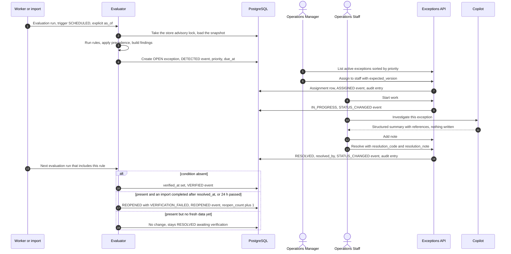

# Exception Management Workflow

> **Status:** v1 business workflow (milestone M1, task T-010). **Owner:** Product / BA.
> **Canonical sources:** [`STATE_MACHINES.md §3`](../domain/STATE_MACHINES.md) (states, transitions,
> permissions, reconciliation table, verification), [`EXCEPTION_CATALOG.md`](../domain/EXCEPTION_CATALOG.md)
> (the nine rules, precedence), [`PRIORITY_MODEL.md`](../domain/PRIORITY_MODEL.md) (score, bands, due
> dates), [`DOMAIN_MODEL.md`](../domain/DOMAIN_MODEL.md) (OperationalException, events, assignments,
> notes). If this document and `docs/domain/*` disagree, the domain docs win.

Labels for anything the canonical docs do not settle: **Industry practice**, **MVP assumption**,
**Needs validation**. Examples use the fictional demo store *Kestrel Home & Kitchen* (USD,
`America/New_York`, November 2026 times in EST) and its fictional accounts `manager@kestrel.example` and
`staff@kestrel.example`.

Related workflows: [Orders](./ORDER_LIFECYCLE.md) · [Inventory](./INVENTORY_LIFECYCLE.md) ·
[Imports](./IMPORT_PIPELINE.md) · [AI investigation](./AI_ASSISTED_INVESTIGATION.md) ·
[Roles](./ROLE_AND_PERMISSION_WORKFLOW.md)

---

## 1. Purpose and principle

An operational exception is a **live business condition** that needs a person's attention: an oversold
SKU, an overdue order, a refund owed. The workflow has one rule that shapes everything else:

> Detection and verification are deterministic and done by the system. Deciding, acting, and explaining
> are done by people. The AI copilot helps people understand; it never changes an exception.

That is why "resolved" in RetailOps means two different things, and the product keeps them apart:
*a person says it is fixed* (manual resolution) and *the data shows it is fixed* (verification or
auto-resolution).

## 2. Actors and responsibilities

| Stage | Store Owner | Operations Manager | Operations Staff | Analyst | System |
|---|---|---|---|---|---|
| Detect | Can trigger a manual run | Can trigger a manual run (`evaluations.run`) after imports or fixes | – | – | **Runs** evaluations after every import, every 15 min, and on demand |
| Triage | Optional | **Owns**: confirms, dismisses, sets due dates | Acknowledges what they see first | Informed (reads) | Ranks by priority |
| Assign | Can | **Owns**: assigns and reassigns (`exceptions.assign`) | Claims unassigned items only | – | Carries the assignee over on supersede (BR-401) |
| Investigate | – | Consulted | **Owns** the exceptions assigned to them | Consulted: reads evidence, uses the copilot | Provides evidence, calculation, history, related records |
| Resolve | Can resolve any | Can resolve any (`exceptions.manage`) | Resolves their own (`exceptions.work`) | – | Auto-resolves when the condition clears |
| Dismiss or reopen | Can | **Owns** (`exceptions.manage`) | – | – | Reopens on failed verification or recurrence |
| Verify | – | Watches `REOPENED` items | Responds to reopens | Analyses reopen and dismissal rates | **Verifies** at the next evaluation |
| Tune | Thresholds and weights (`settings.manage`) | Same (`settings.manage`) | – | Proposes changes from trends | Applies new settings at the next run |

The permission behind each action is specified in
[ROLE_AND_PERMISSION_WORKFLOW.md](./ROLE_AND_PERMISSION_WORKFLOW.md).

## 3. End-to-end flow

### 3.1 Flowchart: detect → triage → assign → investigate → resolve → verify

### 3.2 Sequence: one exception from detection to verification

### 3.3 Stage by stage

| Stage | Entry | What happens | Exit | Records written |
|---|---|---|---|---|
| **Detect** | An evaluation run (trigger `IMPORT`, `MANUAL`, or `SCHEDULED`) with an explicit `as_of` (BR-504) | Each executed rule emits findings. Inventory precedence (BR-401) and order precedence are applied. Findings are reconciled against stored exceptions (§5) | Exception created, refreshed, auto-resolved, verified, reopened, or superseded | `evaluation_run` with counts; `DETECTED`, `EVIDENCE_UPDATED`, `SEVERITY_CHANGED`, `AUTO_RESOLVED`, `VERIFIED`, `REOPENED`, `SUPERSEDED` events |
| **Triage** | Exception `OPEN` or `REOPENED` | Manager reads title, severity, priority breakdown, evidence. Decides: real and actionable, or dismiss | `ACKNOWLEDGED`, assigned, or `DISMISSED` | `STATUS_CHANGED`, audit |
| **Assign** | Active exception without the right owner | Manager assigns or reassigns to an organization member whose role grants `exceptions.work`. Staff can claim an unassigned item. Starting work on an unassigned item assigns the actor automatically; a manager who starts someone else's exception keeps the existing assignee | Assignee set | `exception_assignment`, `ASSIGNED` / `UNASSIGNED`, audit |
| **Investigate** | Assigned exception | Owner reads the detection explanation, evidence, history, related orders and products, and optionally the AI summary ([AI_ASSISTED_INVESTIGATION.md](./AI_ASSISTED_INVESTIGATION.md)) | Owner knows the cause and the next step | Notes (`NOTE_ADDED`), AI conversation rows |
| **Act** | Owner knows what to do | Real-world action: pick and ship, refund, reorder, count stock, fix data in the source system, then re-import | Data reflects the fix, or the owner records the action | `IN_PROGRESS`, notes |
| **Resolve** | Condition fixed or about to be | Preferably the system resolves it when the data clears. A manual resolution needs a `resolution_code` and a note of at least 10 characters | `RESOLVED` | `STATUS_CHANGED`, audit |
| **Verify** | Each evaluation after a manual resolution that runs this rule, until verified or reopened | Condition absent: verified. Present: reopened only if an import completed after `resolved_at` or 24 h have passed (grace rule); otherwise it waits | `RESOLVED` with `verified_at`, still `RESOLVED` awaiting verification, or `REOPENED` | `VERIFIED` or `REOPENED` |

## 4. Exception identity and the dedup key

- **Identity of an occurrence:** the exception row `id` (UUID), scoped by `store_id`, plus a
  human-friendly `reference` such as `EXC-1001` from a per-store counter, which people use in notes and
  conversation. A `version` field supports optimistic concurrency (`expected_version`).
- **Identity of the condition:** `dedup_key = {exception_type}:{entity_type}:{entity_id}`, for example
  `INVENTORY_BELOW_REORDER_POINT:product:<product uuid>` or `ORDER_FULFILLMENT_OVERDUE:order:<order uuid>`.
  `entity_id` is the internal UUID, not the SKU or order number, so it is stable across re-imports
  (products and orders are upserted by natural key and keep their UUID).
- **At most one active exception per key and store**, enforced by a partial unique index on
  `(store_id, dedup_key)` over the active statuses (DOMAIN_MODEL §4, invariant 5). `RESOLVED` and
  `DISMISSED` rows do not block a new occurrence.
- **Occurrence chain:** a new occurrence after a closed one links back through `previous_occurrence_id`,
  so the detail page can show "this happened before on Nov 12".
- **Supersede chain:** a less severe inventory exception resolved by a more severe one points to it
  through `superseded_by_id`. Different types have different keys, which is why supersede creates a
  new exception rather than changing the type of the old one.

## 5. Reconciliation: what an evaluation does with each finding

The authoritative table is `STATE_MACHINES.md §3.3`. Each row below is the same rule, named and
explained in plain language with the scenario in §6 that shows it.

| Row | Stored state for the key | This run | Outcome | Plain meaning | Scenario |
|---|---|---|---|---|---|
| R1 | none | finding present | Create `OPEN` | New problem | A |
| R2 | active | present | Refresh evidence, `last_detected_at`, `detection_count`, severity, priority. Event only if evidence changed materially or severity changed | Still a problem; numbers updated | A |
| R3 | active | absent | Auto-resolve, `CONDITION_CLEARED` | The data shows it is fixed | A |
| R4 | `RESOLVED` by a user, not yet verified | present or absent | absent: verify (`verified_at`). present: reopen with `VERIFICATION_FAILED` **only if** an import completed after `resolved_at` or 24 h have passed; otherwise stay `RESOLVED`, awaiting verification | "Confirmed", "you said fixed and fresh data disagrees", or "not judged yet" | E |
| R5 | `RESOLVED`, cleared, re-detected within `reopen_window_hours` (72) of `resolved_at` | present | Reopen, `RECURRED_WITHIN_WINDOW` | It came back too soon to count as a new problem | C1 |
| R6 | `RESOLVED`, re-detected after the window | present | New `OPEN` with `previous_occurrence_id` | A new occurrence of an old problem | C2 |
| R7 | `DISMISSED`, condition never cleared since the dismissal | present or absent | present: update `last_detected_at` only, no event. absent: set `condition_cleared_at` | The decision to ignore it stands while the condition persists | B |
| R8 | `DISMISSED` with `condition_cleared_at` set | present | New `OPEN` with `previous_occurrence_id` | The dismissed situation ended, and this is a fresh one | B |

Two run-level rules matter in practice:

- **Only rules that ran can resolve.** A run restricted to inventory rules never auto-resolves or
  verifies order exceptions. Which rules an import-triggered run executes is not stated in the
  canonical docs; this document assumes the full v1 rule set (**MVP assumption**, open question O-25).
- **Supersede (BR-401).** When a more severe inventory condition appears for a product, the active less
  severe exception is resolved with `SUPERSEDED` (not `CONDITION_CLEARED`), `superseded_by_id` points to
  the new exception, and the assignee carries over. `ORDER_FULFILLMENT_OVERDUE` supersedes
  `ORDER_STALLED_AFTER_PAYMENT` the same way.

## 6. Scenarios

### Scenario A: supplier purchase order pending (R1 → R2 → R3)

`KHK-MUG-S4` (stoneware mug set of 4): reorder point 20, supplier Harbor Ceramics with a 14-day lead
time, estimated 2.0 units/day.

| Time (EST) | Actor | Action | Exception state and events |
|---|---|---|---|
| Mon Nov 9 08:15 | System (scheduled run) | `available` 12 ≤ 20; days of cover 12 ÷ 2.0 = 6 < 14 | **R1** create `OPEN`, `HIGH`, priority 35 (P3), `due_at` Tue Nov 10 08:15 (HIGH = 24 h) |
| 09:05 | Manager | Assigns to `staff@kestrel.example` | `ASSIGNED` |
| 09:40 | Staff | Starts work. Note: "PO HC-2291 for 60 units placed with Harbor Ceramics. Supplier confirms delivery Thu Nov 12." | `IN_PROGRESS`, `NOTE_ADDED` |
| 10:00 | Manager | Imports `INCOMING_EXPECTED` 60, `expected_at` Nov 12 | **R2** refresh: incoming 0 → 60 is a material change, so `EVIDENCE_UPDATED`. Still `HIGH`, because incoming never counts toward `available` (BR-103). The suggested quantity drops from 60 to max(0, 60 − 60) = 0, so the recommended action now reads "Incoming stock (60 units) covers the reorder point. Confirm the ETA with Harbor Ceramics." |
| Tue Nov 10 09:00 | Manager | The item is past due, but the plan is sound. Moves `due_at` to Thu Nov 12 18:00 with a note | `DUE_DATE_CHANGED`, audit, `due_at_overridden = true`: no later recalculation replaces it |
| Wed Nov 11 | System | Sales continue, `available` 6. Priority T component reaches 4 (2 days) | **R2** refresh |
| Thu Nov 12 14:00 | Manager | Imports `RECEIPT` 60 | **R3** `available` 66 > 20, auto-resolve `CONDITION_CLEARED`, `AUTO_RESOLVED` event |

The staff member never had to press "Resolve". **Anti-pattern:** resolving at 09:45 on Monday with
`STOCK_REPLENISHED` because a PO was placed. The 10:00 adjustments import completes after
`resolved_at`, the evaluation it triggers still sees `available` at or below 20, and the exception is
reopened with `VERIFICATION_FAILED` (without that import it would have been reopened 24 h later). Long-running work stays `IN_PROGRESS` with a note
(`STATE_MACHINES.md §3.4`).

### Scenario B: false positive dismissed (R7 → R8)

Order `KHK-100610` (marketplace): lines 2 × 24.00, shipping 5.95, tax 3.12, so the expected total is
57.07. The recorded total is 62.02, because the marketplace charged a 4.95 gift-wrap fee that has no
column in `orders.csv`. `DATA_ORDER_TOTAL_MISMATCH`, `MEDIUM` (difference ≥ 1.00), priority 23 (P4).

| When | Actor | Action | Result |
|---|---|---|---|
| Day 1 | Manager | Compares with the marketplace: the total is correct there | Dismisses with `FALSE_POSITIVE` and the note "Gift-wrap fee 4.95 has no column in orders.csv. Source total is correct." |
| Following runs | System | Mismatch still present | **R7** `last_detected_at` updated, no event, stays `DISMISSED`, never returns to the inbox |
| Day 5 | Manager | Re-imports the order with the fee folded into `shipping_total` (10.90) | Totals reconcile: **R7** `condition_cleared_at` set, still `DISMISSED` |
| Day 9 | Manager | An older export is re-imported and brings back shipping 5.95 | **R8** new `OPEN` exception linked by `previous_occurrence_id` |

Variants: a manager can reopen a dismissed exception at any time (`DISMISSED → REOPENED`,
`exceptions.manage`, reason note). If a dismissed inventory exception is overtaken by a more severe
condition, the more severe type gets its own exception, and the dismissed one's finding disappears
(precedence), so `condition_cleared_at` is set. In effect, a dismissal of "below reorder point" does
not survive the product going out of stock.

### Scenario C: recurrence inside and outside the window (R5, R6)

`KHK-MUG-S4` was auto-resolved Thu Nov 12 14:00 (Scenario A). The window ends 72 h later, Sun Nov 15 14:00.

- **C1, inside the window.** Sat Nov 14 11:00: a wholesale order of 46 units is paid, `available` drops
  from 64 to 18. **R5**: the same exception moves to `REOPENED` with `RECURRED_WITHIN_WINDOW`,
  `reopen_count` 1. History, notes, and assignee stay with it (assignment is an attribute and is not
  changed by status transitions).
- **C2, outside the window.** If the drop happened Mon Nov 16 09:00 instead (91 h after resolution):
  **R6**, a new `OPEN` exception with `previous_occurrence_id` pointing to the Nov 9 one. It starts
  unassigned and its priority time component starts from zero.

How `due_at` is set on a reopened exception is not specified (open question O-19). **Proposal:** recalculate it from the reopen time and the current severity, unless it was overridden.

### Scenario D: supersede from below-reorder to out-of-stock, assignee carried over

`KHK-CHF-20` (chef's knife 20 cm): reorder point 8, lead time 21 days, estimated 0.8 units/day.

| Time (EST) | Event | Below-reorder exception | Out-of-stock exception |
|---|---|---|---|
| Mon Nov 9 10:00 | `available` 5 → detected | `OPEN`, `HIGH` (6.25 days of cover < 21) | – |
| Mon Nov 9 10:30 | Staff claims and starts. Note: "Reorder of 24 awaiting owner approval." | `IN_PROGRESS`, assignee staff | – |
| Tue Nov 10 15:30 | Import: two paid orders (3 + 2 units), `available` 0. No pending orders, so no oversell risk | **`RESOLVED`, `resolution_code = SUPERSEDED`**, `superseded_by_id` = the new exception, `SUPERSEDED` event | Created `OPEN`, `HIGH` (the product is selling), **assignee = staff** (carried over, `ASSIGNED` event with system actor), `due_at` +24 h |
| Tue Nov 10 15:35 | Staff opens "My exceptions" | Shown as superseded, with a link | Shown at the top. Staff starts it and copies the context into a new note |

What carries over is the **assignee only** (BR-401). Status starts again at `OPEN`, notes stay on the
old exception (linked), and the priority time component restarts because the new exception has its own
`first_detected_at`.

**The way back.** On Thu Nov 12 six units arrive: `available` 6 ≤ 8. The out-of-stock exception
auto-resolves. The below-reorder finding is present again and its latest exception is `RESOLVED`
(`SUPERSEDED`) two days earlier, so the canonical table reads as **R5** (reopen with
`RECURRED_WITHIN_WINDOW`), although nothing "recurred": severity stepped down. Whether superseded
exceptions should follow R5/R6 is open question O-18.

### Scenario E: verification with the grace rule (R4)

Order `KHK-100533` is `READY_TO_SHIP` and 5 h past `ship_by`: `ORDER_FULFILLMENT_OVERDUE`, `MEDIUM`.

| Time (EST) | Actor | Action | Result |
|---|---|---|---|
| 10:05 | Staff | Hands the parcel to the carrier and resolves with `ORDER_FULFILLED`, note "Collected by carrier 10:00, tracking in source." | `RESOLVED` |
| 10:15 | System (scheduled run) | The order is still `READY_TO_SHIP` in RetailOps, but no import has completed since 10:05 and 24 h have not passed | **R4** no change: stays `RESOLVED`, awaiting verification |
| 10:40 | Manager | Imports the orders export: `KHK-100533` is `SHIPPED` | **R4** the import-triggered run finds the condition absent: `verified_at` set, `VERIFIED` event |

Two variants show when it reopens:

- **The fix did not happen.** If the 10:40 export still showed `READY_TO_SHIP` (the carrier never
  collected), the import-triggered run reopens the exception with `VERIFICATION_FAILED`.
- **Nobody imports.** If no import completes after 10:05, the first evaluation after 10:05 the next day
  reopens it if the order still looks unshipped.

The grace rule (`STATE_MACHINES.md §3.3`, §3.4) means a correct fix is no longer reopened just because
the source export has not been imported yet. **Team practice:** fix → import → let the system resolve
or verify. A manual resolution is fine when the import follows the same day.

## 7. Due dates and priority

The formula, bands, and due-date rule are in [PRIORITY_MODEL.md](../domain/PRIORITY_MODEL.md); they are not
repeated here. Workflow consequences:

- **Severity says how bad; priority says what first.** The inbox sorts by `priority_score`, and every
  exception shows its breakdown (S, A, E, D, T) so a person can see why it ranks where it does.
- **Priority moves on its own.** A refresh recalculates it: the deadline component climbs as `ship_by`
  approaches, and the time component adds 2 points per whole day unresolved (max 8).
- **`due_at` is the response commitment**, set at creation from severity (4 h / 24 h / 72 h / 168 h) or
  from an earlier future business deadline, and recalculated when severity changes. A manager can
  override it (`exceptions.assign`); the override is audited, sets `due_at_overridden = true`, and is
  never replaced by automatic recalculation (PRIORITY_MODEL). Only a person changes it again.
- **Bands are guidelines.** P1 same working day, P2 within a day, P3 within 3 days, P4 within 7 days.
  These band names (P1–P4) are unrelated to the feature priorities (P0–P3) used in the backlog.

Examples from the scenarios:

| Exception | S | A | E | D | T | Score | Band | `due_at` |
|---|---|---|---|---|---|---|---|---|
| `KHK-SKL-28` oversold, 1 order short by 2 units (108.00), deadline in 48 h ([Inventory §4.1](./INVENTORY_LIFECYCLE.md)) | 50 | 3 | 8 | 4 | 0 | **65** | P2 | detection + 4 h |
| `KHK-100504` refund pending, total 230.04 ([Orders §4.1](./ORDER_LIFECYCLE.md)) | 35 | 3 | 10 | 12 | 0 | **60** | P2 | detection + 24 h |
| `KHK-MUG-S4` below reorder point, day 2 (Scenario A) | 35 | 0 | 0 | 0 | 4 | **39** | P3 | overridden to Nov 12 18:00 |
| `KHK-100610` total mismatch (Scenario B) | 20 | 3 | 0 | 0 | 0 | **23** | P4 | detection + 72 h |

(E for 108.00 = round(15 × log10(109) / log10(5001)) = round(8.26) = 8. E for 230.04 = round(9.59) = 10.
A for an order exception counts the order itself.)

## 8. Notes and evidence

**Evidence** is a structured snapshot on the exception (`evidence` and `calculation` JSONB). Each fact
carries its value and the record it came from. When a refresh changes the evidence materially, the
previous version is kept in the `EVIDENCE_UPDATED` event, so the history shows how the situation
developed ("on hand 19 → 7 after `KHK-100503` shipped"). What counts as material is not defined; the
proposal is any change to a quantity, amount, affected-order set, or deadline, but not the passage of
time alone, such as "hours overdue" (open question O-20).

**Notes** are the human record. They are append-only, at most 4,000 characters, and have a source of
`USER` or `AI_DRAFT_ACCEPTED` (an AI draft becomes a note only when a person accepts it). Recommended
note pattern (**Industry practice**: the "what / next / when" handover note):

> **What I found:** 19 on hand per Nov 2 count; KHK-100505 short by 2.
> **What I did:** asked Ironleaf to ship PO 7781 early.
> **Next step / by when:** confirm delivery date by Fri 15:00; if later than Nov 8, contact the customer.

Resolution and dismissal notes are required and are the audit trail for why something was closed.

## 9. The Operations Manager's daily triage routine

A recommended operating rhythm for a small team (**MVP assumption**, **Needs validation** with real
operators). Filters named here are views of the exception inbox.

| When (store time) | Time box | Routine |
|---|---|---|
| 08:30 | 20 min | **Load fresh data.** Import overnight exports in the recommended order (products, adjustments, orders, order items). Read each import summary: rejected rows, skipped rows, and the evaluation run counts (created / resolved / reopened / superseded) |
| 08:50 | 15 min | **Work the top of the list.** Filter: active, sorted by priority. Every P1 and P2 gets an assignee now. Dismiss obvious false positives with a reason and note |
| 09:05 | 10 min | **Reopened first.** Filter: status `REOPENED`. A `VERIFICATION_FAILED` reopen means fresh data (or 24 h without any) still shows the condition: the fix did not land or was never imported. Ask the owner which. Also glance at resolved items still awaiting verification from yesterday |
| 09:15 | 10 min | **Past due.** Filter: `due_at` before now. Chase the owner, or move the due date with a note when the plan is sound (Scenario A) |
| 09:25 | 5 min | **Data quality.** Filter: category `DATA_QUALITY`. Several mismatches from one import usually mean one systematic export problem, not many separate ones |
| 13:00 | 10 min | **Midday check.** Import the midday orders export. New `CRITICAL` items get assigned at once. Run analysis manually if a large fix landed outside an import |
| 16:30 | 10 min | **End of day.** No P1 unassigned. Every `IN_PROGRESS` item has a note from today. Refunds pending: anything close to the 3 × 24 h escalation gets done today |
| Weekly | 30 min | **Review.** Dismissed list (are accepted risks still acceptable?), reopen counts and dismissal counts by type (a noisy rule needs tuning), threshold and weight changes with the owner |

## 10. Failure paths and edge cases

| # | Situation | System behaviour | What the user sees or does |
|---|---|---|---|
| X1 | Two people act on the same exception | Mutations carry `expected_version`; the second gets 409 | "This exception changed. Reload to see the latest." Whether an evaluation refresh also bumps the version, causing avoidable 409s, is open question O-20 |
| X2 | Transition not in the state machine (for example start a `DISMISSED` exception) | 409 `EXCEPTION_TRANSITION_NOT_ALLOWED` | The UI only offers allowed actions; the API still enforces |
| X3 | Staff resolves an exception assigned to someone else | 403 | Action hidden or disabled with the reason "Assigned to another user" |
| X4 | Resolution note shorter than 10 characters, or no dismissal reason | 422 with field details | Inline form errors |
| X5 | An evaluation run fails part-way | The run works in a savepoint that is rolled back, so it commits no exception changes. Only the run record persists, with status `FAILED` and its error (`STATE_MACHINES.md §3.3`). The next trigger retries | Run history shows the failure |
| X6 | Two triggers at once for one store | Postgres advisory lock per store: runs never overlap. A run that cannot take the lock is recorded as `SKIPPED` (ADR-0009, `STATE_MACHINES.md §3.3`) | A skipped import-triggered run is caught up by the next scheduled run, at most 15 minutes later |
| X7 | A rule did not run | Its exceptions are neither auto-resolved nor verified in that run | None |
| X8 | Product archived while an inventory exception is open | Inventory rules apply to `ACTIVE` products only, so the finding disappears and the exception auto-resolves as `CONDITION_CLEARED` | History shows the auto-resolution right after the products import |
| X9 | Order cancelled while overdue | Overdue auto-resolves. If the order was paid, the refund clock starts | Refund-pending appears 24 h later if not refunded |
| X10 | Assignee deactivated or demoted to a role without `exceptions.work` | Valid assignees are members whose role grants `exceptions.work` (`STATE_MACHINES.md §3.2`), but what happens to existing assignments is not specified (open question O-27). **Proposal:** their active exceptions are unassigned with a system `UNASSIGNED` event | Items return to the unassigned view |
| X11 | Staff claimed by mistake | Staff cannot unassign themselves (needs `exceptions.assign`) | Ask a manager to reassign (open question O-27) |
| X12 | First products import for a new store | Every new `ACTIVE` product is out of stock until its first count, so the inbox fills with `INVENTORY_OUT_OF_STOCK` items that auto-resolve after the adjustments import (open question O-16) | Import adjustments right after products |
| X13 | `REOPENED` exception acknowledged again | Allowed: `OPEN/REOPENED → ACKNOWLEDGED` with `exceptions.work` (`STATE_MACHINES.md §3.2`) | – |

## 11. Verification

| What is verified | How | Where |
|---|---|---|
| Every row R1–R8 and supersede | One integration test per row, driving the evaluator with fixed `as_of` values | T-053 |
| Transitions and permissions | For each transition in `STATE_MACHINES.md §3.2` and each role, assert allowed / 403 / 409 | T-054 |
| Events and audit | Every status, assignment, and due-date change writes exactly one event and, for user actions, one audit row | T-054 |
| At most one active exception per key | Concurrent create attempts against the partial unique index | T-053 |
| Priority and due dates | `PRIORITY_MODEL.md` worked examples as unit tests | T-053 |
| Full journey in the UI | Assign → start → note → resolve → verification reopen | T-062, T-081 |

Process health measures the product can compute from its own tables, without inventing targets:
manual resolutions later reopened with `VERIFICATION_FAILED` ÷ manual resolutions; time from detection
to first acknowledgement; share of active exceptions past `due_at`; dismissals by type and reason. Target
values are **Needs validation**.

## 12. Open questions raised by this workflow

IDs match the M1 report. **Resolved:** items are decided in the canonical docs and the text above
follows them; the rest remain labelled proposals.

- **O-16** Open. Out-of-stock noise during onboarding (X12).
- **O-18** Open. Whether superseded exceptions follow R5/R6 when the lesser condition returns, and the
  reset of the time component on supersede (Scenario D).
- **O-19** Partly resolved: PRIORITY_MODEL now says automatic recalculation never replaces a manual
  override (`due_at_overridden`). Open: `due_at` of a reopened exception (proposal in Scenario C).
- **O-20** Open. Definition of a "material" evidence change, and whether evaluation refreshes bump
  `version` and so cause avoidable 409s (X1).
- **O-25** Open. Rule scope of import-triggered runs (assumed: all v1 rules).
- **O-27** Partly resolved: valid assignees are organization members whose role grants
  `exceptions.work`, and a manager who starts someone else's exception keeps the assignee
  (`STATE_MACHINES.md §3.2`). Open: existing assignments of a demoted or deactivated user (X10), and staff
  releasing their own claim (X11).
- **O-30** **Resolved:** `STATE_MACHINES.md §3.2` now lists `OPEN/REOPENED → ACKNOWLEDGED` (X13).
- **O-31** **Resolved:** PRIORITY_MODEL worked example 2 corrected to T = 2, score 60.
- **O-32** Open. Priority band names P1–P4 collide with backlog priorities P0–P3.
- **O-37** **Resolved:** verification grace rule (`STATE_MACHINES.md §3.3`, §3.4). A manual resolution is
  reopened only if the condition persists after an import completed after `resolved_at`, or after 24 h
  (§3.1, R4, Scenario E).
