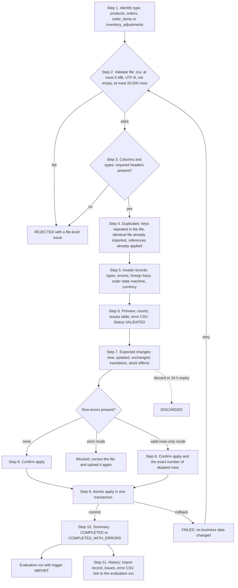
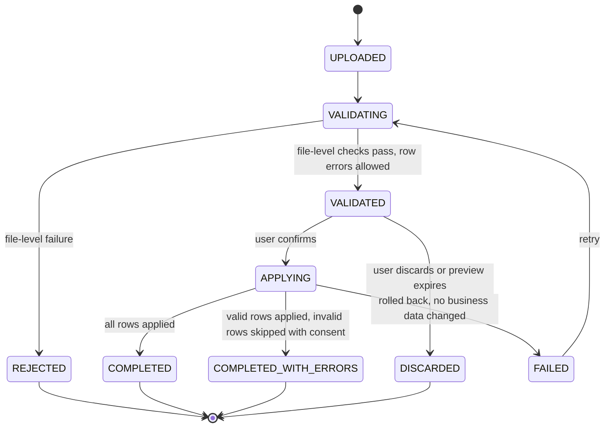
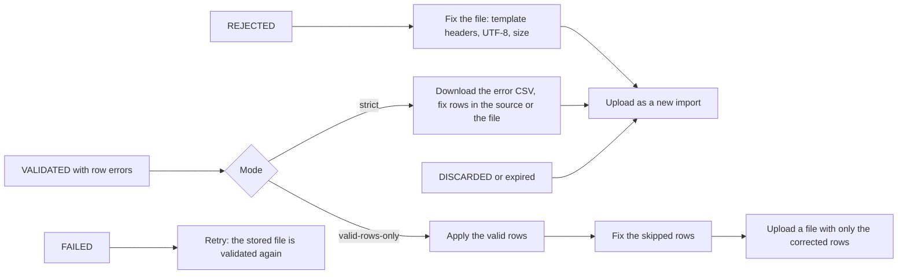

# Import Pipeline Workflow and CSV Data Contracts

> **Status:** v1 business workflow and data contract (milestone M1, task T-010). **Owner:** Product / BA.
> **Canonical sources:** [`BUSINESS_RULES.md §6`](../domain/BUSINESS_RULES.md) (BR-601..608, plus
> BR-004, BR-112, BR-502, BR-506), [`STATE_MACHINES.md §1 and §4`](../domain/STATE_MACHINES.md) (order
> guards, import lifecycle), [`DOMAIN_MODEL.md`](../domain/DOMAIN_MODEL.md) (DataImport, ImportRowIssue).
> `BUSINESS_RULES.md` points here for the detailed contracts. The column lists, types, and issue codes
> below are the canonical set agreed for v1; anything added here beyond them is labelled.

Labels for anything not settled by the canonical docs: **Industry practice**, **MVP assumption**,
**Needs validation**. Examples use the fictional demo store *Kestrel Home & Kitchen* (USD,
`America/New_York`).

Related workflows: [Orders](./ORDER_LIFECYCLE.md) · [Inventory](./INVENTORY_LIFECYCLE.md) ·
[Exceptions](./EXCEPTION_MANAGEMENT.md) · [Roles](./ROLE_AND_PERMISSION_WORKFLOW.md)

---

## 1. Purpose and principles

Imports are how operational data enters RetailOps in v1. Four principles shape the pipeline:

1. **Nothing is skipped silently** (AGENTS.md §5). Every rejected row is stored as an issue, shown in
   the preview, and downloadable. Skipping rows needs explicit consent to the exact count.
2. **Preview before apply.** Validation never changes business data. The user sees what will change
   and decides.
3. **Apply is atomic** (BR-606). All accepted rows are applied in one transaction, or none are.
4. **Re-running is safe.** Products and orders are upserts by natural key, order items by
   `(order_number, line_number)`, and adjustments are idempotent by `reference`. Importing the same data
   twice changes nothing the second time.

## 2. Actors

| Actor | What they do | Permission |
|---|---|---|
| Operations Manager (typical operator) | Exports from source systems, uploads, reviews the preview, applies, fixes rejected rows | `imports.run` |
| Store Owner | Same as the manager; usually does the first load | `imports.run` |
| Operations Staff, Analyst, demo Viewer | View import history and issues, download the error CSV and templates | `imports.read` |
| `imports` module | Parses, validates, previews, applies, records history | n/a |
| `catalog`, `orders`, `inventory` services | Validate and apply rows of their own entities (cross-module calls go through services) | n/a |
| `exceptions` evaluator | Runs automatically after a successful apply (trigger `IMPORT`) | n/a |

## 3. The 11-step flow

### 3.1 Flowchart



### 3.2 Step detail

| # | Step | What happens | Import status | Possible outcome |
|---|---|---|---|---|
| 1 | Identify type | The user picks one of the four types; one file holds one type. The system confirms the choice from the header row. **MVP assumption:** if the headers match another type's contract better, the rejection message names it ("this looks like an orders file") | `UPLOADED` | – |
| 2 | Validate file | Extension `.csv`; at most 5 MB; decodes as UTF-8 (a BOM is accepted); not empty; at most 20,000 data rows (BR-602). Parsed with a CSV reader; cell content is never evaluated | `VALIDATING` | `REJECTED`: `FILE_TYPE`, `FILE_TOO_LARGE`, `FILE_ENCODING`, `FILE_EMPTY`, `TOO_MANY_ROWS` |
| 3 | Columns and types | Required headers present (`MISSING_COLUMNS` rejects the file); unknown headers ignored with `UNKNOWN_COLUMN` (BR-603). Each cell parsed to its type | `VALIDATING` | Row errors such as `INVALID_NUMBER`, `INVALID_DATETIME` |
| 4 | Duplicates | Natural key repeated in the file: every occurrence after the first is an error (BR-604). File SHA-256 equal to a completed import of the same type: `DUPLICATE_FILE` warning (BR-607). Adjustment reference already applied: `ALREADY_APPLIED` warning (BR-112) | `VALIDATING` | `DUPLICATE_KEY_IN_FILE` errors; warnings |
| 5 | Invalid records | Business validation against current data: enums, foreign keys (BR-605), currency (BR-004), stale cycle counts (BR-113), locked order lines (BR-609), order guards and reachability (`STATE_MACHINES.md §1`), locked lines, discount limits | `VALIDATING` → `VALIDATED` | Row errors; the file itself is valid |
| 6 | Preview | Counts by outcome (new / updated / unchanged / error / warning), a filterable issues table (row, column, code, message, raw value), the first rows with issues highlighted, error CSV download | `VALIDATED` | User reviews |
| 7 | Expected changes | Type-specific impact, see §3.3 | `VALIDATED` | User decides |
| 8 | Confirm | The user chooses strict (default) or valid-rows-only. Valid-rows-only requires confirming the exact skipped-row count (BR-606). The request carries an `Idempotency-Key` | `VALIDATED` → `APPLYING` | Or `DISCARDED` (user discards, or 24 h expiry) |
| 9 | Atomic apply | One database transaction: entity writes, order events, reservation sync, `SHIPMENT` movements, inventory movements. **MVP assumption:** rows are re-validated inside the transaction; if the outcome differs from the confirmed preview (for example another import changed an order meanwhile), the apply fails rather than skipping a different set of rows (open question O-26) | `APPLYING` | Commit or rollback |
| 10 | Summary | Final counts, skipped rows (with the error CSV), warnings, and the evaluation run started by the import with its created / resolved / reopened counts | `COMPLETED`, `COMPLETED_WITH_ERRORS`, or `FAILED` | – |
| 11 | History | Every import is listed with type, file name, size, row count, SHA-256, mode, uploader, timestamps, status, summary, and the evaluation run. File bytes are kept only for the validation-to-apply window, then purged (DOMAIN_MODEL) | terminal | – |

### 3.3 Expected changes shown before apply (step 7)

| Type | What the preview states |
|---|---|
| `products` | New products; changed fields per product (price, cost, reorder point, status); suppliers that will be created; supplier lead times that will change; products changing to or from `ACTIVE` (this changes which inventory rules apply) |
| `orders` | New orders; transitions grouped by status pair with skipped states ("`PAID → SHIPPED`: 37 orders, skipped `PROCESSING`, `READY_TO_SHIP`"); reservations to be created, consumed, or released; `SHIPMENT` movements to be written versus suppressed by the cycle-count cutoff (BR-130) |
| `order_items` | New lines; changed lines; reservation changes for committed orders; lines refused because the order already shipped |
| `inventory_adjustments` | Movement counts per type; net `on_hand` and `incoming` change per SKU; SKUs whose `on_hand` would become negative (shown as information, there is no issue code for it) |

### 3.4 Lifecycle

The canonical lifecycle is `STATE_MACHINES.md §4`:



Steps 1 → `UPLOADED`; steps 2–5 → `VALIDATING`; steps 6–8 → `VALIDATED`; step 9 → `APPLYING`;
step 10 → `COMPLETED`, `COMPLETED_WITH_ERRORS`, or `FAILED`. A preview expires 24 hours after
validation (`expires_at`), because the data it was checked against may have changed.

## 4. Conventions that apply to every file

| Topic | Rule | Basis |
|---|---|---|
| Format | `.csv`, UTF-8 (BOM accepted), at most 5 MB and 20,000 data rows | BR-602 |
| Structure | First row is the header. Comma delimiter, double-quote quoting as in RFC 4180. Column order is free | **MVP assumption** |
| Header names | Matched after trimming and lower-casing. Unknown headers produce `UNKNOWN_COLUMN` and are ignored | BR-603; matching rule **MVP assumption** |
| Whitespace | Leading and trailing whitespace is trimmed from every cell. SKUs are then compared case-sensitively (BR-506) | BR-506 |
| Enumerations | Matched case-insensitively and stored in upper case (`paid` → `PAID`) | **MVP assumption** |
| Money | Dot decimal separator, no thousands separator, no currency symbol, at most 2 decimal places, within `NUMERIC(12,2)` | BR-503 |
| Integers | Whole numbers only (`3`, not `3.0`) | **MVP assumption** |
| Timestamps | ISO-8601. With an offset (`2026-11-05T13:00:00-05:00` or `...Z`) the value is exact. Without one it is read in the store time zone and flagged `TIMEZONE_ASSUMED`. A local time that is ambiguous at a DST change resolves to the first occurrence (`fold=0`). A date without a time, or a local time that does not exist (spring-forward gap), is rejected as `INVALID_DATETIME` | BR-502; date-only and non-existent-time rules are **MVP assumptions** (open question O-5) |
| Empty cells | An empty cell means "no value". For a required column it is `REQUIRED` | – |
| Absent column versus empty cell (upserts) | **Proposal:** an optional column that is absent from the file leaves stored values unchanged; an optional column present with an empty cell sets the value to empty, its default, or its derived value. This prevents a file without, say, supplier columns from wiping supplier links | **MVP assumption**, open question O-4 |
| Safety | Cells are data, never formulas. The error CSV prefixes any cell starting with `=`, `+`, `-`, or `@` with an apostrophe | Security baseline |

## 5. Data contracts

Download templates contain exactly these headers in this order.

### 5.1 `products.csv`: upsert by `sku`

| Column | Required | Type and validation | Issue codes | Notes |
|---|---|---|---|---|
| `sku` | yes | string ≤ 64, trimmed, unique in the file | `REQUIRED`, `VALUE_TOO_LONG`, `DUPLICATE_KEY_IN_FILE` | Natural key. Case-sensitive: `khk-skl-28` is a different product from `KHK-SKL-28` |
| `name` | yes | string ≤ 200 | `REQUIRED`, `VALUE_TOO_LONG` | |
| `category` | no | string ≤ 100 | `VALUE_TOO_LONG` | |
| `status` | yes | `ACTIVE` \| `DRAFT` \| `ARCHIVED` | `REQUIRED`, `INVALID_ENUM` | Only `ACTIVE` products get inventory health and inventory exceptions |
| `unit_price` | yes | decimal ≥ 0, ≤ 2 dp | `REQUIRED`, `INVALID_NUMBER`, `NEGATIVE_VALUE`; warning `PRICE_ZERO` when `ACTIVE` with price 0 | Current list price. Used for oversell-risk exposure |
| `unit_cost` | no | decimal ≥ 0 | `INVALID_NUMBER`, `NEGATIVE_VALUE`; warning `NEGATIVE_MARGIN` when cost > price | |
| `reorder_point` | yes | integer ≥ 0 | `REQUIRED`, `INVALID_INTEGER`, `NEGATIVE_VALUE` | 0 disables below/approaching classification (BR-140) |
| `reorder_quantity` | no | integer ≥ 0 | `INVALID_INTEGER`, `NEGATIVE_VALUE` | Used in the below-reorder recommendation |
| `supplier_name` | no | string ≤ 200 | `VALUE_TOO_LONG` | Matched to an existing supplier by name (unique per store); **creates the supplier if new** |
| `supplier_lead_time_days` | no | integer 0–365 | `INVALID_INTEGER`, `NEGATIVE_VALUE` | **Sets the supplier's lead time.** **MVP assumption:** requires `supplier_name` on the same row (`REQUIRED` otherwise); if rows disagree on one supplier's lead time, the last row wins and the preview lists the conflict (open question O-17) |

```csv
sku,name,category,status,unit_price,unit_cost,reorder_point,reorder_quantity,supplier_name,supplier_lead_time_days
KHK-SKL-28,Cast-iron skillet 28 cm,Cookware,ACTIVE,54.00,21.50,10,40,Ironleaf Cookware,10
KHK-MUG-S4,"Stoneware mug set, 4 pieces",Tableware,ACTIVE,36.00,13.80,20,60,Harbor Ceramics,14
KHK-TWL-02,Linen tea towel,Textiles,ACTIVE,9.00,3.10,30,120,Northloom Textiles,21
```

**Semantics.** Insert when the SKU is new (with an empty inventory balance), update changed fields
when it exists, count as unchanged otherwise. Products are never deleted by import; retire one with
`ARCHIVED`. Renaming a SKU is not possible: a different SKU is a different product.

### 5.2 `orders.csv`: upsert by `order_number`

| Column | Required | Type and validation | Issue codes | Notes |
|---|---|---|---|---|
| `order_number` | yes | string ≤ 64, unique in the file | `REQUIRED`, `VALUE_TOO_LONG`, `DUPLICATE_KEY_IN_FILE` | Natural key |
| `channel` | no | `WEB` \| `MARKETPLACE` \| `POS` \| `OTHER`, default `WEB` | `INVALID_ENUM` | |
| `customer_ref` | no | string ≤ 64, opaque | `VALUE_TOO_LONG` | Must not contain personal data such as names or emails (BR-505); the system cannot detect this reliably, so it is an export rule for the operator |
| `placed_at` | yes | ISO-8601 | `REQUIRED`, `INVALID_DATETIME`; warning `TIMEZONE_ASSUMED` | |
| `status` | yes | one of the 12 order statuses | `REQUIRED`, `INVALID_ENUM`, `ORDER_TRANSITION_NOT_ALLOWED` | Must be reachable from the stored status (BR-608) |
| `payment_status` | yes | `PENDING` \| `PAID` \| `FAILED` \| `REFUNDED` | `REQUIRED`, `INVALID_ENUM`, `ORDER_INVALID_STATUS_COMBINATION` | |
| `fulfillment_status` | no | `UNFULFILLED` \| `IN_PROGRESS` \| `SHIPPED` \| `DELIVERED` \| `RETURNED` | `INVALID_ENUM`, `ORDER_INVALID_STATUS_COMBINATION`; `REQUIRED` when `status = REFUNDED` | Derived from `status` when omitted, using the first allowed value (`STATE_MACHINES.md §1.3`) |
| `paid_at` | conditional | ISO-8601; required when `payment_status` ∈ {`PAID`, `REFUNDED`} | `ORDER_MISSING_TIMESTAMP`, `INVALID_DATETIME`, `ORDER_TIMESTAMP_SEQUENCE` | |
| `ship_by` | no | ISO-8601 | `INVALID_DATETIME` | When empty: `paid_at + fulfillment_sla_hours` (BR-201) |
| `shipped_at` | conditional | ISO-8601; required when fulfillment ∈ {`SHIPPED`, `DELIVERED`, `RETURNED`} | `ORDER_MISSING_TIMESTAMP`, `INVALID_DATETIME`, `ORDER_TIMESTAMP_SEQUENCE` | Drives the cycle-count cutoff (BR-130) |
| `delivered_at` | conditional | ISO-8601; required when fulfillment = `DELIVERED` or status = `RETURN_REQUESTED` | `ORDER_MISSING_TIMESTAMP`, `INVALID_DATETIME`, `ORDER_TIMESTAMP_SEQUENCE` | |
| `cancelled_at` | conditional | ISO-8601; required when status = `CANCELLED` | `ORDER_MISSING_TIMESTAMP`, `INVALID_DATETIME` | Starts the refund clock (BR-206) |
| `currency` | yes | must equal the store currency (ISO 4217) | `REQUIRED`, `CURRENCY_MISMATCH` | BR-004 |
| `subtotal` | yes | decimal ≥ 0 | `REQUIRED`, `INVALID_NUMBER`, `NEGATIVE_VALUE` | |
| `discount_total` | no | decimal ≥ 0, default 0 | `INVALID_NUMBER`, `NEGATIVE_VALUE` | Read as the **order-level** discount in BR-205 (open question O-7) |
| `shipping_total` | no | decimal ≥ 0, default 0 | `INVALID_NUMBER`, `NEGATIVE_VALUE` | |
| `tax_total` | no | decimal ≥ 0, default 0 | `INVALID_NUMBER`, `NEGATIVE_VALUE` | |
| `total` | yes | decimal ≥ 0 | `REQUIRED`, `INVALID_NUMBER`, `NEGATIVE_VALUE` | Checked against the lines by `DATA_ORDER_TOTAL_MISMATCH` after apply, not at import |
| `carrier` | no | text | `VALUE_TOO_LONG` | Length limit not set by the canonical contract (open question O-17) |
| `tracking_number` | no | text | `VALUE_TOO_LONG` | Same |

```csv
order_number,channel,customer_ref,placed_at,status,payment_status,fulfillment_status,paid_at,ship_by,shipped_at,delivered_at,cancelled_at,currency,subtotal,discount_total,shipping_total,tax_total,total,carrier,tracking_number
KHK-100611,WEB,CUST-10492,2026-11-09T09:14:00-05:00,PROCESSING,PAID,IN_PROGRESS,2026-11-09T09:15:30-05:00,,,,,USD,108.00,10.00,6.95,8.28,113.23,,
KHK-100612,MARKETPLACE,CUST-31877,2026-11-09T10:02:00,DELIVERED,PAID,DELIVERED,2026-11-09T10:02:41,,2026-11-09T16:30:00,2026-11-11T13:05:00,,USD,45.00,0.00,4.95,2.93,52.88,USPS,DEMO0000612
KHK-100504,WEB,CUST-20117,2026-11-05T12:52:00-05:00,CANCELLED,PAID,UNFULFILLED,2026-11-05T13:00:00-05:00,,,,2026-11-05T16:40:00-05:00,USD,216.00,0.00,0.00,14.04,230.04,,
```

The second row has no UTC offsets, so each of its four timestamps produces a `TIMEZONE_ASSUMED` warning
and is read as EST. `KHK-100611` gets `ship_by` = Wed Nov 11 09:15:30 EST from the 48 h SLA.

**Semantics.** Insert new orders at the imported status; update existing orders when the new status is
reachable (or equal). Every status change writes an `order_event` with `source = IMPORT` and the
skipped states. Reservations and `SHIPMENT` movements are synchronised in the same transaction. Orders
are never deleted by import. Details: [ORDER_LIFECYCLE.md §5](./ORDER_LIFECYCLE.md).

### 5.3 `order_items.csv`: upsert by `(order_number, line_number)`

| Column | Required | Type and validation | Issue codes | Notes |
|---|---|---|---|---|
| `order_number` | yes | must exist in the store | `REQUIRED`, `UNKNOWN_ORDER` | Import `orders.csv` first (BR-605) |
| `line_number` | yes | integer ≥ 1 | `REQUIRED`, `INVALID_INTEGER`, `DUPLICATE_KEY_IN_FILE` (for a repeated pair) | |
| `sku` | yes | must exist in the store | `REQUIRED`, `UNKNOWN_SKU` | |
| `quantity` | yes | integer ≥ 1 | `REQUIRED`, `INVALID_INTEGER`, `NEGATIVE_VALUE` | |
| `unit_price` | yes | decimal ≥ 0 | `REQUIRED`, `INVALID_NUMBER`, `NEGATIVE_VALUE` | Price actually charged on this line. Used for oversold exposure |
| `line_discount` | no | decimal ≥ 0, ≤ `quantity × unit_price` | `INVALID_NUMBER`, `NEGATIVE_VALUE`, `LINE_DISCOUNT_EXCEEDS_LINE` | |

```csv
order_number,line_number,sku,quantity,unit_price,line_discount
KHK-100611,1,KHK-SKL-28,1,54.00,
KHK-100611,2,KHK-MUG-S4,1,36.00,
KHK-100611,3,KHK-TWL-02,2,9.00,0.00
```

The three lines sum to 108.00, which equals the order's `subtotal`; with the 10.00 order discount,
6.95 shipping, and 8.28 tax, the expected total is 113.23 and matches (BR-205).

**Semantics (BR-609).** Insert or update lines by `(order_number, line_number)`. The order must already
exist in the database, so `orders.csv` is imported first (BR-605). A line that is **already recorded** on
an order that has shipped (`fulfillment_status` ∈ {`SHIPPED`, `DELIVERED`, `RETURNED`}) cannot change:
`ORDER_LINE_LOCKED`; an identical re-import of it is "unchanged", not an error. Recording a line **for
the first time** is always allowed, even on a shipped order, because historical shipped orders arrive in
`orders.csv` before their lines. Lines are never deleted by import; a line removed in the source system
stays, and the total-mismatch rule will usually reveal it. Adding or changing a line of a committed
order re-syncs its reservation; changing its SKU moves the reservation to the new product (BR-121).

### 5.4 `inventory_adjustments.csv`: append-only, idempotent by `reference`

| Column | Required | Type and validation | Issue codes | Notes |
|---|---|---|---|---|
| `reference` | yes | string ≤ 100, unique per store | `REQUIRED`, `VALUE_TOO_LONG`, `DUPLICATE_KEY_IN_FILE`; warning `ALREADY_APPLIED` | External id from the warehouse or source system |
| `sku` | yes | must exist in the store | `REQUIRED`, `UNKNOWN_SKU` | Any product status |
| `adjustment_type` | yes | `CYCLE_COUNT` \| `RECEIPT` \| `INCOMING_EXPECTED` \| `INCOMING_CANCELLED` \| `DAMAGE` \| `SHRINKAGE` \| `RETURN_RESTOCK` \| `CORRECTION` | `REQUIRED`, `INVALID_ENUM` | `SHIPMENT` is system-only and not importable |
| `quantity` | yes | integer. `CYCLE_COUNT`: absolute count ≥ 0. `CORRECTION`: non-zero signed delta. All others: positive magnitude, sign implied by the type | `REQUIRED`, `INVALID_INTEGER`, `NEGATIVE_VALUE` | See the ledger table in [INVENTORY_LIFECYCLE.md §4](./INVENTORY_LIFECYCLE.md) |
| `occurred_at` | yes | ISO-8601 | `REQUIRED`, `INVALID_DATETIME`, `STALE_CYCLE_COUNT` (a count older than the product's latest count); warning `TIMEZONE_ASSUMED` | For counts, the point in time the count describes (BR-113) and the cutoff used by BR-130 |
| `expected_at` | no | ISO-8601, for `INCOMING_EXPECTED` | `INVALID_DATETIME`; warning `TIMEZONE_ASSUMED` | Becomes the incoming ETA shown in evidence |
| `note` | no | string ≤ 500 | `VALUE_TOO_LONG` | |

```csv
reference,sku,adjustment_type,quantity,occurred_at,expected_at,note
CC-1102-A,KHK-SKL-28,CYCLE_COUNT,24,2026-11-02T08:00:00-05:00,,Opening count aisle A
PO-7781-EXP,KHK-SKL-28,INCOMING_EXPECTED,40,2026-11-02T14:00:00-05:00,2026-11-09T12:00:00-05:00,PO 7781 Ironleaf Cookware
DMG-118,KHK-SKL-28,DAMAGE,2,2026-11-03T12:00:00-05:00,,Cracked during unpacking
COR-DMG-118,KHK-SKL-28,CORRECTION,1,2026-11-08T09:00:00-05:00,,One unit from DMG-118 is resaleable
```

**Semantics.** Each accepted row becomes exactly one `inventory_movement` with `source = IMPORT`
(BR-110). A reference that was already applied is reported as `ALREADY_APPLIED` and has no effect
(BR-112), **even if the quantity differs**: corrections always need a new reference. A `CYCLE_COUNT`
sets on-hand as of its `occurred_at` (BR-113): movements dated after the count keep their effect, so a
count imported late is still correct. A count older than the product's latest count is rejected with
`STALE_CYCLE_COUNT`. **MVP assumption:** rows for the same SKU within one file are applied in
`occurred_at` order, then file order, so a file holding an older and a newer count applies both.

## 6. Issue-code catalogue

Levels: **FILE** rejects the whole file (`REJECTED`); **ERROR** blocks the row; **WARNING** is shown in
the preview and the row is still applied.

| Code | Level | Applies to | Meaning | How to fix |
|---|---|---|---|---|
| `FILE_EMPTY` | FILE | all | No bytes, or a header with no data rows | Re-export; check that the export filter returned rows |
| `FILE_TOO_LARGE` | FILE | all | Larger than 5 MB | Split by date range and import the parts in order |
| `FILE_TYPE` | FILE | all | Not a `.csv` file, or binary content (for example an `.xlsx` renamed to `.csv`) | Save or export as CSV |
| `FILE_ENCODING` | FILE | all | Not valid UTF-8 (typical: a spreadsheet saved as Windows-1252, so "Café" breaks) | Save as "CSV UTF-8" |
| `TOO_MANY_ROWS` | FILE | all | More than 20,000 data rows | Split the file |
| `TOO_MANY_COLUMNS` | FILE | all | More than 100 header columns (security hardening, T-082) | Keep only the template's columns |
| `MISSING_COLUMNS` | FILE | all | One or more required headers are absent. The message lists them and, if the headers fit another type, names it | Start from the downloadable template, or choose the right type |
| `REQUIRED` | ERROR | all | A required value (or a conditionally required one) is empty | Fill the value in the source export |
| `VALUE_TOO_LONG` | ERROR | all | Text longer than the column limit | Shorten in the source |
| `INVALID_ENUM` | ERROR | all | Value not in the allowed list | Map the source value to an allowed one |
| `INVALID_NUMBER` | ERROR | all | Not a decimal, more than 2 decimals, or out of range for money | Remove symbols and thousands separators; round to cents |
| `INVALID_INTEGER` | ERROR | all | Not a whole number. **Proposal:** also used for values outside an allowed range, such as `quantity` 0 or a lead time of 400 days (open question O-17) | Use a whole number in range |
| `NEGATIVE_VALUE` | ERROR | all | Negative where only ≥ 0 is allowed (including positive-magnitude adjustment types) | Use the positive magnitude; the type gives the sign. Use `CORRECTION` for a signed fix |
| `INVALID_DATETIME` | ERROR | all | Not ISO-8601 (for example `11/05/2026 2:00 PM`) | Export as `2026-11-05T14:00:00-05:00` |
| `DUPLICATE_KEY_IN_FILE` | ERROR | all | Natural key repeated; every occurrence after the first is rejected (BR-604) | Remove the repeat or merge the rows |
| `UNKNOWN_SKU` | ERROR | `order_items`, `inventory_adjustments` | SKU does not exist in the store | Import the product first, or fix the SKU spelling and case |
| `UNKNOWN_ORDER` | ERROR | `order_items` | Order does not exist in the store | Import `orders.csv` first |
| `CURRENCY_MISMATCH` | ERROR | `orders` | Currency differs from the store currency (BR-004) | Multi-currency is out of scope; export in the store currency |
| `ORDER_INVALID_STATUS_COMBINATION` | ERROR | `orders` | The three status axes are not an allowed combination (`STATE_MACHINES.md §1.3`) | Check the source mapping of payment and fulfillment states |
| `ORDER_MISSING_TIMESTAMP` | ERROR | `orders` | A timestamp required by the statuses is missing (§1.4) | Include `paid_at`, `shipped_at`, `delivered_at`, or `cancelled_at` |
| `ORDER_TIMESTAMP_SEQUENCE` | ERROR | `orders` | `placed_at ≤ paid_at ≤ shipped_at ≤ delivered_at` violated | Usually a time-zone mix-up between columns; check offsets |
| `ORDER_TRANSITION_NOT_ALLOWED` | ERROR | `orders` | New status is not reachable from the stored one (for example `DELIVERED → PAID`) | Usually an older export; import the newest export. If the source really went backwards, fix it there |
| `ORDER_LINE_LOCKED` | ERROR | `order_items` | An already-recorded line of an order that has shipped would change (BR-609). First-time lines are never locked | Shipped lines are history; correct the source only if the shipment record itself was wrong |
| `LINE_DISCOUNT_EXCEEDS_LINE` | ERROR | `order_items` | `line_discount > quantity × unit_price` | Check whether the discount is per unit or per line in the source |
| `UNKNOWN_COLUMN` | WARNING | all | Header not in the contract; the column is ignored (BR-603) | Nothing, or remove the column |
| `TIMEZONE_ASSUMED` | WARNING | all with timestamps | No UTC offset; read in the store time zone (BR-502) | Export with offsets to remove ambiguity |
| `PRICE_ZERO` | WARNING | `products` | `ACTIVE` product with price 0 | Confirm it is intentional (for example a free sample) |
| `NEGATIVE_MARGIN` | WARNING | `products` | `unit_cost > unit_price` | Confirm the cost or the price |
| `STALE_CYCLE_COUNT` | ERROR | `inventory_adjustments` | `CYCLE_COUNT` older than the product's latest count (BR-113) | Usually a re-sent old count. Drop the row; if the old count was really wrong, record a `CORRECTION` |
| `ALREADY_APPLIED` | WARNING | `inventory_adjustments` | Reference already applied; no effect (BR-112) | Nothing. Use a new reference for a genuine new movement |
| `DUPLICATE_FILE` | WARNING | all | Same SHA-256 as a completed import of the same type (BR-607) | Check that you meant to import it again; applying is safe |

## 7. Strict versus valid-rows-only

| | Strict (default) | Valid-rows-only |
|---|---|---|
| When row errors exist | Apply is blocked | Apply allowed after explicit confirmation of the exact number of rows to skip |
| Warnings | Never block | Never block |
| Result | `COMPLETED` | `COMPLETED_WITH_ERRORS` |
| Skipped rows | none | Stored as row issues, listed in the summary, downloadable as an error CSV |
| Recorded | mode `STRICT` | mode `VALID_ROWS_ONLY`, the confirmed count, the user, and an audit entry |
| Good for | Products, first loads, anything where a missing row breaks later files | Large daily order exports where a handful of rows need a fix at the source and the rest should not wait |

Cascades to keep in mind: an order skipped in `orders.csv` makes its lines fail with `UNKNOWN_ORDER` in
the next `order_items.csv`; a product skipped in `products.csv` makes its adjustments and lines fail with
`UNKNOWN_SKU`.

## 8. Duplicate-file rule (BR-607)

- The SHA-256 of the uploaded bytes is compared with completed imports (`COMPLETED` or
  `COMPLETED_WITH_ERRORS`, **MVP assumption**) of the **same store and type**.
- A match produces a `DUPLICATE_FILE` warning in the preview. The user may still apply, because the
  semantics make it safe: products, orders, and lines come out "unchanged", and adjustments come out
  `ALREADY_APPLIED`.
- A re-exported file with identical content but different bytes (a new export timestamp in a comment
  line, different line endings) is not caught by the hash. The same idempotent semantics still apply.
- Replaying an **older** orders export is the real risk: reachability rejects backward status moves, but
  rows with an unchanged status overwrite other fields with older values (last write wins).

## 9. Retry and correction workflow



- **A correction file can be small.** Because every type is an upsert or idempotent append, a file with
  just the corrected rows is enough.
- **Retry after `FAILED`** reuses the stored bytes while they are still kept (within the
  validation-to-apply window) and goes through validation again (`FAILED → VALIDATING`). After the bytes
  are purged, upload again.
- **The error CSV** contains the original columns plus `row_number`, `code`, `column`, and `message`, and
  is formula-injection safe.
- **Fix at the source when possible.** Fixing only the CSV means the next export brings the same error
  back.

## 10. Recommended import order

| Order | Type | Why it comes here |
|---|---|---|
| 1 | `products` | Every other file references SKUs (`UNKNOWN_SKU` otherwise). Creates suppliers and lead times |
| 2 | `inventory_adjustments` | Opening counts first, so that orders which shipped before the count write no second decrement (BR-130). A count that arrives later is still applied correctly as of its `occurred_at` (BR-113). Also clears the out-of-stock state of new products |
| 3 | `orders` | Order headers must exist before their lines (`UNKNOWN_ORDER` otherwise) |
| 4 | `order_items` | Creates lines and the reservations of committed orders |

The daily routine follows the same order: counts and receipts first, then orders, then lines. Each
import triggers its own evaluation run, so the inbox reflects each step.

**Onboarding note.** After step 1, every new `ACTIVE` product has `available = 0`, so the import-triggered
evaluation raises `INVENTORY_OUT_OF_STOCK` for each of them. They auto-resolve after step 2. Import step
2 immediately after step 1 to keep this window short (open question O-16 proposes avoiding the noise
altogether).

## 11. The import triggers an evaluation run

After `COMPLETED` or `COMPLETED_WITH_ERRORS`, an evaluation run with `trigger = IMPORT` starts
automatically (`STATE_MACHINES.md §4`) and is linked to the import (`data_import.evaluation_run_id`).

- It never overlaps another run for the same store (advisory lock, ADR-0009). If the lock is taken, the
  run is recorded as `SKIPPED`, and the next scheduled run (at most 15 minutes later) evaluates the new data.
- The import summary shows the run's counts: created, refreshed, resolved, reopened, superseded.
- `REJECTED`, `DISCARDED`, and `FAILED` imports change no data and trigger no run.
- If the run itself fails, the import stays completed (its data is committed). The run commits no
  exception changes (its savepoint is rolled back), is recorded as `FAILED` with its error, and the next
  scheduled run catches up.
- Which rules an import-triggered run executes is not stated in the canonical docs; this document
  assumes all v1 rules (open question O-25).

## 12. Failure cases

| # | Failure | Example | Detected at | Outcome | What the user does |
|---|---|---|---|---|---|
| F1 | Wrong headers | `orders.csv` uploaded as type `products` | Step 3 | `REJECTED`, `MISSING_COLUMNS`, hint "this looks like an orders file" | Choose the right type or use the template |
| F2 | Renamed or misspelled column | `SKU Code` instead of `sku` | Step 3 | `MISSING_COLUMNS` for `sku`, `UNKNOWN_COLUMN` for `SKU Code` | Rename the header |
| F3 | Wrong encoding | Spreadsheet saved as Windows-1252 with "Café" in a name | Step 2 | `REJECTED`, `FILE_ENCODING` | Save as "CSV UTF-8" |
| F4 | Not a CSV | `.xlsx` renamed to `.csv` | Step 2 | `REJECTED`, `FILE_TYPE` | Export as CSV |
| F5 | Empty file | Export filter returned nothing; only the header row | Step 2 | `REJECTED`, `FILE_EMPTY` | Check the export filter |
| F6 | Too big | 31,000 order rows, 7 MB | Step 2 | `REJECTED`, `TOO_MANY_ROWS` or `FILE_TOO_LARGE` | Split by date range |
| F7 | Duplicate rows | `KHK-100611` twice in one orders file | Step 4 | Second occurrence `DUPLICATE_KEY_IN_FILE` | Remove the repeat |
| F8 | Same file twice | Yesterday's adjustments file again | Step 4 | `DUPLICATE_FILE` and `ALREADY_APPLIED` warnings; applying changes nothing | Discard, or apply knowingly |
| F9 | Missing foreign key | Line for `KHK-100699`, which was never imported; line with SKU `KHK-SKL-30` that does not exist | Step 5 | `UNKNOWN_ORDER`, `UNKNOWN_SKU` | Import the order or product first, then re-import the lines |
| F10 | Negative quantity | `DAMAGE` with quantity `-2`; order line quantity `-1` | Steps 3–5 | `NEGATIVE_VALUE` | Use the positive magnitude; use `CORRECTION` for a signed change |
| F11 | Zero where at least 1 is needed | Order line quantity `0` | Step 3 | `INVALID_INTEGER` (proposal, O-17) | Remove the line or fix the quantity |
| F12 | Invalid dates | `11/05/2026 2:00 PM`, `2026-13-01`, `2026-11-05` without a time | Step 3 | `INVALID_DATETIME` | Export ISO-8601 with an offset |
| F13 | Dates without offset | `2026-11-09T10:02:00` | Step 3 | Accepted with `TIMEZONE_ASSUMED` | Prefer offsets |
| F14 | Timestamps out of order | `shipped_at` before `paid_at` because one column is UTC and the other local | Step 5 | `ORDER_TIMESTAMP_SEQUENCE` | Fix the offsets in the export |
| F15 | Stale export | Monday's file re-imported on Wednesday | Step 5 | `ORDER_TRANSITION_NOT_ALLOWED` for orders that moved on | Import the newest export |
| F16 | Status combination | `SHIPPED` with payment `PENDING` | Step 5 | `ORDER_INVALID_STATUS_COMBINATION` | Fix the status mapping |
| F17 | Wrong currency | `EUR` in a USD store | Step 5 | `CURRENCY_MISMATCH` | Out of scope in v1 |
| F18 | Changing shipped lines | Quantity of an already-recorded line on a `DELIVERED` order changes from 2 to 3 (a first-time line on the same order would be accepted) | Step 5 | `ORDER_LINE_LOCKED` (BR-609) | Treat as history; fix at the source only if the shipment record was wrong |
| F18a | Old count re-sent | Yesterday's 07:30 count re-exported under a new reference after today's 14:00 count was applied | Step 5 | `STALE_CYCLE_COUNT` (BR-113) | Drop the row |
| F19 | Partial data: truncated export | Orders file cut off after 8,000 of 12,000 rows | Not detectable | Orders not in the file are untouched (upsert, no deletes). If the cut lands mid-row, that row fails with `REQUIRED` or a parse problem (open question O-17) | Re-export the full range; the re-import is idempotent |
| F20 | Partial data: lines missing | One line of `KHK-100611` rejected as `UNKNOWN_SKU` in valid-rows-only mode | After apply | Order has two of three lines: `DATA_ORDER_TOTAL_MISMATCH` after the evaluation, with evidence that import rows for the order were rejected | Import the product, then the missing line; the exception auto-resolves |
| F21 | Data changed after the preview | Another import moved an order between validation and apply | Step 9 | Apply fails (`FAILED`), nothing changed (proposal, O-26) | Retry, which re-validates |
| F22 | Database error during apply | Connection lost mid-transaction | Step 9 | `FAILED`, full rollback (BR-606) | Retry |
| F23 | Double-click on apply | Two identical apply requests | Step 8 | Same `Idempotency-Key`, so the second request returns the first result | Nothing |
| F24 | Preview left open | User returns after 24 h | Step 8 | `DISCARDED` | Upload again |
| F25 | Malformed CSV structure | Unbalanced quote, or a row with more cells than headers | Step 2 or 3 | No canonical code exists. **Proposal:** a file that cannot be parsed is rejected; a row with extra cells is a row error (open question O-17) | Re-export from the source |

## 13. History and audit

- **History** (`imports.read`): every import with type, file name, size, rows, SHA-256, mode, uploader,
  validated and applied timestamps, status, summary counts, issues, the error CSV, and the evaluation run.
- **Audit** (`audit.read`): `import.apply` with type, mode, row counts, the confirmed skipped-row count, and
  the file hash; `import.discard`. File contents are never written to the audit log.

## 14. Verification

| What is verified | How | Where |
|---|---|---|
| BR-601..603 | One fixture per file-level failure (F1–F6) asserting `REJECTED` and the code | T-052 |
| BR-604 | Duplicate keys in each of the four types | T-052 |
| BR-605 | Unknown order and unknown SKU, including the import-order cascade | T-052 |
| BR-609 | First-time line on a shipped order accepted; change to a recorded line refused | T-052 |
| BR-113 | Late count applied as of `occurred_at`; older count refused with `STALE_CYCLE_COUNT` | T-051, T-052 |
| BR-606 | Fault injection during apply leaves zero business rows changed; valid-rows-only without the confirmed count is refused | T-052 |
| BR-607, BR-112 | Same file twice: warnings, then no changes | T-052 |
| BR-608 | Reachability cases from [ORDER_LIFECYCLE.md §5.3](./ORDER_LIFECYCLE.md) | T-050, T-052 |
| Every issue code | At least one failing row per code in §6 | T-052 |
| Error CSV safety | A cell `=HYPERLINK(...)` is exported with a leading apostrophe | T-052, T-082 |
| UI | Every failure path visible; apply needs consent | T-065 (Playwright) |
| Evaluation trigger | A completed import creates exactly one run with `trigger = IMPORT` | T-053 |

## 15. Open questions raised by this workflow

IDs match the M1 report. **Resolved:** items are decided in the canonical docs and the text above
follows them; the rest remain labelled proposals.

- **O-1** **Resolved:** BR-113. Counts set on-hand as of `occurred_at`; older counts are rejected with
  `STALE_CYCLE_COUNT` (§5.4, §6, F18a).
- **O-2** **Resolved:** BR-609 and the reworded BR-605. First-time lines are always allowed; only
  already-recorded lines of shipped orders are locked; orders must already exist in the database (§5.3).
- **O-4** Open. Absent column versus empty cell in upserts (proposal in §4).
- **O-5** Partly resolved: BR-502 resolves ambiguous DST times to the first occurrence. Open:
  non-existent local times and date-only values (proposal: `INVALID_DATETIME`).
- **O-7** Open. Meaning of `discount_total` and `subtotal` in BR-205; no column for other fees.
- **O-16** Open. Out-of-stock noise during onboarding (§10).
- **O-17** Open. Missing codes for out-of-range values, malformed CSV structure, and duplicate headers;
  lead time without a supplier name; conflicting lead times; text limits for `carrier` and
  `tracking_number`. `STALE_CYCLE_COUNT` should also be added to the brief's canonical code list.
- **O-25** Open. Rule scope of import-triggered evaluation runs (assumed: all v1 rules).
- **O-26** Open. Re-validation at apply time versus the confirmed preview (proposal in §3.2, step 9).
