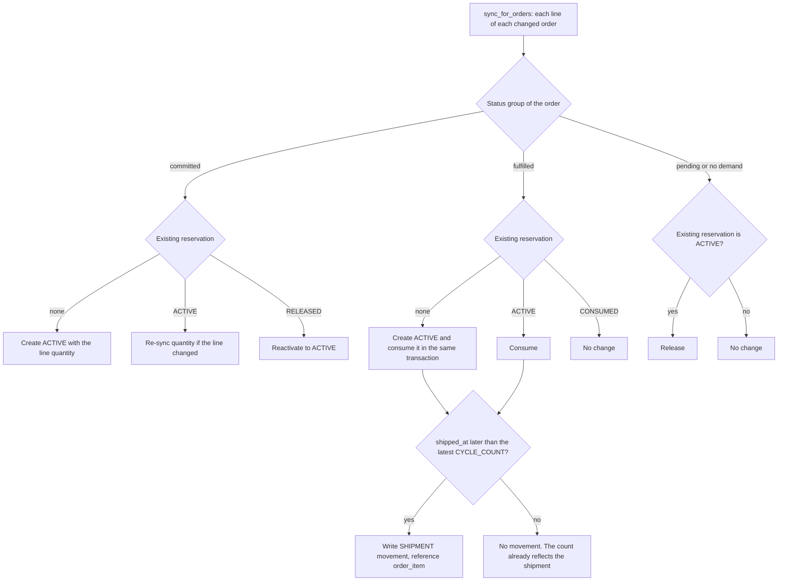

# Inventory Lifecycle Workflow

> **Status:** v1 business workflow (milestone M1, task T-010). **Owner:** Product / BA.
> **Canonical sources:** [`BUSINESS_RULES.md §2`](../domain/BUSINESS_RULES.md) (BR-101..152),
> [`STATE_MACHINES.md §1.5 and §2`](../domain/STATE_MACHINES.md) (reservation effects and lifecycle),
> [`EXCEPTION_CATALOG.md`](../domain/EXCEPTION_CATALOG.md) (inventory and data-quality rules),
> [`DOMAIN_MODEL.md`](../domain/DOMAIN_MODEL.md) (InventoryBalance, InventoryMovement, StockReservation).
> If this document and `docs/domain/*` disagree, the domain docs win.

Labels for anything the canonical docs do not settle: **Industry practice**, **MVP assumption**,
**Needs validation**. Examples use the fictional demo store *Kestrel Home & Kitchen* (USD,
`America/New_York`); all November 2026 times are EST.

Related workflows: [Orders](./ORDER_LIFECYCLE.md) · [Exceptions](./EXCEPTION_MANAGEMENT.md) ·
[Imports](./IMPORT_PIPELINE.md)

---

## 1. Scope

- One fulfillment location per store (BR-005, ADR-0005). Every quantity is per `(store, product)`.
- RetailOps is **not** a warehouse management system. Physical events (counts, receipts, damage,
  restocks) happen in the warehouse or a source system and arrive as `inventory_adjustments.csv`
  rows. The only movement RetailOps writes on its own is `SHIPMENT`, derived from orders.
- Reservations are derived from order state. Nobody creates them by hand.

## 2. Actors and systems

| Actor / system | Role in the inventory process |
|---|---|
| Warehouse team (Operations Staff) | Counts stock, receives deliveries, records damage and shrinkage, inspects returns |
| Operations Manager | Imports adjustment files (`imports.run`), triages inventory exceptions, chases suppliers |
| Store Owner | Sets reorder points and reorder quantities (through `products.csv`) and the approaching factor and velocity window (`settings.manage`) |
| Supplier | Confirms purchase orders and delivers. Represented only by `supplier.lead_time_days` and `INCOMING_EXPECTED` / `RECEIPT` movements (no PurchaseOrder entity in v1) |
| `inventory` module | Owns the ledger, the cached balance, reservations, health, velocity, and the reconciliation check |
| `orders` module | Drives reservations and `SHIPMENT` movements through order state (see [ORDER_LIFECYCLE.md](./ORDER_LIFECYCLE.md)) |
| `exceptions` module | Raises inventory and data-quality exceptions on every evaluation run |

## 3. Quantities and the formula

The definitions are in `BUSINESS_RULES.md §2.1`. In short:

| Quantity | Comes from | Counts toward `available`? |
|---|---|---|
| `on_hand` | Σ `on_hand_delta` over the ledger | yes |
| `reserved` | Σ quantity of `ACTIVE` reservations (committed, unshipped order lines) | yes, subtracted |
| `available` | **`on_hand − reserved`** (BR-101) | n/a |
| `incoming` | Σ `incoming_delta` over the ledger | **no** (BR-103), context only |
| `pending_demand` | Lines on `CREATED` / `PAYMENT_PENDING` orders | **no**. Compared with `available` only in the oversell-risk rule (BR-403) |

Why the formula is written this way:

- **Committed demand is subtracted exactly once.** `reserved` already is the committed demand. A
  report that computes `on_hand − reserved − open committed lines` subtracts the same units twice. With
  `on_hand` 19 and 12 units reserved for a paid order, `available` is 7, not −5.
- **Pending demand is not subtracted.** An unpaid basket is not a promise. Subtracting it would hide
  sellable stock and push products into false out-of-stock states. The risk is surfaced separately as
  `INVENTORY_OVERSELL_RISK`.
- **Negative `available` is reported, never clamped** (BR-102). −2 means two units have been promised
  that do not physically exist.
- **`inventory_balance` is a cache** (BR-104). The ledger and the reservations are the truth. `available`
  is computed, never stored, and health is computed on read (BR-141).

## 4. The movement ledger

Every change to `on_hand` or `incoming` is one append-only `inventory_movement` row (BR-110). Rows are
never updated or deleted. A mistake is fixed with a compensating `CORRECTION`.

| `movement_type` | Written by (`source`) | `on_hand_delta` | `incoming_delta` | CSV `quantity` convention | Typical business trigger |
|---|---|---|---|---|---|
| `CYCLE_COUNT` | import (`IMPORT`) | counted − `on_hand` as of `occurred_at` (BR-113; equals counted − current `on_hand` when nothing later-dated is recorded) | 0 | absolute count, ≥ 0 | Physical count of a bin or the whole store |
| `RECEIPT` | import | + q | − min(q, current `incoming`) | positive | Supplier delivery booked in |
| `INCOMING_EXPECTED` | import | 0 | + q | positive | Supplier confirms a purchase order |
| `INCOMING_CANCELLED` | import | 0 | − q | positive | Purchase order cancelled or reduced |
| `DAMAGE` | import | − q | 0 | positive | Broken or unsellable unit found |
| `SHRINKAGE` | import | − q | 0 | positive | Unexplained loss or theft |
| `RETURN_RESTOCK` | import | + q | 0 | positive | Returned unit inspected and resaleable (BR-132) |
| `CORRECTION` | import | ± q | 0 | non-zero signed delta | Fix an earlier movement |
| `SHIPMENT` | system (`ORDER`) | − line quantity | 0 | not importable | Order line shipped after the latest count (BR-130) |

Notes:

- Imported rows carry an external `reference` unique per store. Re-importing an applied reference is
  reported as `ALREADY_APPLIED` and changes nothing (BR-112). A corrected row therefore needs a **new**
  reference, typically as a `CORRECTION`.
- `SHIPMENT` rows use `reference = order_item:<id>` and exist at most once per order line (BR-131).
- A count older than the product's latest count is rejected with `STALE_CYCLE_COUNT` (BR-113); see §6.3.
- **MVP assumption:** `CORRECTION` affects `on_hand` only. Incoming mistakes are corrected with
  `INCOMING_EXPECTED` or `INCOMING_CANCELLED`.

### 4.1 Worked example: one SKU through a week

Product `KHK-SKL-28` (cast-iron skillet 28 cm): unit price 54.00, reorder point 10, reorder quantity
40, supplier lead time 10 days. Approaching threshold = ceil(10 × 1.25) = **13**. Assume sales velocity
of **1.50 units/day** throughout (42 eligible units in the last 28 days, BR-150). Times are when the
change is recorded in RetailOps (import applied). Each import triggers an evaluation run, so exception
effects appear immediately after the row.

Starting position, Mon Nov 2 07:00: `on_hand` 26, `reserved` 0, `available` 26, `incoming` 0.

| # | Time (EST) | Business event | Ledger row (Δ on_hand / Δ incoming) | Reservation change | on_hand | reserved | available | incoming | Health and exception effect |
|---|---|---|---|---|---|---|---|---|---|
| 1 | Mon Nov 2 08:00 | Opening count: 24 on the shelf (`CC-1102-A`) | `CYCLE_COUNT` −2 / 0 (24 − 26) | – | 24 | 0 | 24 | 0 | `HEALTHY` (24 > 13) |
| 2 | Mon Nov 2 10:15 | `KHK-100501` paid, 3 units | – | new `ACTIVE` 3 | 24 | 3 | 21 | 0 | `HEALTHY` |
| 3 | Mon Nov 2 11:00 | `KHK-100502` placed, `PAYMENT_PENDING`, 2 units | – | none (pending demand 2) | 24 | 3 | 21 | 0 | `HEALTHY`. Pending 2 ≤ available 21, so no oversell risk |
| 4 | Mon Nov 2 14:00 | Supplier confirms PO 7781: 40 units, ETA Mon Nov 9 (`PO-7781-EXP`) | `INCOMING_EXPECTED` 0 / +40 | – | 24 | 3 | 21 | 40 | `HEALTHY`. Incoming does not count (BR-103) |
| 5 | Tue Nov 3 09:30 | `KHK-100501` shipped (after the Nov 2 count) | `SHIPMENT` −3 / 0 | `ACTIVE` 3 → `CONSUMED` | 21 | 0 | 21 | 40 | `HEALTHY`. Shipping did not change `available` |
| 6 | Tue Nov 3 12:00 | Two units found cracked (`DMG-118`) | `DAMAGE` −2 / 0 | – | 19 | 0 | 19 | 40 | `HEALTHY` |
| 7 | Thu Nov 5 09:10 | `KHK-100503` paid, 12 units | – | new `ACTIVE` 12 | 19 | 12 | 7 | 40 | `BELOW_REORDER_POINT`. `INVENTORY_BELOW_REORDER_POINT` raised `HIGH`: days of cover 7 ÷ 1.5 = 4.7 < lead time 10. Suggested quantity max(0, 40 − 40 incoming) = 0, so the action reads "Incoming stock (40 units) covers the reorder point. Confirm the ETA with Ironleaf Cookware." |
| 8 | Thu Nov 5 13:00 | `KHK-100504` paid, 4 units | – | new `ACTIVE` 4 | 19 | 16 | 3 | 40 | Still below reorder point. Evidence refreshed (days of cover 2.0) |
| 9 | Thu Nov 5 16:40 | `KHK-100504` cancelled while still paid (refund pending) | – | `ACTIVE` 4 → `RELEASED` | 19 | 12 | 7 | 40 | Below reorder point. Evidence refreshed |
| 10 | Fri Nov 6 11:20 | `KHK-100505` paid, 9 units | – | new `ACTIVE` 9 | 19 | 21 | **−2** | 40 | `OVERSOLD`. `INVENTORY_OVERSOLD` raised `CRITICAL`. The below-reorder exception is resolved as `SUPERSEDED` and its assignee carries over (BR-401) |
| 11 | Sat Nov 7 08:30 | `KHK-100503` shipped (12 of the 19 on hand) | `SHIPMENT` −12 / 0 | `ACTIVE` 12 → `CONSUMED` | 7 | 9 | −2 | 40 | Still oversold. Evidence refreshed: 7 on hand cover 7 of `KHK-100505`'s 9 units |
| 12 | Sat Nov 7 10:00 | PO 7781 arrives early, 40 received (`RCV-7781`) | `RECEIPT` +40 / −40 | – | 47 | 9 | 38 | 0 | `HEALTHY`. Oversold exception auto-resolves (`CONDITION_CLEARED`) |
| 13 | Sat Nov 7 15:00 | `KHK-100505` shipped | `SHIPMENT` −9 / 0 | `ACTIVE` 9 → `CONSUMED` | 38 | 0 | 38 | 0 | `HEALTHY` |
| 14 | Sun Nov 8 09:00 | Inspection: one "damaged" unit is resaleable (`COR-DMG-118`) | `CORRECTION` +1 / 0 | – | 39 | 0 | 39 | 0 | `HEALTHY`. `DMG-118` itself is never edited |
| 15 | Sun Nov 8 18:00 | End-of-week count: 38 (`CC-1108-A`) | `CYCLE_COUNT` −1 / 0 (38 − 39) | – | 38 | 0 | 38 | 0 | `HEALTHY` |

Check (the same arithmetic the reconciliation check runs): on_hand 26 − 2 − 3 − 2 − 12 + 40 − 9 + 1 − 1 =
**38**; incoming 0 + 40 − 40 = **0**; `ACTIVE` reservations: none, so reserved = **0**. `KHK-100502` is
still pending (2 units of pending demand) and has never touched `reserved`.

Oversold evidence at step 10 (BR-402): committed lines are allocated in FIFO order of `paid_at`.
`KHK-100503` (12 units) is fully covered by the 19 on hand, leaving 7. `KHK-100505` (9 units) gets 7 and
is **2 units short**. Affected orders: 1. Exposure = 2 × 54.00 = **108.00** (gross order-line value at
risk, BR-404, never "loss"). Deadline = `KHK-100505`'s `ship_by`, Sun Nov 8 11:20.

## 5. Reservations

The lifecycle (`ACTIVE`, `CONSUMED`, `RELEASED`) is in `STATE_MACHINES.md §2`; the order-state mapping is
in `STATE_MACHINES.md §1.5`. One reservation per order line.

### 5.1 When reservations change

| Operation | Business trigger | Transition | Effect on `reserved` / `available` | Rule |
|---|---|---|---|---|
| Create | Order enters committed demand (`PAID`, `PROCESSING`, `READY_TO_SHIP`), or a line is added to a committed order | → `ACTIVE` | reserved + q, available − q | BR-120 |
| Re-sync | Line quantity changes on a committed order | `ACTIVE → ACTIVE` | reserved and available move by the difference | BR-123 |
| Consume | Order reaches `SHIPPED` or later | `ACTIVE → CONSUMED` | reserved − q. `on_hand` − q too if a `SHIPMENT` movement is written | BR-122, BR-130 |
| Release | Order cancelled, or refunded before shipping | `ACTIVE → RELEASED` | reserved − q, available + q | BR-121 |
| Reconcile | Reconciliation check | none | Reports drift between `reserved` and Σ `ACTIVE` | BR-104 |

### 5.2 The sync function

All of the above runs through one idempotent function, `reservations.sync_for_orders` (BR-123). It is
called inside the same transaction as any order or order-line change, so stock and orders never
disagree after a commit. Running it twice gives the same result.

Status groups: **committed** = `PAID`, `PROCESSING`, `READY_TO_SHIP`; **fulfilled** = `SHIPPED`,
`DELIVERED`, `RETURN_REQUESTED`, `RETURNED`, and `REFUNDED` with fulfillment `DELIVERED` or `RETURNED`;
**pending or no demand** = `CREATED`, `PAYMENT_PENDING`, `PAYMENT_FAILED`, `CANCELLED`, and `REFUNDED`
with fulfillment `UNFULFILLED`.

BR-121 settles the two branches that the v1 order graph cannot reach: payment failure happens before
an order is ever reserved, so no reservation is released for it, and `RELEASED → ACTIVE` exists only so
the sync stays idempotent (a cancelled order can never return to committed demand). If the SKU of a
committed line changes, the reservation moves to the new product and `reserved` is recomputed for both
products.

## 6. Cycle-count cutoff (BR-130)

### 6.1 The problem it solves

Counts come from the warehouse, and they already reflect every order that physically left before the
count was taken. Order snapshots come from the sales channel, often hours later. If RetailOps wrote a
`SHIPMENT` movement for an order that shipped *before* the latest count, the same units would leave
`on_hand` twice: once through the count and once through the movement.

**Rule:** when a line becomes fulfilled, write `SHIPMENT` (−quantity) only if `shipped_at` is later
than the product's latest `CYCLE_COUNT.occurred_at` (`inventory_balance.last_cycle_count_at`).
Otherwise consume the reservation and write nothing.

### 6.2 Numeric example: the double count it prevents

`KHK-SKL-28` on Tue Nov 10: `on_hand` 38. Two paid orders are reserved: `KHK-100520` (2 units) and
`KHK-100521` (3 units), so `reserved` 5 and `available` 33.

| Time (EST) | Event | With BR-130 (on_hand / reserved / available) | Without the cutoff (on_hand / reserved / available) |
|---|---|---|---|
| Tue Nov 10 16:00 | `KHK-100520` physically ships. RetailOps does not know yet | 38 / 5 / 33 | 38 / 5 / 33 |
| Wed Nov 11 07:30 | Warehouse counts **36** on the shelf (38 − 2 shipped) | – | – |
| Wed Nov 11 08:00 | Count imported: `CYCLE_COUNT` 36 − 38 = −2 | 36 / 5 / 31 | 36 / 5 / 31 |
| Wed Nov 11 12:00 | Orders import: `KHK-100520` `SHIPPED`, `shipped_at` Nov 10 16:00, which is before the 07:30 count | Reservation consumed, **no movement**: **36 / 3 / 33** | `SHIPMENT` −2 written: **34 / 3 / 31** |
| Wed Nov 11 15:00 | `KHK-100521` ships, imported at once. `shipped_at` is after the count | `SHIPMENT` −3: **33 / 0 / 33** | `SHIPMENT` −3: **31 / 0 / 31** |
| Physical truth | 33 units on the shelf | **matches** | **2 units missing on paper**. The next count "finds" 2 units, which looks like negative shrinkage |

Between 08:00 and 12:00, `available` is temporarily understated by 2 in both cases, because
`KHK-100520`'s reservation is still active although the goods have gone. The order import corrects that
gap with the cutoff and makes it permanent without it. On a product whose reorder point sits between
31 and 33, the version without the cutoff would also raise a false `INVENTORY_BELOW_REORDER_POINT`.

### 6.3 Counts imported late (BR-113)

A count is often imported hours after it was taken, by which time later-dated movements may already be
recorded. BR-113 therefore sets on-hand **as of the count's `occurred_at`**:
`delta = counted − (on_hand − Σ on_hand_delta of movements with occurred_at after the count)`. Movements
recorded after the count keep their effect. (`SHIPMENT` movements are dated at `shipped_at`.)

Continuing §6.2: on Wed Nov 11 a second count is taken at 14:00, before `KHK-100521` ships, but it is
imported only at 18:00.

| Time (EST) | Event | on_hand in RetailOps | Physical truth |
|---|---|---|---|
| Wed Nov 11 14:00 | Count taken: 36 on the shelf | 36 | 36 |
| Wed Nov 11 15:00 | `KHK-100521` ships and is imported. The latest count on file is still 07:30, so `SHIPMENT` −3 is written (dated 15:00) | 33 | 33 |
| Wed Nov 11 18:00 | The 14:00 count is imported. On-hand as of 14:00 = 33 − (−3) = 36, so delta = 36 − 36 = **0** | **33** | 33 |
| Wed Nov 11 18:05 | Someone imports the 07:30 count again under a new reference | **Row rejected: `STALE_CYCLE_COUNT`** (older than the 14:00 count) | 33 |

A naive `counted − current on_hand` would have produced +3 and overstated stock by 3 units; BR-113
keeps the ledger equal to the shelf. From 18:00 the cutoff in §6.1 uses 14:00, which is correct: the
15:00 shipment is after it and keeps its movement.

Operating guidance remains to import counts promptly, but a late count is no longer harmful. **MVP
assumption:** rows for the same SKU within one file are applied in `occurred_at` order, so a file holding
an older and a newer count applies both instead of rejecting the older one as stale.

## 7. Stock health classification

The table is in `BUSINESS_RULES.md §2.5`: `ACTIVE` products only, evaluated top-down, first match wins,
computed on read (BR-141).

For `reorder_point` 10 and the default factor 1.25 (approaching threshold ceil(12.5) = 13):

| `available` | Health | Exception raised (if no higher-precedence condition) |
|---|---|---|
| −2 | `OVERSOLD` | `INVENTORY_OVERSOLD` |
| 0 | `OUT_OF_STOCK` | `INVENTORY_OUT_OF_STOCK` |
| 1 to 10 | `BELOW_REORDER_POINT` | `INVENTORY_BELOW_REORDER_POINT` |
| 11 to 13 | `APPROACHING_REORDER_POINT` | none, badge only |
| 14 or more | `HEALTHY` | none |

Other reorder points: with `reorder_point` 3 the threshold is ceil(3.75) = 4, so only `available` = 4 is
"approaching". With `reorder_point` 0, a product is never below or approaching (BR-140): it is either
oversold, out of stock, or healthy.

**The health badge and the exception are not the same thing.** The exception precedence (BR-401)
includes oversell risk, which is not a health state; negative on-hand suppresses every inventory rule
(BR-402a); and the data-quality rule ignores product status:

| on_hand | reserved | pending demand | available | Health badge | Exception |
|---|---|---|---|---|---|
| 12 | 12 | 3 | 0 | `OUT_OF_STOCK` | `INVENTORY_OVERSELL_RISK` (pending 3 > available 0 takes precedence over out of stock) |
| 30 | 10 | 25 | 20 | `HEALTHY` | `INVENTORY_OVERSELL_RISK`, potential shortage 5 |
| 11 | 0 | 0 | 11 | `APPROACHING_REORDER_POINT` | none |
| −3 | 0 | 0 | −3 | `OVERSOLD` | `DATA_NEGATIVE_ON_HAND` **only**. The stock figure is invalid, so inventory rules are suppressed until on-hand is corrected (BR-402a) |
| −3 (product `ARCHIVED`) | 0 | 0 | −3 | not classified (inactive) | `DATA_NEGATIVE_ON_HAND` only |

## 8. Sales velocity and days of cover (estimates)

| Rule | Formula |
|---|---|
| BR-150 | `avg_daily_units` = units on lines placed in the last `velocity_window_days` (28) whose order status is not `CANCELLED`, `PAYMENT_FAILED`, `CREATED`, or `PAYMENT_PENDING`, and that are not `REFUNDED` before shipping (`REFUNDED` + `UNFULFILLED`), ÷ 28 |
| BR-151 | `days_of_cover = available ÷ avg_daily_units` when `avg_daily_units > 0`; otherwise "not enough sales history" |
| BR-152 | Both are **estimates** and must be labelled that way in the UI and by the AI. They ignore seasonality and promotions |

Worked example (`KHK-SKL-28`, Thu Nov 5 09:10): 42 eligible units in the window → 42 ÷ 28 = **1.50
units/day**. `available` 7 → 7 ÷ 1.5 = **≈ 4.7 days of cover (estimate)**. Supplier lead time is 10
days, so the below-reorder exception is `HIGH`: at the current pace the product runs out before a new
order could arrive.

Where these estimates drive decisions:

- `INVENTORY_OUT_OF_STOCK` severity: `HIGH` if the product is selling (`avg_daily_units > 0`), else `MEDIUM`.
- `INVENTORY_BELOW_REORDER_POINT` severity: `HIGH` only if a sales velocity and a supplier lead time both exist and `days_of_cover < lead_time_days`; otherwise `MEDIUM` (EXCEPTION_CATALOG).
- Evidence and the AI investigation summary, always under "estimates" with their basis.

Limitations to state wherever the numbers appear:

- A product listed 10 days ago that sold 15 units shows 15 ÷ 28 = 0.54/day, not 1.5/day: the window is
  not shortened for new products (**Needs validation**).
- A promotion week inflates velocity for the next 28 days. Seasonality is ignored (BR-152).
- Days of cover is only meaningful for `available > 0`. **Proposal (open question O-36):** for 0 or
  negative `available` the UI shows "no available stock" rather than 0 or a negative number of days.

## 9. Reconciliation check

`inventory_balance` is a cached projection (BR-104). The check `inventory.reconcile` proves it is
still a faithful cache:

| Compared | Expected (DOMAIN_MODEL §4) |
|---|---|
| `inventory_balance.on_hand` | Σ `on_hand_delta` of the product's movements |
| `inventory_balance.incoming` | Σ `incoming_delta` of the product's movements |
| `inventory_balance.reserved` | Σ quantity of the product's `ACTIVE` reservations |

- **Drift is a software defect, not a business event.** The check reports it (the product, the expected
  and cached values) and never fixes it silently.
- **Example.** A bug releases `KHK-100504`'s reservation row but fails to decrement the cached balance:
  `reserved` shows 16 while Σ `ACTIVE` is 12. The check reports a drift of +4. Until fixed, `available`
  shows 3 instead of 7, and the product could be classified wrongly. The repair is an explicit,
  audited engineering action after the bug is fixed (**MVP assumption**), never an automatic overwrite.
- **Where it runs.** On demand: `GET /inventory/reconciliation` and the Data quality page (BR-104), plus
  the test suite. It is not a background job; the only background process is the scheduled evaluation
  worker. An Operations Manager who sees a balance that looks wrong opens the Data quality page, runs the
  check, and reports any drift as a defect.

## 10. Exceptions this workflow can raise

Definitions are in `EXCEPTION_CATALOG.md`; handling is in [EXCEPTION_MANAGEMENT.md](./EXCEPTION_MANAGEMENT.md).

| Exception | Inventory condition | Severity | Auto-resolves when | First action (rule-authored) |
|---|---|---|---|---|
| `INVENTORY_OVERSOLD` | `on_hand ≥ 0` and `available < 0` (always has affected orders) | `CRITICAL` | `available ≥ 0` | Confirm stock with a count, then expedite incoming or contact affected customers |
| `INVENTORY_OVERSELL_RISK` | `available ≥ 0` and pending demand > available | `HIGH` | pending ≤ available, or superseded | Consider pausing the listing or confirming incoming stock |
| `INVENTORY_OUT_OF_STOCK` | `available = 0` | `HIGH` if selling, else `MEDIUM` | `available > 0` | Reorder or hide the listing |
| `INVENTORY_BELOW_REORDER_POINT` | `0 < available ≤ reorder_point`, `reorder_point > 0` | `HIGH` if velocity and lead time exist and days of cover < lead time, else `MEDIUM` | `available > reorder_point` | Order at least `max(0, (reorder_quantity, or reorder_point × 2 − available) − incoming)` units; if that is 0, confirm the ETA of the incoming stock |
| `DATA_NEGATIVE_ON_HAND` | `on_hand < 0`, any product status. Evaluated first; suppresses the four inventory rules for that product (BR-402a) | `HIGH` | `on_hand ≥ 0` | Count and import a `CYCLE_COUNT` |

Only one of the first four can be active per product at a time (BR-401).

## 11. Edge cases

| # | Case | What happens | Rule |
|---|---|---|---|
| I1 | Receipt larger than `incoming` (40 expected, 45 received) | `on_hand` +45, `incoming` −40 (down to 0) | BR-111 |
| I2 | Partial receipt (40 expected, 30 received) | `on_hand` +30, `incoming` 10 left | BR-111 |
| I3 | `INCOMING_CANCELLED` larger than `incoming` | Not specified. **Proposal:** clamp at 0 like `RECEIPT` (open question O-24) | gap |
| I4 | Two purchase orders with different ETAs | `incoming` is one pooled number. Which ETA `incoming_eta` shows after a partial receipt is not specified (open question O-24) | DOMAIN_MODEL §3 (no PurchaseOrder) |
| I5 | Same adjustment reference imported twice | `ALREADY_APPLIED` warning, no effect, even if the quantity in the second file differs | BR-112 |
| I6 | Count of 0 for a product with paid orders | `available` goes negative: `INVENTORY_OVERSOLD` | BR-102 |
| I7 | Shipment before the latest count | Reservation consumed, no movement | BR-130 |
| I8 | Count imported after a later-dated shipment | On-hand set as of the count; the later shipment keeps its effect (§6.3) | BR-113 |
| I8a | Count older than the product's latest count | Row rejected with `STALE_CYCLE_COUNT` | BR-113 |
| I9 | `DAMAGE` recorded by mistake | Never edited. A `CORRECTION` with a new reference compensates | BR-110 |
| I10 | Return received | No stock change until a `RETURN_RESTOCK` row is imported | BR-132 |
| I11 | New `ACTIVE` product imported with no movements yet | `available` = 0, so the import-triggered evaluation raises `INVENTORY_OUT_OF_STOCK` until the opening count is imported (open question O-16) | §2.5 |
| I12 | Product archived while oversold | Inventory exceptions auto-resolve as `CONDITION_CLEARED` (only `ACTIVE` products are classified). `DATA_NEGATIVE_ON_HAND` still applies | §2.5 |
| I13 | Non-stocked SKU (gift card, drop-ship item) set `ACTIVE` | Every paid order drives `available` negative: `INVENTORY_OVERSOLD`. After shipment `on_hand` goes negative, so only `DATA_NEGATIVE_ON_HAND` remains (BR-402a). There is no "inventory not tracked" flag in v1 (open question O-22) | gap |
| I14 | `reorder_point` 0 | Never below or approaching. Out-of-stock and oversold still apply | BR-140 |
| I15 | Below reorder point while a purchase order is incoming | Still raised: incoming never counts toward `available` (BR-103). The suggested quantity subtracts incoming and never goes below 0; when incoming covers it, the action asks to confirm the ETA instead (step 7 of §4.1). Team practice: keep the exception `IN_PROGRESS` with a note citing the PO | BR-103, EXCEPTION_CATALOG |
| I16 | Line SKU changed on a committed order | The reservation moves to the new product and `reserved` is recomputed for both products | BR-121 |

## 12. Verification

| What is verified | How | Where |
|---|---|---|
| BR-101/102: formula, no clamping, no double subtraction | Unit tests with negative and zero `available` | T-051 |
| BR-110/111: append-only ledger and sign conventions | One test per movement type, plus a test that no update or delete path exists | T-051 |
| BR-113: counts as of `occurred_at` | Replay §6.3: the late count gives delta 0, the older count is rejected with `STALE_CYCLE_COUNT` | T-051, T-052 |
| BR-112: idempotent references | Import the same adjustment file twice and assert the second run is all `ALREADY_APPLIED` | T-052 |
| BR-120..123: reservations | Replay the §4.1 table as a test and assert every row's balances | T-051 |
| BR-130/131: cutoff | Replay §6.2 with and without a count in between | T-051 |
| BR-140/141, BR-402a: health and suppression | One case per row of §7, including negative on-hand raising only `DATA_NEGATIVE_ON_HAND` | T-051, T-053 |
| BR-150..152: velocity | Fixed `as_of`, window boundaries, excluded statuses | T-051 |
| BR-104: reconciliation | Corrupt a cached balance in a test and assert the drift is reported, not repaired | T-051 |
| Manual check | Inventory view badges equal the backend classification; movement ledger shows every row of a product's history | T-064 |

## 13. Open questions raised by this workflow

IDs match the M1 report. **Resolved:** items are decided in the canonical docs and the text above
follows them; the rest remain labelled proposals.

- **O-1** **Resolved:** BR-113 (`BUSINESS_RULES.md §2.2`). Counts set on-hand as of `occurred_at`; older
  counts are rejected with `STALE_CYCLE_COUNT` (§6.3).
- **O-8** **Resolved:** BR-150 excludes orders `REFUNDED` before shipping (§8).
- **O-11** **Resolved:** BR-121 reworded. Payment failure precedes reservation in v1, `RELEASED → ACTIVE`
  is kept only for idempotent re-sync, and a SKU change moves the reservation (§5.2, I16). Residual: the
  `STATE_MACHINES.md §2` diagram labels still mention "payment failed" and "payment retried and paid".
- **O-15** **Resolved:** BR-104. Reconciliation runs on demand (`GET /inventory/reconciliation`, Data
  quality page); the only background process is the scheduled evaluation worker (§9). Residual: the
  invariant line in `STATE_MACHINES.md §2` still says "reconciliation job".
- **O-16** Open. Onboarding noise: every new `ACTIVE` product is out of stock until its first count.
- **O-21** **Resolved:** the suggested quantity in `EXCEPTION_CATALOG.md` (`INV-BELOW-ROP@1`) subtracts
  incoming and is floored at 0 (§10, I15).
- **O-22** Open. No way to mark a SKU as not inventory-tracked (I13).
- **O-23** **Resolved:** BR-402a. Negative on-hand raises only `DATA_NEGATIVE_ON_HAND` (§7, §10).
- **O-24** Open. `INCOMING_CANCELLED` beyond `incoming` (proposal: clamp at 0), and `incoming_eta` with
  several expectations.
- **O-36** Partly resolved: `EXCEPTION_CATALOG.md` makes below-reorder severity `MEDIUM` when velocity or
  lead time is missing. Open: how days of cover is shown for `available ≤ 0` (proposal in §8).
