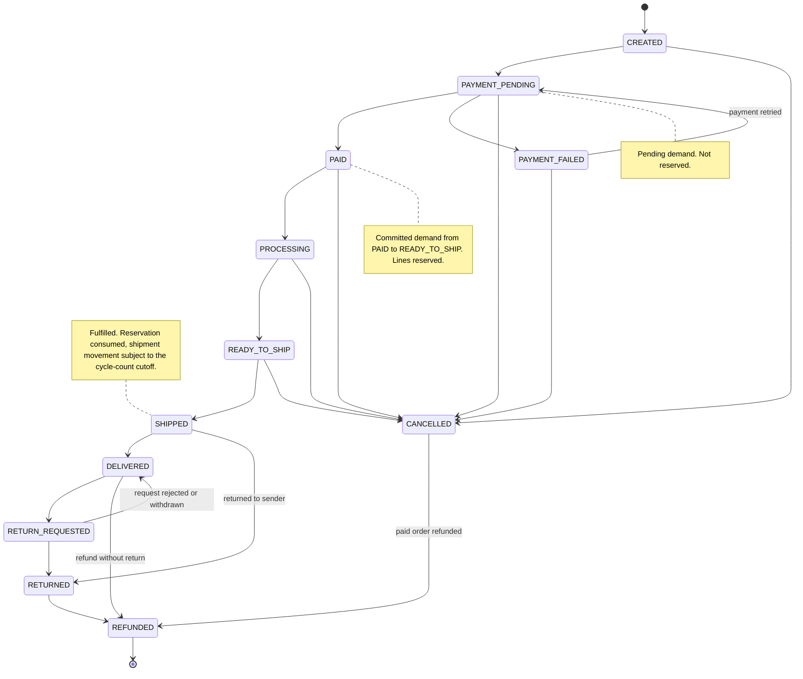
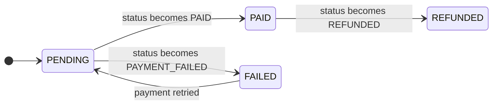
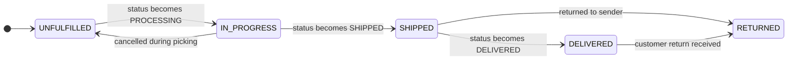
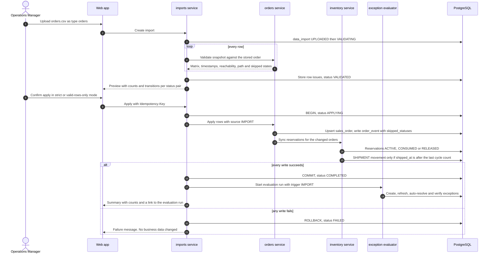

# Order Lifecycle Workflow

> **Status:** v1 business workflow (milestone M1, task T-010). **Owner:** Product / BA.
> **Canonical sources:** [`STATE_MACHINES.md §1`](../domain/STATE_MACHINES.md) (states, transitions,
> axis matrix, required timestamps, reservation effects), [`BUSINESS_RULES.md`](../domain/BUSINESS_RULES.md)
> (BR-120..132, BR-201..206, BR-501..502), [`EXCEPTION_CATALOG.md`](../domain/EXCEPTION_CATALOG.md) (order rules).
> This document explains how the process runs. It does not redefine rules: if it ever disagrees with
> `docs/domain/*`, the domain docs win and the difference is a documentation defect.

Statements that are not settled by the canonical docs are labelled **Industry practice**, **MVP
assumption**, or **Needs validation**. Examples use the fictional demo store *Kestrel Home & Kitchen*
(USD, `America/New_York`). Times are shown in store time with the zone abbreviation (BR-501), with UTC
where it matters. US daylight saving time ends on **Sunday 2026-11-01 at 02:00 EDT**, so dates before
that are EDT (UTC−4) and dates after are EST (UTC−5).

Related workflows: [Inventory](./INVENTORY_LIFECYCLE.md) · [Exceptions](./EXCEPTION_MANAGEMENT.md) ·
[Imports](./IMPORT_PIPELINE.md) · [AI investigation](./AI_ASSISTED_INVESTIGATION.md) ·
[Roles](./ROLE_AND_PERMISSION_WORKFLOW.md)

---

## 1. Scope and position in the product

RetailOps Intelligence is **not the order system of record** in v1. Orders are created and changed in
the source systems (web store, marketplace, POS) and arrive as CSV snapshots (`orders.csv` and
`order_items.csv`, see [IMPORT_PIPELINE.md](./IMPORT_PIPELINE.md)). For orders, the product:

1. keeps a validated copy that always satisfies the state machine and the axis compatibility matrix;
2. derives stock reservations and shipment movements from order state (BR-120..131);
3. detects fulfillment, payment, and data-quality exceptions on every evaluation run.

**MVP assumption:** order screens are read-only in v1. Every order status change arrives through an
import, so `order_event.source = IMPORT`. The event model also supports `USER` and `SYSTEM` sources
for later use. Fixing an order therefore means fixing it in the source system and re-importing the
snapshot.

## 2. Actors and systems

| Actor / system | Kind | Role in the order process | How the product represents it |
|---|---|---|---|
| Customer | External person | Places, pays for, cancels, or returns an order | Opaque `customer_ref` only (BR-505). No names, addresses, emails, or phones |
| Sales channel (web store, marketplace, POS, other) | External system of record | Creates the order and owns its status | `channel` (`WEB`, `MARKETPLACE`, `POS`, `OTHER`) and the three status axes |
| Payment processor | External system | Authorises, captures, refunds | `payment_status`, `paid_at`. No Payment entity in v1 (DOMAIN_MODEL §3) |
| Warehouse team | Operations Staff persona | Picks, packs, hands over to the carrier, inspects returns | `PROCESSING` → `READY_TO_SHIP` → `SHIPPED`, as reported by the source system |
| Carrier | External | Transports, delivers, or returns to sender | `carrier`, `tracking_number`, `shipped_at`, `delivered_at`. No tracking events in v1 (`ORDER_DELIVERY_DELAYED` is roadmap) |
| Operations Manager | Persona | Imports order snapshots, triages and assigns order exceptions | `imports.run`, `exceptions.assign`, `exceptions.manage` |
| Store Owner | Persona | Sets the fulfillment SLA and thresholds | `settings.manage` (`fulfillment_sla_hours`, `stall_threshold_hours`, `refund_overdue_hours`) |
| Analyst | Persona | Reads fulfillment performance and trends | `orders.read`, `analytics.read` |
| `imports` module | RetailOps | Validates and atomically applies snapshots | `data_import`, `import_row_issue` |
| `orders` module | RetailOps | Owns the transition function, reachability, axis matrix, and order events | `sales_order`, `order_item`, `order_event` |
| `inventory` module | RetailOps | Reserves, consumes, and releases stock and writes `SHIPMENT` movements | `stock_reservation`, `inventory_movement` |
| `exceptions` module and `worker` | RetailOps | Run the order rules after each import, on demand, and every 15 minutes | `evaluation_run`, `operational_exception` |

## 3. The lifecycle

### 3.1 State diagram

Identical transitions to `STATE_MACHINES.md §1.2`. The notes show the demand class from §1.5.

`CANCELLED → REFUNDED` is allowed only when `payment_status` was `PAID`. `CANCELLED` is terminal for
unpaid orders, and `REFUNDED` is terminal for everything.

### 3.2 Happy path, step by step

| # | Business event in the source system | `status` | `payment_status` | `fulfillment_status` | Timestamp set | What RetailOps does after the import |
|---|---|---|---|---|---|---|
| 1 | Customer submits the order | `CREATED` | `PENDING` | `UNFULFILLED` | `placed_at` | Counts the lines as **pending demand** (not reserved). Used only by the oversell-risk rule (BR-403) |
| 2 | Checkout hands off to the payment processor | `PAYMENT_PENDING` | `PENDING` | `UNFULFILLED` | none | Still pending demand |
| 3 | Payment captured | `PAID` | `PAID` | `UNFULFILLED` | `paid_at` | Creates one `ACTIVE` reservation per line (BR-120). Sets `ship_by = paid_at + fulfillment_sla_hours` unless `ship_by` was imported (BR-201). Starts the stall and overdue clocks |
| 4 | Picking starts | `PROCESSING` | `PAID` | `IN_PROGRESS` | none | Reservation unchanged. An `ORDER_STALLED_AFTER_PAYMENT` exception, if any, auto-resolves (status ≠ `PAID`) |
| 5 | Packed and labelled | `READY_TO_SHIP` | `PAID` | `IN_PROGRESS` | none | Reservation unchanged. Overdue clock still running |
| 6 | Handed to the carrier | `SHIPPED` | `PAID` | `SHIPPED` | `shipped_at` | Reservation `CONSUMED` (BR-122). `SHIPMENT` movement written only if `shipped_at` is after the product's latest cycle count (BR-130). An overdue exception auto-resolves |
| 7 | Carrier confirms delivery | `DELIVERED` | `PAID` | `DELIVERED` | `delivered_at` | No stock effect. Order is fulfilled |

Alternative paths: payment failure and retry (`PAYMENT_PENDING ↔ PAYMENT_FAILED`), cancellation before
shipment (from `CREATED` through `READY_TO_SHIP`), customer return (`DELIVERED → RETURN_REQUESTED →
RETURNED → REFUNDED`), refund without return (`DELIVERED → REFUNDED`), return to sender
(`SHIPPED → RETURNED`), and refund of a cancelled paid order (`CANCELLED → REFUNDED`). There is no
transition out of `SHIPPED` to `CANCELLED`: once goods have left, the only way back is `RETURNED`.

### 3.3 Guards applied to every order snapshot

Each imported row is checked in this order. The first failing check produces a row-level error, and
the stored order is left untouched.

| Check | Canonical rule | Error code |
|---|---|---|
| Currency equals the store currency | BR-004 | `CURRENCY_MISMATCH` |
| The three axes form an allowed combination | `STATE_MACHINES.md §1.3` | `ORDER_INVALID_STATUS_COMBINATION` |
| Required timestamps are present | `STATE_MACHINES.md §1.4` | `ORDER_MISSING_TIMESTAMP` |
| `placed_at ≤ paid_at ≤ shipped_at ≤ delivered_at` where present | `STATE_MACHINES.md §1.4` | `ORDER_TIMESTAMP_SEQUENCE` |
| The new status is reachable from the stored status | `STATE_MACHINES.md §1.2`, BR-608 | `ORDER_TRANSITION_NOT_ALLOWED` |

The check order is an **MVP assumption** chosen so the most fundamental problem is reported first.
All errors found for a row are listed in the preview, not only the first.

## 4. How the payment and fulfillment axes relate

`status` says where the order is in its overall lifecycle. `payment_status` says where the customer's
money is. `fulfillment_status` says where the goods are. The full compatibility matrix is in
`STATE_MACHINES.md §1.3`. The two diagrams below are derived from it and show how each axis moves
as `status` moves.

**Payment axis** (derived; the transition labels name the `status` move that causes it):

`PENDING` and `FAILED` simply stay as they are when an unpaid order is cancelled. `PAID` stays `PAID`
through cancellation, shipment, delivery, and return until the refund is recorded.

**Fulfillment axis** (derived):

Two consequences are easy to miss:

- **Cancelling during picking resets fulfillment.** `PROCESSING → CANCELLED` and `READY_TO_SHIP →
  CANCELLED` move `fulfillment_status` back to `UNFULFILLED`, because `CANCELLED` allows only
  `UNFULFILLED`. Packed goods go back to the shelf. No movement is written, because nothing left the
  building.
- **`REFUNDED` keeps the fulfillment fact.** It allows `UNFULFILLED`, `DELIVERED`, or `RETURNED`, which
  is how the team can tell a cancelled-and-refunded order from a refund without return or a classic
  return. This is why `fulfillment_status` is mandatory in the import when `status = REFUNDED`.

| Combination (`status` / payment / fulfillment) | What it tells the team | Follow-up in RetailOps |
|---|---|---|
| `CANCELLED` / `PENDING` / `UNFULFILLED` | Cancelled before any money moved | None |
| `CANCELLED` / `FAILED` / `UNFULFILLED` | Payment failed and the order was abandoned | None |
| `CANCELLED` / `PAID` / `UNFULFILLED` | **The store owes the customer a refund** | `ORDER_REFUND_PENDING` once `refund_overdue_hours` (24) have passed since `cancelled_at` (BR-206) |
| `REFUNDED` / `REFUNDED` / `UNFULFILLED` | Cancelled and refunded. Goods never left | Refund-pending exception auto-resolves |
| `REFUNDED` / `REFUNDED` / `DELIVERED` | Refund without return. The customer kept the goods | None. Stock already left (reservation stays `CONSUMED`) |
| `REFUNDED` / `REFUNDED` / `RETURNED` | Classic return and refund | Restock only via a `RETURN_RESTOCK` adjustment (BR-132) |
| `RETURNED` / `PAID` / `RETURNED` | Goods are back, money not yet refunded | **No v1 rule watches this** (see §10) |
| `RETURN_REQUESTED` / `PAID` / `DELIVERED` | Return authorised, goods still with the customer | None in v1 |

### 4.1 Worked example: cancelled but paid

Order `KHK-100504`: 4 × `KHK-SKL-28` (cast-iron skillet 28 cm) at 54.00, tax 14.04, total **230.04**.

| Time (EST) | Event | Order state after import | Effect |
|---|---|---|---|
| Thu Nov 5 13:00 | Payment captured | `PAID` / `PAID` / `UNFULFILLED` | Reservation `ACTIVE` 4 units. `ship_by` = Sat Nov 7 13:00 |
| Thu Nov 5 16:40 | Customer cancels in the web store. The refund is a separate manual step in the payment processor | `CANCELLED` / `PAID` / `UNFULFILLED`, `cancelled_at` 16:40 | Transition `PAID → CANCELLED` (direct edge). Reservation `RELEASED`, so `available` rises by 4 at once (BR-121). Refund clock starts |
| Fri Nov 6 16:40 | `cancelled_at + 24 h` | unchanged | Exactly at the threshold, nothing is raised: the condition is `as_of − cancelled_at > 24 h` |
| Fri Nov 6 16:45 | First scheduled evaluation past the threshold | unchanged | `ORDER_REFUND_PENDING` created, `HIGH`. Priority S 35 + A 3 + E 10 + D 12 + T 0 = **60 (P2)**. The business deadline has already passed, so `due_at` = first detection + 24 h = Sat Nov 7 16:45 |
| Sat Nov 7 10:00 | Refund issued in the payment processor | unchanged in RetailOps | Nothing changes until the snapshot is re-imported |
| Sat Nov 7 11:00 | Orders import applied | `REFUNDED` / `REFUNDED` / `UNFULFILLED` | `CANCELLED → REFUNDED` is allowed because payment was `PAID`. The import-triggered evaluation auto-resolves the exception (`CONDITION_CLEARED`). Reservation stays `RELEASED` |

If the refund had not been issued, the exception would escalate to `CRITICAL` once more than
3 × `refund_overdue_hours` (72 h) have passed since `cancelled_at`, that is after Sun Nov 8 16:40. Both
clocks start at `cancelled_at` (EXCEPTION_CATALOG, `ORDER_REFUND_PENDING`).

**Anti-pattern.** If staff mark the exception resolved with `REFUND_ISSUED` but the next orders import
still shows `payment_status = PAID` (or nobody re-imports within 24 h), the exception is reopened with
`VERIFICATION_FAILED` under the verification grace rule (`STATE_MACHINES.md §3.3`, §3.4). The team
practice matches the rule's recommended action: refund, re-import the snapshot, and let the import that
shows `REFUNDED` close the exception automatically.

### 4.2 Worked example: refunded after delivery

Order `KHK-100388`: 1 × Dutch oven 5.5 qt at 129.00, delivered Tue Nov 3 14:20 EST.

- **Refund without return.** On Nov 4 the customer reports chipped enamel with a photo, and the store
  refunds without asking for the item back because return shipping would cost more than the item is
  worth (**Industry practice**: a "returnless refund"). The next snapshot shows `REFUNDED` / `REFUNDED`
  / `DELIVERED`. Transition `DELIVERED → REFUNDED` is a direct edge. The reservation stays `CONSUMED`
  and the `SHIPMENT` movement stands: the unit left the building and is not coming back. Nothing is
  restocked.
- **Variant with a return.** `DELIVERED → RETURN_REQUESTED` (Nov 4, `delivered_at` stays set) →
  `RETURNED` (Nov 9, goods received, fulfillment `RETURNED`) → `REFUNDED` (Nov 9). `RETURNED` never
  restocks automatically (BR-132): the warehouse inspects the item and records a `RETURN_RESTOCK`
  adjustment only if it is resaleable.
- If the return request is withdrawn, `RETURN_REQUESTED → DELIVERED` is allowed and nothing else
  changes.

### 4.3 Worked example: return to sender

Order `KHK-100455` shipped Mon Nov 2. The carrier cannot deliver (incomplete address) and returns the
parcel, which the warehouse receives on Mon Nov 9.

- The snapshot shows `RETURNED` / `PAID` / `RETURNED` with `shipped_at` set and `delivered_at` empty.
  `delivered_at` is not required, because it is required only for fulfillment `DELIVERED` or status
  `RETURN_REQUESTED` (§1.4). An empty `delivered_at` on a `RETURNED` order is how the team tells a
  return to sender apart from a customer return.
- Transition `SHIPPED → RETURNED` ("returned to sender") is a direct edge. The reservation stays
  `CONSUMED`. The parcel is restocked only through a `RETURN_RESTOCK` adjustment after inspection.
- The customer has still paid. The store either refunds (`RETURNED → REFUNDED`) or ships again. A
  re-shipment is **not** modelled: there is no `RETURNED → SHIPPED` edge, so a replacement appears as
  a new order in the source system with its own reservation (**MVP assumption**).
- No v1 rule flags a `RETURNED` order that stays `PAID`. Until such a rule exists, the order list
  filter "status `RETURNED`, payment `PAID`" is the manual check (open question O-9).

## 5. Import synchronisation and reachability

### 5.1 Principle

Source exports skip intermediate states. An order exported as `PAID` yesterday can arrive as
`SHIPPED` today. The import accepts any target status that is **reachable** from the stored status
through the graph in §3.1, records the move as one `order_event` with `source = IMPORT`, and lists
the states it skipped in `skipped_statuses`. A target that is not reachable is a row error
(`ORDER_TRANSITION_NOT_ALLOWED`), so a stale or wrong export can never move an order backwards.

### 5.2 Row outcomes

| Situation | Outcome | Order event |
|---|---|---|
| `order_number` not yet stored | Order created at the imported status, provided the row passes the guards in §3.3 | `from_status = null`, `to_status` = imported status. **MVP assumption:** the path from `CREATED` is not reconstructed for new orders |
| Same status, no field changed | Counted as *unchanged* | none |
| Same status, other fields changed (for example `total`, `tracking_number`) | Counted as *updated* | none (status did not change) |
| Different status, reachable | Transition applied | one event, with `skipped_statuses` |
| Different status, not reachable | Row error `ORDER_TRANSITION_NOT_ALLOWED`. Stored order untouched | none |

### 5.3 Reachability examples

| Stored status | Imported status | Result | Skipped states recorded |
|---|---|---|---|
| `PAID` | `SHIPPED` | Allowed | `PROCESSING`, `READY_TO_SHIP` |
| `PAYMENT_PENDING` | `DELIVERED` | Allowed | `PAID`, `PROCESSING`, `READY_TO_SHIP`, `SHIPPED` |
| `PAYMENT_FAILED` | `PAID` | Allowed | `PAYMENT_PENDING` |
| `DELIVERED` | `RETURNED` | Allowed | `RETURN_REQUESTED` |
| `RETURN_REQUESTED` | `DELIVERED` | Allowed (request withdrawn) | none |
| `PAID` | `REFUNDED` with fulfillment `UNFULFILLED` | Allowed | `CANCELLED` (proposed path, see below) |
| `PAID` | `REFUNDED` with fulfillment `DELIVERED` | Allowed | `PROCESSING`, `READY_TO_SHIP`, `SHIPPED`, `DELIVERED` |
| `DELIVERED` | `PAID` | **Rejected** | n/a |
| `CANCELLED` | `SHIPPED` | **Rejected** | n/a |
| `SHIPPED` | `CANCELLED` | **Rejected**: goods that left can only come back as `RETURNED` | n/a |
| `CANCELLED` with payment `PENDING` | `REFUNDED` | **Rejected**: `CANCELLED → REFUNDED` needs a paid order | n/a |
| `REFUNDED` | anything else | **Rejected** (terminal) | n/a |

**Path selection (proposal, open question O-3).** Some targets can be reached by more than one path.
`PAID → REFUNDED` can go through `CANCELLED`, through `DELIVERED`, or through `RETURNED`. The path
determines `skipped_statuses` and, more importantly, whether goods shipped. The proposal is to pick
the shortest path that is consistent with the row's `fulfillment_status` and timestamps:
`UNFULFILLED` goes through `CANCELLED`; `DELIVERED` goes through `SHIPPED → DELIVERED`; `RETURNED`
goes through `SHIPPED → RETURNED` when `delivered_at` is empty and through `DELIVERED →
RETURN_REQUESTED → RETURNED` otherwise.

### 5.4 Sequence

## 6. What each state means for inventory reservations

The canonical mapping is `STATE_MACHINES.md §1.5`, and the mechanics are in
[INVENTORY_LIFECYCLE.md](./INVENTORY_LIFECYCLE.md). The operational reading:

| State group | Reserved? | Effect on `on_hand` | Effect on `available` (= `on_hand − reserved`) | What the team should take from it |
|---|---|---|---|---|
| `CREATED`, `PAYMENT_PENDING` | No (pending demand) | none | none | Not promised yet. Compared with `available` only by the oversell-risk rule (BR-403) |
| `PAYMENT_FAILED` | No | none | none | No demand |
| `PAID`, `PROCESSING`, `READY_TO_SHIP` | Yes, one `ACTIVE` reservation per line | none | falls by the line quantity | Stock is promised. If `available` goes negative, the product is oversold |
| `SHIPPED`, `DELIVERED`, `RETURN_REQUESTED`, `RETURNED` | Consumed | falls by the quantity, **unless** the latest cycle count already reflects the shipment (BR-130) | unchanged when the movement is written (on_hand and reserved fall together); rises when the cutoff suppresses the movement, because the count already removed the units | The unit has left |
| `CANCELLED` | Released | none | rises by the line quantity | Goods go back to sellable stock |
| `REFUNDED` | Released if never shipped, otherwise stays consumed | none | rises only if the order never shipped | A refund never restocks by itself |

Other order changes that move reservations:

- **Line quantity changes on a committed order** (for example 2 → 3 units on a `PROCESSING` order):
  the reservation is re-synced (`ACTIVE → ACTIVE`, BR-123).
- **Line SKU changes on a committed order:** the reservation moves to the new product and `reserved`
  is recomputed for both products (BR-121).
- **Lines arrive after the order.** With the recommended import order, `orders.csv` comes before
  `order_items.csv`, so a `PAID` order briefly has no lines and reserves nothing. Its reservations are
  created when the lines are applied. An order without lines is still checked for overdue and stall,
  but never for total mismatch (BR-205 needs at least one line).
- **Order first imported as already shipped** (historical load): the line's reservation is created
  and consumed in the same sync, and a `SHIPMENT` movement is written only if `shipped_at` is after
  the latest cycle count.

## 7. Ship-by deadline and time-zone handling

### 7.1 Rules

| Rule | Summary |
|---|---|
| BR-201 | `ship_by` comes from the import when present (`ship_by_source = IMPORTED`). Otherwise `ship_by = paid_at + fulfillment_sla_hours` (default 48, `ship_by_source = STORE_SLA`). Stored in UTC |
| BR-202 | Overdue when status ∈ {`PAID`, `PROCESSING`, `READY_TO_SHIP`} and `as_of > ship_by`. Exactly at the deadline is not overdue |
| BR-203 | Stalled when `status = PAID`, `as_of − paid_at > stall_threshold_hours` (default 12), and not overdue. Overdue supersedes stalled |
| BR-204 | Calendar hours. No business-hour calendars or carrier cut-off times |
| BR-501 | Stored as UTC, displayed in the store time zone with its abbreviation |
| BR-502 | ISO-8601 only. A timestamp without an offset is read in the store time zone, and the preview shows a `TIMEZONE_ASSUMED` warning. A local time that is ambiguous at a DST change resolves to the first occurrence (`fold=0`) |
| BR-504 | Every evaluation carries an explicit `as_of`. Rules never read the wall clock |

### 7.2 Clocks on one order

For an order paid at time *P* with the default settings and no imported `ship_by`:

| Point in time | What becomes true | Exception effect |
|---|---|---|
| *P* + 12 h (strictly after) | Stall threshold crossed while still `PAID` | `ORDER_STALLED_AFTER_PAYMENT`, `MEDIUM` |
| `ship_by` − 12 h (*P* + 36 h) | Less than 12 h left before the deadline | Stalled exception refreshed to `HIGH` |
| `ship_by` (*P* + 48 h) | Deadline. Not overdue yet (strict comparison) | none |
| First evaluation after `ship_by` | Overdue | `ORDER_FULFILLMENT_OVERDUE` (`MEDIUM`, overdue ≤ 24 h). The stalled exception is resolved as `SUPERSEDED` |
| `ship_by` + 24 h (strictly after) | Overdue by more than 24 h | Severity `HIGH` |
| `ship_by` + 72 h (strictly after) | Overdue by more than 72 h | Severity `CRITICAL` |

Detection latency is at most `evaluation_interval_minutes` (15 by default), or less when an import or a
manual run happens first.

### 7.3 Boundary examples

| # | Input | Computation | Result and lesson |
|---|---|---|---|
| T1 | Paid **Sat Oct 31 2026 23:30 EDT** (= Sun Nov 1 03:30 UTC) | `ship_by` = 03:30 UTC + 48 h = Tue Nov 3 03:30 UTC | Displayed as **Mon Nov 2 22:30 EST**, not 23:30. Exactly 48 elapsed hours, but the wall clock moved back one hour when DST ended. The UI must render from UTC with the zone abbreviation and never add "two days" in local time |
| T2 | Same order, stall threshold | 03:30 UTC + 12 h = Sun Nov 1 15:30 UTC | Stalled after **Sun Nov 1 10:30 EST** if still `PAID` |
| T3 | Paid **Tue Nov 10 23:30 EST** (= Wed Nov 11 04:30 UTC) | `ship_by` = Fri Nov 13 04:30 UTC | Displayed as **Thu Nov 12 23:30 EST**. The order belongs to Nov 10 in store time even though its UTC date is Nov 11. Any "orders per day" view must bucket by the store-local date (BR-501; open question O-12) |
| T4 | Imported `ship_by = 2026-11-12T17:00:00` (no offset) | Read as 17:00 EST = 22:00 UTC | Stored 22:00 UTC, `ship_by_source = IMPORTED`, warning `TIMEZONE_ASSUMED` |
| T5 | Imported `ship_by = 2026-11-12T17:00:00Z` | Explicit UTC | Displayed as Thu Nov 12 12:00 EST. No warning. The same digits as T4 mean a deadline five hours earlier, which is why the preview shows the store-local value next to the raw input |
| T6 | `ship_by` = 22:30:00 EST; scheduled runs at 22:30:00 and 22:45:00 | 22:30:00 is not > 22:30:00 | Not overdue at 22:30. Overdue (0.25 h, `MEDIUM`) at the 22:45 run |
| T7 | Overdue by exactly 24 h 00 min | "≤ 24 h → `MEDIUM`" | Still `MEDIUM`. One minute later, `HIGH` |
| T8 | Paid Fri 18:00 EST, warehouse closed at weekends | Calendar hours (BR-204): `ship_by` Sun 18:00 EST | Overdue on Sunday evening. Teams that do not ship at weekends should send `ship_by` from the source system or raise the SLA (**Needs validation** with real operators) |
| T9 | `paid_at = 2026-11-01T01:30:00` (no offset) | 01:30 happens twice in New York that night (EDT, then EST) | Resolved to the first occurrence, 01:30 EDT = 05:30 UTC (`fold=0`, BR-502), with the `TIMEZONE_ASSUMED` warning. The preview shows the resolved store-local value so the operator can spot the rare case where the second occurrence was meant |
| T10 | `paid_at = 2027-03-14T02:30:00` (no offset) | This local time does not exist (clocks jump from 02:00 to 03:00) | Not covered by BR-502. **Proposal:** reject the row with `INVALID_DATETIME` rather than guess (open question O-5) |
| T11 | Store owner changes `fulfillment_sla_hours` from 48 to 72 | Existing `ship_by` values are stored | Whether stored `STORE_SLA` deadlines are recalculated is not specified. **Proposal:** apply the new SLA only to orders paid after the change, because the promise to the customer was made at payment time (open question O-13) |

## 8. Exceptions this workflow can raise

Full definitions, severities, and recommended actions are in `EXCEPTION_CATALOG.md`. Handling is
described in [EXCEPTION_MANAGEMENT.md](./EXCEPTION_MANAGEMENT.md).

| Exception type | Raised when (in order-process terms) | Auto-resolves when | Typical owner and first action |
|---|---|---|---|
| `ORDER_STALLED_AFTER_PAYMENT` | Paid more than 12 h ago, still not in processing, not yet overdue | Status leaves `PAID`, or superseded by overdue | Staff: move the order into picking before `ship_by` |
| `ORDER_FULFILLMENT_OVERDUE` | Committed and past `ship_by` | The order ships or is cancelled | Staff: clear the blocker. If a line's product is oversold, work the linked inventory exception |
| `ORDER_REFUND_PENDING` | Cancelled, still `PAID`, more than 24 h after `cancelled_at` (`CRITICAL` after more than 72 h) | `payment_status = REFUNDED` | Manager or staff: refund in the payment processor; the next orders import showing `REFUNDED` resolves it automatically |
| `DATA_ORDER_TOTAL_MISMATCH` | `total` differs from the line-based expected total by more than 0.01 (BR-205) | Totals reconcile | Staff: compare with the source; a rejected or missing line is the most common cause |
| `INVENTORY_OVERSOLD` (indirect) | Paying orders pushes `reserved` above `on_hand` | `available ≥ 0` | See [INVENTORY_LIFECYCLE.md](./INVENTORY_LIFECYCLE.md) |
| `INVENTORY_OVERSELL_RISK` (indirect) | Pending orders exceed `available` | Pending demand ≤ available | Same |

Problems in the CSV rows themselves (unknown SKU, bad status combination) are **not** exceptions. They
are import issues, because the row was never stored (EXCEPTION_CATALOG, "Explicitly not exceptions").

## 9. Edge cases

| # | Case | What happens | Rule |
|---|---|---|---|
| E1 | Order first seen already `DELIVERED` (historical load) | Created directly. Reservation created and consumed in one sync. `SHIPMENT` movement only if `shipped_at` is after the latest cycle count | BR-130, §5.2 |
| E2 | An older export is re-imported after a newer one | Rows whose status would move backwards fail with `ORDER_TRANSITION_NOT_ALLOWED`. Rows with the same status overwrite other fields with older values (last write wins). There is no source-timestamp check in v1 | BR-608; limitation |
| E3 | Same order twice in one file | The second and later occurrences fail with `DUPLICATE_KEY_IN_FILE` | BR-604 |
| E4 | `PAID` without `paid_at` | `ORDER_MISSING_TIMESTAMP` | §1.4 |
| E5 | `shipped_at` earlier than `paid_at` | `ORDER_TIMESTAMP_SEQUENCE` | §1.4 |
| E6 | Imported `ship_by` earlier than `paid_at` | Not covered by the sequence rule. Accepted, so the order is overdue immediately. **Proposal:** add a warning (open question O-14) | gap |
| E7 | Order in EUR in a USD store | `CURRENCY_MISMATCH`. Row rejected | BR-004 |
| E8 | `PAID` order with no lines yet | No reservation, no total-mismatch check, but overdue and stall still apply | BR-205, §1.5 |
| E9 | Line quantity changed on a `PROCESSING` order | Reservation re-synced to the new quantity | BR-123 |
| E10 | Already-recorded line changed on a shipped order | `ORDER_LINE_LOCKED`. A line recorded for the first time is always accepted, even on a shipped order (historical load) | BR-609 |
| E11 | Payment fails, then is retried and succeeds | `PAYMENT_PENDING → PAYMENT_FAILED → PAYMENT_PENDING → PAID`. No reservation until `PAID` | §1.2, §1.5 |
| E12 | Cancelled while `READY_TO_SHIP` | Fulfillment back to `UNFULFILLED`. Reservation released. The overdue exception, if any, auto-resolves. If paid, the refund clock starts | §1.3, BR-206 |
| E13 | Paid order for a `DRAFT` or `ARCHIVED` product | Reserved like any other line: stock is physical. Inventory exceptions are raised only for `ACTIVE` products, but `DATA_NEGATIVE_ON_HAND` applies to any status | BR-120, §2.5 |
| E14 | `PAYMENT_PENDING` order abandoned for weeks | Stays pending demand indefinitely and can hold an `INVENTORY_OVERSELL_RISK` open. There is no expiry rule in v1 (open question O-10) | BR-403 |
| E15 | Return to sender, then re-shipped | Re-shipment is a new order in the source system | §4.3 |
| E16 | Order shipped before the latest cycle count but imported after it | Reservation consumed, no `SHIPMENT` movement, because the count already reflects it | BR-130 |
| E17 | Staff resolve an overdue exception before the order ships | Stays `RESOLVED` until the data is refreshed. If the first import completed after `resolved_at` still shows the order unshipped, or 24 h pass, it is reopened with `VERIFICATION_FAILED` | `STATE_MACHINES.md §3.3`, §3.4 (grace rule) |
| E18 | Cancelled and then refunded order | Excluded from sales velocity: BR-150 excludes orders `REFUNDED` before shipping (`REFUNDED` + `UNFULFILLED`) as well as `CANCELLED` ones | BR-150 |
| E19 | Fees that have no column (gift wrap, handling) | Not representable in `orders.csv`, so the order raises `DATA_ORDER_TOTAL_MISMATCH` unless the fee is folded into another column (open question O-7) | BR-205 |

## 10. Verification

How the business and the test suite confirm that this workflow behaves as described:

| What is verified | How | Where |
|---|---|---|
| Every transition in `STATE_MACHINES.md §1.2` and every forbidden one | Parametrised unit tests over the full from × to matrix | T-050 |
| Reachability and skipped states | Tests for each row of §5.3, plus a property test: an import never produces a stored status that is unreachable from the previous one | T-050, T-052 |
| Axis matrix and timestamps | One passing and one failing row per line of §1.3 and §1.4 | T-052 |
| Reservation effects | For each state group in §6, assert `reserved = Σ ACTIVE reservations` after sync, and that running the sync twice changes nothing | T-051 (BR-120..123) |
| Cycle-count cutoff | Ship before and after the latest count, and assert whether a movement exists | T-051 (BR-130) |
| Deadlines and time zones | T1–T7 as unit tests with fixed `as_of` values (BR-504), including the DST-end date | T-050, T-053 |
| Manual check by the Operations Manager | After each orders import, read the summary: transitions per status pair, skipped states, rows rejected for reachability | Import summary screen |

## 11. Open questions raised by this workflow

IDs match the M1 report. Items marked **Resolved:** have been decided in the canonical docs; the text
above already follows the decision. The others remain labelled proposals that need a decision by the
architect or orchestrator.

- **O-2** **Resolved:** BR-609 (`BUSINESS_RULES.md §6`). Only already-recorded lines of shipped orders
  are locked; a line recorded for the first time is always allowed. BR-605 now requires the order to
  exist in the database (import `orders.csv` first).
- **O-3** Open. Path selection for multi-path reachability, and whether `cancelled_at` is required when
  an import skips through `CANCELLED` to `REFUNDED` (proposal in §5.3).
- **O-5** Partly resolved: BR-502 resolves ambiguous DST times to the first occurrence (T9). Open:
  non-existent local times (T10, proposal: `INVALID_DATETIME`).
- **O-6** **Resolved:** `EXCEPTION_CATALOG.md`, `ORDER_REFUND_PENDING`. Both clocks start at
  `cancelled_at`: `HIGH` after more than 1 ×, `CRITICAL` after more than 3 × `refund_overdue_hours` (§4.1).
- **O-7** Open. Definition of `discount_total` (order-level only or including line discounts), the role
  of `subtotal` in BR-205, and fees that have no column.
- **O-8** **Resolved:** BR-150 now excludes orders `REFUNDED` before shipping (E18).
- **O-9** Open. No rule for `RETURNED` + `PAID` (return awaiting refund) or for long-running
  `RETURN_REQUESTED`.
- **O-10** Open. No age limit on pending demand.
- **O-12** Open. Day bucketing for daily aggregates (proposal: store-local date).
- **O-13** Open. Effect of an SLA settings change on stored `STORE_SLA` deadlines (proposal in T11).
- **O-14** Open. `ship_by` earlier than `paid_at`, and timestamps in the future (proposal in E6).
- **O-33** **Resolved:** the `ORDER_REFUND_PENDING` recommended action now says the next orders import
  showing `payment_status = REFUNDED` resolves the exception automatically; no manual recording
  feature is implied. Order screens remain read-only in v1 (§1).
- **O-37** **Resolved:** verification grace rule (`STATE_MACHINES.md §3.3`, §3.4), reflected in §4.1 and E17.
