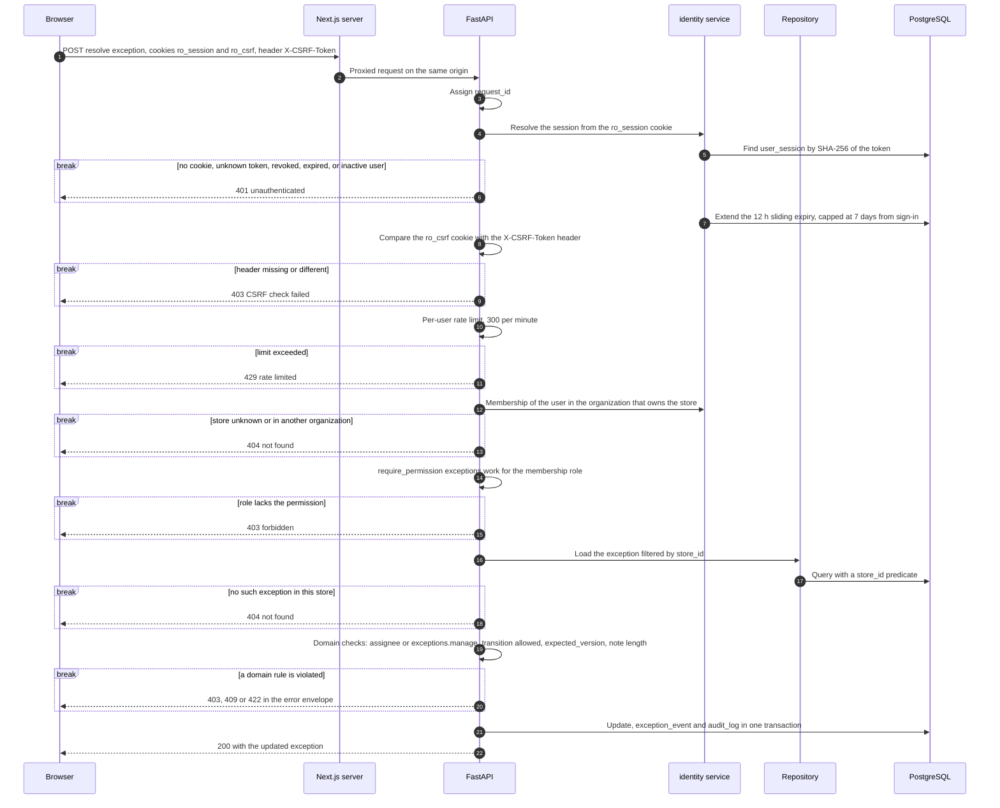
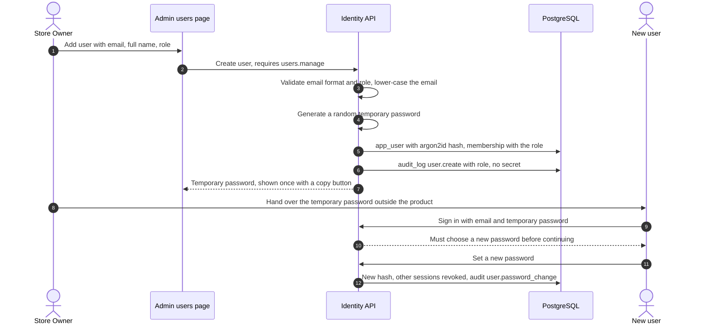

# Role and Permission Workflow

> **Status:** v1 business workflow (milestone M1, task T-010). **Owner:** Product / BA.
> **Canonical sources:** the code-defined role → permission matrix (ADR-0007, constant in
> `identity/permissions.py`), [`STATE_MACHINES.md §3.2`](../domain/STATE_MACHINES.md) (permissions per
> exception transition), [`BUSINESS_RULES.md §1`](../domain/BUSINESS_RULES.md) (BR-001..003, tenancy),
> [`DOMAIN_MODEL.md`](../domain/DOMAIN_MODEL.md) (Organization, Store, User, Membership, UserSession,
> AuditLog). Session and CSRF mechanics follow ADR-0004. If this document and `docs/domain/*` disagree,
> the domain docs win.

Labels for anything the canonical docs do not settle: **Industry practice**, **MVP assumption**,
**Needs validation**. "P1" in §8 is a **feature priority** from the backlog, not an exception priority
band. Examples use the fictional demo organization *Kestrel Commerce* and its fictional accounts
(`owner@kestrel.example`, `manager@kestrel.example`, `staff@kestrel.example`, `analyst@kestrel.example`).

Related workflows: [Exceptions](./EXCEPTION_MANAGEMENT.md) · [Imports](./IMPORT_PIPELINE.md) ·
[AI investigation](./AI_ASSISTED_INVESTIGATION.md)

---

## 1. Principles

1. **Roles and permissions are code, not data** (ADR-0007). The five roles are a fixed enum and the
   matrix is a reviewed, tested constant. Nobody can widen access by editing database rows. Custom roles
   are a P3 roadmap item.
2. **The backend decides.** Every endpoint declares its permission with `require_permission(...)`, and
   every repository query on store data is filtered by `store_id` (BR-003). The UI hides or disables
   controls only to be helpful, always with a reason.
3. **Tenancy before permission.** A user who has no membership in a store's organization gets 404 for
   anything in that store, so the existence of other tenants' data is never revealed.
4. **One role per organization** (BR-002). A membership carries one role and, in v1, grants access to
   every store of that organization.
5. **Security-relevant and business-changing actions are audited**, append-only, without secrets.

## 2. Roles and personas

| Role | Persona | Purpose in v1 |
|---|---|---|
| `OWNER` | Store Owner | Everything, including user administration |
| `MANAGER` | Operations Manager | Runs operations: imports, analysis runs, triage, assignment, dismissal, settings. Cannot manage users |
| `STAFF` | Operations Staff | Works exceptions: acknowledge, claim, start, resolve own, add notes. Read access elsewhere |
| `ANALYST` | Analyst | Read-only access to operations data, analytics, audit log, and the copilot |
| `VIEWER` | Public demo visitor | Same permissions as `ANALYST`. Can never change shared data |

## 3. Permission catalogue

| Permission | Allows |
|---|---|
| `dashboard.read` | Overview dashboard and attention list |
| `catalog.read` | Products and suppliers |
| `orders.read` | Orders, lines, order events |
| `inventory.read` | Inventory positions, health, movement ledger, reservations |
| `exceptions.read` | Exception inbox, detail, evidence, history, notes |
| `exceptions.work` | Acknowledge, claim an unassigned exception, start work, resolve own, add notes (including accepting an AI-drafted note) |
| `exceptions.assign` | Assign, reassign, unassign; change the due date |
| `exceptions.manage` | Dismiss, reopen, resolve any exception |
| `evaluations.run` | Trigger a manual "Run analysis" |
| `imports.read` | Import history, row issues, error CSV, templates |
| `imports.run` | Upload, validate, apply, discard, retry imports |
| `analytics.read` | Trends and performance views |
| `copilot.use` | Ask the copilot and run AI investigations |
| `audit.read` | Audit log |
| `settings.read` | View store settings |
| `settings.manage` | Change store settings (SLA, thresholds, priority weights) |
| `users.read` | List users and their roles |
| `users.manage` | Create users, change roles, deactivate, reset passwords |

## 4. Role → permission matrix

The canonical matrix (✓ granted, – not granted):

| Permission | OWNER | MANAGER | STAFF | ANALYST | VIEWER |
|---|---|---|---|---|---|
| `dashboard.read` | ✓ | ✓ | ✓ | ✓ | ✓ |
| `catalog.read` | ✓ | ✓ | ✓ | ✓ | ✓ |
| `orders.read` | ✓ | ✓ | ✓ | ✓ | ✓ |
| `inventory.read` | ✓ | ✓ | ✓ | ✓ | ✓ |
| `exceptions.read` | ✓ | ✓ | ✓ | ✓ | ✓ |
| `exceptions.work` | ✓ | ✓ | ✓ | – | – |
| `exceptions.assign` | ✓ | ✓ | – | – | – |
| `exceptions.manage` | ✓ | ✓ | – | – | – |
| `evaluations.run` | ✓ | ✓ | – | – | – |
| `imports.read` | ✓ | ✓ | ✓ | ✓ | ✓ |
| `imports.run` | ✓ | ✓ | – | – | – |
| `analytics.read` | ✓ | ✓ | ✓ | ✓ | ✓ |
| `copilot.use` | ✓ | ✓ | ✓ | ✓ | ✓ |
| `audit.read` | ✓ | ✓ | – | ✓ | ✓ |
| `settings.read` | ✓ | ✓ | ✓ | ✓ | ✓ |
| `settings.manage` | ✓ | ✓ | – | – | – |
| `users.read` | ✓ | ✓ | – | – | – |
| `users.manage` | ✓ | – | – | – | – |

In words: `OWNER` has all; `MANAGER` has all except `users.manage`; `STAFF` has the read permissions
except `audit.read` and `users.read`, plus `exceptions.work` and `copilot.use`; `ANALYST` and `VIEWER` are
read-only plus `copilot.use` and `audit.read`.

## 5. Permissions per exception action

Consistent with `STATE_MACHINES.md §3.2`. System transitions (auto-resolve, supersede, verification,
system reopen) have no user permission and are never available as user actions.

| Action | Transition or attribute | Permission | Extra condition | OWNER | MANAGER | STAFF | ANALYST | VIEWER |
|---|---|---|---|---|---|---|---|---|
| View | – | `exceptions.read` | – | ✓ | ✓ | ✓ | ✓ | ✓ |
| Acknowledge | `OPEN/REOPENED → ACKNOWLEDGED` | `exceptions.work` | – | ✓ | ✓ | ✓ | – | – |
| Claim | assignee: none → self | `exceptions.work` | Only while unassigned | ✓ | ✓ | ✓ | – | – |
| Start work | `OPEN` / `ACKNOWLEDGED` / `REOPENED` → `IN_PROGRESS` | `exceptions.work` | Needs an assignee; if none, the actor is assigned automatically. Staff only on exceptions that are unassigned or assigned to them. An owner or manager who starts someone else's exception keeps the existing assignee | ✓ | ✓ | own or unassigned | – | – |
| Resolve (manual) | active → `RESOLVED` | `exceptions.work` | Actor is the assignee **or** holds `exceptions.manage`. `resolution_code` and a note of at least 10 characters | any | any | own only | – | – |
| Dismiss | active → `DISMISSED` | `exceptions.manage` | A reason (stored as `dismissed_reason`) ∈ {`FALSE_POSITIVE`, `ACCEPTED_RISK`, `DUPLICATE`, `NOT_ACTIONABLE`} and a note | ✓ | ✓ | – | – | – |
| Reopen (manual) | `RESOLVED` / `DISMISSED` → `REOPENED` | `exceptions.manage` | Reason note | ✓ | ✓ | – | – | – |
| Assign, reassign, unassign | assignee | `exceptions.assign` | The assignee must be a member of the store's organization whose role grants `exceptions.work`, so only OWNER, MANAGER, or STAFF users (`STATE_MACHINES.md §3.2`). **MVP assumption:** the member must also be active | ✓ | ✓ | – | – | – |
| Change due date | `due_at` | `exceptions.assign` | Audited | ✓ | ✓ | – | – | – |
| Add a note | – | `exceptions.work` | – | ✓ | ✓ | ✓ | – | – |
| Accept an AI-drafted note | – | `exceptions.work` (drafting needs `copilot.use`) | Saved only on acceptance | ✓ | ✓ | ✓ | – | – |
| Investigate with AI | – | `copilot.use` | Read-only | ✓ | ✓ | ✓ | ✓ | ✓ |

### 5.1 Other actions

| Action | Permission | Roles |
|---|---|---|
| Upload, validate, apply, discard, retry an import | `imports.run` | OWNER, MANAGER |
| View import history, issues, error CSV; download templates | `imports.read` | all |
| Run analysis manually | `evaluations.run` | OWNER, MANAGER |
| Change store settings | `settings.manage` | OWNER, MANAGER |
| View the audit log | `audit.read` | OWNER, MANAGER, ANALYST, VIEWER |
| List users and roles | `users.read` | OWNER, MANAGER |
| Create users, change roles, deactivate, reset passwords | `users.manage` | OWNER |

## 6. How a request is authorised

### 6.1 Sequence

The browser only talks to the Next.js origin, which proxies `/api/*` to FastAPI, so cookies are
first-party (ADR-0004). The example is a staff member resolving an exception.

### 6.2 Checks in order

| # | Check | Layer | Failure |
|---|---|---|---|
| 1 | Session cookie maps to a live `user_session` of an active user | Middleware | 401 |
| 2 | CSRF double-submit on `POST`, `PUT`, `PATCH`, `DELETE` | Middleware | 403 |
| 3 | Rate limit (general 300/min per user; copilot 20/min per user, or per session for the shared demo viewer; login 5/min per IP and email) | Middleware | 429 |
| 4 | Membership in the organization that owns `store_id` | Dependency | 404 |
| 5 | `require_permission(...)` for the membership role | Dependency | 403 |
| 6 | Resource exists in that store (repository filter) | Repository | 404 |
| 7 | Domain rules (assignee, transition, version, required input) | Service | 403, 409, 422 |

Rate limits are in-process, so they apply per API instance; scaling out would need a shared store such
as Redis. This is a documented v1 limitation.

## 7. Denial behaviour: 403 versus 404

| Situation | Status | Reason |
|---|---|---|
| No session, or session expired or revoked | 401 | The user must sign in |
| Signed in, store belongs to another organization | **404** | Never reveal that another tenant's store exists |
| Signed in, own store, but the exception id belongs to another store (in any organization) | **404** | The repository filters by `store_id`; the record "does not exist" here |
| Own store, role lacks the permission (a Viewer calls resolve; Staff opens the audit log) | **403** | The user can already see that the area exists; saying "not allowed" leaks nothing |
| Own store, Staff resolves an exception assigned to someone else | **403** | Authorization rule on the actor, not on the state |
| Transition not allowed, or stale `expected_version` | 409 | `EXCEPTION_TRANSITION_NOT_ALLOWED`, or a version conflict |
| Missing resolution note or dismissal reason | 422 | Validation |
| CSRF header missing or wrong | 403 | Request not trusted |
| Too many requests | 429 | Rate limit |

All errors use the standard envelope with a `request_id` and never include stack traces or SQL. In the
UI, every data view implements a permission-denied state (AGENTS.md §4): controls the user cannot use
are hidden or disabled with the reason (for example "Requires exceptions.manage" or "Read-only demo").

## 8. User creation and role changes (feature priority P1)

v1 has **no email delivery**. An owner creates users directly and hands over a temporary password
outside the product.

### 8.1 Create a user

- **Proposal (open question O-28):** forcing the password change on first sign-in and expiring an unused
  temporary password (for example after 72 hours) both need fields that `DOMAIN_MODEL.md` does not have
  yet (such as a "password change required" flag and an expiry).
- **Existing email.** Emails are unique across the product. If the email already belongs to an account
  (a member of another organization), **proposal:** add only the membership, never touch the password,
  and tell the owner the person can sign in with their existing password. This tells the owner that the
  email has an account somewhere (open question O-35).
- The temporary password is never stored in plain text, logged, or written to the audit log.

### 8.2 Change a role

1. The owner opens the user, picks a new role, and confirms.
2. Guards: the **last `OWNER`** of an organization cannot be demoted, deactivated, or removed; an owner
   cannot change their own role (**MVP assumption**, prevents accidental lock-out).
3. `membership.role` is updated and `user.role_change` is audited with the old and new role.
4. The change takes effect **on the user's next request**: permissions are computed from the membership
   on every request, so no sign-out is needed and sessions are not revoked. Open pages may show stale
   controls until they refetch; the backend already enforces the new role.
5. If the new role lacks `exceptions.work` (to `ANALYST` or `VIEWER`), the user's active assigned
   exceptions would become unworkable. **Proposal (O-27):** unassign them with a system `UNASSIGNED`
   event so they return to the unassigned view.

### 8.3 Deactivate, reactivate, reset password

| Action | Effect | Audit |
|---|---|---|
| Deactivate | `is_active = false`; **all sessions revoked at once**; the next request gets 401. Assignments handled as in §8.2 step 5 (proposal). Notes, events, and audit history keep the user's name | `user.deactivate` |
| Reactivate | `is_active = true`; the user signs in again | `user.reactivate` |
| Reset password (owner) | New temporary password shown once; all sessions revoked | `user.password_reset` |
| Change own password | New hash; other sessions revoked (**MVP assumption**) | `user.password_change` |

## 9. Sessions

| Event | Behaviour |
|---|---|
| Sign in | Email and password, argon2id verification. 5 attempts per minute per IP and email. A failure always returns the same message ("Email or password is incorrect"), so accounts cannot be enumerated. Success creates an opaque random token in the `HttpOnly` cookie `ro_session` (`Secure` in production, `SameSite=Lax`) and a readable `ro_csrf` cookie; only the SHA-256 of the token is stored |
| Activity | 12 h sliding expiry, never beyond 7 days from sign-in |
| Sign out | Session revoked server-side; cookies cleared |
| Revocation | Deactivation, password reset, or password change revokes sessions server-side, effective on the next request |

## 10. Demo viewer access mode

Public visitors use **Explore the demo** and need no registration.

| Aspect | Behaviour |
|---|---|
| Entry | "Explore the demo" on the sign-in page creates a session for a `VIEWER` membership in the demo organization *Kestrel Commerce* (`is_demo = true`), store *Kestrel Home & Kitchen*. **MVP assumption:** available only when the deployment enables demo mode |
| What it shows | Every read view, imports history, analytics, audit log, and the copilot, with a persistent "Demo data" label (seeded data is never presented as live) |
| What it blocks | Every mutation of shared data: no exception actions, imports, analysis runs, settings, or user administration. Controls are hidden or disabled with "Read-only demo"; the API returns 403 regardless |
| What a visitor's activity writes | Sessions, AI conversation and tool-call records, audit entries for sign-in. None of these is shared business data |
| Seeded staff accounts | `owner@`, `manager@`, `staff@`, `analyst@kestrel.example` exist so that assignments, notes, and history look realistic. **MVP assumption:** their credentials are never published on the public demo. The full write workflow for visitors is the P2 per-visitor sandbox (T-095) |
| Demo reset | Not an in-app job. A documented ops command (`python -m app.demo`, ADR-0011) regenerates the dataset and is scheduled by the host. The only background process in the app is the scheduled evaluation worker. A visitor whose session no longer matches the regenerated data simply re-enters the demo |
| Abuse | **Proposal:** a per-IP rate limit on demo sign-in, which the canonical limits do not cover yet |

Decisions for the shared demo viewer (open question O-29, resolved):

- **Audit log.** `VIEWER` keeps `audit.read`, but the audit API **never returns IP addresses or user
  agents** to any role. They are stored for security investigation and are not exposed through the
  product. Failed sign-in entries are therefore visible without the network details that identify a
  visitor.
- **Shared identity.** Copilot conversations and the copilot rate limit are keyed by **session** for the
  shared demo viewer, so visitors never see each other's questions or exhaust each other's quota (an
  AI-phase requirement).
- **Cost.** The live LLM path uses free-tier providers only (ADR-0010), with per-instance budget caps;
  without a key the deterministic adapter answers. A public visitor cannot create paid usage.

## 11. Audit events

`DOMAIN_MODEL.md` gives `exception.resolve`, `import.apply`, and `auth.login_failed` as examples. The rest
of this list follows the same naming pattern and is a **proposal** for T-043. Metadata never includes
passwords, temporary passwords, session tokens, or CSRF tokens. The IP address and user agent are stored
with the entry but are never returned by the audit API (§10).

| Area | Action | Recorded when | Key metadata |
|---|---|---|---|
| Authentication | `auth.login` | Successful sign-in | user, IP, user agent |
| | `auth.login_failed` | Failed sign-in | submitted email (normalised), IP, reason category |
| | `auth.logout` | Sign-out | session id |
| | `auth.session_revoked` | Revocation by deactivation, reset, or password change | cause |
| | `auth.demo_session_started` | "Explore the demo" | IP, user agent |
| Authorization | `authz.denied` | 403 on a mutating request | permission required, endpoint |
| Users | `user.create`, `user.role_change`, `user.deactivate`, `user.reactivate`, `user.password_reset`, `user.password_change` | User administration | target user, old and new role where relevant |
| Settings | `settings.update` | Any store setting changed, including priority weights | key, old value, new value |
| Exceptions | `exception.acknowledge`, `exception.claim`, `exception.start`, `exception.resolve`, `exception.dismiss`, `exception.reopen`, `exception.assign`, `exception.unassign`, `exception.due_date_change`, `exception.note_add` | Every user action on an exception | exception, from and to status, resolution code or `dismissed_reason`, assignee, old and new due date, note source |
| Imports | `import.apply`, `import.discard` | Apply confirmed, or preview discarded | type, mode, row counts, confirmed skipped-row count, file SHA-256 |
| Evaluations | `evaluation.run` | Manual "Run analysis" | run id |

AI tool executions are recorded in `ai_tool_call`, not in the audit log. Exception history is also in
`exception_event`; the audit log is the cross-cutting, security-oriented record.

## 12. Edge cases

| # | Case | Behaviour |
|---|---|---|
| U1 | Last owner tries to demote or deactivate themselves | Refused with 409 and a clear message |
| U2 | Role changed while the user has the page open | Next request uses the new role; stale buttons fail with 403 and the UI refetches |
| U3 | User removed from the organization while signed in | Next request for that store returns 404; the UI shows "You no longer have access to this store" |
| U4 | User belongs to two organizations | Each request is checked against the membership of the organization that owns the requested store |
| U5 | Staff claims by mistake | Staff cannot unassign themselves (needs `exceptions.assign`); a manager reassigns (open question O-27) |
| U6 | Manager tries to create a user | 403: `MANAGER` has `users.read` but not `users.manage` |
| U7 | Analyst tries "Run analysis" | 403: no `evaluations.run` |
| U8 | Viewer accepts an AI-drafted note | 403: no `exceptions.work`; the draft stays in the conversation |
| U9 | Probing another tenant's exception ids | Always 404, whether or not the id exists, with the same response shape and code |
| U10 | Many failed sign-ins from one IP for one email | 429 after 5 per minute; each failure audited |

## 13. Verification

| What is verified | How | Where |
|---|---|---|
| The matrix in §4 | A test asserts the constant equals this table, so a change to either fails until both change | T-042 |
| 401, 403, 404, 409, 422, 429 | One API test per row of §7 | T-042, T-054 |
| Cross-tenant isolation | For every store-scoped endpoint, a user of another organization gets 404 | T-042 and every later endpoint task (AGENTS.md §6) |
| Exception actions per role | Every row of §5 × every role | T-054 |
| Audit | Each action in §11 writes exactly one row without secrets | T-043 |
| Admin UI | Create user, change role, deactivate, last-owner guard | T-066 |
| Demo viewer | Anonymous visitors cannot change shared data | T-094 |

## 14. Open questions raised by this workflow

IDs match the M1 report. **Resolved:** items are decided in the canonical docs and the text above
follows them; the rest remain labelled proposals.

- **O-27** Partly resolved: valid assignees are organization members whose role grants `exceptions.work`,
  and an owner or manager who starts someone else's exception keeps the assignee (`STATE_MACHINES.md
  §3.2`; §5). Open: existing assignments when a user is demoted or deactivated (proposal in §8.2), and
  staff releasing their own claim (U5).
- **O-28** Open. Fields for "password change required" and temporary-password expiry (proposal in §8.1).
- **O-29** **Resolved** (orchestrator decision; ADR-0010 for free-tier providers): the audit API never
  returns IPs or user agents, demo-viewer copilot conversations and rate limits are keyed by session,
  and LLM cost is bounded by free-tier providers and budget caps (§10, §11).
- **O-30** **Resolved:** `STATE_MACHINES.md §3.2` lists `OPEN/REOPENED → ACKNOWLEDGED`, and the field is
  named `dismissed_reason` (§5).
- **O-35** Open. Adding an email that already has an account in another organization (proposal in §8.1).
